> **boaz · Visão do produto** · `00_visao-produto` · **v20** · 2026-11-05 12:34 · **Aprovado**

# Visão do produto

**Objetivo:** definir o que é o deboaz, para quem ele existe, como ele é contratado e com que identidade se apresenta; a visão é montada aos poucos.

**Sumário:** [Problema](#problema) · [Objetivos e métricas](#objetivos-e-metricas) · [Personas](#personas) · [Escopo](#escopo) · [Identidade](#identidade) · [Fora de escopo](#fora-de-escopo) · [Histórico](#historico)

---

## Problema

- Quiz ao vivo em sala e em treinamento hoje depende de plataformas estrangeiras, como Kahoot e Quizizz
- 181.939 escolas no Brasil (76,2 % públicas, 23,8 % privadas) e 807.286 professores só nas privadas
- Empresas fazem treinamentos e dinâmicas de equipe sem saber na hora o que foi entendido
- A família só vê frequência e desempenho do aluno na reunião
- O **deboaz**: plataforma educacional gamificada, lançada primeiro no Brasil, que aproxima a família da escola e mostra ao instrutor, na hora, o que foi compreendido

---

## Objetivos e métricas

### Validar o produto

- **Indicador:** professores usando o beta gratuito
- **Meta:** 50 a 100
- **Prazo:** nos primeiros 6 meses

### Ganhar mercado

- **Indicador:** professores de escolas privadas usando o deboaz
- **Meta:** 5 % (40.364)
- **Prazo:** no horizonte de 5 anos das projeções do `PROJECT.md`

### Reter assinantes

- **Indicador:** escolas e educadores que cancelam por mês
- **Meta:** ≤ 5 %
- **Prazo:** a partir do lançamento

---

## Personas

### Visitante

- **Quem é:** chega à landing page e ainda não usa o produto
- **Precisa de:** entender o que o deboaz oferece, conhecer os módulos, ver quem já usa e criar a conta para começar

### Educador

- **Quem é:** professor, instrutor ou responsável por treinamento que usa o hub, pela instituição ou como autônomo
- **Precisa de:** criar quizzes, abrir salas, acompanhar em tempo real e analisar relatórios

### Participante

- **Quem é:** estudante, ou colaborador de empresa, que joga pelo quest
- **Precisa de:** entrar com o código de acesso que a instituição entrega, ver as tarefas pelo prazo, entrar nas salas, responder, ver o ranking e as conquistas

### Responsável

- **Quem é:** familiar do estudante, que entra no quest com o código de acesso dele
- **Precisa de:** ver frequência, desempenho e agenda do estudante e falar com a secretaria da escola

### Gestor da escola

- **Quem é:** contrata e administra o deboaz na escola
- **Precisa de:** escolher os módulos do catálogo, cadastrar professores e turmas, definir permissões e ver relatórios da escola

### Gestor corporativo

- **Quem é:** RH ou treinamento de uma empresa
- **Precisa de:** aplicar treinamentos, organizar competições entre equipes e exportar relatórios

---

## Escopo

- [Landing page](99_glossario.md#landing-page): plataforma, módulos, números e depoimentos; leva ao hub e ao quest ([07](07_landing-page-ux.md))
- [Hub](99_glossario.md#hub), no navegador e no app: quizzes, salas, relatórios, usuários, turmas, catálogo e pagamentos ([08](08_hub-ux.md))
- [Quest](99_glossario.md#quest), no navegador e no app: perfil pelo [código de acesso](99_glossario.md#codigo-de-acesso), com Tarefas, Feed, Carteira e Perfil ([09](09_quest-ux.md))
- Suporte dentro da conta, pelo [SAC](99_glossario.md#sac) do time deboaz, com histórico para auditoria
- Escola e família: atividades com datas, frequência, desempenho, agenda, conversa com a secretaria e cartão do aluno
- Empresas: treinamentos com a resposta da equipe colhida na sessão
- Contratação pela instituição (escola ou empresa) ou pelo educador autônomo
- [Catálogo de módulos](99_glossario.md#catalogo-de-modulos): cada módulo contratado à parte, com documento próprio ([15](15_modulos.md))
- Dados do cliente só com o cliente, que decide e dispara a exclusão em cascata
- Uma identidade visual nas três frentes, a do design system ([06](06_design-system-telas.md))

---

## Identidade

- Nome: **deboaz**, sempre em minúsculas, de Boaz + “de boa” (“E aí, Boaz, tá deboaz?”)
- Endereços: deboaz.com, hub.deboaz.com e quest.deboaz.com
- Símbolo: um `b` e um `d`; oficial em preto e branco, nas cores do tema escolhido
- Lema: “Na força do conhecimento, a sabedoria floresce”
- Regras de uso: [Identidade visual](90_identidade-visual.md)

**Logo principal** — `logos/logo-principal.svg` · fundo claro

**Logo do quest** — `logos/logo-principal-curto-negativo.svg` · fundo escuro

**Símbolo** — `logos/simbolo.svg` · fundo claro

**Ícone do app** — `icones/app-icone.svg` · fundo claro

**Favicon do quest** — `icones/favicon-curto.svg` · fundo claro

---

## Fora de escopo

- Mercados fora do Brasil no lançamento
- Contratação por governos: só por licitação, quando houver; não é meta inicial
- Preço e receita de cada módulo: definidos no documento do módulo
- Gestão de várias unidades de uma mesma escola ou empresa: fase de escala, após 18 meses
- Integração com outras plataformas educacionais e recursos de inteligência artificial: fase de escala

---

## Histórico

| Versão | Data | Mudança |
|---|---|---|
| **v20** | 2026-11-05 12:34 | Formato `.md`: migrado de `.html` sem mudar cenários, telas nem diagramas; links entre documentos apontam para `.md` |
| v19 | 2026-11-03 22:11 | Aprovado, sem pendências em aberto |
| v18 | 2026-11-01 18:30 | Enxuta: problema, identidade e escopo em listas curtas; métricas, personas e fora de escopo mantidos; status → Em revisão |
| v17 | 2026-11-01 03:57 | Aprovado |
| v16 | 2026-11-01 03:48 | Painel de administração do deboaz retirado (Módulos `MOD-15`): as mensagens chegam ao SAC e o time deboaz cuida das contas no módulo Usuários |
| v15 | 2026-11-01 01:00 | Aprovação |
| v14 | 2026-10-31 16:46 | Quest com Tarefas, Feed, Carteira e Perfil |
| v13 | 2026-10-19 00:53 | Status → Aprovado |
| v12 | 2026-10-19 00:53 | Quest pelo código de acesso entregue pela instituição; Participante e Responsável atualizados; status → Em revisão |
| v11 | 2026-10-18 22:27 | Status → Aprovado |

---

boaz · v20 · 2026-11-05 12:34 · `1_Requisitos/00_visao-produto.md`
