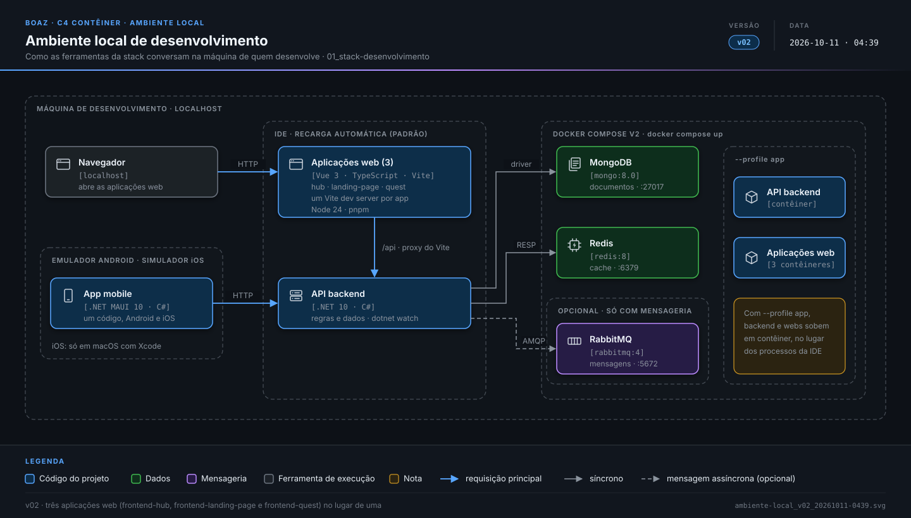

> **boaz · Transversal** · `01_stack-desenvolvimento` · **v19** · 2026-11-05 12:34 · **Aprovado**

# Stack de desenvolvimento

**Objetivo:** listar, antes de escrever código, as ferramentas e versões do ambiente de desenvolvimento, para que o ambiente local e o CI sejam configurados iguais.

---

<a id="cenarios"></a>

## Cenários

<a id="decisao-de-stack"></a>

### Decisão de stack

```gherkin
Esquema do Cenário: tecnologia de cada frente (decisão de 2026-10-11)
  Quando a frente é <frente>
  Então usa <tecnologia>

  Exemplos:
    | frente      | tecnologia                |
    | backend     | .NET com C#               |
    | web         | Vue com TypeScript e Vite |
    | mobile      | .NET MAUI                 |
    | dados       | MongoDB                   |
    | cache       | Redis                     |
    | contêineres | Docker com Docker Compose |
    | CI          | GitHub Actions            |
    | mensageria  | RabbitMQ, quando houver   |
```

<a id="RN-01"></a>

### `RN-01` Versão estável com suporte

```gherkin
Cenário: linha LTS
  Dado o Node.js com as linhas 24 (LTS) e 25 (atual)
  Então o projeto usa o Node.js 24
```

<a id="RN-02"></a>

### `RN-02` Mesmas versões

```gherkin
Cenário: local igual ao CI
  Então o ambiente local e o CI usam exatamente as versões deste documento
```

<a id="RN-03"></a>

### `RN-03` Mudança de versão

```gherkin
Esquema do Cenário: quando precisa de versão nova do documento
  Quando o time troca o .NET de <de> para <para>
  Então <resultado>

  Exemplos:
    | de     | para   | resultado                               |
    | 10.0.1 | 10.0.2 | não precisa de versão nova do documento |
    | 10.0   | 10.1   | precisa de versão nova antes do CI      |
    | 10     | 11     | precisa de versão nova antes do CI      |
```

<a id="RN-04"></a>

### `RN-04` Fim do suporte

```gherkin
Cenário: ferramenta sem suporte
  Dado o fim do suporte do Redis 8 em 2027-03-01
  Então o Redis é atualizado até 2027-05-30, em até 90 dias
```

<a id="RNF-01"></a>

### `RNF-01` Backend

```gherkin
Cenário: linguagem do backend
  Então os serviços são escritos em C# sobre o .NET 10 (LTS), com o SDK 10.0.x
```

<a id="RNF-02"></a>

### `RNF-02` Web

```gherkin
Cenário: linguagem da web
  Então frontend-hub, frontend-landing-page e frontend-quest são escritos em Vue 3 com TypeScript
```

<a id="RNF-03"></a>

### `RNF-03` Vite

```gherkin
Cenário: build da web
  Então cada aplicação web usa o Vite no desenvolvimento e no build
```

<a id="RNF-04"></a>

### `RNF-04` Node.js

```gherkin
Cenário: ferramentas da web
  Então as ferramentas da web rodam no Node.js 24 (LTS)
```

<a id="RNF-12"></a>

### `RNF-12` pnpm

```gherkin
Cenário: dependências da web
  Então as dependências da web são instaladas com pnpm, ativado pelo Corepack
```

<a id="RNF-05"></a>

### `RNF-05` Mobile

```gherkin
Cenário: um código para Android e iOS
  Então o app é um único código em .NET MAUI, no .NET 10, o mesmo do backend
```

<a id="RNF-06"></a>

### `RNF-06` MongoDB

```gherkin
Cenário: documentos
  Então o armazenamento de documentos usa MongoDB 8.0
```

<a id="RNF-07"></a>

### `RNF-07` Redis

```gherkin
Cenário: cache
  Então o cache usa Redis 8
```

<a id="RNF-08"></a>

### `RNF-08` RabbitMQ

```gherkin
Cenário: mensageria só quando precisar
  Dado nenhuma funcionalidade com mensagem assíncrona
  Então o RabbitMQ 4 não entra no Compose nem no CI
  E entra quando a primeira funcionalidade precisar
```

<a id="RNF-09"></a>

### `RNF-09` Dependências em contêiner

```gherkin
Cenário: subir o ambiente local
  Então MongoDB e Redis sobem em contêineres Docker, descritos no Docker Compose v2
```

<a id="RNF-10"></a>

### `RNF-10` Só as dependências

```gherkin
Cenário: docker compose up
  Quando a pessoa roda "docker compose up"
  Então sobem só as dependências
  E backend e web rodam pela IDE com recarga automática
```

<a id="RNF-20"></a>

### `RNF-20` Perfil app

```gherkin
Cenário: docker compose --profile app up
  Quando a pessoa roda "docker compose --profile app up"
  Então sobem também o backend e as aplicações web em contêineres
```

<a id="RNF-19"></a>

### `RNF-19` Versões fixadas

```gherkin
Esquema do Cenário: onde cada versão fica
  Então a versão de <ferramenta> fica em <arquivo>

  Exemplos:
    | ferramenta                | arquivo                         |
    | o SDK .NET e os workloads | global.json (workloadVersion)   |
    | o Xcode do build iOS      | .xcode-version                  |
    | o Node.js                 | .nvmrc                          |
    | o pnpm                    | packageManager do package.json  |
    | as imagens Docker         | tag major.minor, como mongo:8.0 |
```

<a id="RNF-167"></a>

### `RNF-167` Docker

```gherkin
Cenário: Compose v2
  Então o Docker Engine é estável com suporte, pelo Docker Desktop no macOS e no Windows
  E usa "docker compose"; o "docker-compose" v1 não é usado
```

<a id="RNF-168"></a>

### `RNF-168` Imagens de build

```gherkin
Cenário: build em contêiner
  Então o backend usa mcr.microsoft.com/dotnet/sdk com a versão de global.json
  E a web usa node:<versão>-bookworm com a versão de .nvmrc
  E as dependências usam mongo:8.0 e redis:8.0
```

<a id="RNF-169"></a>

### `RNF-169` Android na máquina

```gherkin
Cenário: build Android
  Então o Android compila fora de contêiner, com o workload maui-android
  E com o JDK 17 e o SDK do Android em ANDROID_HOME ou no local padrão do Android Studio
```

<a id="RNF-170"></a>

### `RNF-170` iOS no macOS

```gherkin
Cenário: build iOS
  Então o iOS compila no macOS, com o Xcode 26.6 de .xcode-version e o simulador dele
  E com o SDK de global.json e os workloads 10.0.111.1, com o .NET para iOS 26.5
```

<a id="RNF-173"></a>

### `RNF-173` Checagem do Xcode

```gherkin
Cenário: workload e Xcode diferentes
  Dado o workload iOS 26.5 e o Xcode 26.6
  Então ValidateXcodeVersion fica desligado em Directory.Build.props
  E volta quando workload e Xcode casarem
```

<a id="RNF-174"></a>

### `RNF-174` iOS no GitHub Actions

```gherkin
Cenário: imagem fixa
  Então o job iOS roda em macos-26, nunca em macos-latest
  E seleciona o Xcode de .xcode-version antes do build
```

<a id="RNF-171"></a>

### `RNF-171` Porta e saúde

```gherkin
Esquema do Cenário: imagem pronta
  Quando a imagem <imagem> está pronta
  Então escuta na porta 8080 e responde 200 em /health

  Exemplos:
    | imagem                |
    | backend-mono          |
    | frontend-hub          |
    | frontend-landing-page |
    | frontend-quest        |
```

---

<a id="diagramas"></a>

## Diagramas

**Ambiente local de desenvolvimento** — `3_Arquitetura/ambiente-local_v02_20261011-0439.svg`

[](../3_Arquitetura/ambiente-local_v02_20261011-0439.svg)

---

<a id="historico"></a>

## Histórico

| Versão | Data | Mudança |
|---|---|---|
| **v19** | 2026-11-05 12:34 | Formato `.md`: migrado de `.html` sem mudar cenários, telas nem diagramas; links entre documentos apontam para `.md` |
| v18 | 2026-11-03 22:11 | Aprovado, sem pendências em aberto |
| v17 | 2026-11-01 18:26 | Só Gherkin e diagramas: contexto, RN e RNF viram cenários (mesmos IDs como âncora); status → Em revisão |
| v16 | 2026-10-25 03:57 | `RNF-173` alterado: a checagem do Xcode fica em `5_DEV/frontend/mobile/Directory.Build.props`, que reúne as propriedades comuns do mobile; status: Aprovado |
| v15 | 2026-10-24 07:58 | Status → Aprovado |
| v14 | 2026-10-24 07:33 | `RNF-19` passa a fixar também o `workloadVersion` do `global.json` e o `.xcode-version`; `RNF-170` detalha Xcode 26.6, runtime do simulador e workloads `10.0.111.1` (.NET para iOS 26.5); `RNF-173` (checagem de versão do Xcode desligada) e `RNF-174` (imagem fixa `macos-26` no job iOS) incluídos |
| v13 | 2026-10-24 06:06 | `RNF-167` a `RNF-171` incluídos (Docker e contêineres: Docker Engine com Compose v2, imagens de build e testes do backend e da web, Android e iOS direto na máquina, porta 8080 e `/health` nas imagens das aplicações); aviso de Android e iOS trocado por nota do CI local; status → Em revisão |
| v12 | 2026-10-11 14:53 | Status → Aprovado |
| v11 | 2026-10-11 14:46 | Link de CI e qualidade atualizado para `03_ci-qualidade` (documentos renumerados); status → Em revisão |
| v10 | 2026-10-11 04:46 | Status → Aprovado |

---

<sub>boaz · v19 · 2026-11-05 12:34 · `1_Requisitos/01_stack-desenvolvimento.md`</sub>
