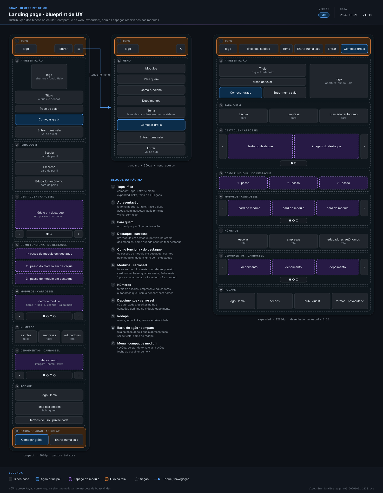
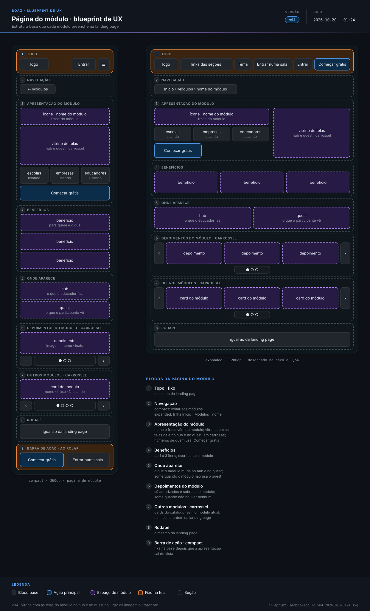

> **boaz · Funcionalidade** · `07_landing-page-ux` · **v12** · 2026-11-05 12:34 · **Aprovado**

# Landing page · UX base

**Objetivo:** definir como os blocos da landing page se distribuem no celular e na web e como o visitante se move entre eles, deixando espaços fixos para cada módulo se apresentar.

---

<a id="cenarios"></a>

## Cenários

<a id="sequencia-das-telas"></a>

### Sequência das telas

```gherkin
Cenário: da blueprint à vista
  Dado a blueprint, só com blocos e ações, sem cores, textos finais nem componentes
  Então os compostos (10) e as UIs (11 a 13) montam as vistas sobre esta distribuição
  E cada módulo entra pelos espaços reservados em roxo tracejado

Cenário: sem formulário de contato
  Quando o visitante procura falar com o deboaz
  Então a landing page não tem formulário de contato (decisão de 2026-10-18)
  E quem quer usar cria a conta e fala com o SAC de dentro dela
```

<a id="RF-01"></a>

### `RF-01` Ordem dos blocos

```gherkin
Cenário: página completa
  Dado ao menos um módulo com destaque e um depoimento autorizado
  Quando o visitante rola a landing page do início ao fim
  Então vê topo, apresentação, para quem, destaque, como funciona e módulos
  E depois números, depoimentos e rodapé, nessa ordem

Cenário: o destaque muda
  Dado o Quiz em destaque e Como funciona com os passos do Quiz
  Quando o destaque passa para a Presença
  Então Como funciona passa a mostrar os passos da Presença
```

<a id="RF-02"></a>

### `RF-02` Topo fixo

```gherkin
Cenário: voltar ao início pelo logo
  Dado o visitante no bloco Depoimentos
  Quando toca no logo do topo
  Então a página volta à apresentação
```

<a id="RF-03"></a>

### `RF-03` Menu no compact e no medium

```gherkin
Cenário: ir a uma seção pelo menu
  Dado a landing page aberta numa janela compact
  Quando o visitante abre o menu e toca em "Módulos"
  Então o menu fecha
  E a página mostra o bloco Módulos
```

<a id="RF-04"></a>

### `RF-04` Topo no expanded

```gherkin
Cenário: topo completo
  Dado a landing page aberta numa janela expanded
  Então o topo mostra os quatro links das seções e o seletor de tema
  E as ações "Entrar numa sala", "Entrar" e "Começar grátis"
  E não há botão de menu
```

<a id="RF-05"></a>

### `RF-05` Apresentação

```gherkin
Cenário: primeira tela no celular
  Dado a landing page aberta numa tela de 360 × 640dp
  Então o visitante vê o logo, o título, a frase de valor e a ação "Começar grátis" sem rolar
```

<a id="RF-06"></a>

### `RF-06` Destinos das ações

```gherkin
Cenário: entrar numa sala
  Dado o visitante na landing page
  Quando toca em "Entrar numa sala"
  Então abre a entrada pelo código da sala no quest
```

<a id="RF-08"></a>

### `RF-08` Carrossel de módulos

```gherkin
Cenário: ordem por contratação
  Dado os módulos A com 30 contratações, B com 12 e C sem contratação
  E C criado depois de D, também sem contratação
  Quando o visitante percorre o carrossel no compact
  Então vê um card por vez, na ordem A, B, C e D
  E cada card mostra quantas instituições e educadores autônomos usam o módulo, sem preço
```

<a id="RF-09"></a>

### `RF-09` Página do módulo

```gherkin
Cenário: abrir a página do módulo
  Dado o visitante no bloco Módulos
  Quando toca em "Saiba mais" num card
  Então abre a página daquele módulo com a vitrine das telas dele e os números dele
  E o carrossel Outros módulos não mostra o módulo atual
```

<a id="RF-13"></a>

### `RF-13` Números

```gherkin
Cenário: totais sem nomes
  Dado 40 escolas, 5 empresas e 120 educadores autônomos usando o deboaz
  Quando o visitante chega ao bloco Números
  Então vê os totais 40, 5 e 120
  E nenhum nome de cliente aparece
```

<a id="RF-14"></a>

### `RF-14` Depoimentos

```gherkin
Cenário: só depoimentos autorizados
  Dado dois depoimentos escritos no hub, um autorizado e outro não
  Quando o visitante chega ao bloco Depoimentos
  Então vê só o autorizado, com a imagem da instituição, o nome e o texto
```

<a id="RF-15"></a>

### `RF-15` Seletor de tema

```gherkin
Cenário: escolha guardada
  Dado o visitante escolhe um tema de cor colorido no modo escuro
  Quando volta à landing page no mesmo aparelho
  Então a página abre com esse tema e esse modo

Cenário: primeira visita
  Dado um aparelho sem escolha guardada
  Quando o visitante abre a landing page
  Então a página usa o tema de cor padrão no modo do sistema
```

<a id="RF-07"></a>

### `RF-07` Barra de ação fixa

```gherkin
Esquema do Cenário: barra fixa no compact
  Dado o visitante no compact
  Quando <posição>
  Então a barra de ação fixa <resultado>

  Exemplos:
    | posição                      | resultado   |
    | a apresentação está à vista  | não aparece |
    | a apresentação saiu de vista | aparece     |
    | o rodapé está visível        | não aparece |
```

<a id="RN-60"></a>

### `RN-60` Só módulo publicado

```gherkin
Cenário: módulo não publicado
  Dado a Agenda ainda não publicada no catálogo
  Então a Agenda não aparece na landing page
```

<a id="RN-61"></a>

### `RN-61` Card e página

```gherkin
Cenário: módulo publicado
  Dado o Quiz publicado, sem destaque
  Então o Quiz tem um card no bloco Módulos e uma página do módulo
  E não aparece em Destaque
```

<a id="RN-62"></a>

### `RN-62` O módulo define o conteúdo

```gherkin
Cenário: conteúdo do Quiz
  Então o card, a página, o destaque e os passos do Quiz vêm do documento do Quiz
  E a ordem e a estrutura dos blocos não mudam
```

<a id="RN-63"></a>

### `RN-63` Destaque

```gherkin
Cenário: um destaque por vez
  Dado o Quiz e a Presença com destaque
  Então o bloco mostra um por vez, na ordem do mais contratado

Cenário: sem destaque
  Dado nenhum módulo publicado com destaque
  Então o bloco Destaque não aparece
```

<a id="RN-64"></a>

### `RN-64` Sem login

```gherkin
Cenário: visitante sem conta
  Quando o visitante abre a landing page sem conta
  Então vê todo o conteúdo
```

<a id="RN-65"></a>

### `RN-65` Mudança exige versão

```gherkin
Cenário: bloco novo
  Quando o time muda a ordem dos blocos
  Então este documento e a blueprint ganham versão nova antes da UI (11)
```

<a id="RN-66"></a>

### `RN-66` Ordem dos módulos

```gherkin
Esquema do Cenário: ordem no carrossel
  Dado <módulos>
  Então a ordem é <ordem>

  Exemplos:
    | módulos                                              | ordem             |
    | Quiz em 90 contas e Presença em 40                   | Quiz, Presença    |
    | Agenda e Mensagens sem contratação, Agenda mais nova | Agenda, Mensagens |
```

<a id="RN-67"></a>

### `RN-67` Todos no carrossel

```gherkin
Cenário: 7 publicados
  Dado 7 módulos publicados
  Então o carrossel do bloco Módulos mostra os 7
```

<a id="RN-68"></a>

### `RN-68` Só totais

```gherkin
Cenário: números sem nome
  Então o bloco Números mostra "128 escolas", e nunca o nome de um cliente
```

<a id="RN-69"></a>

### `RN-69` Depoimento autorizado

```gherkin
Cenário: depoimento sem autorização
  Dado um depoimento escrito no hub pela EBFGA, ainda sem autorização
  Então ele não aparece na landing page
  E aparece depois que a EBFGA autoriza
```

<a id="RN-70"></a>

### `RN-70` Bloco Depoimentos

```gherkin
Cenário: nenhum autorizado
  Dado nenhum depoimento autorizado
  Então o bloco Depoimentos e os depoimentos do módulo não aparecem
```

<a id="RN-71"></a>

### `RN-71` Sem preço

```gherkin
Cenário: preço só na conta
  Quando o visitante abre a página do Quiz
  Então não vê preço
  E o preço só aparece na contratação, dentro da conta
```

<a id="RN-72"></a>

### `RN-72` Sem mensagens

```gherkin
Cenário: reclamação
  Quando o visitante procura enviar uma reclamação
  Então a landing page não recebe mensagens
  E suporte, conversa e reclamação acontecem dentro da conta
```

<a id="RN-73"></a>

### `RN-73` Termos e privacidade

```gherkin
Cenário: página de termos
  Quando o visitante abre Termos de uso
  Então a página tem o mesmo topo e rodapé
  E o texto é do Jurídico
```

<a id="RN-74"></a>

### `RN-74` Como funciona

```gherkin
Esquema do Cenário: passos do bloco
  Dado <destaque>
  Então Como funciona mostra <passos>

  Exemplos:
    | destaque                  | passos                                                         |
    | o Quiz em destaque        | os passos do Quiz, com o nome dele                             |
    | nenhum módulo em destaque | criar no hub, abrir a sala e passar o código, jogar pelo quest |
```

<a id="RN-75"></a>

### `RN-75` Tema padrão

```gherkin
Cenário: primeira visita
  Dado o aparelho sem tema escolhido e no modo escuro
  Quando o visitante abre a landing page
  Então a página usa o tema de cor padrão no modo escuro
```

<a id="RNF-120"></a>

### `RNF-120` Começar grátis sem rolar

```gherkin
Cenário: tela pequena
  Quando a landing page abre numa tela de 360 × 640dp
  Então Começar grátis aparece sem rolar
```

<a id="RNF-121"></a>

### `RNF-121` Dois toques

```gherkin
Cenário: ir aos Depoimentos
  Dado o visitante no rodapé
  Quando ele abre o menu e toca Depoimentos
  Então chega ao bloco em 2 toques
```

<a id="RNF-123"></a>

### `RNF-123` Cards por janela

```gherkin
Esquema do Cenário: carrossel de módulos
  Quando o carrossel abre na janela <janela>
  Então mostra <cards> por vez

  Exemplos:
    | janela   | cards |
    | compact  | 1     |
    | medium   | 2     |
    | expanded | 3     |
```

<a id="RNF-124"></a>

### `RNF-124` Janelas largas

```gherkin
Cenário: large
  Quando a página abre numa janela large
  Então mantém a distribuição da expanded, centralizada na largura máxima de conteúdo
```

<a id="RNF-125"></a>

### `RNF-125` Sem rolagem horizontal

```gherkin
Cenário: 360dp
  Quando a página abre com 360dp de largura
  Então não há rolagem horizontal
```

<a id="RNF-126"></a>

### `RNF-126` Ordem de leitura

```gherkin
Cenário: foco pelo teclado
  Quando o visitante navega com Tab
  Então o foco segue topo, apresentação, para quem, destaque e como funciona
  E depois módulos, números, depoimentos e rodapé
```

<a id="RNF-127"></a>

### `RNF-127` Movimento reduzido

```gherkin
Cenário: sem animação
  Dado o aparelho com movimento reduzido
  Quando o visitante vai a uma seção pelo menu ou troca o item de um carrossel
  Então a mudança acontece sem animação
```

<a id="RNF-128"></a>

### `RNF-128` Carrossel por ação

```gherkin
Cenário: posição visível
  Dado o carrossel no segundo de 7 módulos
  Então mostra "2 de 7"
  E só avança quando o visitante age
```

<a id="RNF-129"></a>

### `RNF-129` Operar o carrossel

```gherkin
Esquema do Cenário: formas de avançar
  Quando o visitante <ação>
  Então o carrossel vai para o próximo item

  Exemplos:
    | ação                           |
    | desliza o dedo para a esquerda |
    | toca em próximo                |
    | aperta Enter no botão próximo  |
```

<a id="fora-de-escopo"></a>

### Fora de escopo

```gherkin
Cenário: o que este documento não trata
  Então card, página e destaque de cada módulo ficam no documento do módulo
  E SAC, mensagens e a administração das contas ficam nos módulos da conta
  E as regras do depoimento ficam no documento do módulo depoimento
  E o preço de cada módulo aparece só na contratação, no hub
  E o texto dos termos e da privacidade é do Jurídico
  E textos finais, cores e componentes ficam nos compostos (10) e na UI (11)
  E as telas do hub e do quest ficam em 08_hub-ux e 09_quest-ux
  E outros idiomas além do português do Brasil ficam de fora
```

---

<a id="telas"></a>

## Telas

**Landing page · blueprint de UX** — `2_Diagramas/blueprint-landing-page_v05_20261021-2138.svg`

[](../2_Diagramas/blueprint-landing-page_v05_20261021-2138.svg)

**Página do módulo · blueprint de UX** — `2_Diagramas/blueprint-landing-modulo_v04_20261020-0124.svg`

[](../2_Diagramas/blueprint-landing-modulo_v04_20261020-0124.svg)

---

<a id="historico"></a>

## Histórico

| Versão | Data | Mudança |
|---|---|---|
| **v12** | 2026-11-05 12:34 | Formato `.md`: migrado de `.html` sem mudar cenários, telas nem diagramas; links entre documentos apontam para `.md` |
| v11 | 2026-11-03 22:11 | Aprovado, sem pendências em aberto |
| v10 | 2026-11-01 18:24 | Só Gherkin, telas e diagramas: contexto, tabelas de RF, RN e RNF e fora de escopo viram cenários (mesmos IDs como âncora); blueprints em Telas; status → Em revisão |
| v09 | 2026-11-01 03:57 | Aprovado |
| v08 | 2026-11-01 03:48 | Painel de administração do deboaz retirado (Módulos `MOD-15`): as mensagens chegam ao SAC e o time deboaz cuida das contas no módulo Usuários |
| v07 | 2026-10-21 22:12 | `RF-05` alterado: o logo na abertura no lugar do mascote de boas-vindas; blueprint v05; status → Aprovado |
| v06 | 2026-10-20 01:57 | Status → Aprovado |
| v05 | 2026-10-20 01:27 | Destaque antes de Como funciona, que mostra os passos do módulo em destaque, e dos Módulos (`RF-01`, `RN-62`, `RN-74`); página do módulo com a vitrine das telas dele (`RF-09`); blueprints da página e da página do módulo v04; status → Em revisão |
| v04 | 2026-10-18 22:27 | Status → Aprovado |
| v03 | 2026-10-18 22:21 | Blueprints v03: fundo escuro na janela inteira ao abrir o diagrama no navegador |

---

<sub>boaz · v12 · 2026-11-05 12:34 · `1_Requisitos/07_landing-page-ux.md`</sub>
