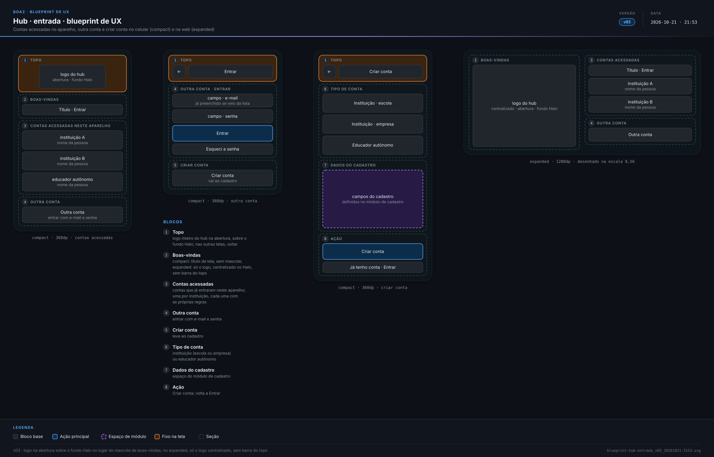
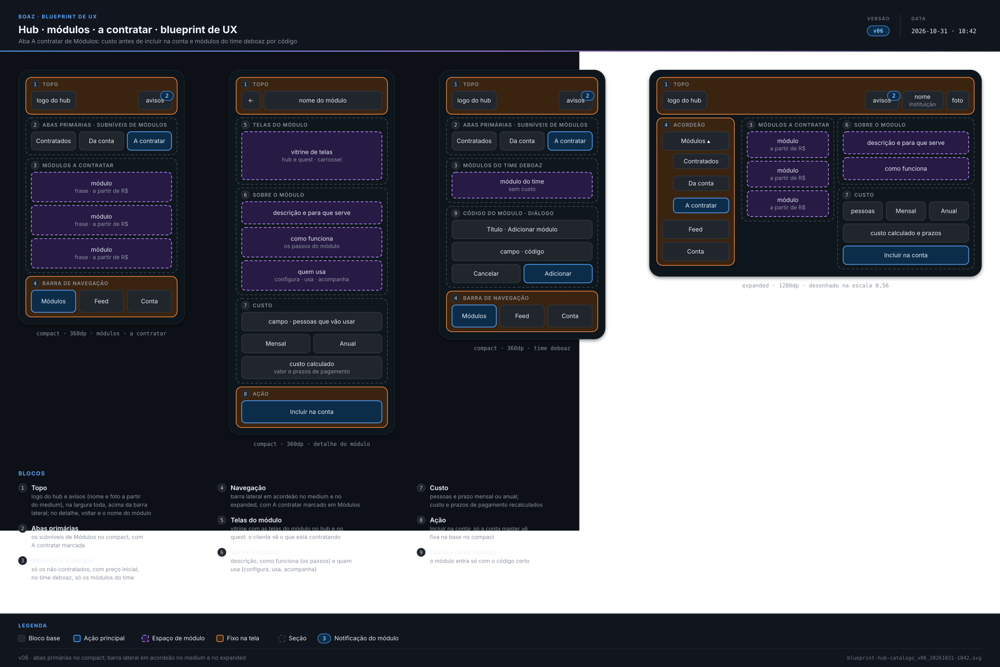
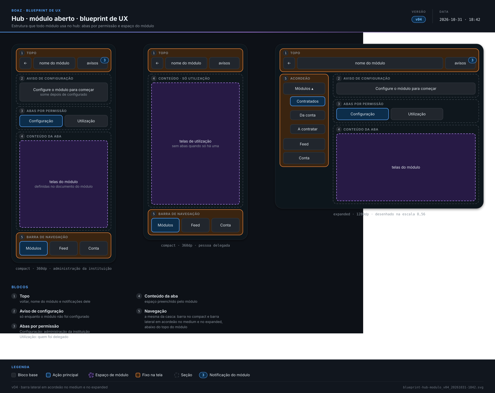

> **boaz · Funcionalidade** · `08_hub-ux` · **v28** · 2026-11-05 12:34 · **Aprovado**

# Hub · UX base

**Objetivo:** definir como o hub se organiza no celular e na web — entrada, navegação, módulos (contratados, da conta e a contratar), feed, módulo aberto e conta — com espaços fixos para cada módulo trabalhar.

---

<a id="cenarios"></a>

## Cenários

<a id="exemplo-presenca"></a>

### Exemplo: módulo de presença

```gherkin
Cenário: do contrato à chamada
  Dado a conta master contratando a Presença em A contratar
  Quando a administração cadastra as turmas e delega os professores na aba Configuração
  E o professor Paulo faz a chamada do 7º A na aba Utilização
  Então o Lucas e os responsáveis acompanham a presença pelo quest
  E o registro fica guardado para a escola analisar
```

<a id="RF-16"></a>

### `RF-16` Entrada

```gherkin
Cenário: criar conta de educador autônomo
  Dado a pessoa na tela Criar conta
  Quando escolhe "Educador autônomo", preenche os dados e toca em "Criar conta"
  Então entra no hub em Módulos, com os módulos da conta
```

<a id="RF-17"></a>

### `RF-17` Casca e navegação por janela

```gherkin
Cenário: casca em toda tela
  Dado a pessoa dentro de um módulo
  Então o topo e a navegação entre Módulos, Feed e Conta continuam na tela

Cenário: do celular para a web
  Dado o hub aberto numa janela compact com a barra inferior
  Quando a janela passa a expanded
  Então a navegação vira a barra lateral em acordeão, abaixo do topo, com Módulos, Feed e Conta
  E Contratados, Da conta e A contratar ficam dentro de Módulos, sem as abas
  E o topo continua na largura toda da janela, com o nome e a foto que abrem a Conta

Cenário: encolher a barra lateral
  Dado o hub numa janela expanded com a barra lateral aberta
  Quando a pessoa toca no botão de encolher, no alto da barra
  Então a barra fica só com os ícones de Módulos, Feed e Conta
  E o conteúdo ganha a largura que a barra liberou

Cenário: publicação para uma turma
  Dado um módulo que publicou no Feed um aviso para a turma 7º A
  E o professor Caio, staff da turma 7º A, e a professora Rita, de outra turma
  Quando cada um abre o Feed
  Então o Caio vê o aviso com o ícone e o nome do módulo, "7º A" e a data
  E a Rita não vê o aviso

Cenário: conta do time deboaz
  Dado o administrador do deboaz no hub
  Então a navegação mostra só "Módulos" e "Conta"
```

<a id="RF-19"></a>

### `RF-19` Módulos

```gherkin
Cenário: três subníveis
  Dado uma conta com dois módulos contratados
  Quando a pessoa entra no hub
  Então vê a aba Contratados marcada, com os dois módulos, e as abas Da conta e A contratar ao lado

Cenário: carcaça do card
  Dado um módulo contratado
  Então o card mostra o ícone, o nome e as notificações do módulo
  E o espaço do conteúdo, preenchido como define o documento do módulo

Cenário: tamanhos do card
  Dado o SAC na normal, o Quiz na reduzida, duas mínimas e a Presença na expandida
  Quando a pessoa abre Contratados no compact
  Então o SAC ocupa a linha toda num quadrado, com os números
  E o Quiz ocupa metade de uma linha num quadrado, com as duas mínimas ao lado
  E a Presença ocupa a linha toda com o dobro da altura do SAC
  E o toque em qualquer um dos cards abre o módulo
```

<a id="RF-20"></a>

### `RF-20` Notificação no módulo

```gherkin
Cenário: três notificações não lidas
  Dado três notificações não lidas no SAC
  Quando a pessoa abre Da conta
  Então o card do SAC mostra 3
```

<a id="RF-22"></a>

### `RF-22` Abas por permissão

```gherkin
Cenário: pessoa delegada
  Dado um professor delegado só para usar o módulo
  Quando abre o módulo
  Então vê o conteúdo de Utilização, sem a aba Configuração
```

<a id="RF-23"></a>

### `RF-23` A contratar

```gherkin
Cenário: só o que falta contratar
  Dado uma conta com o módulo A contratado
  Quando a conta master abre a aba A contratar
  Então o módulo A não aparece
  E cada módulo listado mostra a descrição simples e o preço inicial

Cenário: conhecer antes de contratar
  Quando a conta master abre o detalhe de um módulo
  Então vê as telas do módulo, o que ele é, como funciona, quem usa, o custo e a ação de incluir
```

<a id="RF-24"></a>

### `RF-24` Custo antes de incluir

```gherkin
Cenário: mudar o prazo
  Dado a conta master no detalhe de um módulo, com 30 pessoas e prazo mensal
  Quando troca o prazo para anual
  Então o custo e os prazos de pagamento são recalculados antes de "Incluir na conta"
```

<a id="RF-25"></a>

### `RF-25` Módulo recém-contratado

```gherkin
Cenário: contratar e configurar
  Dado a conta master incluiu um módulo na conta
  Quando volta a Contratados
  Então o módulo aparece com o aviso "Configurar"
```

<a id="RF-26"></a>

### `RF-26` Código do time deboaz

```gherkin
Cenário: código certo
  Dado uma conta do time deboaz na aba A contratar
  Quando toca em "Adicionar" num módulo e informa o código recebido
  Então o módulo aparece em Contratados

Cenário: código errado
  Dado um código que não confere
  Quando a pessoa toca em "Adicionar"
  Então o módulo não entra na conta e a tela diz em texto que o código não confere
```

<a id="RF-27"></a>

### `RF-27` Conta

```gherkin
Cenário: sair
  Dado a pessoa em Conta
  Quando toca em "Sair"
  Então a sessão termina e o hub volta à tela Entrar
  E a conta aparece entre as contas acessadas no aparelho
```

<a id="RF-28"></a>

### `RF-28` Contas acessadas

```gherkin
Cenário: professor em duas escolas
  Dado um professor que já entrou neste aparelho com a conta da escola A e com a da escola B
  Quando abre a tela Entrar
  Então vê as duas contas, cada uma com o nome da escola
  E a ação "Outra conta"

Cenário: primeiro acesso no aparelho
  Dado um aparelho em que ninguém entrou no hub
  Quando a pessoa abre o hub
  Então vê só "Entrar" e "Criar conta", sem lista de contas
```

<a id="RF-21"></a>

### `RF-21` Ordenar módulos

```gherkin
Cenário: arrastar pela alça
  Dado a conta master em Ordenar
  Quando arrasta o card da Presença pela alça para o primeiro lugar
  Então a Presença fica em primeiro em Contratados, só naquele aparelho

Cenário: tamanho pelo menu
  Quando ela escolhe "Reduzida" no menu do card do Quiz
  Então o Quiz fica na reduzida, só naquele aparelho
```

<a id="RN-76"></a>

### `RN-76` Só a conta master contrata

```gherkin
Esquema do Cenário: quem contrata
  Quando <quem> abre o detalhe da Presença em A contratar
  Então <resultado>

  Exemplos:
    | quem                      | resultado           |
    | a conta master da EBFGA   | vê Incluir na conta |
    | o educador autônomo Pedro | vê Incluir na conta |
```

<a id="RN-77"></a>

### `RN-77` Consulta e sugestão

```gherkin
Cenário: staff consulta preços
  Quando a staff Maria abre A contratar
  Então vê os módulos com os preços, sem Incluir na conta
  E sugere módulos pelo módulo Sugestão
```

<a id="RN-78"></a>

### `RN-78` Mesma casca

```gherkin
Cenário: staff com a Presença
  Dado a Maria com a Utilização da Presença e o Paulo sem a Presença
  Então os dois veem a mesma casca
  E só a Maria vê o card da Presença
```

<a id="RN-79"></a>

### `RN-79` Módulos da conta

```gherkin
Cenário: conta nova
  Quando a EBFGA cria a conta
  Então já tem SAC, Contas, Usuários, Turmas e Perfil
  E a lista completa fica no registro de módulos
```

<a id="RN-80"></a>

### `RN-80` Sugestão para quem trabalha

```gherkin
Cenário: staff com Sugestão
  Quando a Maria abre Da conta
  Então vê o módulo Sugestão
```

<a id="RN-81"></a>

### `RN-81` Da conta fora da ordem

```gherkin
Cenário: ordenar só contratados
  Quando a conta master abre Ordenar
  Então só os contratados aparecem
  E os módulos da conta ficam na aba Da conta
```

<a id="RN-82"></a>

### `RN-82` Preço por pessoas e prazo

```gherkin
Cenário: simulação do Quiz
  Quando a conta master simula o Quiz para 300 participantes, no plano anual
  Então o preço muda com o número de pessoas e o prazo escolhido
```

<a id="RN-83"></a>

### `RN-83` Abas do módulo

```gherkin
Esquema do Cenário: quem usa cada aba
  Então a aba <aba> é de <quem>

  Exemplos:
    | aba          | quem                                 |
    | Configuração | a administração da instituição       |
    | Utilização   | quem foi delegado para usar o módulo |

Cenário: acompanhamento
  Então o estudante e os responsáveis acompanham pelo quest
```

<a id="RN-84"></a>

### `RN-84` Conta do time deboaz

```gherkin
Cenário: conta do time
  Quando o Caio entra na conta do time deboaz
  Então ela não tem custos e começou sem módulos
  E A contratar mostra só os módulos do time
```

<a id="RN-85"></a>

### `RN-85` Módulo do time por código

```gherkin
Cenário: adicionar o Catálogo
  Dado o código entregue junto da solicitação do Catálogo
  Quando o administrador toca Adicionar e informa o código
  Então o Catálogo entra na conta do time

Cenário: sem código
  Quando o administrador toca Adicionar sem o código certo
  Então o módulo não entra
```

<a id="RN-86"></a>

### `RN-86` O módulo define o conteúdo

```gherkin
Cenário: Presença na casca
  Então o card, as abas e o conteúdo da Presença vêm do documento da Presença
  E a casca desta UX base não muda
```

<a id="RN-87"></a>

### `RN-87` Mudança exige versão

```gherkin
Cenário: destino novo
  Quando o time muda a estrutura das telas do hub
  Então este documento e as blueprints ganham versão nova antes da UI (12)
```

<a id="RN-88"></a>

### `RN-88` Notificações por módulo

```gherkin
Cenário: sem lista única
  Dado 3 notificações no SAC e 2 na Presença
  Então o hub não tem lista única de notificações
  E cada módulo mostra as suas quando aberto
```

<a id="RN-89"></a>

### `RN-89` Preferências do aparelho

```gherkin
Cenário: computador novo
  Dado a conta master com o tema Oceano e a Presença na expandida no notebook
  Quando ela entra pelo computador da escola
  Então o tema, a ordem e os tamanhos voltam ao padrão
```

<a id="RN-221"></a>

### `RN-221` Feed do hub

```gherkin
Esquema do Cenário: o que cada pessoa vê
  Dado publicações da Agenda para toda a escola e do Quiz para o 7º A
  Quando <quem> abre Feed
  Então vê <publicações>

  Exemplos:
    | quem                        | publicações       |
    | a Maria, professora do 7º A | as duas           |
    | o Paulo, professor do 8º B  | só a da Agenda    |
    | a conta master              | todas as da conta |

Cenário: ordem e conta do time
  Então as publicações vêm da mais recente para a mais antiga, com módulo, público e data
  E a conta do time deboaz não tem Feed
```

<a id="RN-90"></a>

### `RN-90` Uma conta por instituição

```gherkin
Cenário: professora em duas escolas
  Dado a Maria na EBFGA e na COLSA
  Então ela tem duas contas, "maria.ebfga" e "maria.colsa"
  E cada uma segue as regras da sua escola
```

<a id="RNF-130"></a>

### `RNF-130` Um toque

```gherkin
Cenário: destinos sempre perto
  Dado a conta master dentro da Presença
  Então Módulos, Feed e Conta ficam a 1 toque
```

<a id="RNF-131"></a>

### `RNF-131` Custo na hora

```gherkin
Cenário: muda o número de pessoas
  Dado o detalhe do Quiz com 300 participantes
  Quando a conta master muda para 320
  Então o custo é recalculado sem sair da tela
```

<a id="RNF-132"></a>

### `RNF-132` Grade de Módulos

```gherkin
Esquema do Cenário: espaço de cada tamanho
  Quando o card está na <tamanho>
  Então ocupa <largura> × <altura>

  Exemplos:
    | tamanho   | largura | altura |
    | mínima    | 1       | 1      |
    | reduzida  | 2       | 2      |
    | normal    | 4       | 4      |
    | expandida | 4       | 8      |

Cenário: grade e rolagem
  Então as células são quadradas, de 76dp ou mais, com pelo menos 4 colunas, também ao ordenar
  E o topo e as abas se escondem ao rolar
```

<a id="RNF-133"></a>

### `RNF-133` A contratar lado a lado

```gherkin
Cenário: expanded
  Quando a conta master abre A contratar no expanded
  Então a lista e o detalhe do módulo aparecem lado a lado
```

<a id="RNF-134"></a>

### `RNF-134` Ordenar sem arrastar

```gherkin
Cenário: pelo teclado
  Dado Ordenar aberto
  Quando a conta master abre o menu do card da Presença pelo teclado e escolhe "Mover para cima"
  Então a Presença sobe uma posição
  E o mesmo menu muda o tamanho do card
```

<a id="RNF-135"></a>

### `RNF-135` Notificações no leitor de tela

```gherkin
Cenário: card com selo
  Dado o card do SAC com o selo "3"
  Então o leitor de tela anuncia "SAC, 3 notificações"
```

<a id="fora-de-escopo"></a>

### Fora de escopo

```gherkin
Cenário: o que este documento não trata
  Então as telas e o conteúdo de cada módulo ficam no documento do módulo
  E os campos do cadastro ficam no Módulo Usuários
  E cobrança e pagamento ficam no módulo Contas
  E SAC, mensagens, sugestão e a administração das contas ficam nos próprios módulos
  E as regras de login ficam em Usuários · Autenticação
  E o acompanhamento pelo estudante fica em 09_quest-ux
  E textos finais, cores e componentes ficam nos compostos (10) e na UI do hub (12)
```

---

<a id="telas"></a>

## Telas

**Hub · entrada · blueprint de UX** — `2_Diagramas/blueprint-hub-entrada_v03_20261021-2153.svg`

[](../2_Diagramas/blueprint-hub-entrada_v03_20261021-2153.svg)

**Hub · módulos, feed e conta · blueprint de UX** — `2_Diagramas/blueprint-hub-meus-modulos_v10_20261031-2329.svg`

[](../2_Diagramas/blueprint-hub-meus-modulos_v10_20261031-2329.svg)

**Hub · módulos · a contratar · blueprint de UX** — `2_Diagramas/blueprint-hub-catalogo_v06_20261031-1842.svg`

[](../2_Diagramas/blueprint-hub-catalogo_v06_20261031-1842.svg)

**Hub · módulo aberto · blueprint de UX** — `2_Diagramas/blueprint-hub-modulo_v04_20261031-1842.svg`

[](../2_Diagramas/blueprint-hub-modulo_v04_20261031-1842.svg)

---

<a id="historico"></a>

## Histórico

| Versão | Data | Mudança |
|---|---|---|
| **v28** | 2026-11-05 12:34 | Formato `.md`: migrado de `.html` sem mudar cenários, telas nem diagramas; links entre documentos apontam para `.md` |
| v27 | 2026-11-03 22:11 | Aprovado, sem pendências em aberto |
| v26 | 2026-11-01 18:23 | Só Gherkin, telas e diagramas: contexto e exemplo da presença, tabelas de RF, RN e RNF e fora de escopo viram cenários (mesmos IDs como âncora); blueprints em Telas; status → Em revisão |
| v25 | 2026-11-01 03:57 | Aprovado |
| v24 | 2026-11-01 03:48 | Painel de administração do deboaz retirado (Módulos `MOD-15`): as mensagens chegam ao SAC e o time deboaz cuida das contas no módulo Usuários |
| v23 | 2026-11-01 01:20 | Aprovação |
| v22 | 2026-11-01 01:14 | Feed respondido: publicações dos módulos para toda a instituição ou para uma turma ou equipe, e a conta do time deboaz sem Feed (`RF-17`, `RN-221`); Em aberto retirado |
| v21 | 2026-10-31 23:30 | Cards de Módulos com célula de 76dp ou mais, no mínimo 4 colunas e quantas couberem na janela, com o card do mesmo tamanho em qualquer janela, e topo e abas escondidos ao rolar (`RNF-132`); blueprint de Módulos v10 |
| v20 | 2026-10-31 22:55 | Card de módulo em quatro tamanhos de células quadradas (largura × altura): mínima 1x1, reduzida 2x2, normal 4x4 (o padrão) e expandida 4x8, numa grade de 4 colunas no compact e no medium e 8 a partir do expanded (`RF-19`, `RNF-132`); blueprint de Módulos v09 |
| v19 | 2026-10-31 22:16 | Cards de Módulos em grade nos quatro tamanhos do registro de módulos (`RF-19`, `RNF-132`); ordem e tamanho pelo menu do card, só no aparelho (`RF-21`, `RN-89`, `RNF-134`); botão de encolher a barra lateral (`RF-17`); Entrar e Criar conta primeiro no aparelho sem contas (`RF-28`); blueprint de Módulos v08 |

---

<sub>boaz · v28 · 2026-11-05 12:34 · `1_Requisitos/08_hub-ux.md`</sub>
