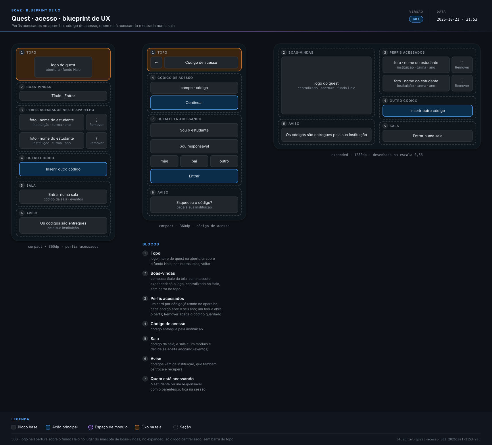
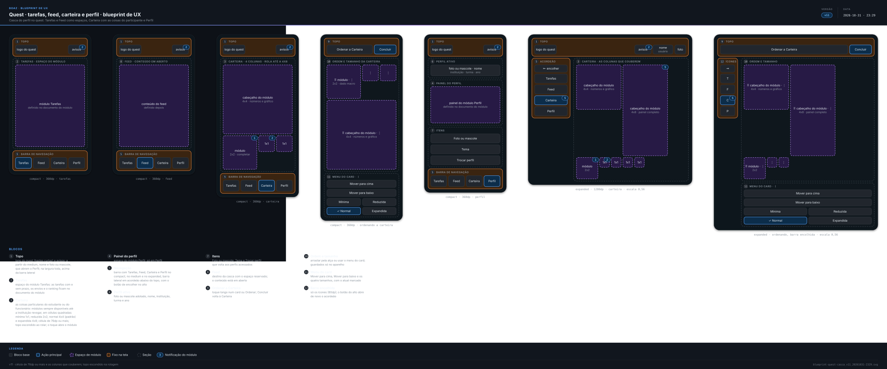
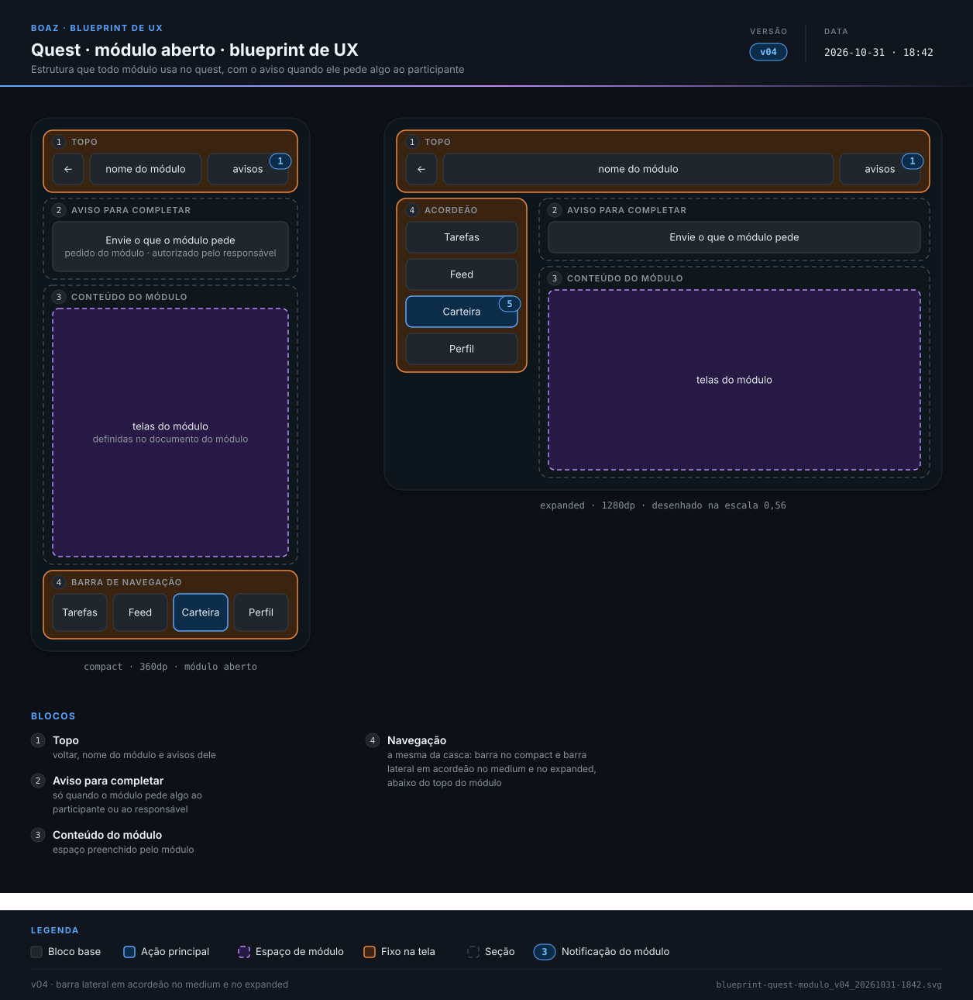

> **boaz · Funcionalidade** · `09_quest-ux` · **v24** · 2026-11-05 12:34 · **Aprovado**

# Quest · UX base

**Objetivo:** definir como o participante e o responsável acessam o quest pelo código de acesso e como Tarefas, Feed, Carteira e Perfil se distribuem no celular e na web.

---

<a id="cenarios"></a>

## Cenários

<a id="exemplo-carteirinha"></a>

### Exemplo: módulo de carteirinha

```gherkin
Cenário: carteirinha completa com a foto
  Dado a escola com a Carteirinha contratada e configurada no hub
  Quando o Lucas abre a Carteira
  Então a carteirinha já traz o nome, a série e os responsáveis, com o aviso para completar
  E quando ele envia a foto pelo app, com a autorização dos responsáveis, ela fica pronta
```

<a id="RF-29"></a>

### `RF-29` Perfis acessados

```gherkin
Cenário: responsável com dois filhos
  Dado um responsável que já entrou neste aparelho com o código de cada filho
  Quando abre o quest
  Então vê dois cards, cada um com a foto, o nome, a instituição, a turma e o ano do filho
  E a ação "Inserir outro código"
```

<a id="RF-30"></a>

### `RF-30` Aviso dos códigos

```gherkin
Cenário: primeira vez no aparelho
  Dado um aparelho sem perfil acessado
  Quando a pessoa abre o quest
  Então vê o aviso de que os códigos de acesso são entregues e recuperados pela instituição
```

<a id="RF-31"></a>

### `RF-31` Código guardado

```gherkin
Cenário: voltar sem digitar
  Dado um estudante que entrou com o código de acesso neste aparelho
  Quando abre o quest de novo
  Então toca no card do perfil e entra sem digitar o código

Cenário: remover de um aparelho compartilhado
  Dado um perfil acessado num aparelho compartilhado
  Quando a pessoa toca em "Remover" no card do perfil
  Então o card sai da tela de acesso e o código guardado é apagado
```

<a id="RF-32"></a>

### `RF-32` Quem está acessando

```gherkin
Cenário: mãe entra com o código do filho
  Dado o código de acesso de um estudante
  Quando a pessoa informa o código e escolhe "Sou responsável" e "mãe"
  Então entra no perfil do estudante
  E a sessão registra que a mãe acessou
```

<a id="RF-33"></a>

### `RF-33` Entrar numa sala

```gherkin
Cenário: visitante de evento aberto
  Dado uma sala aberta que aceita participante anônimo
  Quando um visitante toca em "Entrar numa sala" e informa o código da sala
  Então entra no módulo da sala sem código de acesso
```

<a id="RF-34"></a>

### `RF-34` Casca do perfil

```gherkin
Cenário: do celular para a web
  Dado o perfil aberto numa janela compact com a barra inferior
  Quando a janela passa a expanded
  Então a navegação vira a barra lateral em acordeão, abaixo do topo
  E a barra lateral tem Tarefas, Feed, Carteira e Perfil
  E o nome e a foto do perfil aparecem no topo e abrem o Perfil
Cenário: Feed da turma
  Dado um módulo que publicou no Feed um aviso para a turma 7º A e outro para a turma 8º B
  E o Lucas Andrade, da turma 7º A
  Quando ele toca em "Feed"
  Então vê o aviso da 7º A, com o ícone e o nome do módulo e a data
  E não vê o aviso da 8º B
```

<a id="RF-35"></a>

### `RF-35` Trocar de perfil

```gherkin
Cenário: ir para o outro filho
  Dado um responsável no perfil do primeiro filho, no celular
  Quando abre Perfil e toca em "Trocar perfil"
  Então volta à tela de acesso com os dois perfis
```

<a id="RF-36"></a>

### `RF-36` Tarefas

```gherkin
Cenário: abrir o perfil
  Quando o estudante entra no perfil
  Então vê Tarefas marcada na navegação e o espaço do módulo Tarefas
  E as tarefas aparecem como o documento do módulo Tarefas define
```

<a id="RF-38"></a>

### `RF-38` Carteira

```gherkin
Cenário: mensagens novas
  Dado cinco mensagens não lidas no módulo Mensagens
  Quando o estudante abre a Carteira
  Então o card de Mensagens mostra 5

Cenário: tamanhos
  Dado a Carteirinha na reduzida e Mensagens na normal
  Quando o estudante abre a Carteira no compact
  Então Mensagens ocupa a linha toda num quadrado e a Carteirinha metade de uma linha num quadrado
  E o toque na Carteirinha abre o módulo
```

<a id="RF-130"></a>

### `RF-130` Ordenar a Carteira

```gherkin
Cenário: mudar o tamanho
  Dado o estudante na Carteira
  Quando faz um toque longo no card de Mensagens
  Então vê Ordenar a Carteira
  E, no menu do card de Mensagens, escolhe "Expandida"
  Então Mensagens passa a mostrar o painel completo, na linha toda, só neste aparelho
```

<a id="RF-39"></a>

### `RF-39` Perfil

```gherkin
Cenário: estudante que mudou de ano
  Dado um estudante com o código do ano passado e o novo código deste ano guardados no aparelho
  Quando abre o perfil pelo código deste ano
  Então Perfil mostra só os dados deste ano
  E o card do ano passado, na tela de acesso, abre os dados daquele ano
```

<a id="RF-40"></a>

### `RF-40` Aviso para completar

```gherkin
Cenário: carteirinha sem foto
  Dado o módulo de carteirinha esperando a foto do estudante
  Quando o estudante abre a Carteira
  Então o card da carteirinha mostra o aviso para completar
  E o módulo aberto pede a foto
```

<a id="RN-222"></a>

### `RN-222` Feed do quest

```gherkin
Cenário: o que o Lucas vê
  Dado publicações da Agenda para toda a escola e do Quiz para o 7º A
  E o Lucas no 7º A
  Quando ele abre Feed
  Então vê as duas, da mais recente para a mais antiga
  E cada uma com o ícone e o nome do módulo, o público e a data

Cenário: responsável vê o mesmo
  Quando a Carla entra com o código do Lucas e abre Feed
  Então vê o mesmo Feed do Lucas
```

<a id="RN-223"></a>

### `RN-223` Tarefas em todo perfil

```gherkin
Cenário: Tarefas sempre presente
  Dado qualquer escola, com qualquer contratação
  Quando o Lucas entra no quest
  Então Tarefas está lá, porque o módulo Tarefas é da conta
```

<a id="RN-91"></a>

### `RN-91` Código de acesso

```gherkin
Cenário: código no cadastro
  Quando a escola EBFGA cadastra o Lucas, nome curto "lucas", matrícula "48201755"
  Então o código é como "EBFGA-LUCAS-0412", único
  E a matrícula é um campo do cadastro, e não o código
```

<a id="RN-92"></a>

### `RN-92` Quem recebe o código

```gherkin
Esquema do Cenário: entrega do código
  Quando a escola entrega o código de <quem>
  Então entrega a <recebe>

  Exemplos:
    | quem                      | recebe               |
    | o Lucas, de 12 anos       | os responsáveis dele |
    | a Júlia, de 17 anos       | os responsáveis dela |
    | o colaborador Rui, adulto | o próprio Rui        |
```

<a id="RN-93"></a>

### `RN-93` Só a instituição cuida do código

```gherkin
Cenário: código esquecido
  Dado a Carla sem o código do Lucas
  Quando ela procura recuperar o código no quest
  Então o quest mostra "Esqueceu o código? Peça à sua instituição."
```

<a id="RN-94"></a>

### `RN-94` Mesmo código

```gherkin
Cenário: mãe e filho
  Quando o Lucas e a Carla entram com "EBFGA-LUCAS-0412"
  Então as duas sessões são do Lucas
  E a da Carla registra "Mãe"
```

<a id="RN-95"></a>

### `RN-95` Vários estudantes

```gherkin
Cenário: mãe de dois
  Quando a Carla entra com o código do Lucas e depois com o da Bia
  Então a tela de acesso do aparelho mostra os dois perfis
```

<a id="RN-96"></a>

### `RN-96` Troca de ano

```gherkin
Cenário: ano novo
  Dado o Lucas no 7º A em 2026 com "EBFGA-LUCAS-0412"
  Quando a escola passa o Lucas para o 8º A em 2027
  Então ele recebe um código novo, que começa sem dados
  E "EBFGA-LUCAS-0412" continua abrindo os dados de 2026
```

<a id="RN-98"></a>

### `RN-98` Carteira pessoal

```gherkin
Cenário: só o que é do Lucas
  Quando o Lucas abre a Carteira
  Então vê só os módulos dele
  E cada um fica até a escola revogar
```

<a id="RN-99"></a>

### `RN-99` Instituição contrata, participante usa

```gherkin
Cenário: participante não contrata
  Quando o Lucas abre a Carteira
  Então não vê ação de contratar nem de configurar
```

<a id="RN-100"></a>

### `RN-100` Sala é módulo

```gherkin
Cenário: telas da sala
  Então a espera, as perguntas, o ranking e o resultado ficam no documento do módulo da sala
```

<a id="RN-101"></a>

### `RN-101` Sala de evento público

```gherkin
Esquema do Cenário: entrada na sala aberta
  Dado a sala 482107 de evento público <regra>
  Quando uma pessoa sem código entra
  Então <resultado>

  Exemplos:
    | regra                       | resultado                 |
    | que aceita anônimo          | entra com um apelido      |
    | que pede o código de acesso | precisa informar o código |
```

<a id="RN-102"></a>

### `RN-102` Autorização dos responsáveis

```gherkin
Cenário: foto da carteirinha
  Dado o Lucas, de 12 anos
  Quando ele envia a foto da carteirinha
  Então a foto só vale depois da autorização da Carla ou do Paulo
```

<a id="RN-103"></a>

### `RN-103` O módulo define o conteúdo

```gherkin
Cenário: card da Carteirinha
  Então o conteúdo do card, as tarefas, o aviso e as telas vêm do documento da Carteirinha
  E a casca desta UX base não muda
```

<a id="RN-104"></a>

### `RN-104` Mudança exige versão

```gherkin
Cenário: destino novo na barra
  Quando o time muda a estrutura das telas do quest
  Então este documento e as blueprints ganham versão nova antes da UI (13)
```

<a id="RN-105"></a>

### `RN-105` Responsável vê igual

```gherkin
Cenário: mãe no perfil do filho
  Quando a Carla abre o perfil do Lucas
  Então vê igual ao Lucas
  E cabe a ela deixar o Lucas responder às tarefas
```

<a id="RNF-136"></a>

### `RNF-136` Um toque

```gherkin
Cenário: perfil já acessado
  Dado o perfil do Lucas na tela de acesso
  Quando a Carla toca no card do Lucas
  Então o perfil abre, sem digitar o código
```

<a id="RNF-138"></a>

### `RNF-138` Grade da Carteira

```gherkin
Esquema do Cenário: espaço de cada tamanho
  Quando o card da Carteira está na <tamanho>
  Então ocupa <largura> × <altura>

  Exemplos:
    | tamanho   | largura | altura |
    | mínima    | 1       | 1      |
    | reduzida  | 2       | 2      |
    | normal    | 4       | 4      |
    | expandida | 4       | 8      |

Cenário: grade e rolagem
  Então as células são quadradas, de 76dp ou mais, com pelo menos 4 colunas, também ao ordenar
  E o topo se esconde ao rolar
```

<a id="RNF-141"></a>

### `RNF-141` Notificações no leitor de tela

```gherkin
Cenário: card com selo
  Dado o card da Carteirinha com o selo "1"
  Então o leitor de tela anuncia "Carteirinha, 1 notificação"
```

<a id="fora-de-escopo"></a>

### Fora de escopo

```gherkin
Cenário: o que este documento não trata
  Então a sala do quiz e o apelido do anônimo ficam no documento do módulo da sala
  E as telas e o conteúdo de cada módulo ficam nos documentos dos módulos
  E agenda, prazos, envios e ranking das tarefas ficam no documento do Tarefas (MOD-09)
  E geração e entrega dos códigos ficam no Módulo Usuários
  E as regras de login ficam em Usuários · Autenticação
  E textos finais, cores e componentes ficam nos compostos (10) e na UI do quest (13)
```

---

<a id="telas"></a>

## Telas

**Quest · acesso · blueprint de UX** — `2_Diagramas/blueprint-quest-acesso_v03_20261021-2153.svg`

[](../2_Diagramas/blueprint-quest-acesso_v03_20261021-2153.svg)

**Quest · tarefas, feed, carteira e perfil · blueprint de UX** — `2_Diagramas/blueprint-quest-casca_v11_20261031-2329.svg`

[](../2_Diagramas/blueprint-quest-casca_v11_20261031-2329.svg)

**Quest · módulo aberto · blueprint de UX** — `2_Diagramas/blueprint-quest-modulo_v04_20261031-1842.svg`

[](../2_Diagramas/blueprint-quest-modulo_v04_20261031-1842.svg)

---

<a id="historico"></a>

## Histórico

| Versão | Data | Mudança |
|---|---|---|
| **v24** | 2026-11-05 12:34 | Formato `.md`: migrado de `.html` sem mudar cenários, telas nem diagramas; links entre documentos apontam para `.md` |
| v23 | 2026-11-03 22:11 | Aprovado, sem pendências em aberto |
| v22 | 2026-11-01 18:22 | Só Gherkin, telas e diagramas: contexto e exemplo da carteirinha, tabelas de RF, RN e RNF e fora de escopo viram cenários (mesmos IDs como âncora); blueprints em Telas; status → Em revisão |
| v21 | 2026-11-01 01:20 | Aprovação |
| v20 | 2026-11-01 01:14 | Feed respondido: publicações dos módulos para a instituição e para a turma ou equipe do participante (`RF-34`, `RN-222`); Tarefas é módulo da conta e existe em todo perfil (`RN-223`); Em aberto retirado |
| v19 | 2026-10-31 23:30 | Carteira com célula de 76dp ou mais, no mínimo 4 colunas e quantas couberem na janela, com o card do mesmo tamanho em qualquer janela, e topo escondido ao rolar (`RNF-138`); blueprint da casca v11 |
| v18 | 2026-10-31 22:55 | Carteira com os quatro tamanhos de células quadradas, mínima 1x1, reduzida 2x2, normal 4x4 e expandida 4x8 (`RF-38`, `RNF-138`); blueprint da casca v10 |
| v17 | 2026-10-31 22:18 | Carteira como as coisas particulares do estudante ou do funcionário, com os cards nos quatro tamanhos do registro de módulos (`RF-38`, `RN-98`, `RNF-138`); Ordenar a Carteira, com ordem e tamanho só no aparelho (`RF-130`); botão de encolher a barra lateral (`RF-34`); blueprint da casca v09 |
| v16 | 2026-10-31 18:44 | Barra lateral em acordeão com Tarefas, Feed, Carteira e Perfil a partir do medium, no lugar do trilho; subníveis em abas primárias no compact (`RF-34`); blueprints novos |
| v15 | 2026-10-31 16:42 | Casca só com a carcaça: navegação com Tarefas, Feed, Carteira e Perfil e trilho com Tarefas, Feed e Carteira (`RF-34`); Tarefas vira o espaço do módulo Tarefas (`RF-36`), e as regras de tarefas saem para o documento do módulo (MOD-09): saem `RF-37`, `RN-97`, `RN-134`, `RN-136`, `RNF-137`, `RNF-139` e `RNF-140`; Fixos vira Carteira, com cards só de carcaça (`RF-38`, `RN-98`, `RNF-138`); Perfil com o espaço do módulo Perfil (`RF-39`, `RN-103`); Feed e Tarefas sem contratação em aberto; blueprints da casca v07 e do módulo aberto v03; status → Em revisão |

---

<sub>boaz · v24 · 2026-11-05 12:34 · `1_Requisitos/09_quest-ux.md`</sub>
