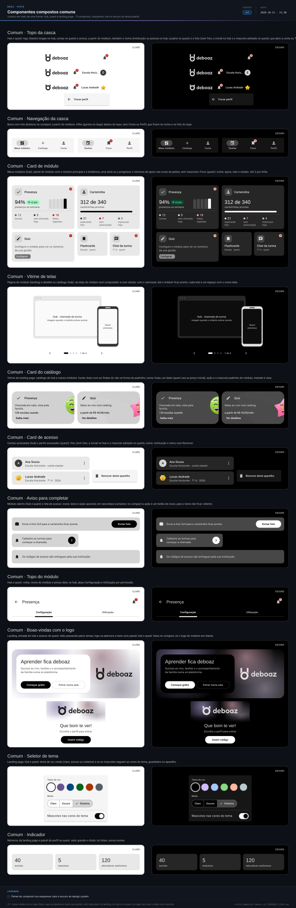

> **boaz · Funcionalidade** · `10_componentes-compostos-comuns` · **v24** · 2026-11-05 12:34 · **Aprovado**

# Componentes compostos · comuns

**Objetivo:** definir os componentes compostos usados por mais de uma frente — hub, quest e landing page — para que as telas das UIs sejam montadas com os mesmos blocos.

---

<a id="cenarios"></a>

## Cenários

<a id="sequencia-das-telas"></a>

### Sequência das telas

```gherkin
Cenário: de onde vêm os compostos
  Dado as blueprints da UX base (07 a 09)
  Então os compostos (10) juntam componentes e identidade do design system
  E as UIs (11 a 13) montam as telas só com estes compostos e com o design system
```

<a id="RF-41"></a>

### `RF-41` Topo da casca

```gherkin
Cenário: hub
  Dado a conta da Escola Horizonte com duas notificações não lidas
  Quando a pessoa abre qualquer tela do hub
  Então o topo mostra o logo de hastes longas, o selo 2 nos avisos, "Escola Horizonte" e a foto
  E o título da tela aparece só no destino ativo da navegação

Cenário: hub no celular
  Dado o hub numa janela compact
  Então o topo mostra só o logo e os avisos, e a conta abre pelo destino Conta

Cenário: quest
  Dado o perfil de Lucas aberto no quest numa janela medium
  Quando toca no nome ou na foto do topo
  Então vê a ação "Trocar perfil"
```

<a id="RF-42"></a>

### `RF-42` Navegação da casca

```gherkin
Cenário: destino com novidades
  Dado cinco mensagens não lidas num módulo da Carteira do quest
  Então o destino Carteira mostra o selo 5

Cenário: subníveis no compact
  Dado o hub numa janela compact em Módulos
  Então as abas primárias "Contratados", "Da conta" e "A contratar" aparecem logo abaixo do topo

Cenário: barra lateral
  Dado o hub numa janela medium
  Então a barra lateral mostra Módulos aberto com os três subníveis, Feed e Conta, sem abas
  E a conta abre também pelo nome e pela foto do topo

Cenário: barra encolhida
  Dado o quest numa janela expanded com cinco notificações na Carteira
  Quando o estudante toca no botão de encolher, no alto da barra lateral
  Então a barra fica só com os ícones de Tarefas, Feed, Carteira e Perfil, com o selo 5 na Carteira
```

<a id="RF-43"></a>

### `RF-43` Card de módulo

```gherkin
Cenário: módulo esperando configuração
  Dado um módulo recém-contratado
  Então o card mostra o nome do módulo, "Configure para ver as métricas" e o estado "Configurar"

Cenário: métrica na capa
  Dado a Presença com 94% de presença na semana
  Então o card mostra "94%", "presença na semana" e as últimas semanas no gráfico

Cenário: menu do card ao ordenar
  Dado o card da Presença na normal, ao ordenar
  Quando a pessoa escolhe "Reduzida" no menu do card
  Então o card passa a ocupar 2 × 2 células, só com o ícone, o nome e o dado macro

Cenário: mínima
  Quando a pessoa escolhe "Mínima" no menu do card da Presença
  Então o card passa a ocupar 1 célula, só com o ícone e o selo
```

<a id="RF-44"></a>

### `RF-44` Card do catálogo

```gherkin
Cenário: vitrine da landing page
  Dado um módulo usado por 120 escolas
  Então o card mostra "120 escolas usando" e a ação "Saiba mais"
  E o mascote padrinho do módulo pela metade, sem preço
  E as Ondas do vão saem do padrinho, na forma dele
```

<a id="RF-45"></a>

### `RF-45` Card de acesso

```gherkin
Cenário: remover de um aparelho compartilhado
  Dado o card de um perfil acessado
  Quando a pessoa abre o menu do card
  Então vê a ação "Remover deste aparelho"
```

<a id="RF-46"></a>

### `RF-46` Aviso para completar

```gherkin
Cenário: carteirinha sem foto
  Dado um módulo que pede a foto do estudante
  Então o aviso mostra o pedido em texto e a ação "Enviar foto"

Cenário: compact
  Dado uma janela compact
  Então a ação do aviso é um botão de ícone com o rótulo "Enviar foto" para o leitor de tela
  E o texto aparece inteiro
```

<a id="RF-47"></a>

### `RF-47` Topo do módulo

```gherkin
Cenário: pessoa delegada
  Dado uma pessoa que só usa o módulo
  Então o topo do módulo não mostra as abas
```

<a id="RF-48"></a>

### `RF-48` Boas-vindas com o logo

```gherkin
Cenário: acesso do quest
  Dado o quest aberto
  Então as boas-vindas mostram o logo do quest, de hastes curtas
  E o logo se monta uma vez sobre o fundo Halo
  E nenhum mascote aparece nas boas-vindas

Cenário: apresentação da landing page
  Dado a landing page aberta
  Então as boas-vindas mostram o logo de hastes longas
  E o título, a frase e as ações num painel de superfície
```

<a id="RF-49"></a>

### `RF-49` Seletor de tema

```gherkin
Cenário: tema escolhido
  Dado o seletor de tema aberto
  Quando a pessoa escolhe um tema de cor e o modo escuro
  Então a amostra escolhida fica marcada e o modo Escuro selecionado

Cenário: mascotes fora do tema
  Dado o tema Roxo escolhido
  Quando a pessoa desliga "Mascotes nas cores do tema"
  Então cada mascote volta à cor da sua expressão
```

<a id="RF-50"></a>

### `RF-50` Indicador

```gherkin
Cenário: números da landing page
  Dado 40 escolas usando o deboaz
  Então o indicador mostra 40 e o rótulo "escolas"
```

<a id="RF-101"></a>

### `RF-101` Vitrine de telas

```gherkin
Cenário: módulo ainda sem imagens
  Dado um módulo publicado sem as imagens das telas
  Então a vitrine mostra o computador e o celular com o nome de cada tela
  E "imagem quando o módulo estiver pronto"

Cenário: módulo pronto
  Dado um módulo com quatro telas
  Então a vitrine mostra a primeira e o carrossel "1 de 4"
```

<a id="RN-106"></a>

### `RN-106` Quando é comum

```gherkin
Esquema do Cenário: onde o composto fica
  Quando o composto <composto> é usado <uso>
  Então fica em <documento>

  Exemplos:
    | composto           | uso               | documento                   |
    | card de módulo     | no hub e no quest | Comuns                      |
    | simulador de custo | só no hub         | Componentes compostos · hub |
```

<a id="RN-107"></a>

### `RN-107` Só o design system

```gherkin
Cenário: falta um componente
  Dado um composto que precisa de um carrossel
  Quando o design system não tem carrossel
  Então o carrossel entra antes no design system
```

<a id="RN-108"></a>

### `RN-108` O que é do módulo

```gherkin
Cenário: card de módulo da Presença
  Então o ícone, o nome, o dado e o estado do card da Presença vêm do documento da Presença
```

<a id="RN-109"></a>

### `RN-109` Mudança de anatomia

```gherkin
Cenário: selo muda de lugar
  Quando o time muda o selo do card de módulo de lugar
  Então este documento, o catálogo do design system e a vista ganham versão nova
  E só depois a mudança chega às UIs
```

<a id="RN-113"></a>

### `RN-113` Topo sem título repetido

```gherkin
Cenário: destino Módulos
  Quando a conta master abre Módulos
  Então o topo da casca não mostra "Módulos"
  E o destino ativo na navegação indica a tela
```

<a id="RN-114"></a>

### `RN-114` Nome longo no topo

```gherkin
Cenário: nome que não cabe
  Dado a conta "Escola Estadual de Ensino Fundamental Bento Freitas" no compact
  Então o nome é cortado com reticências
  E o logo e os avisos continuam no lugar
```

<a id="RN-119"></a>

### `RN-119` Mascote padrinho

```gherkin
Cenário: padrinho do Quiz
  Dado o Quiz com o padrinho "acertou" em forma de estrela, no documento do Quiz
  Então o mascote aparece no card do catálogo e no destaque
```

<a id="RN-212"></a>

### `RN-212` Subníveis da casca

```gherkin
Esquema do Cenário: subníveis por janela
  Quando a conta master abre Módulos na janela <janela>
  Então Contratados, Da conta e A contratar aparecem <como>

  Exemplos:
    | janela  | como                                                  |
    | compact | como abas primárias logo abaixo do topo               |
    | medium  | recuados dentro de Módulos na barra lateral, sem abas |

Cenário: destino sem subníveis
  Quando a conta master abre Conta
  Então não aparecem abas nem seta de abrir
```

<a id="RNF-142"></a>

### `RNF-142` Composto no design system

```gherkin
Cenário: referência e desenho
  Dado o composto card de módulo
  Então ele está no catálogo do design system em "#compostos"
  E desenhado no tema.svg, nos esquemas claro e escuro
```

<a id="RNF-143"></a>

### `RNF-143` Sem rolagem horizontal

```gherkin
Cenário: janela de 360dp
  Quando qualquer composto aparece numa janela de 360dp
  Então não há rolagem horizontal
```

<a id="RNF-144"></a>

### `RNF-144` Selo no leitor de tela

```gherkin
Cenário: selo com 3
  Dado o card do SAC com o selo "3"
  Então o leitor de tela lê "SAC, 3 notificações"
```

<a id="fora-de-escopo"></a>

### Fora de escopo

```gherkin
Cenário: o que este documento não trata
  Então os compostos de uma só frente ficam nos documentos da landing page, do hub e do quest
  E as telas montadas ficam nas UIs (11, 12 e 13)
  E o conteúdo de cada módulo fica nos documentos dos módulos
```

---

<a id="telas"></a>

## Telas

**Componentes compostos comuns** — `2_Diagramas/vista-compostos-comuns_v11_20261021-2138.svg`

[](../2_Diagramas/vista-compostos-comuns_v11_20261021-2138.svg)

---

<a id="historico"></a>

## Histórico

| Versão | Data | Mudança |
|---|---|---|
| **v24** | 2026-11-05 12:34 | Formato `.md`: migrado de `.html` sem mudar cenários, telas nem diagramas; links entre documentos apontam para `.md` |
| v23 | 2026-11-03 22:11 | Aprovado, sem pendências em aberto |
| v22 | 2026-11-01 18:22 | Só Gherkin, telas e diagramas: contexto, tabelas de RF, RN e RNF e fora de escopo viram cenários (mesmos IDs como âncora); vista em Telas; status → Em revisão |
| v21 | 2026-11-01 01:00 | Aprovação |
| v20 | 2026-10-31 23:30 | Card de módulo com célula de 76dp ou mais, no mínimo 4 colunas e quantas couberem na janela, com o card do mesmo tamanho em qualquer janela (`RF-43`); design system v42 |
| v19 | 2026-10-31 22:55 | Card de módulo em quatro tamanhos de células quadradas (largura × altura): mínima 1x1, reduzida 2x2, normal 4x4 (o padrão) e expandida 4x8, numa grade de 4 colunas no compact e no medium e 8 a partir do expanded, com Mínima no menu do card (`RF-43`); design system v41 |
| v18 | 2026-10-31 22:18 | Card de módulo em três tamanhos, reduzida, normal e expandida, com o menu do card ao ordenar (`RF-43`); botão de encolher a barra lateral, que fica só com os ícones (`RF-42`); design system v40 |
| v17 | 2026-10-31 18:44 | Navegação da casca com barra lateral em acordeão a partir do medium, no lugar do trilho e da gaveta (`RF-42`); subníveis em abas primárias no compact e dentro do destino na barra lateral (`RN-212`) |
| v16 | 2026-10-31 16:46 | Critério de `RF-42`: destino Carteira e trilho com Módulos e Feed |
| v15 | 2026-10-21 22:12 | `RF-48` alterado: boas-vindas com o logo (fundo Halo, logo na abertura, brilhos passando pelos temas coloridos, texto num painel, sem mascotes) na landing page, no hub e no quest, no lugar das boas-vindas com mascote e da turma; vista v11; na entrada do hub e no acesso do quest, a partir do medium, só o logo centralizado; status → Aprovado |

---

<sub>boaz · v24 · 2026-11-05 12:34 · `1_Requisitos/10_componentes-compostos-comuns.md`</sub>
