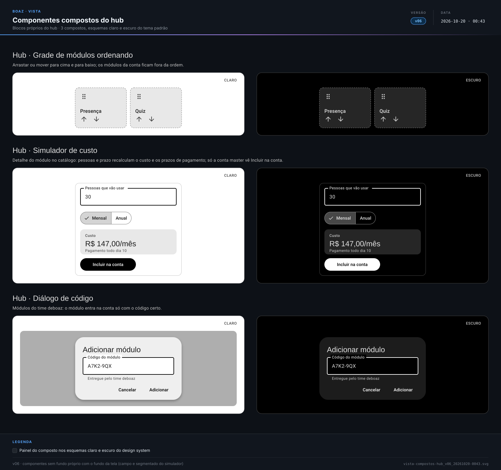

> **boaz · Funcionalidade** · `10_componentes-compostos-hub` · **v11** · 2026-11-05 12:34 · **Aprovado**

# Componentes compostos · hub

**Objetivo:** definir os componentes compostos próprios do hub, que a UI do hub usa junto com os compostos comuns.

---

<a id="cenarios"></a>

## Cenários

<a id="RF-58"></a>

### `RF-58` Grade de módulos ordenando

```gherkin
Cenário: ordenar sem arrastar
  Dado a grade em ordenação
  Quando a pessoa toca em mover para baixo no primeiro card
  Então ele passa a ser o segundo
```

<a id="RF-59"></a>

### `RF-59` Simulador de custo

```gherkin
Cenário: trocar o prazo
  Dado o simulador com 30 pessoas e prazo mensal
  Quando a conta master escolhe "Anual"
  Então o custo e os prazos de pagamento mudam na mesma tela
```

<a id="RF-60"></a>

### `RF-60` Diálogo de código

```gherkin
Cenário: código que não confere
  Dado o diálogo de código aberto
  Quando a pessoa informa um código errado e toca em "Adicionar"
  Então o campo mostra em texto que o código não confere
```

<a id="RN-111"></a>

### `RN-111` Incluir na conta só para a conta master

```gherkin
Esquema do Cenário: simulador por pessoa
  Quando <quem> abre o simulador de custo da Presença
  Então <resultado>

  Exemplos:
    | quem           | resultado                         |
    | a conta master | vê Incluir na conta               |
    | a staff Maria  | só consulta, sem Incluir na conta |
```

<a id="RNF-146"></a>

### `RNF-146` Ordenar pelo teclado

```gherkin
Cenário: mover sem arrastar
  Dado a grade de módulos ordenando
  Quando a conta master leva o foco ao card da Presença com Tab e escolhe "Mover para cima"
  Então a Presença sobe uma posição, sem arrastar
```

<a id="fora-de-escopo"></a>

### Fora de escopo

```gherkin
Cenário: o que este documento não trata
  Então as regras de preço, contratação e código ficam no Hub · UX base e nos módulos
  E as telas montadas ficam na UI do hub (12)
```

---

<a id="telas"></a>

## Telas

**Componentes compostos do hub** — `2_Diagramas/vista-compostos-hub_v06_20261020-0043.svg`

[](../2_Diagramas/vista-compostos-hub_v06_20261020-0043.svg)

---

<a id="historico"></a>

## Histórico

| Versão | Data | Mudança |
|---|---|---|
| **v11** | 2026-11-05 12:34 | Formato `.md`: migrado de `.html` sem mudar cenários, telas nem diagramas; links entre documentos apontam para `.md` |
| v10 | 2026-11-03 22:11 | Aprovado, sem pendências em aberto |
| v09 | 2026-11-01 18:21 | Só Gherkin, telas e diagramas: contexto, tabelas de RF, RN e RNF e fora de escopo viram cenários (mesmos IDs como âncora); vista em Telas; status → Em revisão |
| v08 | 2026-10-20 01:57 | Status → Aprovado |
| v07 | 2026-10-20 00:43 | vista v06: componentes sem fundo próprio (campo outlined, botões outlined e de texto soltos na tela, botão segmentado, chip e controles do carrossel) ganham o fundo da tela, legíveis sobre a Estampa; status → Em revisão |
| v06 | 2026-10-19 03:07 | Status → Aprovado |
| v05 | 2026-10-19 03:04 | Vista v05: nome deboaz centralizado no símbolo e logo centralizado na barra |
| v04 | 2026-10-19 02:32 | Vista v04: logo na linha dos textos do topo |
| v03 | 2026-10-19 02:25 | Vista v03: logo de 40dp nos topos e no rodapé |
| v02 | 2026-10-19 02:17 | Vista v02: logo oficial nos topos e no rodapé e elementos sozinhos centralizados |

---

<sub>boaz · v11 · 2026-11-05 12:34 · `1_Requisitos/10_componentes-compostos-hub.md`</sub>
