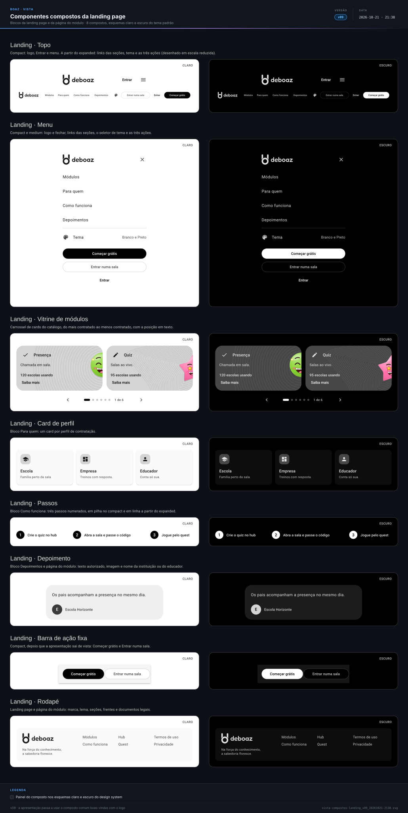

> **boaz · Funcionalidade** · `10_componentes-compostos-landing` · **v15** · 2026-11-05 12:34 · **Aprovado**

# Componentes compostos · landing page

**Objetivo:** definir os componentes compostos próprios da landing page e da página do módulo, que a UI da landing page usa junto com os compostos comuns.

---

<a id="cenarios"></a>

## Cenários

<a id="RF-51"></a>

### `RF-51` Topo da landing page

```gherkin
Cenário: celular
  Dado a landing page numa janela compact
  Então o topo mostra o logo, "Entrar" e o botão de menu
```

<a id="RF-72"></a>

### `RF-72` Menu da landing page

```gherkin
Cenário: menu aberto no celular
  Dado a landing page numa janela compact
  Quando o visitante toca no botão de menu
  Então vê os links Módulos, Para quem, Como funciona e Depoimentos, o item Tema e as três ações
```

<a id="RF-52"></a>

### `RF-52` Vitrine de módulos

```gherkin
Cenário: seis módulos
  Dado seis módulos publicados
  Então a vitrine mostra o primeiro card e a posição "1 de 6"
```

<a id="RF-53"></a>

### `RF-53` Card de perfil

```gherkin
Cenário: bloco Para quem
  Então o bloco mostra os cards Escola, Empresa e Educador autônomo
```

<a id="RF-55"></a>

### `RF-55` Depoimento

```gherkin
Cenário: depoimento autorizado
  Dado um depoimento autorizado da Escola Horizonte
  Então o card mostra o texto, a imagem e "Escola Horizonte"
```

<a id="RF-57"></a>

### `RF-57` Rodapé

```gherkin
Cenário: documentos legais
  Então o rodapé mostra os links "Termos de uso" e "Privacidade"
```

<a id="RF-54"></a>

### `RF-54` Passos

```gherkin
Esquema do Cenário: passos por janela
  Quando o bloco Como funciona abre na janela <janela>
  Então os passos numerados ficam <disposição>

  Exemplos:
    | janela   | disposição |
    | compact  | em pilha   |
    | expanded | em linha   |
```

<a id="RF-56"></a>

### `RF-56` Barra de ação fixa

```gherkin
Esquema do Cenário: barra fixa por janela
  Quando o visitante rola a landing page na janela <janela>
  Então <barra>

  Exemplos:
    | janela   | barra                                                 |
    | compact  | a barra fixa mostra Começar grátis e Entrar numa sala |
    | expanded | não há barra fixa                                     |
```

<a id="RN-110"></a>

### `RN-110` Carrossel só por ação

```gherkin
Cenário: carrossel parado
  Dado a vitrine de módulos aberta
  Quando o visitante fica 30 s sem tocar
  Então a vitrine continua na mesma página
  E só avança quando ele toca em próximo ou arrasta
```

<a id="RNF-145"></a>

### `RNF-145` Topo numa linha

```gherkin
Cenário: topo no expanded
  Quando a landing page abre na janela expanded
  Então o topo mostra todos os links e ações numa única linha, sem menu
```

<a id="fora-de-escopo"></a>

### Fora de escopo

```gherkin
Cenário: o que este documento não trata
  Então a ordem dos módulos e as regras dos depoimentos ficam na Landing page · UX base
  E as telas montadas ficam na UI da landing page (11)
```

---

<a id="telas"></a>

## Telas

**Componentes compostos da landing page** — `2_Diagramas/vista-compostos-landing_v09_20261021-2138.svg`

[](../2_Diagramas/vista-compostos-landing_v09_20261021-2138.svg)

---

<a id="historico"></a>

## Histórico

| Versão | Data | Mudança |
|---|---|---|
| **v15** | 2026-11-05 12:34 | Formato `.md`: migrado de `.html` sem mudar cenários, telas nem diagramas; links entre documentos apontam para `.md` |
| v14 | 2026-11-03 22:11 | Aprovado, sem pendências em aberto |
| v13 | 2026-11-01 18:21 | Só Gherkin, telas e diagramas: contexto, tabelas de RF, RN e RNF e fora de escopo viram cenários (mesmos IDs como âncora); vista em Telas; status → Em revisão |
| v12 | 2026-10-21 22:12 | A apresentação passa a usar as boas-vindas com o logo dos compostos comuns (comum `RF-48`); vista v09; status → Aprovado |
| v11 | 2026-10-20 01:57 | Status → Aprovado |
| v10 | 2026-10-20 00:43 | vista v08: componentes sem fundo próprio (campo outlined, botões outlined e de texto soltos na tela, botão segmentado, chip e controles do carrossel) ganham o fundo da tela, legíveis sobre a Estampa; status → Em revisão |
| v09 | 2026-10-19 04:35 | Status → Aprovado |
| v08 | 2026-10-19 04:24 | Vista v07: vitrine com o card de fundo cheio e o mascote padrinho de cada módulo |
| v07 | 2026-10-19 03:53 | `RF-72` incluído: menu da landing page; vista v06; status → Em revisão |
| v06 | 2026-10-19 03:07 | Status → Aprovado |

---

<sub>boaz · v15 · 2026-11-05 12:34 · `1_Requisitos/10_componentes-compostos-landing.md`</sub>
