> **boaz · Funcionalidade** · `10_componentes-compostos-quest` · **v11** · 2026-11-05 12:34 · **Aprovado**

# Componentes compostos · quest

**Objetivo:** definir os componentes compostos próprios do quest, que a UI do quest usa junto com os compostos comuns.

---

<a id="cenarios"></a>

## Cenários

<a id="RF-61"></a>

### `RF-61` Card de tarefa

```gherkin
Cenário: tarefa que vence hoje
  Dado uma tarefa de exercícios que vence hoje às 23:59
  Então o card mostra "Até 23:59 · vence hoje" e "Envio único · 0 de 1"
  E a borda e a hora em primary e o ponto em sucesso

Cenário: vencida com entrega aceita
  Dado uma tarefa que venceu ontem e cujo módulo aceita entrega depois do prazo
  Então o card mostra "Venceu 23:59 · entrega aceita" e "Até 3 envios · 1 de 3"
  E a borda e a hora em tertiary e o ponto em sucesso

Cenário: envios acabaram
  Dado um quiz de envio único já enviado
  Então o card mostra "Envio único · 1 de 1" e o ponto em erro

Cenário: bloqueada
  Dado uma leitura que só abre na sexta
  Então o card mostra "Abre 08:00 · bloqueada até sexta" e o ponto em erro
```

<a id="RF-98"></a>

### `RF-98` Acontecendo agora

```gherkin
Cenário: aula ao vivo
  Dado uma aula ao vivo das 14:00 às 14:50 e o relógio às 14:10
  Então o card mostra "Agora", a borda de 2dp e o Símbolo recortado com o mascote animado
  E com movimento reduzido o mascote fica parado
```

<a id="RF-99"></a>

### `RF-99` Card de desafio

```gherkin
Cenário: fora do pódio
  Dado o jogo Memória das frações, com Lucas em 8º lugar com 1.240 pontos
  Então o card mostra o pódio com Carla P., Ana S. e Davi R., o 4º e o 5º
  E a linha "8º · Você · 1.240" em destaque, as duas tentativas no gráfico e "Jogar de novo"

Cenário: novo envio
  Dado Lucas em 8º lugar
  Quando ele joga de novo e faz 1.990 pontos
  Então passa a aparecer no pódio, em 2º, com o bloco em destaque e "Você"

Cenário: pódio em festa
  Dado o card de desafio na tela
  Então o 1º comemora, pula e dança, o 2º dança e balança e o 3º pula e balança
  E com movimento reduzido os três ficam parados
```

<a id="RF-62"></a>

### `RF-62` Quem está acessando

```gherkin
Cenário: responsável
  Quando a pessoa escolhe "Sou responsável"
  Então aparece o botão segmentado do parentesco ("Mãe", "Pai" e "Outro") antes de "Entrar"
  E o segmentado ocupa a largura das opções
```

<a id="RN-112"></a>

### `RN-112` Parentesco só para o responsável

```gherkin
Esquema do Cenário: quem está acessando
  Quando a pessoa escolhe <opção>
  Então o parentesco <resultado>

  Exemplos:
    | opção           | resultado   |
    | Sou o estudante | não aparece |
    | Sou responsável | é pedido    |
```

<a id="RN-132"></a>

### `RN-132` Cores da agenda

```gherkin
Esquema do Cenário: cor do card de tarefa
  Dado a tarefa <situação>
  Então a borda e a hora ficam em <borda>
  E o ponto fica em <ponto>

  Exemplos:
    | situação                    | borda    | ponto   |
    | no prazo, aberta            | primary  | sucesso |
    | vencida, com entrega aceita | tertiary | sucesso |
    | vencida, sem entrega aceita | tertiary | erro    |
    | ainda não aberta            | primary  | erro    |
    | com os envios esgotados     | primary  | erro    |

Cenário: dia da agenda
  Então o dia da agenda fica em secondary
```

<a id="RN-135"></a>

### `RN-135` Ranking da tarefa

```gherkin
Cenário: melhor pontuação conta
  Dado o Lucas com envios de 70 e 90 pontos
  Então o ranking conta 90 para ele

Cenário: empate
  Dado a Ana e o Lucas com 90 pontos, a Ana primeiro
  Então a Ana fica à frente do Lucas

Cenário: o que o card mostra
  Dado o Lucas em 8º lugar
  Então o card mostra os 5 primeiros e "8º · Lucas A."
```

<a id="RNF-147"></a>

### `RNF-147` Vence hoje com texto

```gherkin
Cenário: destaque de hoje
  Dado uma tarefa que vence hoje
  Então o destaque usa cor e o texto "vence hoje", nunca só cor
```

<a id="RNF-158"></a>

### `RNF-158` Estado em texto

```gherkin
Cenário: tarefa bloqueada
  Dado uma tarefa com os envios esgotados
  Então o card mostra "bloqueada" em texto e o leitor de tela anuncia o mesmo

Cenário: movimento reduzido no card Agora
  Dado o aparelho com movimento reduzido
  Então o mascote do card Agora fica parado
```

<a id="RNF-159"></a>

### `RNF-159` Acessibilidade do desafio

```gherkin
Cenário: desafio para o leitor de tela
  Dado o Lucas em 4º com 820 pontos e tentativas de 600, 750 e 820
  Então a posição e os pontos aparecem em texto
  E o gráfico de tentativas é anunciado com "600, 750 e 820"
  E os mascotes do pódio são decorativos

Cenário: movimento reduzido no pódio
  Dado o aparelho com movimento reduzido
  Então os mascotes do pódio ficam parados
```

<a id="fora-de-escopo"></a>

### Fora de escopo

```gherkin
Cenário: o que este documento não trata
  Então as regras das tarefas e do código de acesso ficam no Quest · UX base e nos módulos
  E as telas montadas ficam na UI do quest (13)
```

---

<a id="telas"></a>

## Telas

**Componentes compostos do quest** — `2_Diagramas/vista-compostos-quest_v06_20261019-1945.svg`

[](../2_Diagramas/vista-compostos-quest_v06_20261019-1945.svg)

---

<a id="historico"></a>

## Histórico

| Versão | Data | Mudança |
|---|---|---|
| **v11** | 2026-11-05 12:34 | Formato `.md`: migrado de `.html` sem mudar cenários, telas nem diagramas; links entre documentos apontam para `.md` |
| v10 | 2026-11-03 22:11 | Aprovado, sem pendências em aberto |
| v09 | 2026-11-01 18:21 | Só Gherkin, telas e diagramas: contexto, tabelas de RF, RN e RNF e fora de escopo viram cenários (mesmos IDs como âncora); vista em Telas; status → Em revisão |
| v08 | 2026-10-20 01:57 | Status → Aprovado |
| v07 | 2026-10-20 00:43 | `RF-61` e `RF-62` alterados e `RF-98`, `RN-132` e `RNF-158` incluídos: agenda em calendário vertical, card de tarefa com estados por cor, ponto de acesso e acontecendo agora, parentesco e Entrar na largura toda; vista v06; status → Em revisão; envios possíveis e feitos no card de tarefa (`RF-61`, `RN-132`); `RF-99`, `RN-135` e `RNF-159` incluídos: card de desafio da tarefa sem prazo, com pódio de mascotes em forma de número, ranking da tarefa e gráfico de tentativas (o design system ganhou o gráfico de barras); vista v06 com três compostos; pódio em festa: mascotes felizes com movimento composto (`RF-99`, `RNF-159`); parentesco num botão segmentado cheio (`RF-62`); componentes sem fundo próprio (campo outlined, botões outlined e de texto soltos na tela, botão segmentado, chip e controles do carrossel) ganham o fundo da tela, legíveis sobre a Estampa |
| v06 | 2026-10-19 03:07 | Status → Aprovado |
| v05 | 2026-10-19 03:04 | Vista v05: nome deboaz centralizado no símbolo e logo centralizado na barra |
| v04 | 2026-10-19 02:32 | Vista v04: logo na linha dos textos do topo |
| v03 | 2026-10-19 02:25 | Vista v03: logo de 40dp nos topos e no rodapé |
| v02 | 2026-10-19 02:17 | Vista v02: logo oficial nos topos e no rodapé e elementos sozinhos centralizados |

---

<sub>boaz · v11 · 2026-11-05 12:34 · `1_Requisitos/10_componentes-compostos-quest.md`</sub>
