> **boaz · Funcionalidade** · `12_hub-ui` · **v34** · 2026-11-08 02:14 · **Em revisão**

# Hub · UI

**Objetivo:** definir como as telas do hub ficam no celular e na web — entrada, módulos (contratados, da conta e a contratar), feed, conta e módulo aberto — com os textos, os componentes compostos e o mascote de cada bloco.

---

<a id="cenarios"></a>

## Cenários

<a id="RF-75"></a>

### `RF-75` Entrada

```gherkin
Cenário: três contas no aparelho
  Dado três contas acessadas neste aparelho
  Quando a pessoa abre o hub
  Então vê o logo do hub se montando sobre o fundo Halo e "Que bom te ver!"
  E os três cards de conta e "Outra conta"
  E nenhum mascote aparece na entrada

Cenário: aparelho sem contas
  Dado um aparelho em que ninguém entrou no hub
  Quando a pessoa abre o hub
  Então vê "Que bom te ver!", "Entre ou crie a conta para começar", "Entrar" e "Criar conta"
  E nenhum card de conta
```

<a id="RF-76"></a>

### `RF-76` Entrar

```gherkin
Cenário: outra conta
  Quando a pessoa toca em "Outra conta"
  Então vê os campos "E-mail" e "Senha", "Entrar", "Esqueci a senha" e "Criar conta"
```

<a id="RF-77"></a>

### `RF-77` Criar conta

```gherkin
Cenário: tipo de conta
  Quando a pessoa abre Criar conta
  Então vê "Tipo de conta" com "Escola", "Empresa" e "Autônomo" na largura do formulário
  E o espaço do cadastro
  E a opção marcada preenche o segmento dela inteiro
```

<a id="RF-78"></a>

### `RF-78` Entrada na web

```gherkin
Cenário: janela expanded
  Dado o hub aberto numa janela expanded
  Então a entrada mostra só o logo, centralizado sobre o fundo Halo, e as contas acessadas ao lado
  E não mostra a barra do topo nem o painel "Que bom te ver!"
```

<a id="RF-79"></a>

### `RF-79` Abas de Módulos

```gherkin
Cenário: abas e carcaça dos cards
  Quando a conta master abre Módulos
  Então vê "Contratados" marcado, "Da conta" e "A contratar"
  E cada card mostra o ícone, o nome e as notificações do módulo, com o espaço do conteúdo
  E, ao tocar em "Da conta", vê SAC, Contas, Turmas, Usuários e Sugestão com a mesma carcaça
Cenário: recém-contratado
  Dado um módulo incluído na conta e ainda não configurado
  Então o card dele mostra "Configure o módulo para começar" e "Configurar" no espaço do conteúdo
Cenário: tamanhos na grade
  Dado Contratados com um card na normal, um na reduzida, quatro na mínima e um na expandida
  Quando a conta master abre Módulos no compact
  Então a normal ocupa a linha toda num quadrado
  E a reduzida, metade da linha num quadrado, com as quatro mínimas ao lado, duas a duas
  E a expandida ocupa a linha toda com o dobro da altura da normal
  E, no expanded, os cards têm o mesmo tamanho do compact
  E a normal e a expandida ficam lado a lado com mais cards ao lado
Cenário: rolagem
  Quando a conta master rola Contratados até a expandida
  Então o topo e as abas se escondem e a expandida aparece inteira acima da barra inferior
  E, ao rolar para cima, o topo e as abas voltam
```

<a id="RF-80"></a>

### `RF-80` Ordenação

```gherkin
Cenário: ordenar
  Quando a pessoa entra na ordenação
  Então vê "Ordenar módulos", "Concluir" e só os módulos contratados
Cenário: menu do card
  Dado o card da Presença na normal
  Quando a pessoa toca no menu do card
  Então vê "Mover para cima", "Mover para baixo" e "Mínima"
  E "Reduzida", "Normal" marcada e "Expandida"
```

<a id="RF-81"></a>

### `RF-81` Conta

```gherkin
Cenário: tema ativo
  Dado o tema Oceano escolhido
  Quando a pessoa abre Conta
  Então o item "Tema" mostra "Oceano"

Cenário: instituição
  Quando a conta master da Escola Horizonte abre Conta
  Então vê a inicial "E", "Escola Horizonte" e "Responsável · Ana Souza"

Cenário: Atualização dos cards fica na conta
  Dado a conta master com "Ao vivo" marcado em Conta, no notebook
  Quando entra no hub pelo celular
  Então "Atualização dos cards" mostra "Ao vivo" marcado
```

<a id="RF-82"></a>

### `RF-82` A contratar

```gherkin
Cenário: conta master
  Quando a conta master abre a aba "A contratar" de Módulos
  Então vê "Módulos para contratar" e o espaço dos cards da vitrine
  E o conteúdo de cada card vem do Catálogo (16_modulo-catalogo RF-164)
```

<a id="RF-83"></a>

### `RF-83` Detalhe do módulo

```gherkin
Cenário: abrir o detalhe
  Quando a conta master toca em "Ver detalhes" num card de A contratar
  Então vê a barra do topo com o nome do módulo e a navegação da casca
  E o espaço da vitrine do módulo, com o conteúdo do Catálogo (16_modulo-catalogo RF-165 a RF-167)
```

<a id="RF-84"></a>

### `RF-84` Módulo aberto

```gherkin
Cenário: falta configurar
  Dado um módulo ainda não configurado
  Quando a administração abre o módulo
  Então vê o aviso com "Configurar" acima do espaço do módulo

Cenário: compact
  Dado o hub numa janela compact
  Quando a administração abre um módulo ainda não configurado
  Então a ação do aviso é um botão de ícone e o texto do aviso aparece inteiro
```

<a id="RF-85"></a>

### `RF-85` Rótulos da navegação

```gherkin
Cenário: barra lateral
  Dado o hub numa janela medium
  Então a barra lateral mostra "Módulos" aberto com "Contratados", "Da conta" e "A contratar"
  E depois "Feed" e "Conta"
  E o topo, na largura toda, acima da barra lateral, mostra "Escola Horizonte" e a foto
  E o nome e a foto abrem a Conta
Cenário: barra encolhida
  Quando a pessoa toca no botão de encolher, no alto da barra lateral
  Então a barra mostra só os ícones de Módulos, Feed e Conta
  E o mesmo botão abre a barra de novo
Cenário: Feed
  Quando a pessoa toca em "Feed"
  Então vê o espaço reservado do Feed
  E o conteúdo do Feed fica no documento do módulo Feed

Cenário: conta do time deboaz
  Dado o administrador do deboaz no hub, numa janela expanded
  Então a barra lateral mostra só "Módulos" e "Conta"
```

<a id="RF-86"></a>

### `RF-86` Foto

```gherkin
Cenário: conta sem foto
  Dado uma instituição sem foto
  Quando a pessoa abre Conta
  Então vê a primeira letra do nome no lugar da foto, sem mascote

Cenário: enviar foto
  Quando a pessoa abre "Foto" e envia o logo da instituição
  Então o logo aparece no lugar da inicial no topo, em Conta e no card de acesso
  E segue para o deboaz convertido em SVG (15_modulos RN-260)
```

<a id="RN-120"></a>

### `RN-120` Dados de exemplo

```gherkin
Cenário: vistas com exemplo
  Quando alguém abre as vistas do hub
  Então instituição, pessoa, módulos, preços e números são exemplos
  E o hub mostra os dados reais, nas regras do Hub · UX base
```

<a id="RN-121"></a>

### `RN-121` Tema de cor

```gherkin
Cenário: hub no tema Oceano
  Dado o tema de cor Oceano ativo
  Então o logo usa as cores da marca do tema
  E os mascotes e as ações usam as cores do tema
```

<a id="RN-122"></a>

### `RN-122` Mudança exige versão

```gherkin
Cenário: texto novo na entrada
  Quando o time muda o título "Que bom te ver!"
  Então este documento e a vista ganham versão nova antes do código
```

<a id="RN-123"></a>

### `RN-123` Código depois da vista

```gherkin
Cenário: vista em revisão
  Dado a vista da entrada ainda sem aprovação no pull request
  Então o código da tela de entrada não começa
```

<a id="RN-124"></a>

### `RN-124` Topo do hub

```gherkin
Esquema do Cenário: topo por janela
  Dado a conta master no hub na janela <janela>
  Então o topo mostra <topo>
  E a Conta abre <como>

  Exemplos:
    | janela  | topo                               | como                                      |
    | compact | só o logo e os avisos              | pelo destino Conta da barra               |
    | medium  | o logo, os avisos, o nome e a foto | pelo nome, pela foto e pela barra lateral |
```

<a id="RN-125"></a>

### `RN-125` Foto ou inicial

```gherkin
Cenário: conta sem foto
  Dado a Escola Bento Freitas sem foto
  Então o hub mostra a letra "E" no lugar da foto, sem mascote
  E a escola é identificada pelo nome e por "Responsável · Ana Souza"

Cenário: o que identifica a conta
  Quando alguém vê o topo, a Conta ou o card de acesso da Escola Horizonte
  Então vê o nome "Escola Horizonte" e a foto ou a inicial "E"
```

<a id="RN-210"></a>

### `RN-210` Só a carcaça

```gherkin
Cenário: espaços reservados
  Quando alguém abre a vista Módulos
  Então o conteúdo dos cards e do Feed é espaço reservado
  E as telas de cada módulo ficam no documento do módulo

Cenário: de onde vem o conteúdo
  Dado um card de Contratados ou de Da conta
  Então o que ele mostra e de onde vem ficam no documento do módulo dele
  E este documento trata o card só de forma genérica
```

<a id="RN-138"></a>

### `RN-138` Fundo Estampa

```gherkin
Cenário: fundo das telas
  Quando a conta master abre qualquer tela do hub
  Então o fundo Estampa fica abaixo da barra do topo
  E as barras e as abas ficam limpas
  E o Halo da entrada e as Ondas do vão do catálogo ficam por cima
```

<a id="RNF-151"></a>

### `RNF-151` Títulos

```gherkin
Esquema do Cenário: papel tipográfico
  Quando a tela mostra <título>
  Então usa o papel <papel>

  Exemplos:
    | título             | papel          |
    | um título de seção | title-medium   |
    | um título de tela  | headline-small |

Cenário: tela interna
  Quando a conta master abre Dados da instituição
  Então o título fica no topo, com voltar
```

<a id="RNF-152"></a>

### `RNF-152` Colunas da entrada

```gherkin
Esquema do Cenário: colunas por janela
  Quando a entrada abre na janela <janela>
  Então mostra <colunas>

  Exemplos:
    | janela  | colunas                    |
    | compact | uma coluna                 |
    | medium  | duas: boas-vindas e contas |
```

<a id="RNF-153"></a>

### `RNF-153` Leitor de tela no card

```gherkin
Cenário: card com notificações
  Dado o card do SAC com 3 notificações
  Quando o leitor de tela passa pelo card
  Então anuncia "SAC, 3 notificações"
```

<a id="RNF-154"></a>

### `RNF-154` Acessibilidade da entrada

```gherkin
Cenário: Halo no compact
  Quando a entrada abre no compact
  Então o Halo atrás do logo some antes do título
  E nenhum texto fica sobre o desenho

Cenário: inicial decorativa
  Quando o leitor de tela passa pelo card da Escola Bento Freitas
  Então anuncia "Escola Bento Freitas" e ignora a inicial
```

<a id="fora-de-escopo"></a>

### Fora de escopo

```gherkin
Cenário: o que este documento não trata
  Então as telas e o conteúdo de cada módulo e os campos do cadastro ficam nos módulos
  E o conteúdo de cada publicação do Feed fica no módulo que publica
  E as telas do time deboaz ficam nos documentos dos módulos
  E a UI do quest fica em 13_quest-ui
```

---

<a id="telas"></a>

## Telas

### Web

**Hub · entrada · web · vista** — `2_Diagramas/vista-hub-entrada-web_v01_20261103-1435.svg`

[](../2_Diagramas/vista-hub-entrada-web_v01_20261103-1435.svg)

**Hub · módulos · web · vista** — `2_Diagramas/vista-hub-meus-modulos-web_v01_20261103-1435.svg`

[](../2_Diagramas/vista-hub-meus-modulos-web_v01_20261103-1435.svg)

**Hub · módulos · a contratar · web · vista** — `2_Diagramas/vista-hub-catalogo-web_v01_20261103-1435.svg`

[](../2_Diagramas/vista-hub-catalogo-web_v01_20261103-1435.svg)

**Hub · módulo aberto · web · vista** — `2_Diagramas/vista-hub-modulo-web_v01_20261103-1435.svg`

[](../2_Diagramas/vista-hub-modulo-web_v01_20261103-1435.svg)

### PWA

**Hub · entrada · pwa · vista** — `2_Diagramas/vista-hub-entrada-pwa_v01_20261103-1435.svg`

[](../2_Diagramas/vista-hub-entrada-pwa_v01_20261103-1435.svg)

**Hub · módulos · pwa · vista** — `2_Diagramas/vista-hub-meus-modulos-pwa_v02_20261103-2210.svg`

[](../2_Diagramas/vista-hub-meus-modulos-pwa_v02_20261103-2210.svg)

**Hub · módulos · a contratar · pwa · vista** — `2_Diagramas/vista-hub-catalogo-pwa_v01_20261103-1435.svg`

[](../2_Diagramas/vista-hub-catalogo-pwa_v01_20261103-1435.svg)

**Hub · módulo aberto · pwa · vista** — `2_Diagramas/vista-hub-modulo-pwa_v01_20261103-1435.svg`

[](../2_Diagramas/vista-hub-modulo-pwa_v01_20261103-1435.svg)

### Mobile

**Hub · entrada · mobile · vista** — `2_Diagramas/vista-hub-entrada-mobile_v01_20261103-1435.svg`

[](../2_Diagramas/vista-hub-entrada-mobile_v01_20261103-1435.svg)

**Hub · módulos · mobile · vista** — `2_Diagramas/vista-hub-meus-modulos-mobile_v02_20261103-2210.svg`

[](../2_Diagramas/vista-hub-meus-modulos-mobile_v02_20261103-2210.svg)

**Hub · módulos · a contratar · mobile · vista** — `2_Diagramas/vista-hub-catalogo-mobile_v01_20261103-1435.svg`

[](../2_Diagramas/vista-hub-catalogo-mobile_v01_20261103-1435.svg)

**Hub · módulo aberto · mobile · vista** — `2_Diagramas/vista-hub-modulo-mobile_v01_20261103-1435.svg`

[](../2_Diagramas/vista-hub-modulo-mobile_v01_20261103-1435.svg)

---

<a id="diagramas"></a>

## Diagramas

**Hub · casos de uso** — `2_Diagramas/hub-casos-de-uso_v02_20261103-2204.svg`

[](../2_Diagramas/hub-casos-de-uso_v02_20261103-2204.svg)

**Hub · carcaça · sequência com as telas** — `2_Diagramas/hub-sequencia_v02_20261103-2205.svg`

[](../2_Diagramas/hub-sequencia_v02_20261103-2205.svg)

**Entrada no hub · sequência (17_modulo-usuario-a)** — `2_Diagramas/autenticacao-sequencia_v03_20261103-1143.svg`

[](../2_Diagramas/autenticacao-sequencia_v03_20261103-1143.svg)

**Entrada no hub · contrato de API (17_modulo-usuario-a)** — `2_Diagramas/autenticacao-contrato-api_v02_20261101-2206.svg`

[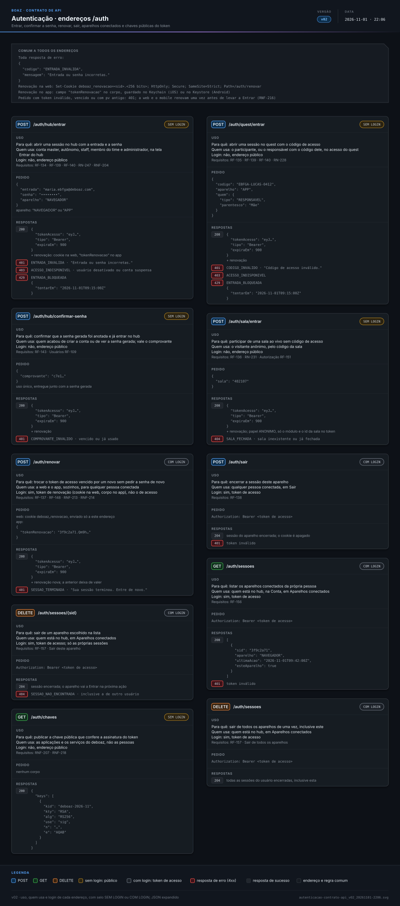](../2_Diagramas/autenticacao-contrato-api_v02_20261101-2206.svg)

**Criar conta · contrato de API (17_modulo-usuario)** — `2_Diagramas/usuarios-contrato-api_v08_20261108-0212.svg`

[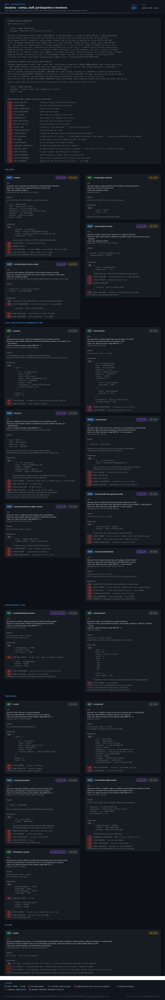](../2_Diagramas/usuarios-contrato-api_v08_20261108-0212.svg)

---

<a id="historico"></a>

## Histórico

| Versão | Data | Mudança |
|---|---|---|
| **v34** | 2026-11-08 02:14 | Diagrama: contrato de API dos usuários do 17 v07 → v08 (esqueci-senha-master auditado, 422 de corpo que não é JSON com DADOS_INVALIDOS) |
| v33 | 2026-11-08 02:04 | Diagrama: contrato de API dos usuários do 17 v06 → v07 (500 ERRO_INESPERADO confirmado, PUT permissões auditado) |
| v32 | 2026-11-08 02:00 | Diagrama: contrato de API dos usuários do 17 v05 → v06 (auditoria, X-Trace-Id); status → Em revisão |
| v31 | 2026-11-07 16:40 | Status → Aprovado, sem pendências em aberto |
| v30 | 2026-11-07 14:52 | Diagramas: contrato de API dos usuários (17_modulo-usuario) v04 → v05; status → Em revisão |
| v29 | 2026-11-05 12:34 | Formato `.md`: migrado de `.html` sem mudar cenários, telas nem diagramas; links entre documentos apontam para `.md` |
| v28 | 2026-11-03 22:11 | Vista de Módulos pwa e mobile v02, com o Feed definido no documento do módulo Feed; aprovado, sem pendências em aberto |
| v27 | 2026-11-03 22:05 | Em aberto respondido: conteúdo e contrato de cada card no documento do módulo (`RN-210`); Feed como espaço reservado do futuro módulo Feed (`RF-85`); conta identificada pelo nome da instituição e pela foto ou inicial (`RN-125`); foto enviada em SVG (`RF-86`, [15 RN-260](15_modulos.md#RN-260)); Atualização dos cards guardada na conta (`RF-81`); casos de uso e sequência v02 |
| v26 | 2026-11-03 14:39 | Telas separadas em Web, PWA e Mobile (vistas entrada, módulos, a contratar e módulo aberto v01); Diagramas: casos de uso e sequência com as telas da carcaça do hub, com a entrada e o sair do [17-a RF-134](17_modulo-usuario-a-autenticacao.md#RF-134), a criação da conta do [17 RF-104](17_modulo-usuario.md#RF-104) e a vitrine do 16 como referência; Em aberto: os contratos ainda não definidos dos cards de Módulos, do Feed, da conta, da foto e da Atualização dos cards |
| v25 | 2026-11-03 13:54 | A contratar e detalhe do módulo só com a carcaça (`RF-82`, `RF-83`, vista-hub-catalogo v09 e vista-hub-meus-modulos v13, sem desenhar outros módulos, nem no código do time): cards, carrossel, descrição, como funciona, quem usa, calculadora e Incluir na conta passam para o Catálogo ([16_modulo-catalogo `RF-164` a `RF-168`](16_modulo-catalogo.md#RF-164)) |
| v24 | 2026-11-01 18:21 | Só Gherkin, telas e diagramas: contexto, tabelas de RF, RN e RNF e fora de escopo viram cenários (mesmos IDs como âncora); vistas em Telas; status → Em revisão |
| v23 | 2026-11-01 03:57 | Aprovado |

---

<sub>boaz · v34 · 2026-11-08 02:14 · `1_Requisitos/12_hub-ui.md`</sub>
