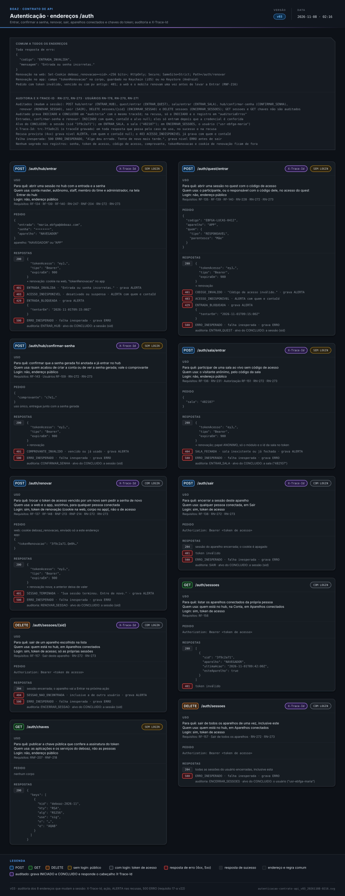

> **boaz · Funcionalidade** · `13_quest-ui` · **v22** · 2026-11-08 02:20 · **Em revisão**

# Quest · UI

**Objetivo:** definir como as telas do quest ficam no celular e na web — acesso, tarefas, feed, carteira, perfil e módulo aberto — com os textos, os componentes compostos e o mascote de cada bloco.

---

<a id="cenarios"></a>

## Cenários

<a id="RF-87"></a>

### `RF-87` Acesso

```gherkin
Cenário: dois perfis e um código do ano passado
  Dado o perfil de Lucas deste ano, o de Beatriz e o de Lucas do ano passado neste aparelho
  Quando a pessoa abre o quest
  Então vê o logo do quest se montando sobre o fundo Halo e "Que bom te ver!"
  E os três cards, "Inserir outro código" e "Entrar numa sala"
  E nenhum mascote aparece nas boas-vindas
```

<a id="RF-88"></a>

### `RF-88` Código de acesso

```gherkin
Cenário: inserir outro código
  Quando a pessoa toca em "Inserir outro código"
  Então vê o campo "Código de acesso", "Continuar" e "Esqueceu o código? Peça à sua instituição."
```

<a id="RF-89"></a>

### `RF-89` Quem está acessando

```gherkin
Cenário: responsável
  Dado um código de acesso válido
  Quando a pessoa toca em "Continuar"
  Então vê o perfil de Lucas, "Sou o estudante", "Sou responsável", o parentesco e "Entrar"
  E "Mãe", "Pai" e "Outro" ficam num botão segmentado na largura das opções
```

<a id="RF-90"></a>

### `RF-90` Acesso na web

```gherkin
Cenário: janela expanded
  Dado o quest aberto numa janela expanded
  Então o acesso mostra só o logo, centralizado sobre o fundo Halo, e os perfis ao lado
  E não mostra a barra do topo nem o painel "Que bom te ver!"
```

<a id="RF-91"></a>

### `RF-91` Tarefas

```gherkin
Cenário: espaço do módulo Tarefas
  Quando o estudante abre Tarefas
  Então vê o espaço reservado "Módulo Tarefas" com "telas definidas no documento do módulo"
  E Tarefas fica marcada na barra
```

<a id="RF-93"></a>

### `RF-93` Carteira

```gherkin
Cenário: módulo pede algo
  Dado um módulo da Carteira esperando a foto do estudante
  Quando o estudante abre a Carteira
  Então o card desse módulo mostra o selo 1 e "Completar"
Cenário: tamanhos
  Dado um card na normal, um na reduzida, quatro na mínima e um na expandida
  Quando o estudante abre a Carteira no compact
  Então a normal mostra "números e gráfico do módulo" num quadrado na linha toda
  E a reduzida mostra "dado macro" num quadrado na metade da linha
  E as quatro mínimas ficam ao lado, só com o ícone
  E a expandida mostra "painel completo do módulo" na linha toda, com o dobro da altura da normal
Cenário: rolagem
  Quando o estudante rola a Carteira até a expandida
  Então o topo se esconde e a expandida aparece inteira acima da barra inferior
```

<a id="RF-131"></a>

### `RF-131` Ordenar a Carteira

```gherkin
Cenário: menu do card
  Dado o estudante em Ordenar a Carteira
  Quando toca no menu de um card na normal
  Então vê "Mover para cima", "Mover para baixo" e "Mínima"
  E "Reduzida", "Normal" marcada e "Expandida"
Cenário: expanded
  Dado o quest numa janela expanded
  Quando o estudante abre Ordenar a Carteira
  Então a barra lateral aparece só com os ícones e a grade usa a largura liberada
```

<a id="RF-94"></a>

### `RF-94` Perfil

```gherkin
Cenário: trocar perfil no celular
  Dado um responsável no perfil de Lucas numa janela compact
  Quando abre Perfil e toca em "Trocar perfil"
  Então volta ao acesso com os perfis do aparelho

Cenário: Atualização dos cards fica no perfil
  Dado o Lucas com "Ao vivo" marcado em Perfil, no celular
  Quando entra no quest pelo computador da escola
  Então "Atualização dos cards" mostra "Ao vivo" marcado
```

<a id="RF-95"></a>

### `RF-95` Foto ou mascote

```gherkin
Cenário: perfil sem foto
  Dado um perfil que entrou pela primeira vez, sem foto
  Quando o estudante abre Perfil
  Então vê um mascote feliz no lugar da foto

Cenário: adotar outro mascote
  Quando o estudante abre "Foto ou mascote", escolhe a estrela e toca em "Usar este mascote"
  Então a estrela aparece no lugar da foto no topo, em Perfil e no card do acesso

Cenário: enviar uma foto
  Quando o estudante abre "Foto ou mascote" e envia uma foto
  Então a foto aparece no lugar do mascote no topo, em Perfil e no card do acesso
  E segue para o deboaz convertida em SVG (15_modulos RN-260)
```

<a id="RF-96"></a>

### `RF-96` Módulo aberto

```gherkin
Cenário: compact
  Dado o quest numa janela compact
  Dado um módulo que pede uma foto
  Quando o estudante abre o módulo
  Então vê o aviso "Envie a foto que o módulo pede para continuar." com um botão de ícone
  E o texto aparece inteiro
```

<a id="RF-97"></a>

### `RF-97` Navegação

```gherkin
Cenário: barra lateral
  Dado o quest numa janela medium com cinco notificações novas num módulo da Carteira
  Então a barra lateral mostra "Tarefas", "Feed", "Carteira" e "Perfil", com o selo 5 na Carteira
  E o topo, na largura toda, acima da barra lateral, mostra "Lucas Andrade" e a foto ou o mascote
  E o nome e a foto abrem o Perfil
Cenário: barra encolhida
  Quando o estudante toca no botão de encolher, no alto da barra lateral
  Então a barra mostra só os ícones dos quatro destinos, com o selo 5 na Carteira
Cenário: Feed
  Quando o estudante toca em "Feed"
  Então vê o espaço reservado do Feed
  E o conteúdo do Feed fica no documento do módulo Feed
```

<a id="RN-127"></a>

### `RN-127` Topo do quest

```gherkin
Esquema do Cenário: topo por janela
  Dado o Lucas no quest na janela <janela>
  Então o topo mostra <topo>
  E o Perfil abre <como>

  Exemplos:
    | janela  | topo                               | como                                      |
    | compact | só o logo e os avisos              | pelo destino da barra                     |
    | medium  | o logo, os avisos, o nome e a foto | pelo nome, pela foto e pela barra lateral |
```

<a id="RN-128"></a>

### `RN-128` Mascote no lugar da foto

```gherkin
Cenário: perfil sem foto
  Dado o Lucas sem foto
  Então um mascote feliz sorteado aparece no card do perfil, no topo e em Perfil
  E continua até ele enviar uma foto ou adotar outro mascote

Cenário: estudante menor de idade
  Dado o Lucas, de 12 anos, sem a autorização dos responsáveis
  Quando ele procura enviar a foto de perfil
  Então a foto segue a autorização dos responsáveis
  E a foto da carteirinha continua pedida pelo módulo dela
```

<a id="RN-261"></a>

### `RN-261` Quem aparece no perfil

```gherkin
Esquema do Cenário: estudante ou responsável
  Dado o perfil de Lucas Andrade, da Escola Horizonte, acessado por <quem>
  Quando alguém vê o topo, o Perfil ou o card do acesso
  Então vê <dados>
  E vê <imagem>

  Exemplos:
    | quem                       | dados                                                 | imagem                          |
    | o estudante                | "Lucas Andrade" e "Escola Horizonte"                  | a foto ou o mascote de Lucas    |
    | a responsável Ana Andrade  | "Lucas Andrade", "Escola Horizonte" e "Ana Andrade"   | as iniciais "AA", sem mascote   |
```

<a id="RN-139"></a>

### `RN-139` Fundo Estampa

```gherkin
Cenário: fundo das telas
  Quando o Lucas abre qualquer tela do quest
  Então o fundo Estampa fica abaixo da barra do topo, atrás dos cards
  E as barras ficam limpas e o Halo do acesso fica por cima
```

<a id="RN-130"></a>

### `RN-130` Dados de exemplo

```gherkin
Cenário: vistas com exemplo
  Quando alguém abre as vistas do quest
  Então pessoas, instituição, tarefas, módulos e números são exemplos
  E num tema de cor o quest segue a regra da landing page e do hub
```

<a id="RN-211"></a>

### `RN-211` Só a carcaça

```gherkin
Cenário: espaços reservados
  Quando alguém abre a vista da casca do quest
  Então Tarefas, Feed, os cards da Carteira e o painel do perfil são espaços reservados
  E as telas de cada módulo ficam no documento do módulo

Cenário: de onde vem o conteúdo
  Dado um card da Carteira ou o espaço de Tarefas
  Então o que ele mostra e de onde vem ficam no documento do módulo dele
  E este documento trata o card só de forma genérica
```

<a id="RN-131"></a>

### `RN-131` Mudança exige versão

```gherkin
Cenário: texto novo no acesso
  Quando o time muda o título "Que bom te ver!"
  Então este documento e a vista ganham versão nova
  E o código só muda depois da vista aprovada no pull request
```

<a id="RNF-156"></a>

### `RNF-156` Colunas

```gherkin
Esquema do Cenário: colunas do acesso
  Quando o acesso abre na janela <janela>
  Então mostra <colunas>

  Exemplos:
    | janela  | colunas                    |
    | compact | uma coluna                 |
    | medium  | duas: boas-vindas e perfis |

Cenário: grade da Carteira
  Então a Carteira tem células quadradas de 76dp ou mais e pelo menos 4 colunas
```

<a id="RNF-157"></a>

### `RNF-157` Acessibilidade do acesso

```gherkin
Cenário: Halo no compact
  Quando o acesso abre no compact
  Então o Halo atrás do logo some antes do título
  E nenhum texto fica sobre o desenho

Cenário: mascote decorativo
  Dado o Lucas com mascote no lugar da foto
  Quando o leitor de tela passa pelo card do perfil
  Então anuncia "Lucas Andrade" e ignora o mascote
```

<a id="fora-de-escopo"></a>

### Fora de escopo

```gherkin
Cenário: o que este documento não trata
  Então a sala do quiz fica no documento do módulo da sala
  E as telas e o conteúdo de cada módulo ficam nos documentos dos módulos
  E o conteúdo de cada publicação do Feed fica no módulo que publica
  E a geração e a entrega dos códigos de acesso ficam no Módulo Usuários
```

---

<a id="telas"></a>

## Telas

### Web

**Quest · acesso · web · vista** — `2_Diagramas/vista-quest-acesso-web_v01_20261103-1426.svg`

[](../2_Diagramas/vista-quest-acesso-web_v01_20261103-1426.svg)

**Quest · tarefas, feed, carteira e perfil · web · vista** — `2_Diagramas/vista-quest-casca-web_v01_20261103-1426.svg`

[](../2_Diagramas/vista-quest-casca-web_v01_20261103-1426.svg)

**Quest · módulo aberto · web · vista** — `2_Diagramas/vista-quest-modulo-web_v01_20261103-1426.svg`

[](../2_Diagramas/vista-quest-modulo-web_v01_20261103-1426.svg)

### PWA

**Quest · acesso · pwa · vista** — `2_Diagramas/vista-quest-acesso-pwa_v01_20261103-1426.svg`

[](../2_Diagramas/vista-quest-acesso-pwa_v01_20261103-1426.svg)

**Quest · tarefas, feed, carteira e perfil · pwa · vista** — `2_Diagramas/vista-quest-casca-pwa_v02_20261103-2210.svg`

[](../2_Diagramas/vista-quest-casca-pwa_v02_20261103-2210.svg)

**Quest · módulo aberto · pwa · vista** — `2_Diagramas/vista-quest-modulo-pwa_v01_20261103-1426.svg`

[](../2_Diagramas/vista-quest-modulo-pwa_v01_20261103-1426.svg)

### Mobile

**Quest · acesso · mobile · vista** — `2_Diagramas/vista-quest-acesso-mobile_v01_20261103-1426.svg`

[](../2_Diagramas/vista-quest-acesso-mobile_v01_20261103-1426.svg)

**Quest · tarefas, feed, carteira e perfil · mobile · vista** — `2_Diagramas/vista-quest-casca-mobile_v02_20261103-2210.svg`

[](../2_Diagramas/vista-quest-casca-mobile_v02_20261103-2210.svg)

**Quest · módulo aberto · mobile · vista** — `2_Diagramas/vista-quest-modulo-mobile_v01_20261103-1426.svg`

[](../2_Diagramas/vista-quest-modulo-mobile_v01_20261103-1426.svg)

---

<a id="diagramas"></a>

## Diagramas

**Quest · casos de uso** — `2_Diagramas/quest-casos-de-uso_v02_20261103-2204.svg`

[](../2_Diagramas/quest-casos-de-uso_v02_20261103-2204.svg)

**Quest · carcaça · sequência com as telas** — `2_Diagramas/quest-sequencia_v02_20261103-2205.svg`

[](../2_Diagramas/quest-sequencia_v02_20261103-2205.svg)

**Entrada no quest · sequência (17_modulo-usuario-a)** — `2_Diagramas/autenticacao-sequencia_v04_20261108-0216.svg`

[](../2_Diagramas/autenticacao-sequencia_v04_20261108-0216.svg)

**Entrada no quest · contrato de API (17_modulo-usuario-a)** — `2_Diagramas/autenticacao-contrato-api_v03_20261108-0216.svg`

[](../2_Diagramas/autenticacao-contrato-api_v03_20261108-0216.svg)

---

<a id="historico"></a>

## Histórico

| Versão | Data | Mudança |
|---|---|---|
| **v22** | 2026-11-08 02:20 | Diagramas da autenticação do 17-a: contrato de API v02 → v03 e sequência v03 → v04 (auditoria das entradas e sessões, X-Trace-Id, recusas como ALERTA, 500 ERRO_INESPERADO); status → Em revisão |
| v21 | 2026-11-05 12:34 | Formato `.md`: migrado de `.html` sem mudar cenários, telas nem diagramas; links entre documentos apontam para `.md` |
| v20 | 2026-11-03 22:11 | Vista da casca pwa e mobile v02, com o Feed definido no documento do módulo Feed e o perfil pela responsável (`RN-261`); aprovado, sem pendências em aberto |
| v19 | 2026-11-03 22:05 | Em aberto respondido: conteúdo e contrato de cada card no documento do módulo (`RN-211`); Feed como espaço reservado do futuro módulo Feed (`RF-97`); quem aparece no perfil: nome do estudante e instituição, com o nome do responsável quando é ele, foto ou mascote do estudante e iniciais do responsável (`RN-261`); foto enviada em SVG (`RF-95`, [15 RN-260](15_modulos.md#RN-260)); Atualização dos cards guardada no perfil (`RF-94`); casos de uso e sequência v02 |
| v18 | 2026-11-03 14:35 | Telas separadas em Web, PWA e Mobile (vistas acesso, casca e módulo v01); Diagramas: casos de uso e sequência com as telas da carcaça do quest, com a entrada do [17-a RF-135](17_modulo-usuario-a-autenticacao.md#RF-135) como referência; Em aberto: os contratos ainda não definidos do perfil, da foto ou mascote, da Carteira, do Feed e da Atualização dos cards |
| v17 | 2026-11-01 18:20 | Só Gherkin, telas e diagramas: contexto, tabelas de RF, RN e RNF e fora de escopo viram cenários (mesmos IDs como âncora); vistas em Telas; status → Em revisão |
| v16 | 2026-11-01 01:20 | Aprovação |
| v15 | 2026-11-01 01:14 | Feed com as publicações dos módulos para o participante (`RF-97`, 09 RN-222) |
| v14 | 2026-11-01 01:00 | Aprovação |
| v13 | 2026-11-01 00:43 | Vista da casca v08: item Atualização dos cards no Perfil, com Na abertura e Ao vivo (`RF-94`) ([15 RF-133](15_modulos.md#RF-133)) |
| v12 | 2026-10-31 23:30 | Carteira com célula de 76dp ou mais, no mínimo 4 colunas e quantas couberem na janela, com o card do mesmo tamanho em qualquer janela, e rolagem com o topo escondido (`RF-93`, `RNF-156`); vista da casca v07 |

---

<sub>boaz · v22 · 2026-11-08 02:20 · `1_Requisitos/13_quest-ui.md`</sub>
