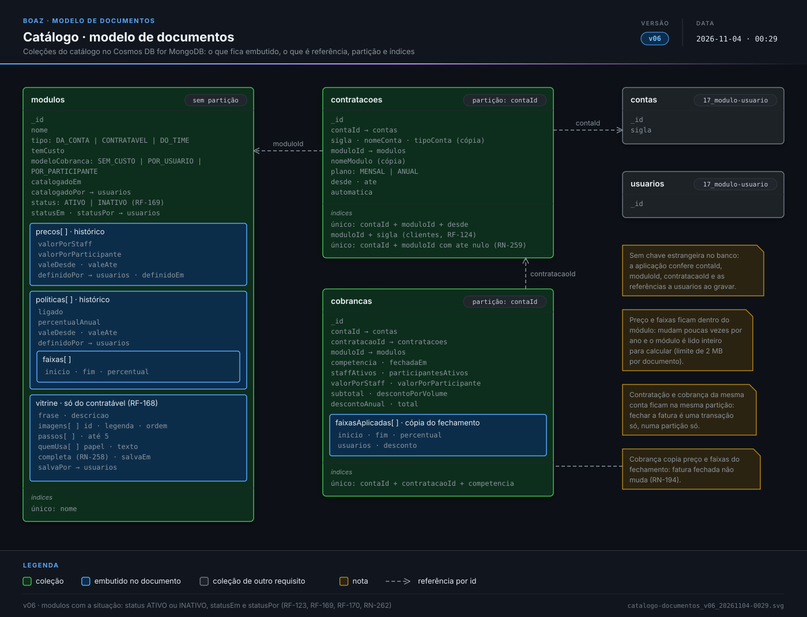

> **boaz · Funcionalidade** · `16_modulo-catalogo` · **v29** · 2026-11-08 23:16 · **Em revisão**

# Catálogo

**Objetivo:** catalogar, só na conta do time deboaz, todo módulo do deboaz, com nome, tipo, custo, precificação e as instituições e os educadores autônomos que o contrataram, começando pelo preço do módulo Usuários, cobrado por staff e por participante, e a vitrine de cada módulo contratável, que a instituição e o educador autônomo veem em A contratar, simulam e incluem na conta.

---

<a id="cenarios-tela"></a>

## Cenários de tela

<a id="exemplo-receita"></a>

### Exemplo de receita

```gherkin
Esquema do Cenário: receita do módulo Usuários por perfil de conta
  Dado staff a R$ 19,90 e participante a R$ 4,90 por mês
  E as faixas de 0% (1 a 100), 5% (101 a 300), 10% (301 a 1.000), 15% (até 3.000) e 20%
  Quando <contas> contas de <perfil> têm <staff> staff e <part> participantes
  Então cada uma tem desconto de <desconto> e paga <mês> por mês
  E o perfil soma <total> por mês

  Exemplos:
    | perfil                | contas | staff | part  | desconto  | mês         | total        |
    | escola pequena        | 50     | 15    | 135   | R$ 16,00  | R$ 944,00   | R$ 47.200,00 |
    | escola média, a EBFGA | 36     | 40    | 312   | R$ 100,39 | R$ 2.224,41 | R$ 80.078,76 |
    | escola grande         | 10     | 80    | 1.120 | R$ 649,00 | R$ 6.431,00 | R$ 64.310,00 |
    | educador autônomo     | 32     | 0     | 60    | R$ 0,00   | R$ 294,00   | R$ 9.408,00  |

Cenário: receita total
  Quando as 128 contas da lista Contas fecham o mês
  Então o módulo Usuários rende R$ 200.996,76 por mês
  E R$ 2.411.961,12 por ano no plano mensal
  E esses preços e faixas são exemplo: os valores são configuração do administrador
```

<a id="RF-116"></a>

### `RF-116` Card do Catálogo

```gherkin
Cenário: administrador vê o resumo do catálogo
  Dado o administrador do deboaz em Módulos
  Quando a tela abre
  Então vê o card "Catálogo" com a receita prevista no mês e as barras dos últimos 5 meses
  E 7 módulos da conta, 5 contratáveis e 2 do time
  E 7 com custo e 7 sem custo

Cenário: conta de instituição
  Dado a conta master da Escola Bento Freitas em Módulos
  Quando a tela abre
  Então não vê o card "Catálogo"
```

<a id="RF-117"></a>

### `RF-117` Lista do catálogo

```gherkin
Cenário: módulos da conta
  Dado o Catálogo aberto em "Da conta"
  Quando a lista aparece
  Então vê os módulos da conta de A a Z, cada um no seu espaço da lista
  E cada espaço mostra o nome, o tipo, o custo e em quantas contas está

Cenário: buscar um módulo
  Dado o Catálogo aberto
  Quando o administrador busca parte do nome de um módulo
  Então vê só os módulos com esse nome, cada um no seu tipo
```

<a id="RF-118"></a>

### `RF-118` Preço do módulo Usuários

```gherkin
Cenário: preço novo
  Dado o administrador do deboaz na aba Preço do módulo Usuários, com R$ 18,90 por staff e R$ 4,50 por participante
  Quando informa "R$ 19,90" por staff e "R$ 4,90" por participante
  E toca em "Salvar preço"
  Então o preço novo vale desde esse momento
  E o anterior vai para o histórico com o período em que valeu

Cenário: membro do time sem permissão
  Dado um membro do time deboaz que não é o administrador
  Quando abre a aba Preço
  Então vê os valores sem poder salvar
```

<a id="RF-119"></a>

### `RF-119` Faixas de desconto

```gherkin
Cenário: faixa com buraco
  Dado as faixas "1 a 100" e "101 a 300"
  Quando o administrador cria a faixa "350 a 1.000"
  Então o sistema recusa e avisa que falta a faixa de 301 a 349

Cenário: percentual menor que o da faixa anterior
  Dado a faixa "101 a 300" com 5%
  Quando o administrador põe 3% na faixa "301 a 1.000"
  Então o sistema recusa e pede um percentual de 5% ou mais

Cenário: desconto desligado
  Dado o desconto por volume desligado
  Quando a fatura de uma conta com 352 usuários fecha
  Então o desconto é R$ 0,00

Cenário: um usuário a mais nunca baixa a conta
  Dado as faixas de exemplo e o preço de R$ 19,90 por staff e R$ 4,90 por participante
  Quando uma conta com 40 staff passa de 260 para 261 participantes
  Então o valor do mês passa de R$ 2.001,00 para R$ 2.005,28
```

<a id="RF-120"></a>

### `RF-120` Simulação

```gherkin
Cenário: escola média
  Dado o preço de R$ 19,90 por staff e R$ 4,90 por participante
  E as faixas de exemplo e o plano anual com 15%
  Quando o administrador simula 40 staff e 312 participantes
  Então vê R$ 796,00 de staff, R$ 1.528,80 de participantes e subtotal R$ 2.324,80
  E desconto por volume de R$ 100,39: 0% em 100 usuários, 5% em 200 e 10% em 52
  E total de R$ 2.224,41 no mês, R$ 26.692,92 em 12 meses e R$ 22.688,98 no plano anual
  E nada é salvo
```

<a id="RF-122"></a>

### `RF-122` Histórico de preços

```gherkin
Cenário: ver quem mudou
  Dado preços que valeram de 01/08 a 31/10/2026 e desde 01/11/2026
  Quando o administrador abre a aba Preço do módulo Usuários
  Então vê cada período com os valores e o nome de quem mudou
```

<a id="RF-123"></a>

### `RF-123` Catalogar um módulo

```gherkin
Cenário: botão Catalogar módulo
  Dado o administrador do deboaz no Catálogo
  E o módulo Usuários (MOD-03) registrado e ainda não catalogado
  Quando toca no botão flutuante "Catalogar módulo"
  Então vê "Catalogar módulo" com as abas Dados, Preço, Desconto e Vitrine
  E, em Dados, o campo "Módulo" lista só os módulos registrados e ainda não catalogados

Cenário: Dados do módulo
  Quando escolhe o módulo "Usuários", o tipo "Da conta", "Com custo"
  E a precificação "Por staff e por participante, ao mês"
  Então a aba Preço pede o valor por staff e o valor por participante

Esquema do Cenário: aba Preço conforme a precificação
  Dado a precificação <precificação> em Dados
  Então <preço>

  Exemplos:
    | precificação                           | preço                                                                     |
    | "Por staff e por participante, ao mês" | a aba Preço pede o valor por staff e o por participante  |
    | "Por participante, ao mês"             | a aba Preço pede só o valor por participante             |
    | "Sem custo"                            | as abas Preço e Desconto somem e nenhum valor é pedido   |

Cenário: catalogar o Usuários
  Dado Dados, Preço, Desconto e Vitrine do Usuários preenchidos
  Quando o administrador toca em "Catalogar"
  Então o Usuários entra no Catálogo com a situação "Ativo"
  E a regra dele já vale desde esse momento

Cenário: dados do módulo catalogado
  Dado o administrador do deboaz no módulo "Usuários" do catálogo
  Quando abre a aba Dados
  Então vê a situação "Ativo", o tipo "Da conta", "Com custo" e o preço de hoje
  E a precificação "Por staff e por participante, ao mês"
```

<a id="RF-124"></a>

### `RF-124` Clientes do módulo

```gherkin
Cenário: instituições que contrataram
  Dado o módulo "Usuários" com 96 instituições e 32 educadores autônomos
  Quando o administrador abre a aba Clientes em "Instituições"
  Então vê 96 siglas de A a Z, como "CLARR" e "EBFGA", com o nome, a data de início e o estado

Cenário: buscar um autônomo
  Dado a aba Clientes em "Autônomos"
  Quando o administrador busca "marina"
  Então vê "MRNCS · Marina Costa"
```

<a id="RF-125"></a>

### `RF-125` Plano anual

```gherkin
Cenário: escola no plano anual
  Dado o plano anual do módulo Usuários com 15%
  E a Escola Bento Freitas no plano anual, com 40 staff e 312 participantes no fechamento
  Quando a fatura do mês fecha
  Então o total é R$ 2.224,41 menos 15%, ou seja, R$ 1.890,75
```

<a id="RF-164"></a>

### `RF-164` Vitrine em A contratar

```gherkin
Cenário: cards da vitrine
  Dado a conta master da EBFGA sem um módulo contratável com preço valendo
  Quando abre a aba A contratar de Módulos
  Então vê o card do módulo com o nome, a frase da vitrine, "R$ 4,90 por participante/mês" e "Ver detalhes"
  E o nome, a frase e o preço do card vêm do Catálogo

Cenário: vitrine incompleta
  Dado um módulo contratável com preço valendo e a vitrine sem descrição
  Quando a conta master abre A contratar
  Então o módulo não aparece
```

<a id="RF-165"></a>

### `RF-165` Detalhe do módulo

```gherkin
Cenário: conhecer o módulo
  Dado a conta master em A contratar
  Quando toca em "Ver detalhes" no card de um módulo
  Então vê o carrossel com as imagens do módulo, a posição "1 de 4" e as setas
  E a descrição, "Como funciona" em passos numerados e "Quem usa" com cada papel e o que ele faz
  E a calculadora de preço e "Incluir na conta"

Cenário: staff consulta
  Dado a staff Maria em A contratar
  Quando abre o detalhe do mesmo módulo
  Então vê a vitrine e a calculadora, sem "Incluir na conta" (08_hub-ux RN-77)
```

<a id="RF-166"></a>

### `RF-166` Calculadora de preço

```gherkin
Cenário: plano mensal
  Dado um módulo cobrado por participante, a R$ 4,90, com as faixas de exemplo
  Quando a conta master informa 30 participantes e escolhe "Mensal"
  Então vê R$ 147,00 por mês

Cenário: plano anual
  Dado a mesma calculadora com 30 participantes e o plano anual com 15%
  Quando escolhe "Anual"
  Então vê R$ 1.764,00 em 12 meses e R$ 1.499,40 no plano anual
  E nada é salvo

Cenário: cobrado por staff e participante
  Dado um módulo cobrado por usuário
  Quando o detalhe abre
  Então a calculadora pede staff e participantes, como a simulação do Catálogo (RF-120)
```

<a id="RF-167"></a>

### `RF-167` Incluir na conta

```gherkin
Cenário: contratar no plano mensal
  Dado a conta master da EBFGA no detalhe de um módulo, com 30 participantes e "Mensal"
  Quando toca em "Incluir na conta"
  Então vê o diálogo com o nome do módulo, o plano e o custo estimado de R$ 147,00 por mês
  E ao tocar em "Incluir" o módulo entra em Contratados com o aviso "Configurar" (08_hub-ux RF-25)
  E sai de A contratar
  E entra na fatura do mês, com a contagem do fechamento (RN-195)

Cenário: contratar no plano anual
  Dado "Anual" escolhido na calculadora
  Quando a conta master inclui o módulo
  Então a contratação fica no plano anual por 12 meses (RN-201)

Cenário: desistir
  Dado o diálogo de incluir aberto
  Quando a conta master toca em "Cancelar"
  Então nada muda e o detalhe continua aberto
```

<a id="RF-168"></a>

### `RF-168` Vitrine no Catálogo

```gherkin
Cenário: editar a vitrine
  Dado o administrador do deboaz na aba Vitrine de um módulo contratável
  Quando informa a frase, a descrição, 3 passos, 3 papéis em "Quem usa" e 4 imagens
  E toca em "Salvar vitrine"
  Então A contratar mostra a vitrine nova
  E a aba mostra quem salvou e quando

Cenário: membro do time sem permissão
  Dado um membro do time deboaz que não é o administrador
  Quando abre a aba Vitrine
  Então vê a vitrine sem poder salvar

Cenário: adicionar uma imagem
  Dado o administrador do deboaz na aba Vitrine
  Quando escolhe uma imagem PNG do computador
  Então a aba converte a imagem em SVG antes de enviar (15_modulos RN-260)
  E a imagem aparece na lista da vitrine, na próxima posição
```

<a id="RF-169"></a>

### `RF-169` Ativar e desativar

```gherkin
Cenário: desativar um módulo
  Dado um módulo contratável "Ativo" com a vitrine completa
  Quando o administrador do deboaz toca em "Desativar módulo" na aba Dados
  E confirma em "Desativar" no diálogo "Desativar o módulo?"
  Então o módulo fica "Inativo" no Catálogo
  E sai de A contratar no hub das instituições e dos autônomos, sem nova contratação

Cenário: contas que já têm o módulo
  Dado a EBFGA com o módulo contratado
  Quando o administrador desativa o módulo
  Então a EBFGA continua usando o módulo
  E continua pagando por ele, como antes

Cenário: ativar de novo
  Dado o mesmo módulo "Inativo"
  Quando o administrador toca em "Ativar módulo" na aba Dados
  Então o módulo fica "Ativo" e volta a A contratar
```

<a id="RF-170"></a>

### `RF-170` Situação no Catálogo

```gherkin
Cenário: ao abrir o Catálogo
  Quando o administrador do deboaz abre o Catálogo
  Então cada módulo da lista mostra a situação "Ativo" ou "Inativo"
  E o botão flutuante "Catalogar módulo" fica no canto de baixo

Cenário: membro do time
  Quando o membro do time Caio abre o Catálogo
  Então vê a situação de cada módulo
  E não vê "Catalogar módulo", "Desativar módulo" nem "Ativar módulo"

Cenário: nada para catalogar
  Dado todos os módulos registrados já catalogados
  Quando o administrador toca em "Catalogar módulo"
  Então o campo "Módulo" mostra "Nenhum módulo para catalogar"
```

<a id="RN-191"></a>

### `RN-191` Só o administrador muda preços

```gherkin
Esquema do Cenário: quem salva
  Quando <quem> abre o Catálogo
  Então <pode>

  Exemplos:
    | quem                      | pode                               |
    | o administrador do deboaz | catalogar e salvar preços e faixas |
    | o membro do time Caio     | ver e simular, sem salvar          |
```

<a id="RN-192"></a>

### `RN-192` Desconto progressivo

```gherkin
Cenário: cada faixa vale só para os seus usuários
  Dado 40 staff e 312 participantes, subtotal R$ 2.324,80
  Quando o desconto por volume é calculado
  Então 100 usuários têm 0%, 200 têm 5% e 52 têm 10%
  E o desconto é R$ 2.324,80 × (100×0% + 200×5% + 52×10%) ÷ 352 = R$ 100,39

Cenário: um usuário a mais nunca baixa a conta
  Quando uma conta com 40 staff passa de 260 para 261 participantes
  Então o valor do mês passa de R$ 2.001,00 para R$ 2.005,28
```

<a id="RN-193"></a>

### `RN-193` Regras das faixas

```gherkin
Esquema do Cenário: faixa recusada
  Dado as faixas "1 a 100" com 0% e "101 a 300" com 5%
  Quando o administrador cria <faixa>
  Então o sistema recusa porque <motivo>

  Exemplos:
    | faixa                 | motivo                        |
    | "350 a 1.000" com 10% | falta a faixa de 301 a 349    |
    | "250 a 1.000" com 10% | sobrepõe a faixa 101 a 300    |
    | "301 a 1.000" com 3%  | é menor que os 5% da anterior |
    | "301 a 1.000" com 55% | passa de 50%                  |

Cenário: primeira e última faixa
  Então a primeira faixa começa em 1 usuário
  E a última faixa não tem fim
```

<a id="RN-194"></a>

### `RN-194` Vale ao salvar

```gherkin
Cenário: preço e desconto valem ao salvar
  Dado hoje 03/11/2026
  Quando o administrador salva um preço novo ou um desconto novo
  Então ele vale desde 03/11/2026, sem data para escolher
  E o anterior fica no histórico, valendo até 02/11/2026

Cenário: fatura fechada não muda
  Dado a fatura de outubro da EBFGA fechada
  Quando o administrador salva um preço novo em 03/11/2026
  Então a fatura de outubro continua igual
  E a fatura de novembro, que fecha depois, usa o preço novo
```

<a id="RN-195"></a>

### `RN-195` Quem é contado

```gherkin
Esquema do Cenário: contagem no fechamento
  Dado a EBFGA no dia do fechamento da fatura
  Quando existe <quem>
  Então <conta>

  Exemplos:
    | quem                                       | conta                        |
    | um staff ativo                             | conta inteiro                |
    | um staff ativo ainda sem o primeiro acesso | conta inteiro                |
    | um staff criado no dia 10                  | conta inteiro, sem proporção |
    | um staff desativado no dia 20              | não conta                    |
    | a conta master                             | não conta                    |
    | um acesso anônimo de sala                  | não conta                    |

Cenário: autônomo e time deboaz
  Então o educador autônomo paga só participantes
  E a conta do time deboaz não paga
```

<a id="RN-196"></a>

### `RN-196` Arredondamento

```gherkin
Cenário: meio centavo para cima, só no fim
  Quando o desconto calculado é R$ 100,385
  Então o desconto é R$ 100,39
  E os valores intermediários não são arredondados
```

<a id="RN-197"></a>

### `RN-197` Todo módulo catalogado

```gherkin
Cenário: módulo fora do catálogo
  Dado o módulo "Agenda" ainda não catalogado
  Então ele não aparece na vitrine do hub
  E não entra em conta nenhuma
```

<a id="RN-199"></a>

### `RN-199` Sem custo e com custo

```gherkin
Esquema do Cenário: valores pelo custo
  Dado o módulo <módulo> <situação>
  Então <resultado>

  Exemplos:
    | módulo   | situação  | resultado                                                     |
    | "Perfil" | sem custo | não pede valores, não tem preço nem desconto e não é cobrado  |
    | "Quiz"   | com custo | tem sempre os valores da precificação, declarados ao catalogar |
```

<a id="RN-257"></a>

### `RN-257` Custo igual em todos os contratos

```gherkin
Cenário: módulo passa a ter custo
  Dado um módulo sem custo contratado por 96 instituições e 32 autônomos
  Quando o administrador marca "Com custo" e salva
  Então as 128 contratações passam a ter custo
  E o administrador declara os valores da precificação ao salvar
  E elas pagam esses valores a partir da fatura que ainda não fechou

Cenário: módulo deixa de ter custo
  Dado um módulo com custo contratado por 128 contas
  Quando o administrador marca "Sem custo" e salva
  Então nenhuma das 128 contas paga por ele na fatura que ainda não fechou
  E as faturas já fechadas não mudam
```

<a id="RN-200"></a>

### `RN-200` Catálogo só no time

```gherkin
Cenário: o Catálogo não é contratável
  Quando a conta master da EBFGA abre a vitrine
  Então não vê o Catálogo
  E o Catálogo é do time, sem custo
```

<a id="RN-201"></a>

### `RN-201` Plano anual

```gherkin
Cenário: desconto anual depois do volume
  Dado o plano anual de 15% e a EBFGA no plano anual
  Quando a fatura do mês fecha com 40 staff e 312 participantes
  Então o total é R$ 2.224,41 menos 15%, R$ 1.890,75
  E a contagem segue o fechamento de cada mês dos 12 assumidos
```

<a id="RN-258"></a>

### `RN-258` Vitrine completa

```gherkin
Esquema do Cenário: o que leva o módulo a A contratar
  Dado um módulo contratável <situação>
  Então <resultado>

  Exemplos:
    | situação                                          | resultado                    |
    | ativo, com frase, descrição, imagem, passo e papel | aparece em A contratar       |
    | ativo e sem imagem                                | não aparece em A contratar   |
    | inativo (RF-169)                                  | não aparece em A contratar   |
    | da conta ou do time                               | nunca aparece em A contratar |

Cenário: limites da vitrine
  Então a vitrine tem de 1 a 5 imagens, de 1 a 5 passos e de 1 a 4 papéis em "Quem usa"
  E a frase e a descrição têm até 500 caracteres cada
```

<a id="RN-259"></a>

### `RN-259` Uma contratação por módulo

```gherkin
Cenário: módulo já contratado
  Dado a EBFGA com um módulo contratado
  Quando a conta master abre A contratar
  Então esse módulo não aparece
  E a conta tem uma só contratação ativa de cada módulo
```

<a id="RN-263"></a>

### `RN-263` Configuração mínima

```gherkin
Esquema do Cenário: o que falta para catalogar
  Dado o administrador em "Catalogar módulo" com <falta>
  Quando toca em "Catalogar"
  Então a aba <aba> abre com o aviso <aviso>
  E o módulo continua fora do Catálogo

  Exemplos:
    | falta                                  | aba      | aviso                                 |
    | nenhum módulo escolhido                | Dados    | "Escolha o módulo."                   |
    | com custo e sem o valor por staff      | Preço    | "Informe o valor por staff."          |
    | sem a frase da vitrine                 | Vitrine  | "Informe a frase."                    |
    | sem papel em "Quem usa"                | Vitrine  | "Informe quem configura."             |

Cenário: o que é a configuração mínima
  Então catalogar pede Dados (módulo, tipo, custo e precificação)
  E, com custo, Preço (os valores da precificação)
  E, com custo, Desconto (faixas ou o desconto por volume desligado e o desconto do plano anual)
  E, sem custo, nenhum valor
  E Vitrine (frase, descrição, imagens, como funciona e quem usa: Configura, Usa e Acompanha)
```

<a id="RN-264"></a>

### `RN-264` Só o administrador do deboaz catalogar

```gherkin
Esquema do Cenário: quem catalogar, ativa e desativa
  Quando <quem> abre o Catálogo
  Então <pode>

  Exemplos:
    | quem                                         | pode                                          |
    | o administrador do deboaz, na conta principal | catalogar, ativar e desativar módulos         |
    | o membro do time Caio, com o Catálogo        | ver a situação, sem catalogar nem desativar   |
    | a conta master da EBFGA                      | não abre o Catálogo                           |
```

<a id="ficha-mod-14"></a>

### Ficha do módulo Catálogo

```gherkin
Esquema do Cenário: card do Catálogo por tamanho
  Dado o administrador em Módulos
  Quando o card Catálogo está <tamanho>
  Então mostra <dados>

  Exemplos:
    | tamanho       | dados                                                                          |
    | mínima 1x1    | o ícone loja                                                                   |
    | reduzida 2x2  | R$ 201k · receita prevista                                                     |
    | normal 4x4    | R$ 200.996,76, "+4,1% no mês", 5 meses em barras e os tipos                    |
    | expandida 4x8 | o mesmo da normal, os 5 meses com valores e Com custo e Sem custo              |

Cenário: membro do time
  Quando o Caio vê o card Catálogo
  Então vê os mesmos números, sem selo, e só a aba Utilização

Cenário: sem dados
  Dado nenhum módulo catalogado
  Então o administrador vê "Catalogue o primeiro módulo" e Configurar
  E o Caio vê "Nenhum módulo catalogado ainda", sem ação

Cenário: rótulo falado
  Quando o leitor de tela lê o card na reduzida
  Então diz "Catálogo, receita prevista de 201 mil reais"
```

<a id="RNF-210"></a>

### `RNF-210` Mesmo valor em todo lugar

```gherkin
Esquema do Cenário: simulação, Contas e fatura iguais
  Quando a conta tem <staff> staff e <part> participantes
  Então a simulação, o módulo Contas e a fatura mostram <mês>

  Exemplos:
    | staff | part  | mês         |
    | 15    | 135   | R$ 944,00   |
    | 40    | 312   | R$ 2.224,41 |
    | 80    | 1.120 | R$ 6.431,00 |
    | 0     | 60    | R$ 294,00   |
```

<a id="RNF-211"></a>

### `RNF-211` Registro de preços

```gherkin
Cenário: mudança registrada
  Quando o administrador muda o valor por staff de R$ 18,90 para R$ 19,90
  Então o registro guarda quem mudou, quando, R$ 18,90 e R$ 19,90
  E ninguém consegue alterar nem apagar o registro
```

<a id="RNF-212"></a>

### `RNF-212` Simulação rápida

```gherkin
Cenário: total em até 1 s
  Quando o administrador muda os participantes da simulação de 312 para 313
  Então o novo total aparece em até 1 segundo
```

---

<a id="cenarios-api"></a>

## Cenários de API

<a id="formato-comum"></a>

### Formato comum

```gherkin
Cenário: resposta de erro
  Quando um pedido ao Catálogo é recusado
  Então o corpo traz o código, a mensagem e, quando houver, o campo:
    """
    {
      "codigo": "DADOS_INVALIDOS",
      "mensagem": "O campo \"valorPorStaff\" está faltando ou é inválido.",
      "campo": "valorPorStaff"
    }
    """

Cenário: dinheiro, datas e módulo
  Então todo valor em reais é um número com 2 casas, como 19.90
  E toda data segue a ISO 8601, como "2026-12-01"
  E o módulo vai no endereço pelo id do registro de módulos, como "MOD-03"

Cenário: módulo fora do registro
  Quando o administrador envia GET /catalogo/modulos/MOD-99
  Então a resposta é 404 MODULO_INEXISTENTE com a mensagem "Módulo não encontrado."
```

<a id="RF-116-api"></a>

### `RF-116` Resumo do catálogo

```gherkin
Cenário: administrador lê o resumo
  Dado o administrador do deboaz com o token de acesso
  Quando envia GET /catalogo/resumo
  Então a resposta é 200 com:
    """
    {
      "competencia": "2026-12",
      "receitaPrevista": 200996.76,
      "ultimosMeses": [
        {
          "competencia": "2026-08",
          "receita": 171204.35
        },
        {
          "competencia": "2026-09",
          "receita": 178950.12
        },
        {
          "competencia": "2026-10",
          "receita": 186311.04
        },
        {
          "competencia": "2026-11",
          "receita": 193118.75
        },
        {
          "competencia": "2026-12",
          "receita": 200996.76
        }
      ],
      "modulos": {
        "daConta": 7,
        "contratavel": 5,
        "doTime": 2
      },
      "comCusto": 7,
      "semCusto": 7
    }
    """

Cenário: conta de instituição
  Quando a conta master da EBFGA envia GET /catalogo/resumo
  Então a resposta é 403 ACESSO_NEGADO
```

<a id="RF-117-api"></a>

### `RF-117` Lista do catálogo

```gherkin
Cenário: módulos da conta
  Quando o administrador envia GET /catalogo/modulos?tipo=DA_CONTA
  Então a resposta é 200 com os módulos da conta de A a Z, entre eles:
    """
    {
      "id": "MOD-03",
      "nome": "Usuários",
      "tipo": "DA_CONTA",
      "temCusto": true,
      "modeloCobranca": "POR_USUARIO",
      "status": "ATIVO",
      "contas": 128
    }
    """

Cenário: buscar um módulo
  Quando o administrador envia GET /catalogo/modulos?busca=pres
  Então a resposta é 200 só com o item "MOD-06", "Presença", do tipo "CONTRATAVEL"

Cenário: tipo fora da lista
  Quando o administrador envia GET /catalogo/modulos?tipo=OUTRO
  Então a resposta é 422 DADOS_INVALIDOS com o campo "tipo"
```

<a id="RF-118-api"></a>

### `RF-118` Salvar preço

```gherkin
Cenário: preço novo
  Dado hoje 2026-11-03 e o preço de 18.90 por staff e 4.50 por participante desde 2026-11-01
  Quando o administrador envia POST /catalogo/modulos/MOD-03/precos com:
    """
    {
      "valorPorStaff": 19.90,
      "valorPorParticipante": 4.90
    }
    """
  Então a resposta é 201 com:
    """
    {
      "valorPorStaff": 19.90,
      "valorPorParticipante": 4.90,
      "valeDesde": "2026-11-03",
      "valeAte": null,
      "anteriorValeAte": "2026-11-02"
    }
    """

Cenário: valor zero
  Quando o administrador envia o mesmo pedido com valorPorStaff 0
  Então a resposta é 422 DADOS_INVALIDOS com o campo "valorPorStaff"
  E o preço não muda
```

<a id="RF-119-api"></a>

### `RF-119` Salvar o desconto

```gherkin
Cenário: faixas de exemplo
  Quando o administrador envia PUT /catalogo/modulos/MOD-03/desconto com:
    """
    {
      "ligado": true,
      "percentualAnual": 15,
      "faixas": [
        {
          "inicio": 1,
          "fim": 100,
          "percentual": 0
        },
        {
          "inicio": 101,
          "fim": 300,
          "percentual": 5
        },
        {
          "inicio": 301,
          "fim": 1000,
          "percentual": 10
        },
        {
          "inicio": 1001,
          "fim": 3000,
          "percentual": 15
        },
        {
          "inicio": 3001,
          "fim": null,
          "percentual": 20
        }
      ]
    }
    """
  Então a resposta é 200 com a política salva, igual à de GET /catalogo/modulos/MOD-03/desconto

Cenário: desconto desligado
  Dado o desconto por volume do módulo Usuários desligado
  Quando um membro do time envia POST /catalogo/modulos/MOD-03/simulacao com 40 staff e 312 participantes
  Então a resposta é 200 com descontoPorVolume 0.00 e totalMes 2324.80
```

<a id="RF-120-api"></a>

### `RF-120` Simulação

```gherkin
Cenário: escola média
  Dado o preço de 19.90 por staff e 4.90 por participante, que vale hoje
  E as faixas de exemplo e o plano anual com 15%
  Quando um membro do time envia POST /catalogo/modulos/MOD-03/simulacao com:
    """
    {
      "staff": 40,
      "participantes": 312
    }
    """
  Então a resposta é 200 com:
    """
    {
      "staff": {
        "quantidade": 40,
        "valor": 796.00
      },
      "participantes": {
        "quantidade": 312,
        "valor": 1528.80
      },
      "subtotal": 2324.80,
      "faixas": [
        {
          "inicio": 1,
          "fim": 100,
          "percentual": 0,
          "usuarios": 100,
          "desconto": 0.00
        },
        {
          "inicio": 101,
          "fim": 300,
          "percentual": 5,
          "usuarios": 200,
          "desconto": 66.05
        },
        {
          "inicio": 301,
          "fim": 1000,
          "percentual": 10,
          "usuarios": 52,
          "desconto": 34.34
        }
      ],
      "descontoPorVolume": 100.39,
      "totalMes": 2224.41,
      "total12Meses": 26692.92,
      "totalPlanoAnual": 22688.98
    }
    """
  E nada é gravado

Cenário: número negativo
  Quando envia a simulação com participantes -1
  Então a resposta é 422 DADOS_INVALIDOS com o campo "participantes"
```

<a id="RF-122-api"></a>

### `RF-122` Histórico de preços

```gherkin
Cenário: preços do mais novo para o mais antigo
  Quando um membro do time envia GET /catalogo/modulos/MOD-03/precos
  Então a resposta é 200 com:
    """
    {
      "precos": [
        {
          "valorPorStaff": 19.90,
          "valorPorParticipante": 4.90,
          "valeDesde": "2026-11-03",
          "valeAte": null,
          "definidoPor": "Administrador do deboaz",
          "definidoEm": "2026-11-03T14:00:00Z"
        },
        {
          "valorPorStaff": 18.90,
          "valorPorParticipante": 4.50,
          "valeDesde": "2026-11-01",
          "valeAte": "2026-11-02",
          "definidoPor": "Administrador do deboaz",
          "definidoEm": "2026-11-01T09:30:00Z"
        }
      ]
    }
    """
```

<a id="RF-123-api"></a>

### `RF-123` Catalogar um módulo

```gherkin
Cenário: módulos para catalogar
  Dado o MOD-03 registrado e ainda não catalogado
  Quando o administrador envia GET /catalogo/modulos/nao-catalogados
  Então a resposta é 200 com:
    """
    [
      {
        "id": "MOD-03",
        "nome": "Usuários"
      }
    ]
    """

Cenário: catalogar o Usuários
  Dado hoje 2026-11-04 e o MOD-03 registrado e ainda não catalogado
  E a imagem "img-MOD-03-1" enviada antes pela aba Vitrine
  Quando o administrador envia POST /catalogo/modulos com:
    """
    {
      "moduloId": "MOD-03",
      "tipo": "DA_CONTA",
      "temCusto": true,
      "modeloCobranca": "POR_USUARIO",
      "preco": {
        "valorPorStaff": 19.90,
        "valorPorParticipante": 4.90
      },
      "desconto": {
        "ligado": true,
        "faixas": [
          {
            "inicio": 1,
            "fim": 100,
            "percentual": 0
          },
          {
            "inicio": 101,
            "fim": null,
            "percentual": 5
          }
        ],
        "percentualAnual": 15
      },
      "vitrine": {
        "frase": "Frase curta da vitrine.",
        "descricao": "Descrição do módulo na vitrine.",
        "imagens": [
          "img-MOD-03-1"
        ],
        "passos": [
          "Primeiro passo",
          "Segundo passo",
          "Terceiro passo"
        ],
        "quemUsa": [
          {
            "papel": "Configura",
            "texto": "Quem prepara o módulo"
          },
          {
            "papel": "Usa",
            "texto": "Quem usa no dia a dia"
          },
          {
            "papel": "Acompanha",
            "texto": "Quem acompanha os resultados"
          }
        ]
      }
    }
    """
  Então a resposta é 201 com:
    """
    {
      "id": "MOD-03",
      "nome": "Usuários",
      "status": "ATIVO",
      "statusEm": "2026-11-04T10:00:00Z",
      "catalogadoEm": "2026-11-04T10:00:00Z",
      "catalogadoPor": {
        "id": "usr-dboaz-admin",
        "nome": "Administrador do deboaz"
      }
    }
    """
  E o MOD-03 sai de GET /catalogo/modulos/nao-catalogados

Cenário: módulo já catalogado
  Quando o administrador envia POST /catalogo/modulos com o "moduloId" "MOD-03" já catalogado
  Então a resposta é 409 JA_CATALOGADO com a mensagem "Este módulo já está no Catálogo."

Cenário: dados do módulo Usuários
  Quando um membro do time envia GET /catalogo/modulos/MOD-03
  Então a resposta é 200 com:
    """
    {
      "id": "MOD-03",
      "nome": "Usuários",
      "tipo": "DA_CONTA",
      "temCusto": true,
      "modeloCobranca": "POR_USUARIO",
      "status": "ATIVO",
      "precoHoje": {
        "valorPorStaff": 18.90,
        "valorPorParticipante": 4.50,
        "valeDesde": "2026-11-01"
      },
      "contas": {
        "instituicoes": 96,
        "autonomos": 32
      },
      "catalogadoEm": "2026-08-01T12:00:00Z",
      "catalogadoPor": {
        "id": "usr-dboaz-admin",
        "nome": "Administrador do deboaz"
      }
    }
    """

Cenário: passar a Presença para com custo
  Quando o administrador envia PUT /catalogo/modulos/MOD-06 com:
    """
    {
      "temCusto": true,
      "modeloCobranca": "POR_PARTICIPANTE",
      "preco": {
        "valorPorParticipante": 3.90
      }
    }
    """
  Então a resposta é 200 com o módulo "MOD-06", temCusto true e precoHoje com valorPorParticipante 3.90

Cenário: com custo sem os valores
  Quando o administrador envia PUT /catalogo/modulos/MOD-06 com temCusto true, o modelo "POR_PARTICIPANTE" e sem "preco"
  Então a resposta é 422 DADOS_INVALIDOS com o campo "preco"

Cenário: modelo que não combina com o custo
  Quando o administrador envia PUT /catalogo/modulos/MOD-06 com temCusto false e o modelo "POR_USUARIO"
  Então a resposta é 422 DADOS_INVALIDOS com o campo "modeloCobranca"
```

<a id="RF-124-api"></a>

### `RF-124` Clientes do módulo

```gherkin
Cenário: instituições que contrataram
  Quando um membro do time envia GET /catalogo/modulos/MOD-03/clientes?tipoConta=INSTITUICAO&pagina=1
  Então a resposta é 200 com total 96, página 1 e até 50 itens de A a Z pela sigla, o primeiro:
    """
    {
      "contaId": "conta-clarr",
      "sigla": "CLARR",
      "nome": "Colégio Aurora",
      "estado": "ATIVA",
      "desde": "2026-02-02",
      "plano": "MENSAL"
    }
    """

Cenário: buscar um autônomo
  Quando envia GET /catalogo/modulos/MOD-03/clientes?tipoConta=AUTONOMO&busca=marina
  Então a resposta é 200 com total 1 e o item "MRNCS", "Marina Costa"
```

<a id="RF-125-api"></a>

### `RF-125` Plano anual

```gherkin
Cenário: percentual do plano anual
  Quando um membro do time envia GET /catalogo/modulos/MOD-03/desconto
  Então a resposta é 200 com percentualAnual 15

Cenário: simulação no plano anual
  Quando envia POST /catalogo/modulos/MOD-03/simulacao com 40 staff e 312 participantes
  Então a resposta traz total12Meses 26692.92 e totalPlanoAnual 22688.98
```

<a id="RF-164-api"></a>

### `RF-164` Vitrine em A contratar

```gherkin
Cenário: módulos para contratar
  Dado o Quiz (MOD-05) com 4.90 por participante e a vitrine completa
  Quando a conta master da EBFGA envia GET /catalogo/vitrine
  Então a resposta é 200 com os módulos que a EBFGA ainda não contratou, de A a Z, entre eles:
    """
    {
      "moduloId": "MOD-05",
      "nome": "Quiz",
      "frase": "Frase curta da vitrine.",
      "modeloCobranca": "POR_PARTICIPANTE",
      "valorPorParticipante": 4.90,
      "valorPorStaff": null
    }
    """

Cenário: conta do time
  Quando um membro do time deboaz envia GET /catalogo/vitrine
  Então a resposta é 200 com a lista vazia
```

<a id="RF-165-api"></a>

### `RF-165` Detalhe do módulo

```gherkin
Cenário: detalhe para a conta
  Quando a conta master da EBFGA envia GET /catalogo/vitrine/MOD-05
  Então a resposta é 200 com:
    """
    {
      "moduloId": "MOD-05",
      "nome": "Quiz",
      "frase": "Frase curta da vitrine.",
      "descricao": "Descrição do módulo na vitrine.",
      "imagens": [
        {
          "id": "img-MOD-05-1",
          "url": "/catalogo/vitrine/MOD-05/imagens/img-MOD-05-1",
          "legenda": "Primeira imagem"
        }
      ],
      "passos": [
        "Primeiro passo",
        "Segundo passo",
        "Terceiro passo"
      ],
      "quemUsa": [
        {
          "papel": "Configura",
          "texto": "Quem prepara o módulo"
        }
      ],
      "modeloCobranca": "POR_PARTICIPANTE",
      "valorPorParticipante": 4.90,
      "valorPorStaff": null,
      "podeIncluir": true
    }
    """

Cenário: staff consulta
  Quando a staff Maria envia GET /catalogo/vitrine/MOD-05
  Então a resposta é 200 com podeIncluir false

Cenário: módulo fora da vitrine
  Quando a conta master envia GET /catalogo/vitrine/MOD-06
  Então a resposta é 404 FORA_DA_VITRINE com a mensagem "Este módulo não está disponível para contratar."
```

<a id="RF-166-api"></a>

### `RF-166` Calculadora de preço

```gherkin
Cenário: plano anual
  Dado o plano anual com 15%
  Quando a conta master da EBFGA envia POST /catalogo/vitrine/MOD-05/simulacao com:
    """
    {
      "staff": 0,
      "participantes": 30
    }
    """
  Então a resposta é 200 com totalMes 147.00, total12Meses 1764.00 e totalPlanoAnual 1499.40
  E nada é gravado

Cenário: quantidade inválida
  Quando envia POST /catalogo/vitrine/MOD-05/simulacao com participantes -1
  Então a resposta é 422 DADOS_INVALIDOS com o campo "participantes"
```

<a id="RF-167-api"></a>

### `RF-167` Incluir na conta

```gherkin
Cenário: contratar
  Dado hoje 2026-11-03
  Quando a conta master da EBFGA envia POST /catalogo/vitrine/MOD-05/contratacao com:
    """
    {
      "plano": "MENSAL"
    }
    """
  Então a resposta é 201 com:
    """
    {
      "id": "ctr-ebfga-MOD-05",
      "contaId": "conta-ebfga",
      "moduloId": "MOD-05",
      "plano": "MENSAL",
      "desde": "2026-11-03",
      "ate": null
    }
    """
  E o MOD-05 sai de GET /catalogo/vitrine da EBFGA

Esquema do Cenário: recusas
  Quando <quem> envia POST /catalogo/vitrine/MOD-05/contratacao
  Então a resposta é <resposta>

  Exemplos:
    | quem                                       | resposta                                                         |
    | a staff Maria                              | 403 ACESSO_NEGADO                                                |
    | a conta master, com o MOD-05 já contratado | 409 JA_CONTRATADO com a mensagem "Este módulo já está na conta." |
    | a conta master, com o plano "SEMANAL"      | 422 DADOS_INVALIDOS com o campo "plano"                          |
```

<a id="RF-168-api"></a>

### `RF-168` Vitrine no Catálogo

```gherkin
Cenário: salvar a vitrine
  Quando o administrador envia PUT /catalogo/modulos/MOD-05/vitrine com:
    """
    {
      "frase": "Frase curta da vitrine.",
      "descricao": "Descrição do módulo na vitrine.",
      "imagens": [
        "img-MOD-05-1"
      ],
      "passos": [
        "Primeiro passo",
        "Segundo passo",
        "Terceiro passo"
      ],
      "quemUsa": [
        {
          "papel": "Configura",
          "texto": "Quem prepara o módulo"
        }
      ]
    }
    """
  Então a resposta é 200 com a vitrine, completa true, salvaEm e salvaPor

Cenário: enviar uma imagem
  Dado uma imagem já convertida em SVG pela aba Vitrine (15_modulos RN-260)
  Quando o administrador envia POST /catalogo/modulos/MOD-05/vitrine/imagens com:
    """
    {
      "svg": "<svg xmlns=\"http://www.w3.org/2000/svg\" viewBox=\"0 0 1200 800\">…</svg>"
    }
    """
  Então a resposta é 201 com o id e a url da imagem

Cenário: texto que não é SVG
  Quando o administrador envia POST /catalogo/modulos/MOD-05/vitrine/imagens com "svg" igual a "foto.png"
  Então a resposta é 422 DADOS_INVALIDOS com o campo "svg"

Cenário: ver a vitrine no time
  Quando um membro do time envia GET /catalogo/modulos/MOD-05/vitrine
  Então a resposta é 200 com a vitrine e completa true

Cenário: membro sem permissão
  Quando o membro do time Caio, com MOD-14 U, envia PUT /catalogo/modulos/MOD-05/vitrine
  Então a resposta é 403 ACESSO_NEGADO
```

<a id="RF-169-api"></a>

### `RF-169` Ativar e desativar

```gherkin
Cenário: desativar
  Quando o administrador envia POST /catalogo/modulos/MOD-05/desativar
  Então a resposta é 200 com:
    """
    {
      "id": "MOD-05",
      "status": "INATIVO",
      "statusEm": "2026-11-04T10:30:00Z",
      "statusPor": "usr-dboaz-admin"
    }
    """
  E o MOD-05 sai de GET /catalogo/vitrine
  E as contratações que já existem do MOD-05 continuam ativas e entram na cobrança do mês

Cenário: ativar
  Dado o MOD-05 inativo, com a vitrine completa
  Quando o administrador envia POST /catalogo/modulos/MOD-05/ativar
  Então a resposta é 200 com o status "ATIVO"
  E o MOD-05 volta a GET /catalogo/vitrine

Esquema do Cenário: recusas
  Quando <quem> envia <pedido>
  Então a resposta é <resposta>

  Exemplos:
    | quem                                    | pedido                                       | resposta                                                          |
    | o administrador, com o MOD-05 inativo   | POST /catalogo/modulos/MOD-05/desativar      | 409 JA_INATIVO com a mensagem "Este módulo já está inativo."      |
    | o administrador, com o MOD-05 ativo     | POST /catalogo/modulos/MOD-05/ativar         | 409 JA_ATIVO com a mensagem "Este módulo já está ativo."          |
    | o administrador, com o MOD-03 não catalogado | POST /catalogo/modulos/MOD-03/ativar    | 409 NAO_CATALOGADO com a mensagem "Catalogue o módulo antes."     |
    | a conta master da EBFGA, com o MOD-05 inativo | POST /catalogo/vitrine/MOD-05/contratacao | 409 MODULO_INATIVO com a mensagem "Este módulo não está disponível." |
```

<a id="RF-170-api"></a>

### `RF-170` Situação no Catálogo

```gherkin
Cenário: situação na lista
  Quando o administrador envia GET /catalogo/modulos?tipo=CONTRATAVEL
  Então cada item da resposta 200 traz o "status", entre eles:
    """
    {
      "id": "MOD-05",
      "nome": "Quiz",
      "tipo": "CONTRATAVEL",
      "status": "INATIVO"
    }
    """

Cenário: filtrar pela situação
  Quando o administrador envia GET /catalogo/modulos?status=INATIVO
  Então a resposta é 200 só com os módulos inativos

Cenário: situação fora da lista
  Quando o administrador envia GET /catalogo/modulos?status=OUTRO
  Então a resposta é 422 DADOS_INVALIDOS com o campo "status"
```

<a id="RN-191-api"></a>

### `RN-191` Só o administrador salva

```gherkin
Esquema do Cenário: quem salva
  Quando <quem> envia <pedido>
  Então a resposta é <resposta>

  Exemplos:
    | quem                                | pedido                                   | resposta          |
    | o administrador do deboaz           | POST /catalogo/modulos/MOD-03/precos     | 201               |
    | o membro do time Caio, com MOD-14 U | POST /catalogo/modulos/MOD-03/precos     | 403 ACESSO_NEGADO |
    | o membro do time Caio, com MOD-14 U | PUT /catalogo/modulos/MOD-03/desconto    | 403 ACESSO_NEGADO |
    | o membro do time Caio, com MOD-14 U | PUT /catalogo/modulos/MOD-06             | 403 ACESSO_NEGADO |
    | o membro do time Caio, com MOD-14 U | POST /catalogo/modulos/MOD-03/simulacao  | 200               |
```

<a id="RN-192-api"></a>

### `RN-192` Desconto progressivo

```gherkin
Esquema do Cenário: um usuário a mais nunca baixa a conta
  Dado as faixas de exemplo e o preço de 19.90 por staff e 4.90 por participante
  Quando envia POST /catalogo/modulos/MOD-03/simulacao com 40 staff e <part> participantes
  Então a resposta traz totalMes <mês>

  Exemplos:
    | part | mês     |
    | 260  | 2001.00 |
    | 261  | 2005.28 |
```

<a id="RN-193-api"></a>

### `RN-193` Regras das faixas

```gherkin
Esquema do Cenário: faixa recusada
  Dado as faixas "1 a 100" com 0% e "101 a 300" com 5%
  Quando o administrador envia PUT /catalogo/modulos/MOD-03/desconto com a terceira faixa <faixa>
  Então a resposta é 422 FAIXA_INVALIDA com o campo "faixas[2]" e a mensagem <mensagem>
  E o desconto não muda

  Exemplos:
    | faixa                 | mensagem                                           |
    | "350 a 1.000" com 10% | "Falta a faixa de 301 a 349."                      |
    | "250 a 1.000" com 10% | "A faixa 250 a 1.000 sobrepõe a faixa 101 a 300."  |
    | "301 a 1.000" com 3%  | "Use 5% ou mais: a faixa anterior tem 5%."         |
    | "301 a 1.000" com 55% | "O percentual vai até 50%."                        |

Cenário: primeira e última faixa
  Quando a primeira faixa começa em 2 ou a última tem fim
  Então a resposta é 422 FAIXA_INVALIDA com "A primeira faixa começa em 1 usuário." ou "A última faixa não tem fim."
```

<a id="RN-194-api"></a>

### `RN-194` Vale ao salvar

```gherkin
Cenário: desconto vale ao salvar
  Dado hoje 2026-11-03
  Quando o administrador envia PUT /catalogo/modulos/MOD-03/desconto com as faixas de exemplo
  Então GET /catalogo/modulos/MOD-03/desconto traz a política nova com valeDesde "2026-11-03" e valeAte null
  E a política anterior fica no histórico com valeAte "2026-11-02"

Cenário: sem data no pedido
  Então nenhum pedido de preço ou de desconto leva "valeDesde"
  E o sistema registra "valeDesde" com a data do salvamento
```

<a id="RN-196-api"></a>

### `RN-196` Arredondamento

```gherkin
Cenário: meio centavo para cima, só no fim
  Dado o desconto calculado de R$ 100,385 para 40 staff e 312 participantes
  Quando envia POST /catalogo/modulos/MOD-03/simulacao
  Então a resposta traz descontoPorVolume 100.39 e totalMes 2224.41
```

<a id="RN-199-api"></a>

### `RN-199` Sem custo e com custo

```gherkin
Esquema do Cenário: recusa pelo custo
  Quando o administrador envia <pedido>
  Então a resposta é 422 <código> com a mensagem <mensagem>

  Exemplos:
    | pedido                                  | código    | mensagem                                 |
    | POST /catalogo/modulos/MOD-13/precos    | SEM_CUSTO | "O módulo Perfil não tem custo."         |
    | PUT /catalogo/modulos/MOD-13/desconto   | SEM_CUSTO | "O módulo Perfil não tem custo."         |
```

<a id="RN-257-api"></a>

### `RN-257` Custo igual em todos os contratos

```gherkin
Cenário: o custo muda em todas as contratações
  Dado o módulo "MOD-06" sem custo, com 128 contratações
  Quando o administrador envia PUT /catalogo/modulos/MOD-06 com temCusto true, o modelo "POR_PARTICIPANTE" e o preco com valorPorParticipante 3.90
  Então a resposta é 200 com temCusto true
  E as 128 contratações do "MOD-06" passam a ter custo, sem mudar as cobranças já fechadas
```

<a id="RN-200-api"></a>

### `RN-200` Catálogo só no time

```gherkin
Esquema do Cenário: fora do time ou sem o Catálogo
  Quando <quem> envia GET /catalogo/modulos
  Então a resposta é 403 ACESSO_NEGADO com a mensagem "Você não tem permissão para esta ação."

  Exemplos:
    | quem                                    |
    | a conta master da EBFGA                 |
    | a staff Maria, da EBFGA                 |
    | o membro do time Caio, sem o MOD-14     |
```

<a id="RN-258-api"></a>

### `RN-258` Vitrine completa

```gherkin
Esquema do Cenário: limites da vitrine
  Quando o administrador envia PUT /catalogo/modulos/MOD-05/vitrine com <pedido>
  Então a resposta é 422 DADOS_INVALIDOS com o campo <campo>

  Exemplos:
    | pedido       | campo     |
    | 6 imagens                    | "imagens"   |
    | 6 passos                     | "passos"    |
    | 5 papéis                     | "quemUsa"   |
    | frase com 501 caracteres     | "frase"     |
    | descrição com 501 caracteres | "descricao" |

Cenário: vitrine salva incompleta
  Quando o administrador salva a vitrine do MOD-05 sem imagens
  Então a resposta é 200 com completa false
  E o MOD-05 sai de GET /catalogo/vitrine
```

<a id="RN-263-api"></a>

### `RN-263` Configuração mínima

```gherkin
Esquema do Cenário: pedido incompleto
  Quando o administrador envia POST /catalogo/modulos sem <dado>
  Então a resposta é 422 DADOS_INVALIDOS com o campo <campo>
  E o módulo continua em GET /catalogo/modulos/nao-catalogados

  Exemplos:
    | dado                                     | campo                     |
    | o "moduloId"                             | "moduloId"                |
    | o "preco", com "temCusto" true           | "preco"                   |
    | o "preco.valorPorStaff", em POR_USUARIO  | "preco.valorPorStaff"     |
    | o "desconto", com "temCusto" true        | "desconto"                |
    | o "vitrine.frase"                        | "vitrine.frase"           |
    | o papel "Acompanha" em "vitrine.quemUsa" | "vitrine.quemUsa"         |

Cenário: sem custo
  Quando o administrador envia POST /catalogo/modulos com "temCusto" false, "modeloCobranca" "SEM_CUSTO" e sem "preco" e "desconto"
  Então a resposta é 201 com o status "ATIVO"
```

<a id="RN-264-api"></a>

### `RN-264` Só o administrador do deboaz catalogar

```gherkin
Esquema do Cenário: token de quem pede
  Quando <quem> envia <pedido>
  Então a resposta é <resposta>

  Exemplos:
    | quem                                               | pedido                                   | resposta          |
    | o administrador do deboaz, papel ADMINISTRADOR     | POST /catalogo/modulos                   | 201               |
    | o membro do time Caio, papel MEMBRO_TIME, MOD-14 U | POST /catalogo/modulos                   | 403 ACESSO_NEGADO |
    | o membro do time Caio, papel MEMBRO_TIME, MOD-14 U | POST /catalogo/modulos/MOD-05/desativar  | 403 ACESSO_NEGADO |
    | a conta master da EBFGA, papel MASTER              | POST /catalogo/modulos/MOD-05/ativar     | 403 ACESSO_NEGADO |
    | sem token                                          | POST /catalogo/modulos                   | 401               |
```

<a id="RNF-210-api"></a>

### `RNF-210` Mesmo valor em todo lugar

```gherkin
Esquema do Cenário: simulação igual ao fechamento
  Quando envia POST /catalogo/modulos/MOD-03/simulacao com <staff> staff e <part> participantes
  Então a resposta traz totalMes <mês>, o mesmo total da cobrança fechada com esses números

  Exemplos:
    | staff | part | mês     |
    | 15    | 135  | 944.00  |
    | 40    | 312  | 2224.41 |
    | 80    | 1120 | 6431.00 |
    | 0     | 60   | 294.00  |
```

<a id="RNF-211-api"></a>

### `RNF-211` Registro de preços

```gherkin
Cenário: preço anterior guardado
  Dado o preço de 18.90 por staff salvo pelo administrador
  Quando ele envia POST /catalogo/modulos/MOD-03/precos com 19.90 por staff
  Então GET /catalogo/modulos/MOD-03/precos traz os dois, cada um com definidoPor e definidoEm
  E não existe endereço para alterar nem apagar um preço
```

<a id="RNF-212-api"></a>

### `RNF-212` Simulação rápida

```gherkin
Cenário: resposta em até 1 s
  Quando envia POST /catalogo/modulos/MOD-03/simulacao com 40 staff e 313 participantes
  Então a resposta 200 chega em até 1 segundo
```

<a id="exemplo-entidades"></a>

### Exemplo de cada entidade

```gherkin
Cenário: documento em modulos
  Dado um documento por módulo
  E o histórico de preços e de políticas de desconto dentro dele
  Então o exemplo é:
    """
    {
      "_id": "MOD-03",
      "nome": "Usuários",
      "tipo": "DA_CONTA",
      "temCusto": true,
      "modeloCobranca": "POR_USUARIO",
      "catalogadoEm": "2026-08-01T12:00:00Z",
      "catalogadoPor": "usr-dboaz-admin",
      "status": "ATIVO",
      "statusEm": "2026-08-01T12:00:00Z",
      "statusPor": "usr-dboaz-admin",
      "precos": [
        { "valorPorStaff": 17.90, "valorPorParticipante": 3.90,
          "valeDesde": "2026-08-01", "valeAte": "2026-10-31",
          "definidoPor": "usr-dboaz-admin", "definidoEm": "2026-08-01T08:00:00Z" },
        { "valorPorStaff": 18.90, "valorPorParticipante": 4.50,
          "valeDesde": "2026-11-01", "valeAte": "2026-11-02",
          "definidoPor": "usr-dboaz-admin", "definidoEm": "2026-11-01T09:30:00Z" },
        { "valorPorStaff": 19.90, "valorPorParticipante": 4.90,
          "valeDesde": "2026-11-03", "valeAte": null,
          "definidoPor": "usr-dboaz-admin", "definidoEm": "2026-11-03T14:00:00Z" }
      ],
      "politicas": [
        { "ligado": true, "percentualAnual": 15,
          "valeDesde": "2026-11-03", "valeAte": null,
          "definidoPor": "usr-dboaz-admin",
          "faixas": [
            { "inicio": 1,    "fim": 100,  "percentual": 0 },
            { "inicio": 101,  "fim": 300,  "percentual": 5 },
            { "inicio": 301,  "fim": 1000, "percentual": 10 },
            { "inicio": 1001, "fim": 3000, "percentual": 15 },
            { "inicio": 3001, "fim": null, "percentual": 20 }
          ] }
      ]
    }
    """

Cenário: vitrine dentro do documento do módulo
  Dado um módulo contratável com a vitrine salva pelo administrador
  E as imagens guardadas à parte, só com o id e a ordem aqui
  Então o trecho do documento em modulos é:
    """
    {
      "_id": "MOD-05",
      "nome": "Quiz",
      "tipo": "CONTRATAVEL",
      "vitrine": {
        "frase": "Frase curta da vitrine.",
        "descricao": "Descrição do módulo na vitrine.",
        "imagens": [
          {
            "id": "img-MOD-05-1",
            "legenda": "Primeira imagem",
            "ordem": 1
          }
        ],
        "passos": [
          "Primeiro passo",
          "Segundo passo",
          "Terceiro passo"
        ],
        "quemUsa": [
          {
            "papel": "Configura",
            "texto": "Quem prepara o módulo"
          }
        ],
        "completa": true,
        "salvaEm": "2026-11-02T14:20:00Z",
        "salvaPor": "usr-dboaz-admin"
      }
    }
    """

Cenário: documento em contratacoes
  Dado uma por conta e módulo
  E o módulo da conta entra sozinho quando a conta é criada
  Então o exemplo é:
    """
    {
      "_id": "ctr-ebfga-MOD-03",
      "contaId": "conta-ebfga",
      "sigla": "EBFGA",
      "nomeConta": "Escola Bento Freitas",
      "tipoConta": "INSTITUICAO",
      "moduloId": "MOD-03",
      "nomeModulo": "Usuários",
      "plano": "MENSAL",
      "desde": "2026-03-12T00:00:00Z",
      "ate": null,
      "automatica": true
    }
    """

Cenário: contratação incluída pela conta
  Dado a conta master da EBFGA incluiu o Quiz no plano mensal
  Então o exemplo é:
    """
    {
      "_id": "ctr-ebfga-MOD-05",
      "contaId": "conta-ebfga",
      "sigla": "EBFGA",
      "nomeConta": "Escola Bento Freitas",
      "tipoConta": "INSTITUICAO",
      "moduloId": "MOD-05",
      "nomeModulo": "Quiz",
      "plano": "MENSAL",
      "desde": "2026-11-03T00:00:00Z",
      "ate": null,
      "automatica": false
    }
    """

Cenário: documento em cobrancas
  Dado uma por contratação e mês
  E os números do dia do fechamento e o desconto de cada faixa
  Então o exemplo é:
    """
    {
      "_id": "cob-ebfga-MOD-03-2026-12",
      "contaId": "conta-ebfga",
      "contratacaoId": "ctr-ebfga-MOD-03",
      "moduloId": "MOD-03",
      "competencia": "2026-12",
      "fechadaEm": "2026-12-31T23:59:59Z",
      "staffAtivos": 40,
      "participantesAtivos": 312,
      "valorPorStaff": 19.90,
      "valorPorParticipante": 4.90,
      "subtotal": 2324.80,
      "faixasAplicadas": [
        { "inicio": 1,   "fim": 100,  "percentual": 0,  "usuarios": 100, "desconto": 0.00 },
        { "inicio": 101, "fim": 300,  "percentual": 5,  "usuarios": 200, "desconto": 66.05 },
        { "inicio": 301, "fim": 1000, "percentual": 10, "usuarios": 52,  "desconto": 34.34 }
      ],
      "descontoPorVolume": 100.39,
      "descontoAnual": 0.00,
      "total": 2224.41
    }
    """
```

<a id="fora-de-escopo"></a>

### Fora de escopo

```gherkin
Cenário: o que este documento não trata
  Então o valor de cada módulo contratável entra quando ele for catalogado
  E cupom, preço especial e teste grátis ficam de fora
  E impostos, nota fiscal e formas de pagamento ficam de fora
  E reajuste automático por índice fica de fora
  E os valores definitivos são configuração do administrador; os daqui são exemplo
  E a fatura que a conta vê e paga é do módulo Contas (MOD-01): o Catálogo grava a cobrança fechada e o Contas a mostra
  E descontratar um módulo e trocar o plano de uma contratação ficam de fora
```

---

<a id="telas"></a>

## Telas

### Web

**Hub · catálogo · web · vista** — `2_Diagramas/vista-hub-catalogo-deboaz-web_v02_20261104-0101.svg`

[](../2_Diagramas/vista-hub-catalogo-deboaz-web_v02_20261104-0101.svg)

**Hub · vitrine do módulo · web · vista** — `2_Diagramas/vista-hub-vitrine-modulo-web_v01_20261103-1329.svg`

[](../2_Diagramas/vista-hub-vitrine-modulo-web_v01_20261103-1329.svg)

**Hub · catalogar módulo · web · vista** — `2_Diagramas/vista-hub-catalogar-modulo-web_v01_20261104-0020.svg`

[](../2_Diagramas/vista-hub-catalogar-modulo-web_v01_20261104-0020.svg)

### PWA

**Hub · catálogo · pwa · vista** — `2_Diagramas/vista-hub-catalogo-deboaz-pwa_v04_20261104-0101.svg`

[](../2_Diagramas/vista-hub-catalogo-deboaz-pwa_v04_20261104-0101.svg)

**Hub · vitrine do módulo · pwa · vista** — `2_Diagramas/vista-hub-vitrine-modulo-pwa_v01_20261103-1329.svg`

[](../2_Diagramas/vista-hub-vitrine-modulo-pwa_v01_20261103-1329.svg)

**Hub · catalogar módulo · pwa · vista** — `2_Diagramas/vista-hub-catalogar-modulo-pwa_v01_20261104-0020.svg`

[](../2_Diagramas/vista-hub-catalogar-modulo-pwa_v01_20261104-0020.svg)

### Mobile

**Hub · catálogo · mobile · vista** — `2_Diagramas/vista-hub-catalogo-deboaz-mobile_v04_20261104-0101.svg`

[](../2_Diagramas/vista-hub-catalogo-deboaz-mobile_v04_20261104-0101.svg)

**Hub · vitrine do módulo · mobile · vista** — `2_Diagramas/vista-hub-vitrine-modulo-mobile_v01_20261103-1329.svg`

[](../2_Diagramas/vista-hub-vitrine-modulo-mobile_v01_20261103-1329.svg)

**Hub · catalogar módulo · mobile · vista** — `2_Diagramas/vista-hub-catalogar-modulo-mobile_v01_20261104-0020.svg`

[](../2_Diagramas/vista-hub-catalogar-modulo-mobile_v01_20261104-0020.svg)

---

<a id="diagramas"></a>

## Diagramas

**Catálogo · casos de uso** — `2_Diagramas/catalogo-casos-de-uso_v04_20261104-0024.svg`

[](../2_Diagramas/catalogo-casos-de-uso_v04_20261104-0024.svg)

**Catálogo · sequência com as telas** — `2_Diagramas/catalogo-sequencia_v05_20261104-0104.svg`

[](../2_Diagramas/catalogo-sequencia_v05_20261104-0104.svg)

**Catálogo · vitrine · sequência com as telas** — `2_Diagramas/catalogo-vitrine-sequencia_v02_20261103-2203.svg`

[](../2_Diagramas/catalogo-vitrine-sequencia_v02_20261103-2203.svg)

**Catálogo · catalogar módulo · sequência com as telas** — `2_Diagramas/catalogo-catalogar-sequencia_v01_20261104-0026.svg`

[](../2_Diagramas/catalogo-catalogar-sequencia_v01_20261104-0026.svg)

**Catálogo · contrato de API** — `2_Diagramas/catalogo-contrato-api_v05_20261104-0028.svg`

[](../2_Diagramas/catalogo-contrato-api_v05_20261104-0028.svg)

**Catálogo · classes** — `2_Diagramas/catalogo-classes_v06_20261104-0029.svg`

[](../2_Diagramas/catalogo-classes_v06_20261104-0029.svg)

**Catálogo · modelo de documentos** — `2_Diagramas/catalogo-documentos_v06_20261104-0029.svg`

[](../2_Diagramas/catalogo-documentos_v06_20261104-0029.svg)

---

<a id="em-aberto"></a>

## Em aberto

- Em qual tarefa o card do Catálogo (`RF-116`, `GET /catalogo/resumo`) passa ao card comum de [15_modulos `RN-276`](15_modulos.md#RN-276), com os recortes de `RN-277` e o ao vivo de `RN-279`? — **Produto**

---

<a id="historico"></a>

## Histórico

| Versão | Data | Mudança |
|---|---|---|
| **v29** | 2026-11-08 23:16 | Em aberto: card do Catálogo (`RF-116`) passa ao card comum de 15_modulos (`RN-276`, `RN-277`, `RN-279`) numa tarefa à parte; status → Em revisão |
| v28 | 2026-11-05 12:34 | Formato `.md`: migrado de `.html` sem mudar cenários, telas nem diagramas; links entre documentos apontam para `.md` |
| v27 | 2026-11-04 01:06 | Aprovado, sem pendências em aberto |
| v26 | 2026-11-04 01:05 | Catalogar módulo com Dados, Preço, Desconto e Vitrine, já Ativo ao salvar (`RF-123`), ativar e desativar, com as contas que já têm o módulo usando e pagando (`RF-169`), situação no Catálogo (`RF-170`), configuração mínima (`RN-263`), só o administrador do deboaz (`RN-264`); sem a data Vale a partir de: preço e desconto valem ao salvar (`RN-194`, `RF-118`); sem custo não pede valores e com custo os declara, sem Com custo sem preço (`RN-199`, `RF-116`, `RN-257`); vistas catalogar-modulo v01 e catalogo-deboaz Web v02, PWA v04 e Mobile v04; catalogar-sequencia v01, sequência v05, casos de uso v04, contrato v05, classes v06 e documentos v06 |
| v25 | 2026-11-03 22:11 | Aprovado, sem pendências em aberto |
| v24 | 2026-11-03 22:03 | Em aberto respondido: frase e descrição da vitrine com até 500 caracteres (`RN-258`); imagem convertida em SVG na aba Vitrine e enviada como texto, com 422 para texto que não é SVG (`RF-168`, [15 RN-260](15_modulos.md#RN-260)); contrato v04 e sequência da vitrine v02 |
| v23 | 2026-11-03 13:52 | Vitrine do módulo trazida de 12_hub-ui (`RF-164` a `RF-168`, `RN-258`, `RN-259`, com as âncoras -api): A contratar, detalhe com carrossel, descrição, como funciona, quem usa e calculadora, Incluir na conta e a aba Vitrine do time; telas vista-hub-vitrine-modulo v01 (web, pwa, mobile) e vista-hub-catalogo-deboaz v03 (pwa, mobile); casos de uso v03, sequência da vitrine v01, contrato v03, classes v05, documentos v05; exemplos da vitrine e da contratação incluída; Em aberto: limites de texto e de imagem |
| v22 | 2026-11-03 12:33 | Lista do catálogo só com o espaço de cada módulo, sem nomes de outros módulos (`RF-117`, vistas pwa e mobile v02); `RF-121` sai para o módulo Contas (fora de escopo); nova `RN-257`: mudar o custo vale para todas as contratações; diagramas com a referência 16_modulo-catalogo (casos de uso v02, sequência v04, contrato v02, classes v04, documentos v04) |
| v21 | 2026-11-03 11:49 | Estrutura do módulo (06 `RNF-103` v17): Telas em Web, PWA e Mobile, uma vista por plataforma, separadas da vista hub-catalogo-deboaz v04 |
| v20 | 2026-11-03 11:02 | Telas: card do Catálogo nos quatro tamanhos no compact, no medium e no expanded, sem outros módulos e sem o Painel de administração (vista-hub-catalogo-deboaz v04, catalogo-sequencia v03); ficha do módulo com a receita do resumo (R$ 200.996,76, R$ 201k) e os 5 meses do contrato no lugar das 7 semanas |

---

<sub>boaz · v29 · 2026-11-08 23:16 · `1_Requisitos/16_modulo-catalogo.md`</sub>
