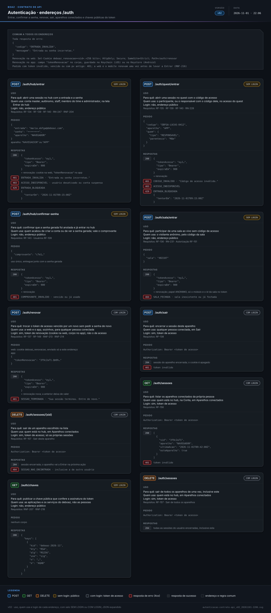
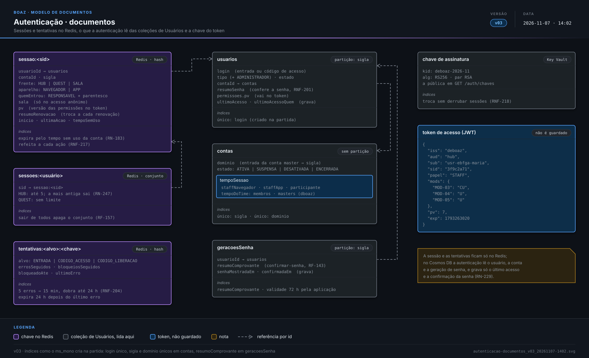

> **boaz · Funcionalidade** · `17_modulo-usuario-a-autenticacao` · **v21** · 2026-11-07 14:05 · **Aprovado**

# Módulo Usuários · Autenticação

**Objetivo:** definir como cada pessoa prova quem é no hub e no quest, que sessão e que tokens recebe, quanto tempo valem e quando deixam de valer.

---

<a id="cenarios-tela"></a>

## Cenários de tela

<a id="RF-134"></a>

### `RF-134` Entrar no hub

```gherkin
Cenário: staff entra
  Dado a staff Maria Souza, ativa, da escola de sigla "EBFGA", ativa
  Quando informa "maria.ebfga@deboaz.com" e a senha dela em Entrar
  Então entra no hub e vê Módulos
```

<a id="RF-135"></a>

### `RF-135` Entrar no quest

```gherkin
Cenário: a mãe entra com o código do filho
  Dado o participante Lucas Andrade com o código "EBFGA-LUCAS-0412"
  Quando a mãe, Carla Andrade, informa o código e escolhe que é ela quem está entrando
  Então o perfil do Lucas abre no quest
```

<a id="RF-137"></a>

### `RF-137` Renovação

```gherkin
Cenário: token de acesso vence durante o uso
  Dado a Maria no hub há 20 min
  Quando ela abre outro módulo
  Então o módulo abre sem pedir a senha

Cenário: tempo sem uso passou
  Dado a Maria sem usar o hub no navegador há 9 h, com o tempo de 8 h da escola
  Quando ela volta a usar o hub
  Então vai para Entrar com o aviso "Sua sessão terminou. Entre de novo."
```

<a id="RF-138"></a>

### `RF-138` Sair

```gherkin
Cenário: sair no computador da escola
  Dado a Maria conectada no navegador e no app
  Quando toca em "Sair" no navegador
  Então o navegador volta para Entrar
  E o app continua conectado
```

<a id="RF-139"></a>

### `RF-139` Entrada errada

```gherkin
Cenário: senha errada
  Quando alguém informa "maria.ebfga@deboaz.com" e uma senha errada
  Então vê "Entrada ou senha incorretas."

Cenário: entrada que não existe
  Quando alguém informa "zeca.ebfga@deboaz.com", que não existe, e uma senha
  Então vê a mesma mensagem "Entrada ou senha incorretas."
```

<a id="RF-140"></a>

### `RF-140` Acesso indisponível

```gherkin
Cenário: conta suspensa
  Dado a escola de sigla "EBFGA" suspensa pelo time deboaz
  Quando a Maria informa a entrada e a senha certas
  Então vê "Acesso indisponível. Fale com quem administra a sua conta."
```

<a id="RF-158"></a>

### `RF-158` Entrada bloqueada

```gherkin
Cenário: quinta senha errada
  Dado 4 senhas erradas seguidas para "maria.ebfga@deboaz.com"
  Quando alguém erra a senha pela quinta vez às 09:00
  Então vê "Muitas tentativas erradas. Tente de novo às 09:15."
  E Entrar fica desligado até as 09:15
```

<a id="RF-159"></a>

### `RF-159` Entrada concluída

```gherkin
Cenário: hub
  Quando a Maria entra no hub com a senha certa
  Então vê Módulos com o aviso flutuante "Você entrou. Que bom te ver de novo!"
  E o selo de volta animado

Cenário: quest
  Quando o Lucas entra com o código e escolhe o perfil dele
  Então vê Tarefas com o aviso "Você entrou no perfil do Lucas."

Cenário: anônimo
  Quando alguém entra na sala com o código da sala
  Então vê a sala com o aviso "Você entrou na sala como PUPIL-EBFGA-13465."
```

<a id="RF-141"></a>

### `RF-141` Encerrar em todos os aparelhos

```gherkin
Cenário: staff desativado
  Dado a Maria conectada no navegador e no app
  Quando a conta master desativa a Maria
  Então na próxima ação, em cada aparelho, ela vai para Entrar
```

<a id="RF-142"></a>

### `RF-142` Sessão terminada

```gherkin
Cenário: aviso ao voltar
  Dado o Lucas sem abrir o quest há 31 dias, com o tempo de 30 dias da escola
  Quando ele abre o quest
  Então vê o acesso com o aviso "Sua sessão terminou. Entre de novo."
```

<a id="RF-143"></a>

### `RF-143` Primeiro acesso

```gherkin
Cenário: senha anotada
  Dado a Maria vendo uma única vez a senha gerada no primeiro acesso
  Quando marca "Anotei a senha" e toca em "Continuar"
  Então entra no hub sem digitar a senha
```

<a id="RF-156"></a>

### `RF-156` Aparelhos conectados

```gherkin
Cenário: navegador e app
  Dado a Maria conectada no navegador da escola e no app do celular
  Quando abre Conta no navegador
  Então vê os dois aparelhos com a hora da última ação
  E o navegador marcado como "Este aparelho"
```

<a id="RF-157"></a>

### `RF-157` Sair dos aparelhos

```gherkin
Cenário: esqueceu o computador da escola aberto
  Dado a Maria conectada no navegador da escola e no app
  Quando, no app, escolhe o navegador em Conta e toca em "Sair deste aparelho"
  Então na próxima ação no navegador aparece Entrar
  E o app continua conectado

Cenário: sair de todos
  Quando a Maria toca em "Sair de todos os aparelhos"
  Então o navegador e o app vão para Entrar
```

<a id="RN-227"></a>

### `RN-227` Hub e quest separados

```gherkin
Cenário: landing page sem sessão
  Quando alguém abre a landing page
  Então nenhuma sessão é aberta
```

<a id="RN-247"></a>

### `RN-247` Limite de sessões

```gherkin
Cenário: sexta sessão do hub
  Dado a Maria com 5 sessões do hub abertas
  Quando ela entra num sexto aparelho
  Então o aparelho de última ação mais antiga vai para Entrar
  E mostra o aviso "Sua sessão terminou. Entre de novo."
```

<a id="RN-250"></a>

### `RN-250` Aviso de cada tentativa

```gherkin
Esquema do Cenário: tipo do aviso
  Quando a tentativa de entrar termina em <resultado>
  Então aparece o aviso de ação <tipo>, com o selo animado

  Exemplos:
    | resultado                     | tipo                                            |
    | sessão aberta                 | concluído                                       |
    | senha ou código incorreto     | recusado                                        |
    | conta ou usuário indisponível | indisponível                                    |
    | entrada bloqueada             | espera                                          |
    | sessão terminada              | indisponível, flutuante sobre a tela de entrada |
```

<a id="RNF-214"></a>

### `RNF-214` Onde ficam os tokens

```gherkin
Esquema do Cenário: guarda no aparelho
  Quando a Maria entra pelo <aparelho>
  Então o token de acesso fica só na memória
  E o token de renovação fica <onde>

  Exemplos:
    | aparelho       | onde                                                      |
    | navegador      | cookie HttpOnly, Secure, SameSite=Strict, só na renovação |
    | app no iOS     | Keychain                                                  |
    | app no Android | Keystore                                                  |
```

<a id="RNF-216"></a>

### `RNF-216` Conferência em cada pedido

```gherkin
Cenário: renova antes de levar a Entrar
  Dado a Maria no hub com o token de acesso vencido
  Quando um pedido do hub recebe 401
  Então o hub tenta uma renovação antes de levar a Entrar
  E se a renovação também for recusada, vai para Entrar com o aviso de sessão terminada
```

---

<a id="cenarios-api"></a>

## Cenários de API

<a id="formas-de-entrar"></a>

### Formas de entrar

```gherkin
Esquema do Cenário: um endereço de entrada por frente
  Quando <quem> envia POST <endereço> com <credencial>
  Então a resposta é 200 com tokenAcesso, tipo "Bearer" e expiraEm 900

  Exemplos:
    | quem                          | endereço           | credencial                |
    | conta master, educador, staff | /auth/hub/entrar   | entrada, senha e aparelho |
    | membro do time deboaz         | /auth/hub/entrar   | entrada, senha e aparelho |
    | participante ou responsável   | /auth/quest/entrar | código, aparelho e quem   |
    | pessoa sem código de acesso   | /auth/sala/entrar  | código da sala            |
```

<a id="RF-134-api"></a>

### `RF-134` Entrar no hub

```gherkin
Cenário: staff entra pelo navegador
  Dado a staff "maria.ebfga@deboaz.com", ativa, da escola "EBFGA", ativa
  Quando envia POST /auth/hub/entrar com:
    """
    {
      "entrada": "maria.ebfga@deboaz.com",
      "senha": "••••••••",
      "aparelho": "NAVEGADOR"
    }
    """
  Então a resposta é 200 com tokenAcesso, tipo "Bearer" e expiraEm 900
  E vem o cookie deboaz_renovacao, HttpOnly, Secure e SameSite=Strict, só para /auth/renovar

Cenário: staff entra pelo app
  Quando envia o mesmo pedido com o aparelho "APP"
  Então a resposta é 200 com o tokenRenovacao no corpo, sem cookie
```

<a id="RF-135-api"></a>

### `RF-135` Entrar no quest

```gherkin
Cenário: a mãe entra com o código do filho
  Quando envia POST /auth/quest/entrar com:
    """
    {
      "codigo": "EBFGA-LUCAS-0412",
      "aparelho": "APP",
      "quem": {
        "tipo": "RESPONSAVEL",
        "parentesco": "Mãe"
      }
    }
    """
  Então a resposta é 200 com o token de acesso do Lucas
  E o token traz em quem o tipo "RESPONSAVEL" e o parentesco "Mãe"
```

<a id="RF-136"></a>

### `RF-136` Sala anônima

```gherkin
Cenário: entra e a sala fecha
  Quando envia POST /auth/sala/entrar com a sala "482107", aberta
  Então a resposta é 200 com um token de papel "ANONIMO", só com o módulo e o id da sala
  E quando o professor fecha a sala, esse token recebe 401 em qualquer pedido

Cenário: sala fechada
  Quando envia POST /auth/sala/entrar com uma sala fechada ou inexistente
  Então a resposta é 404 SALA_FECHADA
```

<a id="RF-137-api"></a>

### `RF-137` Renovação

```gherkin
Cenário: renovação no navegador
  Dado a sessão 3f9c2a71 da Maria ativa e o cookie deboaz_renovacao dela
  Quando envia POST /auth/renovar com o cookie
  Então a resposta é 200 com um tokenAcesso novo e um cookie de renovação novo

Cenário: renovação no app
  Quando envia POST /auth/renovar com:
    """
    {
      "tokenRenovacao": "3f9c2a71.Qm9h…"
    }
    """
  Então a resposta é 200 com tokenAcesso e tokenRenovacao novos

Cenário: tempo sem uso passou
  Dado a sessão da Maria sem pedidos há 9 h, com o tempo de 8 h da escola
  Quando envia POST /auth/renovar
  Então a resposta é 401 SESSAO_TERMINADA com "Sua sessão terminou. Entre de novo."
```

<a id="RF-138-api"></a>

### `RF-138` Sair

```gherkin
Cenário: sair do navegador
  Dado a Maria com sessões no navegador e no app
  Quando envia POST /auth/sair com o token do navegador
  Então a resposta é 204 e o cookie de renovação é apagado
  E o token do navegador recebe 401 no próximo pedido, e o do app continua valendo
```

<a id="RF-139-api"></a>

### `RF-139` Entrada errada

```gherkin
Esquema do Cenário: mesma resposta para senha errada e entrada inexistente
  Quando envia POST /auth/hub/entrar com a entrada <entrada> e <senha>
  Então a resposta é 401 ENTRADA_INVALIDA com "Entrada ou senha incorretas."
  E uma tentativa errada é contada para <entrada>

  Exemplos:
    | entrada                  | senha            |
    | "maria.ebfga@deboaz.com" | uma senha errada |
    | "zeca.ebfga@deboaz.com"  | qualquer senha   |
```

<a id="RF-140-api"></a>

### `RF-140` Acesso indisponível

```gherkin
Esquema do Cenário: conta ou usuário fora de uso
  Dado <situação>
  Quando a Maria envia POST /auth/hub/entrar com a entrada e a senha certas
  Então a resposta é 403 ACESSO_INDISPONIVEL e nenhuma sessão é aberta

  Exemplos:
    | situação                  |
    | a escola "EBFGA" suspensa |
    | a Maria desativada        |
```

<a id="RF-158-api"></a>

### `RF-158` Entrada bloqueada

```gherkin
Cenário: quinta senha errada
  Dado 4 senhas erradas seguidas para "maria.ebfga@deboaz.com"
  Quando a quinta senha errada chega às 09:00
  Então a resposta é 429 ENTRADA_BLOQUEADA com:
    """
    {
      "tentarEm": "2026-11-01T09:15:00Z"
    }
    """
  E até as 09:15 a senha certa também recebe 429
```

<a id="RF-141-api"></a>

### `RF-141` Encerrar em todos os aparelhos

```gherkin
Cenário: staff desativado
  Dado a Maria com sessões no navegador e no app
  Quando a conta master envia POST /usuarios/usr-ebfga-maria/desativar
  Então os tokens das duas sessões recebem 401 no próximo pedido
  E POST /auth/renovar de cada aparelho recebe 401 SESSAO_TERMINADA
```

<a id="RF-143-api"></a>

### `RF-143` Primeiro acesso

```gherkin
Cenário: comprovante da senha anotada
  Dado o comprovante "c7e1…" recebido junto com a senha gerada
  Quando envia POST /auth/hub/confirmar-senha com:
    """
    {
      "comprovante": "c7e1…"
    }
    """
  Então a resposta é 200 com o token de acesso e a renovação
  E o mesmo comprovante, enviado de novo, recebe 401 COMPROVANTE_INVALIDO
```

<a id="RF-156-api"></a>

### `RF-156` Aparelhos conectados

```gherkin
Cenário: lista das sessões
  Dado a Maria com sessões no navegador e no app
  Quando envia GET /auth/sessoes com o token do navegador
  Então a resposta é 200 com:
    """
    [
      {
        "sid": "3f9c2a71",
        "aparelho": "NAVEGADOR",
        "ultimaAcao": "2026-11-01T09:42:00Z",
        "esteAparelho": true
      },
      {
        "sid": "7d20b9e4",
        "aparelho": "APP",
        "ultimaAcao": "2026-11-01T08:10:00Z",
        "esteAparelho": false
      }
    ]
    """
```

<a id="RF-157-api"></a>

### `RF-157` Sair dos aparelhos

```gherkin
Cenário: sair de um aparelho
  Quando a Maria envia DELETE /auth/sessoes/3f9c2a71 com o token do app
  Então a resposta é 204
  E o token do navegador recebe 401 no próximo pedido, e o do app continua valendo

Cenário: sessão de outra pessoa
  Quando a Maria envia DELETE /auth/sessoes/{sid} com o sid de uma sessão do João
  Então a resposta é 404 SESSAO_NAO_ENCONTRADA

Cenário: sair de todos
  Quando a Maria envia DELETE /auth/sessoes
  Então a resposta é 204
  E os tokens e as renovações de todas as sessões dela recebem 401
```

<a id="RN-224"></a>

### `RN-224` Sessão no servidor

```gherkin
Cenário: a sessão vale mais que o token
  Dado um token de acesso da Maria emitido há 5 min
  E a sessão desse token encerrada no servidor
  Quando envia qualquer pedido com esse token
  Então a resposta é 401
```

<a id="RN-225"></a>

### `RN-225` Uma sessão por aparelho

```gherkin
Cenário: navegador e app
  Dado a Maria com uma sessão no navegador
  Quando envia POST /auth/hub/entrar com o aparelho "APP"
  Então GET /auth/sessoes lista duas sessões, uma por aparelho
  E cada sessão guarda a conta, a frente, o aparelho, quem entrou, o pv e a última ação
```

<a id="RN-226"></a>

### `RN-226` Tempo de sessão

```gherkin
Esquema do Cenário: tempo sem uso de cada pessoa
  Dado <quem> com uma sessão no <aparelho>
  Quando passa sem pedidos mais que o tempo <tempo>
  Então o próximo pedido recebe 401 e POST /auth/renovar recebe 401 SESSAO_TERMINADA

  Exemplos:
    | quem           | aparelho  | tempo                 |
    | staff          | navegador | do staff no navegador |
    | staff          | app       | do staff no app       |
    | participante   | app       | do participante       |
    | conta master   | navegador | das contas master     |
    | membro do time | navegador | dos membros do time   |

Cenário: cada pedido conta como uso
  Dado a Maria no navegador, com o tempo de 8 h da escola
  Quando ela faz um pedido a cada 7 h
  Então a sessão continua e POST /auth/renovar recebe 200
```

<a id="RN-227-api"></a>

### `RN-227` Hub e quest separados

```gherkin
Esquema do Cenário: token da outra frente
  Dado um token de acesso de aud "<aud>"
  Quando é usado num endereço do <frente>
  Então a resposta é 401

  Exemplos:
    | aud   | frente |
    | hub   | quest  |
    | quest | hub    |
```

<a id="RN-228"></a>

### `RN-228` Responsável

```gherkin
Cenário: a mãe entra como o filho
  Quando a Carla envia POST /auth/quest/entrar com o código do Lucas e o parentesco "Mãe"
  Então o token tem o sub "usr-ebfga-lucas" e, em quem, o responsável e o parentesco "Mãe"
  E ela faz pela API o que o Lucas faz, menos o que cada módulo restringir ao responsável
```

<a id="RN-229"></a>

### `RN-229` Tokens

```gherkin
Cenário: tokens da sessão
  Quando a Maria envia POST /auth/hub/entrar
  Então recebe um token de acesso com expiraEm 900, que não fica guardado no servidor
  E um token de renovação de uso único, que vale enquanto a sessão estiver ativa
```

<a id="RN-230"></a>

### `RN-230` O que encerra a sessão

```gherkin
Cenário: desativar encerra
  Dado a Maria com uma sessão no navegador
  Quando a conta master envia POST /usuarios/usr-ebfga-maria/desativar
  Então POST /auth/renovar da Maria recebe 401 SESSAO_TERMINADA

Cenário: mudar permissão não encerra
  Dado a Maria com uma sessão no navegador
  Quando a conta master envia PUT /usuarios/usr-ebfga-maria/permissoes
  Então o token antigo recebe 401 PERMISSOES_DESATUALIZADAS
  E POST /auth/renovar da Maria recebe 200 com um token de pv novo
```

<a id="RN-231"></a>

### `RN-231` Sessão anônima

```gherkin
Cenário: sala aberta sem tempo sem uso
  Dado um token de papel "ANONIMO" da sala 482107
  Quando passa 2 h sem pedidos, com a sala aberta
  Então os pedidos à sala continuam com 200
  E os pedidos a perfil, tarefa ou outra sala recebem 403
```

<a id="RN-247-api"></a>

### `RN-247` Limite de sessões

```gherkin
Cenário: sexta sessão do hub
  Dado a Maria com 5 sessões do hub abertas
  Quando envia POST /auth/hub/entrar de um sexto aparelho
  Então a resposta é 200 e a sessão de última ação mais antiga termina
  E POST /auth/renovar daquela sessão recebe 401 SESSAO_TERMINADA

Cenário: quest sem limite
  Dado o código do Lucas usado em POST /auth/quest/entrar de 6 aparelhos
  Então as 6 sessões continuam e cada POST /auth/renovar recebe 200
```

<a id="RNF-207"></a>

### `RNF-207` Token assinado

```gherkin
Cenário: assinatura RS256
  Quando a Maria envia POST /auth/hub/entrar
  Então o token de acesso é um JWT assinado com RS256, com o kid no cabeçalho
  E a chave RSA de 2048 bits que assina nunca sai do Key Vault
  E GET /auth/chaves devolve a chave pública desse kid, sem autenticação
```

<a id="RNF-209"></a>

### `RNF-209` Validade do token

```gherkin
Cenário: renovação dentro do tempo da sessão
  Dado a Maria no hub, com o tempo de 8 h da escola
  Quando o token de acesso dela passa de 15 min
  Então POST /auth/renovar devolve um token novo
  E a renovação funciona enquanto ela não passar 8 h sem pedidos
```

<a id="RNF-203"></a>

### `RNF-203` Credencial antiga

```gherkin
Esquema do Cenário: mudança que invalida o token
  Dado a Maria com sessões no navegador e no app
  Quando <mudança>
  Então o token emitido antes recebe 401 no próximo pedido, nos dois aparelhos

  Exemplos:
    | mudança                                       |
    | a conta master desativa a Maria               |
    | o time deboaz suspende a escola               |
    | a conta master pede uma nova geração de senha |
    | a conta master muda as permissões dela        |
    | a escola descontrata um módulo que ela usa    |
```

<a id="RNF-204"></a>

### `RNF-204` Bloqueio por tentativas

```gherkin
Esquema do Cenário: tempo do bloqueio
  Dado <bloqueios> bloqueios seguidos para "maria.ebfga@deboaz.com"
  Quando a quinta senha errada seguida chega a POST /auth/hub/entrar
  Então a resposta é 429 ENTRADA_BLOQUEADA, com tentarEm daqui a <tempo>

  Exemplos:
    | bloqueios | tempo  |
    | 0         | 15 min |
    | 1         | 30 min |
    | 2         | 1 h    |
    | 7         | 24 h   |

Cenário: código de acesso também bloqueia
  Quando o código "EBFGA-LUCAS-0412" chega errado 5 vezes seguidas a POST /auth/quest/entrar
  Então a resposta é 429 ENTRADA_BLOQUEADA, com tentarEm daqui a 15 min
```

<a id="RNF-213"></a>

### `RNF-213` Token de renovação

```gherkin
Cenário: troca a cada uso
  Dado a Maria com o token de renovação "3f9c2a71.A"
  Quando envia POST /auth/renovar com "3f9c2a71.A"
  Então recebe "3f9c2a71.B", o id da sessão seguido de 256 bits aleatórios
  E "3f9c2a71.A" deixa de valer
  E a sessão guarda só o resumo irreversível do token novo

Cenário: renovação copiada
  Dado o token de renovação "3f9c2a71.A" já trocado por "3f9c2a71.B"
  Quando alguém envia POST /auth/renovar com "3f9c2a71.A"
  Então a resposta é 401 SESSAO_TERMINADA e a sessão 3f9c2a71 termina
```

<a id="RNF-215"></a>

### `RNF-215` Identidade no token

```gherkin
Cenário: token da Maria no navegador
  Quando a Maria envia POST /auth/hub/entrar com o aparelho "NAVEGADOR"
  Então o token de acesso traz esta identidade, sem nome, documento, matrícula nem senha:
    """
    {
      "alg": "RS256",
      "typ": "JWT",
      "kid": "deboaz-2026-11"
    }
    {
      "iss": "deboaz",
      "aud": "hub",
      "sub": "usr-ebfga-maria",
      "sid": "3f9c2a71",
      "conta": "conta-ebfga",
      "sigla": "EBFGA",
      "tipo": "STAFF",
      "aparelho": "NAVEGADOR",
      "iat": 1793262120,
      "exp": 1793263020,
      "jti": "a81c0e5d",
      "papel": "STAFF",
      "mods": {
        "MOD-03": "CU",
        "MOD-04": "U",
        "MOD-05": "U"
      },
      "pv": 7
    }
    """
  E papel, mods e pv são os da autorização

Cenário: quem entrou no quest
  Quando a Carla envia POST /auth/quest/entrar com o código do Lucas, como mãe
  Então o token traz em quem o responsável e o parentesco "Mãe"
```

<a id="RNF-216-api"></a>

### `RNF-216` Conferência em cada pedido

```gherkin
Esquema do Cenário: token recusado
  Dado a Maria com um token <problema>
  Quando envia um pedido com esse token
  Então a resposta é 401

  Exemplos:
    | problema                          |
    | com a assinatura errada           |
    | vencido                           |
    | do quest                          |
    | de uma sessão encerrada           |
    | com a versão de permissões antiga |
```

<a id="RNF-217"></a>

### `RNF-217` Sessão no Redis

```gherkin
Cenário: sessão da Maria
  Quando a Maria entra no hub pelo navegador, com o tempo de 8 h da escola
  Então a sessão fica no Redis na chave sessao:3f9c2a71, expirando em 8 h e refeita a cada pedido:
    """
    {
      "usuarioId": "usr-ebfga-maria",
      "contaId": "conta-ebfga",
      "sigla": "EBFGA",
      "frente": "HUB",
      "aparelho": "NAVEGADOR",
      "quemEntrou": null,
      "versaoPermissoes": 7,
      "resumoRenovacao": "(resumo irreversível do token de renovação)",
      "criadaEm": "2026-11-01T09:00:00Z",
      "ultimaAcao": "2026-11-01T09:42:00Z"
    }
    """
  E o índice sessoes:usr-ebfga-maria lista as sessões dela, para encerrar todas de uma vez

Cenário: tentativas erradas
  Quando alguém erra a senha de "maria.ebfga@deboaz.com"
  Então a tentativa e o bloqueio ficam no Redis, com expiração igual ao tempo do bloqueio
```

<a id="RNF-218"></a>

### `RNF-218` Troca da chave

```gherkin
Cenário: troca a cada 90 dias
  Dado tokens assinados com a chave "deboaz-2026-11"
  Quando a chave é trocada por "deboaz-2027-02" depois de 90 dias
  Então os tokens novos levam o kid "deboaz-2027-02" e GET /auth/chaves traz as duas
  E os assinados com "deboaz-2026-11" continuam aceitos até vencer, sem encerrar sessões

Cenário: troca por vazamento
  Dado a suspeita de vazamento da chave "deboaz-2026-11"
  Quando a chave é trocada na hora
  Então os tokens assinados com "deboaz-2026-11" recebem 401
  E POST /auth/renovar devolve tokens assinados com a chave nova
```

<a id="fora-de-escopo"></a>

### Fora de escopo

```gherkin
Cenário: sem provedor externo nem segundo fator
  Quando a Maria entra no hub
  Então entra só com a entrada e a senha, sem provedor externo nem segundo fator

Cenário: sem biometria no app
  Quando a Maria abre o app de novo, com a sessão ativa
  Então continua conectada pelo token de renovação guardado no aparelho, sem biometria

Cenário: sem aparelhos conectados no quest
  Quando o Lucas abre Perfil no quest
  Então não há a lista de aparelhos conectados nem "Sair de todos os aparelhos"
```

---

<a id="telas"></a>

## Telas

### Web

**Hub · aparelhos conectados · web · vista** — `2_Diagramas/vista-hub-aparelhos-web_v01_20261103-1139.svg`

[](../2_Diagramas/vista-hub-aparelhos-web_v01_20261103-1139.svg)

**Hub · entrar · web · vista** — `2_Diagramas/vista-hub-entrar-web_v01_20261103-1139.svg`

[](../2_Diagramas/vista-hub-entrar-web_v01_20261103-1139.svg)

**Quest · entrar · web · vista** — `2_Diagramas/vista-quest-entrar-web_v01_20261103-1139.svg`

[](../2_Diagramas/vista-quest-entrar-web_v01_20261103-1139.svg)

### PWA

**Hub · aparelhos conectados · pwa · vista** — `2_Diagramas/vista-hub-aparelhos-pwa_v01_20261103-1139.svg`

[](../2_Diagramas/vista-hub-aparelhos-pwa_v01_20261103-1139.svg)

**Hub · entrar · pwa · vista** — `2_Diagramas/vista-hub-entrar-pwa_v01_20261103-1139.svg`

[](../2_Diagramas/vista-hub-entrar-pwa_v01_20261103-1139.svg)

**Quest · entrar · pwa · vista** — `2_Diagramas/vista-quest-entrar-pwa_v01_20261103-1139.svg`

[](../2_Diagramas/vista-quest-entrar-pwa_v01_20261103-1139.svg)

### Mobile

**Hub · aparelhos conectados · mobile · vista** — `2_Diagramas/vista-hub-aparelhos-mobile_v01_20261103-1139.svg`

[](../2_Diagramas/vista-hub-aparelhos-mobile_v01_20261103-1139.svg)

**Hub · entrar · mobile · vista** — `2_Diagramas/vista-hub-entrar-mobile_v01_20261103-1139.svg`

[](../2_Diagramas/vista-hub-entrar-mobile_v01_20261103-1139.svg)

**Quest · entrar · mobile · vista** — `2_Diagramas/vista-quest-entrar-mobile_v01_20261103-1139.svg`

[](../2_Diagramas/vista-quest-entrar-mobile_v01_20261103-1139.svg)

---

<a id="diagramas"></a>

## Diagramas

**Autenticação · casos de uso** — `2_Diagramas/autenticacao-casos-de-uso_v01_20261101-2337.svg`

[](../2_Diagramas/autenticacao-casos-de-uso_v01_20261101-2337.svg)

**Autenticação · sequência** — `2_Diagramas/autenticacao-sequencia_v03_20261103-1143.svg`

[](../2_Diagramas/autenticacao-sequencia_v03_20261103-1143.svg)

**Autenticação · contrato de API** — `2_Diagramas/autenticacao-contrato-api_v02_20261101-2206.svg`

[](../2_Diagramas/autenticacao-contrato-api_v02_20261101-2206.svg)

**Autenticação · classes** — `2_Diagramas/autenticacao-classes_v01_20261101-1501.svg`

[](../2_Diagramas/autenticacao-classes_v01_20261101-1501.svg)

**Autenticação · documentos** — `2_Diagramas/autenticacao-documentos_v03_20261107-1402.svg`

[](../2_Diagramas/autenticacao-documentos_v03_20261107-1402.svg)

---

<a id="historico"></a>

## Histórico

| Versão | Data | Mudança |
|---|---|---|
| **v21** | 2026-11-07 14:05 | Diagrama autenticacao-documentos v03: índices como o ms_mono cria na partida (login, sigla e domínio únicos, resumoComprovante); cenários sem mudança |
| v20 | 2026-11-06 23:23 | Diagrama autenticacao-documentos v02, fiel ao código: tempoDoTime na conta do time, tempoSemUso e ultimoErro no Redis, tipo ADMINISTRADOR |
| v19 | 2026-11-05 12:34 | Formato `.md`: migrado de `.html` sem mudar cenários, telas nem diagramas; links entre documentos apontam para `.md` |
| v18 | 2026-11-03 22:11 | Aprovado, sem pendências em aberto |
| v17 | 2026-11-03 11:45 | Estrutura do módulo (06 `RNF-103` v17): Telas em Web, PWA e Mobile, uma vista por plataforma; sequência v03 com as telas do hub e do quest em cada fase |
| v16 | 2026-11-02 00:11 | Cenários separados em Cenários de tela e Cenários de API; os de API usam os endereços, pedidos e códigos do contrato (IDs nos dois: `<ID>-api`) |
| v15 | 2026-11-01 23:41 | Diagramas de casos de uso e de documentos da autenticação v01 |
| v14 | 2026-11-01 22:01 | JSON do token e da sessão expandidos (RNF-215, RNF-217); contrato de API v02, com JSON expandido |
| v13 | 2026-11-01 17:59 | Só Gherkin, telas e diagramas: contexto, tabelas de RF, RN e RNF e fora de escopo viram cenários (mesmos IDs como âncora); vistas em Telas; status → Em revisão |
| v12 | 2026-11-01 15:28 | Aprovado |
| v11 | 2026-11-01 15:04 | Diagrama autenticacao-classes v01: sessão, índice de sessões, tokens, chave de assinatura e tentativas de entrada |
| v10 | 2026-11-01 13:15 | Aprovado |

---

<sub>boaz · v21 · 2026-11-07 14:05 · `1_Requisitos/17_modulo-usuario-a-autenticacao.md`</sub>
