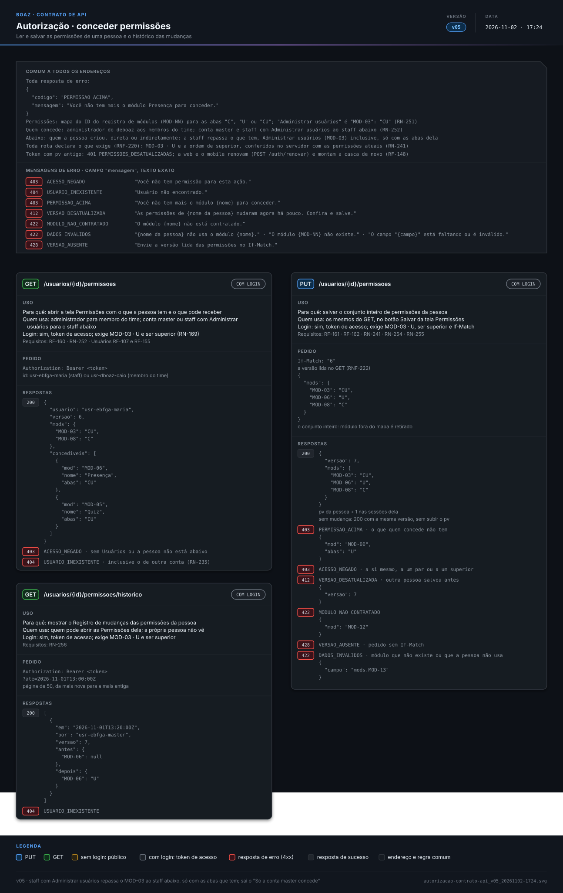
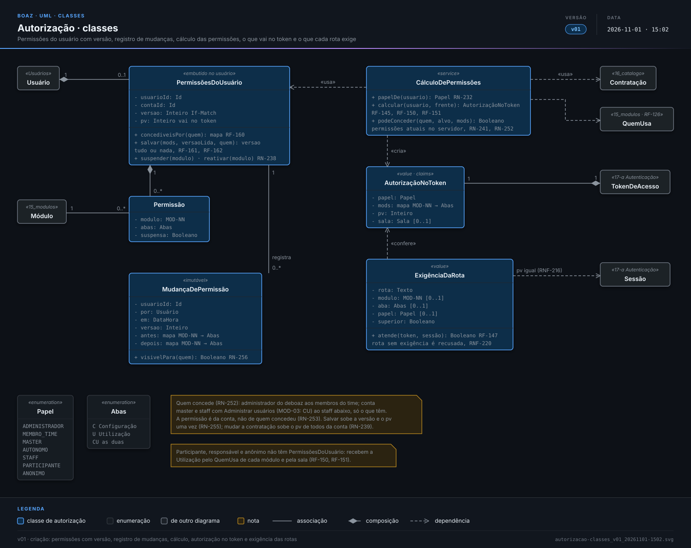
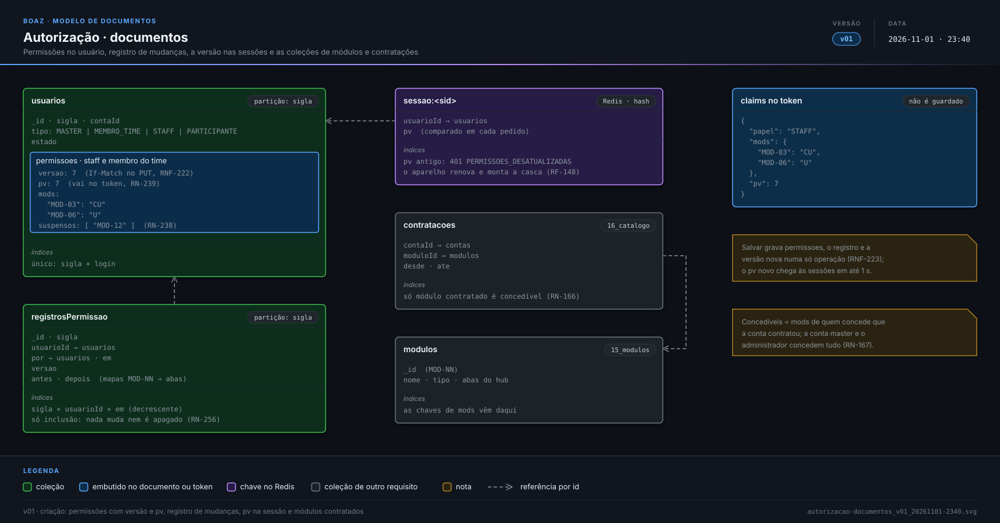

> **boaz · Funcionalidade** · `17_modulo-usuario-b-autorizacao` · **v19** · 2026-11-05 12:34 · **Aprovado**

# Módulo Usuários · Autorização

**Objetivo:** definir o que cada papel pode ver e fazer em cada módulo, como isso viaja no token de acesso e como a web e o mobile montam a casca a partir dele.

---

<a id="cenarios-tela"></a>

## Cenários de tela

<a id="conceder-permissoes"></a>

### Conceder permissões

```gherkin
Cenário: a casca muda sem nova entrada
  Dado a staff Maria Souza conectada no hub, sem a Presença
  Quando a conta master abre Permissões da Maria, marca a Utilização da Presença e salva
  Então na próxima ação o card da Presença aparece para a Maria, sem entrar de novo
  E a conta master e a Maria veem cada uma o seu aviso de ação
```

<a id="RF-146"></a>

### `RF-146` Casca pelo token

```gherkin
Cenário: cards e abas do staff
  Dado o token da Maria com "MOD-05" só com "U"
  Quando ela abre Módulos e toca no card do Quiz
  Então vê o card do Quiz e o módulo aberto só com a aba Utilização
  E não vê o card da Presença nem a aba Configuração do Quiz
```

<a id="RF-148"></a>

### `RF-148` Permissão nova sem sair

```gherkin
Cenário: conta master libera a Presença
  Dado a Maria em Módulos, sem a Presença
  Quando a conta master marca a Utilização da Presença para ela
  E a Maria faz a próxima ação no hub
  Então o card da Presença aparece para ela sem pedir nova entrada
```

<a id="RF-149"></a>

### `RF-149` Endereço direto

```gherkin
Cenário: módulo fora do token
  Dado o token da Maria sem "MOD-06"
  Quando ela abre o endereço da Presença
  Então vai para Módulos com o aviso "Você não tem acesso a este módulo."
```

<a id="RF-151"></a>

### `RF-151` Sala anônima

```gherkin
Cenário: só a sala
  Dado uma pessoa sem código de acesso na sala 482107 do Quiz
  Então vê só a sala
  E a Carteira, Tarefas e o Perfil não abrem
```

<a id="RF-160"></a>

### `RF-160` O que pode conceder

```gherkin
Cenário: staff com Administrar usuários
  Dado o João com Administrar usuários e só a Utilização do Quiz
  Quando ele abre Permissões da Ana, staff abaixo dele
  Então vê Usuários com as duas abas e o Quiz só com a aba Utilização para marcar
  E não vê a Presença nem a Agenda

Cenário: membro do time
  Quando o administrador do deboaz abre Permissões do Caio
  Então vê SAC, Usuários e Catálogo, com Configuração e Utilização
```

<a id="RF-161"></a>

### `RF-161` Salvar tudo ou nada

```gherkin
Cenário: quem concede perdeu a aba
  Dado o João na tela Permissões da Ana, com a Utilização da Presença marcada para ela
  E a conta master tirando a Presença do João antes de ele salvar
  Quando o João toca em "Salvar"
  Então vê "Você não tem mais o módulo Presença para conceder. Confira e salve."
  E nenhuma permissão da Ana muda
```

<a id="RF-162"></a>

### `RF-162` Mudou enquanto editava

```gherkin
Cenário: duas pessoas na mesma tela
  Dado a conta master e o João abrindo Permissões da Maria na versão 6
  E a conta master salvando antes, na versão 7
  Quando o João toca em "Salvar"
  Então vê "As permissões de Maria Souza mudaram agora há pouco. Confira e salve."
  E a tela mostra as permissões da versão 7
```

<a id="RF-163"></a>

### `RF-163` Avisos de quem concede e de quem recebe

```gherkin
Cenário: conta master libera a Presença
  Quando a conta master marca a Utilização da Presença para a Maria e toca em "Salvar"
  Então vê "Permissões da Maria salvas." com o selo de volta animado
  E a Maria, na próxima ação, vê o card da Presença em Módulos
  E o aviso "Suas permissões mudaram: agora você usa a Presença."
```

<a id="RN-233"></a>

### `RN-233` Permissões por papel

```gherkin
Esquema do Cenário: ações de cada papel
  Quando <quem> está no hub
  Então pode <ações>

  Exemplos:
    | quem           | ações                                              |
    | administrador  | criar membros do time e salvar preços e faixas     |
    | membro do time | só o que foi marcado, sem criar membros nem preços |
    | conta master   | contratar, ver a cobrança e conceder permissões    |
    | autônomo       | contratar e ver a cobrança                         |
    | staff          | ver A contratar com os preços, sem contratar       |
```

<a id="RN-234"></a>

### `RN-234` Destinos fixos

```gherkin
Esquema do Cenário: destinos que não dependem de permissão
  Dado <quem> sem nenhum módulo marcado
  Quando entra no <frente>
  Então vê os destinos <destinos>

  Exemplos:
    | quem          | frente | destinos                         |
    | a staff Maria | hub    | Módulos, Feed e Conta            |
    | o membro Caio | hub    | Módulos e Conta, sem Feed        |
    | o Lucas       | quest  | Tarefas, Feed, Carteira e Perfil |
```

<a id="RN-240"></a>

### `RN-240` Responsável

```gherkin
Cenário: só o responsável autoriza a foto
  Dado a Carla entrando com o código do Lucas, de 12 anos
  Quando ela autoriza a foto do Lucas
  Então a autorização é aceita
  E o Lucas, entrando sozinho, não vê essa ação
```

<a id="RN-254"></a>

### `RN-254` Salvar substitui tudo

```gherkin
Cenário: desmarcar retira
  Dado a Maria dentro da Presença
  Quando a conta master desmarca a Presença dela e salva
  Então a Maria vai para Módulos com o aviso "Você não tem acesso a este módulo."
```

<a id="RN-256"></a>

### `RN-256` Registro de mudanças

```gherkin
Esquema do Cenário: quem vê o registro
  Quando <quem> abre Permissões da Maria
  Então <vê> o Registro de mudanças

  Exemplos:
    | quem                    | vê     |
    | a conta master          | vê     |
    | o João, com Adm.        | vê     |
    | a própria Maria         | não vê |
    | o membro do time no SAC | não vê |
```

<a id="RNF-221"></a>

### `RNF-221` Casca sem esperar

```gherkin
Cenário: casca antes do conteúdo
  Quando a Maria entra no hub
  Então os destinos, os cards e as abas aparecem a partir do token
  E só o conteúdo dos cards chega depois, do servidor
```

<a id="RNF-224"></a>

### `RNF-224` Token desatualizado

```gherkin
Cenário: renova uma vez
  Dado a Maria no hub com um token de versão de permissões antiga
  Quando um pedido do hub recebe 401 "PERMISSOES_DESATUALIZADAS"
  Então o hub renova uma vez e monta a casca de novo com o token novo
```

---

<a id="cenarios-api"></a>

## Cenários de API

<a id="RF-144"></a>

### `RF-144` Permissões no token

```gherkin
Cenário: staff com dois módulos
  Dado a Maria com Administrar usuários e a Utilização da Sugestão e do Quiz
  Quando envia POST /auth/hub/entrar com a entrada e a senha dela
  Então o token de acesso tem o papel "STAFF"
  E os mods "MOD-03" com "CU", "MOD-04" com "U" e "MOD-05" com "U"
```

<a id="RF-145"></a>

### `RF-145` Cálculo das permissões

```gherkin
Cenário: módulo não contratado
  Dado a Maria com a Utilização da Presença marcada
  E a escola sem a Presença contratada
  Quando envia POST /auth/hub/entrar
  Então o token dela não tem "MOD-06"

Cenário: membro do time sem o Catálogo
  Dado o membro do time Caio Lima com a Utilização do SAC e de Usuários marcadas
  Quando envia POST /auth/hub/entrar
  Então o token tem o papel "MEMBRO_TIME", "MOD-02" e "MOD-03" com "U", e não tem "MOD-14"

Cenário: staff sem a Sugestão marcada
  Dado o staff João Lima só com a Utilização do Quiz
  Quando envia POST /auth/hub/entrar
  Então o token dele não tem "MOD-04"
```

<a id="RF-147"></a>

### `RF-147` Recusa no servidor

```gherkin
Cenário: ação sem a aba
  Dado o token da Maria sem "MOD-03"
  Quando envia POST /usuarios para criar um staff
  Então a resposta é 403 ACESSO_NEGADO e nenhum usuário é criado
```

<a id="RF-150"></a>

### `RF-150` Participante e responsável

```gherkin
Cenário: mãe no perfil do filho
  Dado a escola com a Presença e a Carteirinha contratadas
  Quando a Carla, mãe do Lucas, envia POST /auth/quest/entrar com o código dele
  Então o token tem o papel "PARTICIPANTE" e, em quem, o parentesco "Mãe"
  E os mods de Tarefas, Perfil, Presença e Carteirinha, todos com "U"
```

<a id="RF-151-api"></a>

### `RF-151` Sala anônima

```gherkin
Cenário: só a sala
  Quando envia POST /auth/sala/entrar com a sala 482107 do Quiz
  Então o token tem o papel "ANONIMO", só "MOD-05" com "U" e a sala 482107
  E os pedidos à Carteira, a Tarefas e ao Perfil recebem 403 ACESSO_NEGADO
```

<a id="RF-160-api"></a>

### `RF-160` O que pode conceder

```gherkin
Cenário: staff com Administrar usuários
  Dado o João com Administrar usuários e só a Utilização do Quiz
  Quando envia GET /usuarios/usr-ebfga-ana/permissoes
  Então a resposta é 200 com:
    """
    {
      "usuario": "usr-ebfga-ana",
      "versao": 2,
      "mods": {},
      "concediveis": [
        {
          "mod": "MOD-03",
          "nome": "Usuários",
          "abas": "CU"
        },
        {
          "mod": "MOD-05",
          "nome": "Quiz",
          "abas": "U"
        }
      ]
    }
    """

Cenário: pessoa que não está abaixo
  Quando o João envia GET /usuarios/usr-ebfga-rui/permissoes, de um par dele
  Então a resposta é 403 ACESSO_NEGADO
```

<a id="RF-161-api"></a>

### `RF-161` Salvar tudo ou nada

```gherkin
Cenário: quem concede perdeu a aba
  Dado a conta master tendo tirado a Presença do João
  Quando o João envia PUT /usuarios/usr-ebfga-ana/permissoes com If-Match "2" e:
    """
    {
      "mods": {
        "MOD-05": "U",
        "MOD-06": "U"
      }
    }
    """
  Então a resposta é 403 PERMISSAO_ACIMA com:
    """
    {
      "codigo": "PERMISSAO_ACIMA",
      "mensagem": "Você não tem mais o módulo Presença para conceder.",
      "mod": "MOD-06",
      "abas": "U"
    }
    """
  E GET /usuarios/usr-ebfga-ana/permissoes continua com a versão 2, sem mudança

Cenário: módulo que a pessoa não usa
  Quando a conta master envia PUT /usuarios/usr-ebfga-maria/permissoes com:
    """
    {
      "mods": {
        "MOD-13": "U"
      }
    }
    """
  Então a resposta é 422 DADOS_INVALIDOS com:
    """
    {
      "codigo": "DADOS_INVALIDOS",
      "mensagem": "Maria Souza não usa o módulo Perfil.",
      "campo": "mods.MOD-13"
    }
    """

Cenário: módulo que não existe
  Quando a conta master envia PUT /usuarios/usr-ebfga-maria/permissoes com:
    """
    {
      "mods": {
        "MOD-99": "U"
      }
    }
    """
  Então a resposta é 422 DADOS_INVALIDOS com:
    """
    {
      "codigo": "DADOS_INVALIDOS",
      "mensagem": "O módulo MOD-99 não existe.",
      "campo": "mods.MOD-99"
    }
    """
```

<a id="RF-162-api"></a>

### `RF-162` Mudou enquanto editava

```gherkin
Cenário: duas pessoas salvando
  Dado as permissões da Maria lidas na versão 6 pela conta master e pelo João
  E a conta master tendo salvado antes, passando à versão 7
  Quando o João envia PUT /usuarios/usr-ebfga-maria/permissoes com If-Match "6"
  Então a resposta é 412 VERSAO_DESATUALIZADA com:
    """
    {
      "codigo": "VERSAO_DESATUALIZADA",
      "mensagem": "As permissões de Maria Souza mudaram agora há pouco. Confira e salve.",
      "versao": 7
    }
    """
```

<a id="RN-232"></a>

### `RN-232` Papéis

```gherkin
Esquema do Cenário: papel de cada pessoa
  Quando <quem> envia POST <endereço>
  Então o token tem o papel "<papel>"

  Exemplos:
    | quem                            | endereço           | papel         |
    | o administrador do deboaz       | /auth/hub/entrar   | ADMINISTRADOR |
    | o membro do time Caio Lima      | /auth/hub/entrar   | MEMBRO_TIME   |
    | a conta master da EBFGA         | /auth/hub/entrar   | MASTER        |
    | o educador autônomo Pedro Reis  | /auth/hub/entrar   | AUTONOMO      |
    | a staff Maria Souza             | /auth/hub/entrar   | STAFF         |
    | o participante Lucas Andrade    | /auth/quest/entrar | PARTICIPANTE  |
    | a Carla, mãe do Lucas           | /auth/quest/entrar | PARTICIPANTE  |
    | uma pessoa sem código de acesso | /auth/sala/entrar  | ANONIMO       |
```

<a id="RN-233-api"></a>

### `RN-233` Permissões por papel

```gherkin
Esquema do Cenário: módulos de cada papel
  Quando <quem> entra no <frente>
  Então o token tem em mods <módulos> com as abas <abas>

  Exemplos:
    | quem           | frente | módulos                                                   | abas     |
    | administrador  | hub    | SAC, Usuários e Catálogo                                  | C e U    |
    | membro do time | hub    | os marcados entre SAC, Usuários e Catálogo                | marcadas |
    | conta master   | hub    | todos os da conta e os contratados usados no hub          | C e U    |
    | autônomo       | hub    | todos os da conta e os contratados usados no hub          | C e U    |
    | staff          | hub    | os marcados pela conta master                             | marcadas |
    | participante   | quest  | Tarefas, Perfil e os que participante ou responsável usam | U        |
    | responsável    | quest  | os mesmos do participante                                 | U        |
    | anônimo        | quest  | só o módulo da sala                                       | U        |
```

<a id="RN-235"></a>

### `RN-235` Escopo da conta

```gherkin
Cenário: registro de outra conta
  Dado a Maria, da escola "EBFGA", com "MOD-03" com "U"
  Quando envia GET /usuarios/usr-colsa-bruno, de um usuário da escola "COLSA"
  Então a resposta é 404 USUARIO_INEXISTENTE, e não 403

Cenário: time deboaz em outra conta
  Quando o membro do time Caio, com "MOD-03" com "U", envia GET /contas/conta-ebfga
  Então a resposta é 200 com o cadastro da conta
```

<a id="RN-236"></a>

### `RN-236` O servidor garante

```gherkin
Cenário: casca adulterada
  Dado a Maria com "MOD-03" só com "C"
  E a casca adulterada mostrando a aba Utilização de Usuários
  Quando envia GET /usuarios?tipo=STAFF
  Então a resposta é 403 ACESSO_NEGADO
```

<a id="RN-237"></a>

### `RN-237` Limites dentro do módulo

```gherkin
Cenário: a autorização só conhece módulo, aba e papel
  Dado o professor João com "MOD-06" com "U"
  Quando envia um pedido da Presença
  Então a autorização libera o módulo
  E quais turmas ele vê é regra do documento da Presença
```

<a id="RN-238"></a>

### `RN-238` Módulo descontratado

```gherkin
Cenário: descontratação e recontratação
  Dado a Maria com "MOD-06" com "U"
  Quando a escola descontrata a Presença
  Então GET /usuarios/usr-ebfga-maria/permissoes não traz "MOD-06" em mods
  E o próximo token da Maria vem sem "MOD-06"
  E quando a escola contrata a Presença de novo, "MOD-06" volta com "U"
```

<a id="RN-239"></a>

### `RN-239` Versão das permissões

```gherkin
Cenário: token com versão antiga
  Dado a Maria com um token de pv 6
  E a conta master tendo salvado as permissões dela, passando à versão 7
  Quando ela envia um pedido com o token de pv 6
  Então a resposta é 401 PERMISSOES_DESATUALIZADAS
  E POST /auth/renovar devolve um token de pv 7
```

<a id="RN-241"></a>

### `RN-241` Ninguém concede o que não tem

```gherkin
Cenário: confere no servidor, não no token
  Dado o João com um token que ainda tem "MOD-06"
  E a conta master tendo tirado a Presença dele há pouco
  Quando envia PUT /usuarios/usr-ebfga-ana/permissoes com "MOD-06" com "U"
  Então a resposta é 403 PERMISSAO_ACIMA, conferida com as permissões atuais do João
```

<a id="RN-251"></a>

### `RN-251` Permissão

```gherkin
Esquema do Cenário: abas de uma permissão
  Quando a conta master salva para a Maria <abas> do Quiz
  Então o token novo da Maria tem "MOD-05" com "<valor>"

  Exemplos:
    | abas                      | valor |
    | Configuração              | C     |
    | Utilização                | U     |
    | Configuração e Utilização | CU    |

Cenário: Administrar usuários
  Quando a conta master salva Administrar usuários para a Maria
  Então o token novo da Maria tem "MOD-03" com "CU"

Cenário: nenhuma aba
  Quando a conta master envia PUT /usuarios/usr-ebfga-maria/permissoes sem "MOD-05"
  Então GET /usuarios/usr-ebfga-maria/permissoes não traz "MOD-05"

Cenário: o que cada aba libera
  Então a Configuração, "C", libera criar e configurar no módulo, como criar um Quiz
  E a Utilização, "U", libera usar o que foi criado, como ver e participar de um Quiz
  E quem cria recebe "C", como a conta master, o autônomo e a staff que dá aula
  E o participante e o responsável só recebem "U"
```

<a id="RN-252"></a>

### `RN-252` Quem concede a quem

```gherkin
Esquema do Cenário: concessões permitidas
  Quando <quem concede> envia PUT /usuarios/{id}/permissoes de <quem recebe>
  Então a resposta é <resposta>

  Exemplos:
    | quem concede     | quem recebe          | resposta                        |
    | o administrador  | o membro Caio        | 200                             |
    | a conta master   | a staff Maria        | 200                             |
    | o João, com Adm. | a Ana, abaixo dele   | 200, só com as abas que ele tem |
    | o João, com Adm. | ele mesmo            | 403 ACESSO_NEGADO               |
    | o João, com Adm. | a Maria, par dele    | 403 ACESSO_NEGADO               |
    | a staff Ana      | o João, acima dela   | 403 ACESSO_NEGADO               |
    | a conta master   | o participante Lucas | 403 ACESSO_NEGADO               |

Esquema do Cenário: abaixo é quem a pessoa criou, direta ou indiretamente
  Dado o João com Administrar usuários e só a Utilização do Quiz
  Quando envia GET /usuarios/<id>/permissoes, de <quem>
  Então a resposta é <resposta>

  Exemplos:
    | id            | quem                                     | resposta          |
    | usr-ebfga-ana | a Ana, que ele criou                     | 200               |
    | usr-ebfga-rui | o Rui, criado pela conta master como ele | 403 ACESSO_NEGADO |

Cenário: staff repassa Administrar usuários
  Dado o João com Administrar usuários e só a Utilização do Quiz
  Quando o João envia PUT /usuarios/usr-ebfga-ana/permissoes com If-Match "2" e:
    """
    {
      "mods": {
        "MOD-03": "CU"
      }
    }
    """
  Então a resposta é 200 com:
    """
    {
      "versao": 3,
      "mods": {
        "MOD-03": "CU"
      }
    }
    """

Cenário: staff repassa Administrar usuários só com as abas que tem
  Dado o João com "MOD-03" só com "U"
  Quando o João envia PUT /usuarios/usr-ebfga-ana/permissoes com If-Match "2" e:
    """
    {
      "mods": {
        "MOD-03": "CU"
      }
    }
    """
  Então a resposta é 403 PERMISSAO_ACIMA com:
    """
    {
      "codigo": "PERMISSAO_ACIMA",
      "mensagem": "Você não tem mais o módulo Usuários para conceder.",
      "mod": "MOD-03",
      "abas": "CU"
    }
    """
```

<a id="RN-253"></a>

### `RN-253` A permissão é da conta

```gherkin
Cenário: quem concedeu é desativado
  Dado a Ana com "MOD-05" com "U" concedida pelo João
  Quando a conta master envia POST /usuarios/usr-ebfga-joao/desativar
  Então GET /usuarios/usr-ebfga-ana/permissoes continua com "MOD-05" com "U"
```

<a id="RN-254-api"></a>

### `RN-254` Salvar substitui tudo

```gherkin
Cenário: desmarcar retira
  Dado a Maria com "MOD-03" com "CU" e "MOD-06" com "U"
  Quando a conta master envia PUT /usuarios/usr-ebfga-maria/permissoes com:
    """
    {
      "mods": {
        "MOD-03": "CU"
      }
    }
    """
  Então a resposta é 200 e "MOD-06" sai das permissões da Maria
```

<a id="RN-255"></a>

### `RN-255` Uma versão por salvamento

```gherkin
Cenário: salvar com mudança
  Dado a Maria na versão de permissões 7, com sessões no navegador e no app
  Quando a conta master salva com o Quiz marcado
  Então a resposta é 200 com a versão 8
  E POST /auth/renovar das duas sessões devolve tokens de pv 8

Cenário: salvar sem mudança
  Quando a conta master salva as permissões da Maria sem mudar nada
  Então a resposta é 200 com a versão 7
```

<a id="RN-256-api"></a>

### `RN-256` Registro de mudanças

```gherkin
Cenário: o que fica registrado
  Dado a conta master tendo marcado a Presença da Maria em 2026-11-01 às 13:20 UTC
  Quando envia GET /usuarios/usr-ebfga-maria/permissoes/historico
  Então a resposta é 200 com:
    """
    [
      {
        "em": "2026-11-01T13:20:00Z",
        "por": "usr-ebfga-master",
        "versao": 8,
        "antes": {
          "MOD-06": null
        },
        "depois": {
          "MOD-06": "U"
        }
      }
    ]
    """
  E nenhum endereço apaga ou altera esse registro

Cenário: a própria pessoa não vê
  Quando a Maria envia GET /usuarios/usr-ebfga-maria/permissoes/historico
  Então a resposta é 403 ACESSO_NEGADO
```

<a id="RNF-208"></a>

### `RNF-208` Autorizar pelo token

```gherkin
Cenário: ação autorizada pelo token
  Dado o token da Maria com o papel "STAFF" e "MOD-05" com "U"
  Quando envia um pedido do Quiz
  Então o pedido é autorizado pelo papel e pelos mods do token, sem ler as permissões
```

<a id="RNF-219"></a>

### `RNF-219` Permissões no token

```gherkin
Cenário: claims de autorização
  Quando a Maria envia POST /auth/hub/entrar
  Então o token tem as claims papel, mods e pv:
    """
    {
      "aud": "hub",
      "sub": "usr-ebfga-maria",
      "papel": "STAFF",
      "mods": {
        "MOD-03": "CU",
        "MOD-04": "U",
        "MOD-05": "U"
      },
      "pv": 7
    }
    """
  E o token inteiro, com a assinatura RS256 de 342 caracteres, cabe em 4 KB

Cenário: responsável no quest
  Quando a Carla envia POST /auth/quest/entrar com o código do Lucas
  Então o token do quest é:
    """
    {
      "aud": "quest",
      "sub": "usr-ebfga-lucas",
      "papel": "PARTICIPANTE",
      "quem": {
        "tipo": "RESPONSAVEL",
        "parentesco": "Mãe"
      },
      "mods": {
        "MOD-06": "U",
        "MOD-07": "U",
        "MOD-09": "U",
        "MOD-13": "U"
      },
      "pv": 3
    }
    """
```

<a id="RNF-220"></a>

### `RNF-220` Negar por padrão

```gherkin
Cenário: rota sem declaração
  Dado uma rota nova sem módulo, aba ou papel declarado
  Quando alguém a chama com um token válido
  Então a resposta é 403 ACESSO_NEGADO
  E o teste automatizado de rotas falha no build
```

<a id="RNF-222"></a>

### `RNF-222` Salvar com versão

```gherkin
Esquema do Cenário: versão no salvamento
  Dado as permissões da Maria na versão 7
  Quando a conta master envia PUT /usuarios/usr-ebfga-maria/permissoes com <versão>
  Então a resposta é <resposta>

  Exemplos:
    | versão       | resposta                                 |
    | If-Match "7" | 200, gravado                             |
    | If-Match "6" | 412 VERSAO_DESATUALIZADA, nada é gravado |
    | sem If-Match | 428 VERSAO_AUSENTE, nada é gravado       |
```

<a id="RNF-223"></a>

### `RNF-223` Gravação única

```gherkin
Cenário: tudo junto
  Quando a conta master envia PUT /usuarios/usr-ebfga-maria/permissoes
  Então as permissões, o registro e a versão nova são gravados numa só operação
  E a versão nova chega às sessões da Maria em até 1 s depois da resposta
```

<a id="RNF-224-api"></a>

### `RNF-224` Token desatualizado

```gherkin
Cenário: código da recusa
  Dado a Maria com um token de versão de permissões antiga
  Quando envia qualquer pedido com esse token
  Então a resposta é 401 PERMISSOES_DESATUALIZADAS
  E POST /auth/renovar devolve o token novo, sem encerrar a sessão
```

<a id="fora-de-escopo"></a>

### Fora de escopo

```gherkin
Cenário: o que este documento não trata
  Então como a pessoa prova quem é e quanto tempo a sessão vale fica em Autenticação
  E limites dentro de um módulo, como turmas ou registros, ficam no documento do módulo
  E o desenho da tela Permissões fica nas vistas de Usuários
  E permissões por ação, como ver, criar, editar e apagar, ficam em cada módulo
```

---

<a id="telas"></a>

## Telas

### Web

**Hub · usuários · web · vista** — `2_Diagramas/vista-hub-usuarios-web_v01_20261103-1139.svg`

[](../2_Diagramas/vista-hub-usuarios-web_v01_20261103-1139.svg)

### PWA

**Hub · usuários · pwa · vista** — `2_Diagramas/vista-hub-usuarios-pwa_v01_20261103-1139.svg`

[](../2_Diagramas/vista-hub-usuarios-pwa_v01_20261103-1139.svg)

### Mobile

**Hub · usuários · mobile · vista** — `2_Diagramas/vista-hub-usuarios-mobile_v01_20261103-1139.svg`

[](../2_Diagramas/vista-hub-usuarios-mobile_v01_20261103-1139.svg)

---

<a id="diagramas"></a>

## Diagramas

**Autorização · casos de uso** — `2_Diagramas/autorizacao-casos-de-uso_v01_20261101-2337.svg`

[](../2_Diagramas/autorizacao-casos-de-uso_v01_20261101-2337.svg)

**Autorização · conceder permissões · sequência** — `2_Diagramas/autorizacao-sequencia_v02_20261102-1400.svg`

[](../2_Diagramas/autorizacao-sequencia_v02_20261102-1400.svg)

**Autorização · contrato de API** — `2_Diagramas/autorizacao-contrato-api_v05_20261102-1724.svg`

[](../2_Diagramas/autorizacao-contrato-api_v05_20261102-1724.svg)

**Autorização · classes** — `2_Diagramas/autorizacao-classes_v01_20261101-1502.svg`

[](../2_Diagramas/autorizacao-classes_v01_20261101-1502.svg)

**Autorização · documentos** — `2_Diagramas/autorizacao-documentos_v01_20261101-2340.svg`

[](../2_Diagramas/autorizacao-documentos_v01_20261101-2340.svg)

---

<a id="historico"></a>

## Histórico

| Versão | Data | Mudança |
|---|---|---|
| **v19** | 2026-11-05 12:34 | Formato `.md`: migrado de `.html` sem mudar cenários, telas nem diagramas; links entre documentos apontam para `.md` |
| v18 | 2026-11-03 22:11 | Aprovado, sem pendências em aberto |
| v17 | 2026-11-03 11:45 | Estrutura do módulo (06 `RNF-103` v17): seção Telas nova, com a vista hub-usuarios em Web, PWA e Mobile (permissões, salvar, recusas, registro de mudanças e aviso de quem recebe) |
| v16 | 2026-11-02 17:24 | Staff com Administrar usuários repassa o MOD-03 ao staff abaixo, só com as abas que tem (`RN-252`): sai o 403 "Só a conta master concede o módulo Usuários." e o MOD-03 entra nas concedíveis da staff (`RF-160`); contrato de API v05 |
| v15 | 2026-11-02 14:02 | Aprovado |
| v14 | 2026-11-02 14:01 | Regras explícitas: abaixo é quem a pessoa criou, direta ou indiretamente, e staff nenhum repassa Administrar usuários (`RN-252`); o que cada aba libera (`RN-251`); módulos de cada papel por extenso (`RN-233`); 422 DADOS_INVALIDOS para módulo que não existe ou que a pessoa não usa (`RF-161`); contrato de API v04, com a mensagem de cada erro; sequência v02, com textos neutros |
| v13 | 2026-11-02 13:32 | Mensagens com texto neutro, sem gênero: "Você não tem mais o módulo Presença para conceder." (`RF-161`) e "As permissões de Maria Souza mudaram agora há pouco." com o nome completo (`RF-162`), nas telas e na API; contrato de API v03 |
| v12 | 2026-11-02 00:11 | Cenários separados em Cenários de tela e Cenários de API; os de API usam os endereços, pedidos e códigos do contrato (IDs nos dois: `<ID>-api`) |
| v11 | 2026-11-01 23:41 | Diagramas de casos de uso e de documentos da autorização v01 |
| v10 | 2026-11-01 22:01 | JSON dos tokens expandidos (RNF-219); contrato de API v02, com JSON expandido |

---

<sub>boaz · v19 · 2026-11-05 12:34 · `1_Requisitos/17_modulo-usuario-b-autorizacao.md`</sub>
