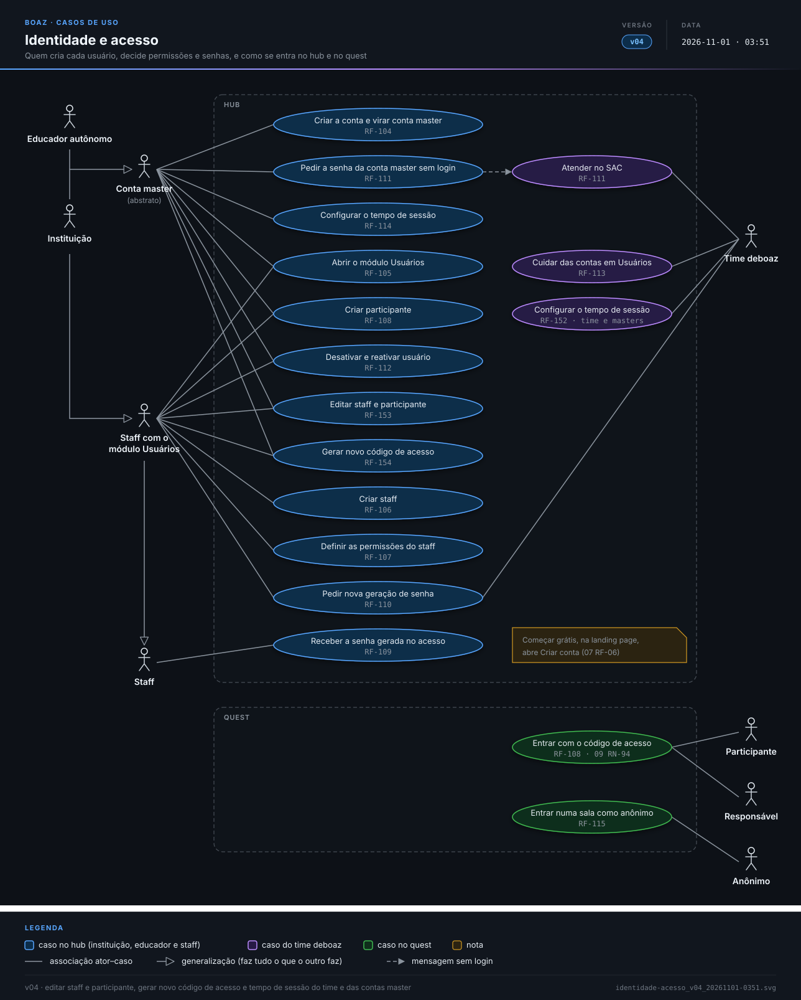
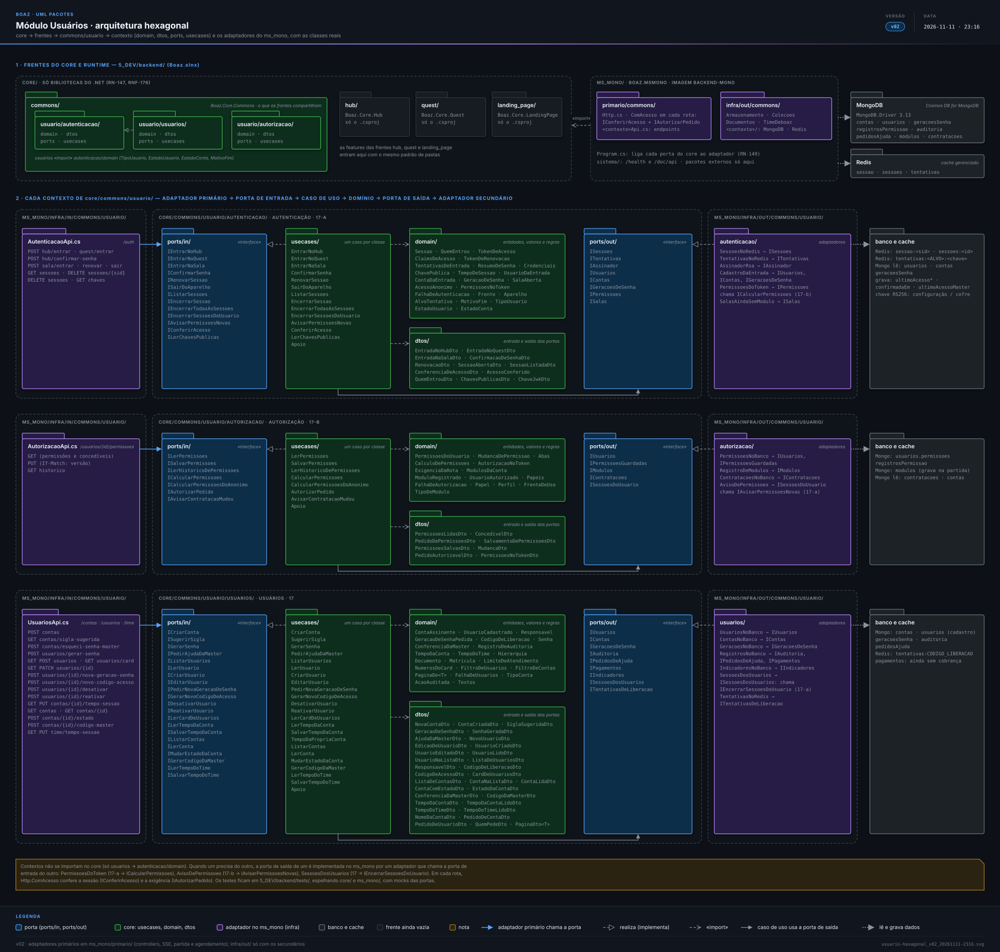

> **boaz · Funcionalidade** · `17_modulo-usuario` · **v104** · 2026-11-11 23:25 · **Em revisão**

# Módulo Usuários

**Objetivo:** definir quem são os usuários do deboaz, quem cria cada um, que permissões recebem, como entram, como recuperam o acesso sem e-mail e quanto tempo a sessão dura, na landing page, no hub e no quest.

**Sumário:** [Cenários de tela](#cenarios-tela) · [Cenários de API](#cenarios-api) · [Telas](#telas) · [Diagramas](#diagramas) · [Histórico](#historico)

---

<a id="cenarios-tela"></a>

## Cenários de tela

<a id="quem-cria-cada-usuario"></a>

### Quem cria cada usuário

```gherkin
Esquema do Cenário: origem de cada usuário
  Quando <quem> passa a existir
  Então foi criado por <origem>

  Exemplos:
    | quem                           | origem                                         |
    | a conta master da escola EBFGA | ela mesma, em Criar conta                      |
    | o educador autônomo Pedro Reis | ele mesmo, em Criar conta                      |
    | a staff Maria Souza            | a conta master, no módulo Usuários             |
    | o participante Lucas Andrade   | a conta master ou um staff, no módulo Usuários |
    | o membro do time Caio Reis     | o administrador do deboaz, no Usuários do time |

Cenário: sem login externo, sem e-mail e sem segundo fator
  Quando qualquer pessoa entra no hub
  Então entra só com a entrada e a senha gerada pelo sistema
  E o deboaz não oferece login Google ou Microsoft, nem segundo fator
  E nenhuma senha ou código é enviado por e-mail ou mensagem
```

<a id="RF-104"></a>

### `RF-104` Conta master

```gherkin
Cenário: escola cria a conta
  Dado a pessoa na tela Criar conta
  Quando escolhe "Instituição", informa o domínio "objetivo_unidade1" e a sigla "EBFGA"
  E toca em "Criar conta"
  Então vê a senha gerada uma única vez, para anotar
  E passa a entrar como conta master com "objetivo_unidade1@deboaz.com"

Cenário: sigla já usada
  Dado uma conta com a sigla "EBFGA"
  Quando outra instituição tenta criar a conta com a sigla "EBFGA"
  Então o sistema recusa a sigla e pede outra
```

<a id="RF-105"></a>

### `RF-105` Módulo Usuários

```gherkin
Cenário: educador autônomo
  Dado a conta master de um educador autônomo
  Quando abre o módulo Usuários
  Então vê só os participantes, sem staff nem permissões
```

<a id="RF-106"></a>

### `RF-106` Criar staff

```gherkin
Cenário: secretária cadastrada pela escola
  Dado a conta master da instituição de sigla "EEJSA" no módulo Usuários
  Quando cria o staff "Maria Souza" com o nome curto "maria"
  Então a Maria aparece na lista do staff, sem permissões
  E a entrada dela é "maria.eejsa@deboaz.com"

Cenário: educador autônomo não cria staff
  Dado a conta master de um educador autônomo no módulo Usuários
  Quando procura a ação de criar staff
  Então o sistema não oferece a ação
```

<a id="RF-107"></a>

### `RF-107` Permissões do staff

```gherkin
Cenário: professor com a Presença
  Dado a instituição com o módulo Presença contratado
  Quando a conta master marca a aba Utilização da Presença para o staff "Paulo"
  Então o Paulo vê a Presença em Módulos só com a aba Utilização

Cenário: módulo não contratado
  Dado a instituição sem o módulo Carteirinha contratado
  Quando a conta master define as permissões de um staff
  Então a Carteirinha não aparece entre os módulos que ela pode marcar
```

<a id="RF-108"></a>

### `RF-108` Criar participante

```gherkin
Cenário: aluno novo com dois responsáveis
  Dado o staff com o módulo Usuários da escola de sigla "EBFGA"
  Quando cria o participante "Lucas Andrade", nome curto "lucas"
  E com a mãe "Carla Andrade" e o pai "Paulo Andrade"
  Então o Lucas aparece entre os participantes com um código como "EBFGA-LUCAS-0412", sem senha
  E esse código abre o perfil dele no quest, para ele e para os dois responsáveis
```

<a id="RF-109"></a>

### `RF-109` Senha gerada no acesso

```gherkin
Cenário: primeiro acesso do staff
  Dado o staff "Gustavo Boaz de Moura Souza", recém-criado
  E o código de liberação entregue pela secretaria
  Quando entra pela primeira vez com a entrada dele e o código
  Então vê uma única vez uma senha como "Gu#Boaz507318", para anotar
  E nenhum superior consegue ver essa senha

Cenário: sem o código de liberação
  Dado um staff com a geração de senha pendente
  Quando alguém informa a entrada dele sem o código de liberação certo
  Então o sistema não mostra a senha
  E conta uma tentativa errada
```

<a id="RF-110"></a>

### `RF-110` Senha esquecida

```gherkin
Cenário: professor esqueceu a senha
  Dado o staff "Paulo", que esqueceu a senha
  Quando o staff com o módulo Usuários pede uma nova geração de senha para ele
  Então vê uma única vez o código de liberação, para entregar ao Paulo
  E a senha antiga do Paulo deixa de valer

Cenário: par não pede a geração
  Dado dois staff com o módulo Usuários
  Quando um procura a nova geração de senha do outro
  Então o sistema não oferece a ação
```

<a id="RF-111"></a>

### `RF-111` Atendimento sem login

```gherkin
Cenário: conta master esqueceu a senha
  Dado a pessoa na tela Entrar do hub, sem login
  Quando toca em "Esqueci a senha da conta master", informa a instituição e um contato e envia
  Então a mensagem aparece no SAC do time deboaz
  E a pessoa vê que o time deboaz vai conferir os dados do cadastro
```

<a id="RF-112"></a>

### `RF-112` Desativar e reativar

```gherkin
Cenário: professor que saiu da escola
  Dado o staff "Paulo" com o hub aberto no celular
  Quando a conta master desativa o Paulo
  Então a próxima ação do Paulo no celular leva à tela Entrar
  E o Paulo continua na lista do staff, como desativado
```

<a id="RF-113"></a>

### `RF-113` Contas no módulo Usuários do time deboaz

```gherkin
Cenário: falta de pagamento
  Dado uma escola ativa com o pagamento em atraso
  Quando o time deboaz desativa a conta na lista Contas do módulo Usuários
  Então o staff e os participantes da escola não entram mais
  E a conta continua na lista Contas, como desativada, com os dados guardados

Cenário: pagamento regularizado
  Dado a mesma escola desativada
  Quando o time deboaz reativa a conta
  Então o staff e os participantes voltam a entrar com as mesmas permissões
```

<a id="RF-114"></a>

### `RF-114` Tempo de sessão

```gherkin
Cenário: sessão do staff termina
  Dado a instituição com um tempo de sessão do staff configurado
  Quando um staff fica sem usar o hub por mais que esse tempo
  Então a próxima ação dele leva à tela Entrar
  E uma sala ao vivo aberta por ele não é encerrada por isso
```

<a id="RF-152"></a>

### `RF-152` Tempo de sessão das contas master e do time

```gherkin
Cenário: time deboaz muda o tempo da conta master no navegador
  Dado o time deboaz na aba Configuração do módulo Usuários
  Quando informa 4 h para as contas master no navegador e salva
  Então a conta master de uma escola que fica 4 h sem usar o hub volta à tela Entrar
  E o tempo dos membros do time continua o mesmo

Cenário: valor fora dos limites
  Quando o time deboaz informa para os membros no navegador um tempo fora dos limites
  Então o campo mostra o erro com os limites e nada é salvo
```

<a id="RF-153"></a>

### `RF-153` Editar staff e participante

```gherkin
Cenário: nome curto do staff
  Dado a staff Maria Souza com a entrada maria.ebfga@deboaz.com e o hub aberto no navegador
  Quando a conta master muda o nome curto dela para "mariasouza" e salva
  Então a sessão aberta da Maria termina
  E ela entra com mariasouza.ebfga@deboaz.com e a mesma senha

Cenário: responsável novo
  Dado o participante Lucas Andrade com a mãe como responsável
  Quando a conta master adiciona Paulo Andrade como pai e salva
  Então o participante selecionado mostra os dois responsáveis, com o mesmo código de acesso

Cenário: nome curto repetido
  Quando a conta master muda o nome curto de um staff para um que já existe na escola
  Então o campo mostra o erro e nada é salvo
```

<a id="RF-154"></a>

### `RF-154` Novo código de acesso

```gherkin
Cenário: família perdeu o código
  Dado o participante Lucas Andrade com o código EBFGA-LUCAS-0412 aberto no celular da mãe
  Quando a conta master toca Gerar novo código de acesso e confirma
  Então o código EBFGA-LUCAS-0412 deixa de valer e a sessão do celular da mãe termina
  E o participante selecionado mostra o código novo, EBFGA-LUCAS-<4 números>
```

<a id="RF-155"></a>

### `RF-155` Permissões do membro do time

```gherkin
Cenário: membro só com o SAC
  Dado o membro do time Caio Lima, sem módulos
  Quando o administrador do deboaz marca para ele a Utilização do SAC e salva
  Então o Caio vê só o card do SAC em Módulos na próxima ação
  E não vê os cards de Usuários nem do Catálogo
```

<a id="RF-115"></a>

### `RF-115` Acesso anônimo

```gherkin
Cenário: visitante de evento aberto
  Dado uma sala da instituição de sigla "EBFGA" que aceita participante anônimo
  Quando a pessoa entra pelo código da sala sem código de acesso
  Então participa da sala com um apelido como "PUPIL-EBFGA-13465"
  E não consegue abrir perfil, tarefa ou outra sala com esse acesso
```

<a id="RN-164"></a>

### `RN-164` Quem se cadastra sozinho

```gherkin
Cenário: staff não se cadastra
  Quando a Maria abre Criar conta
  Então só pode criar a conta de uma instituição ou de um educador autônomo
  E a conta dela de staff só nasce pela conta master, no módulo Usuários

Cenário: só o administrador cria membros
  Dado o membro do time Caio com a Utilização de Usuários
  Quando ele procura Novo membro
  Então a ação não aparece
```

<a id="RN-165"></a>

### `RN-165` Autônomo sem staff

```gherkin
Cenário: autônomo só com participantes
  Quando o educador autônomo Pedro abre o módulo Usuários
  Então vê só Participantes, sem Staff nem Permissões
```

<a id="RN-167"></a>

### `RN-167` Ninguém concede o que não tem

```gherkin
Cenário: conta master tem tudo
  Quando a conta master abre Permissões da Maria
  Então pode marcar qualquer aba de qualquer módulo da escola

Cenário: staff concede só o que tem
  Dado o João com Administrar usuários e só a Utilização do Quiz
  Quando ele abre Permissões da Ana
  Então só pode marcar Administrar usuários e a Utilização do Quiz
```

<a id="RN-169"></a>

### `RN-169` Ordem de superior

```gherkin
Esquema do Cenário: quem age sobre quem
  Quando <quem> procura nova geração de senha, desativar ou reativar <alvo>
  Então a ação <resultado>

  Exemplos:
    | quem                      | alvo                      | resultado   |
    | o administrador           | o membro Caio             | aparece     |
    | o time deboaz             | a conta master da EBFGA   | aparece     |
    | a conta master            | o João, com Adm. usuários | aparece     |
    | o João, com Adm. usuários | a staff Ana               | aparece     |
    | o João, com Adm. usuários | o Lucas                   | aparece     |
    | o João, com Adm. usuários | o Rui, também com Adm.    | não aparece |
    | o qaadmin                 | o admin                   | não aparece |
    | o admin                   | o qaadmin                 | não aparece |
    | a staff Ana               | o João                    | não aparece |
```

<a id="RN-172"></a>

### `RN-172` Senha da conta master

```gherkin
Cenário: conferência pelo SAC
  Dado a conta master da EBFGA pedindo ajuda pelo SAC
  Quando a Ana Lima, do time deboaz, confere o CNPJ 12.345.678/0001-90
  E confere 2 de 3: o nome de quem cadastrou, o telefone e a data do último pagamento
  Então pode pedir a nova geração de senha da conta master
  E o código de liberação vai ao contato conferido (51) 99999-0000

Cenário: conferência incompleta
  Quando só o CNPJ e o telefone conferem e a data do pagamento não confere
  Então Gerar código da master continua inativo
```

<a id="RN-176"></a>

### `RN-176` Sessão não encerra a sala

```gherkin
Cenário: sala ao vivo continua
  Dado a Maria com uma sala ao vivo aberta
  Quando a sessão dela termina pelo tempo sem uso
  Então a sala continua aberta pelo tempo do módulo
```

<a id="RN-177"></a>

### `RN-177` Acesso anônimo

```gherkin
Cenário: apelido na sala
  Quando uma pessoa entra sem código na sala 482107 da EBFGA
  Então recebe um apelido como "PUPIL-EBFGA-13465", único na sala
  E não abre perfil, tarefa nem outra sala

Cenário: sala fecha
  Quando o professor fecha a sala 482107
  Então o acesso "PUPIL-EBFGA-13465" termina
```

<a id="RN-179"></a>

### `RN-179` Sigla

```gherkin
Cenário: sigla sugerida
  Quando a escola informa o nome "Escola Bento Freitas Gonçalves Araújo"
  Então a sigla sugerida é "EBFGA"

Esquema do Cenário: sigla recusada
  Dado a sigla "EBFGA" já usada
  Quando outra conta informa a sigla "<sigla>"
  Então <resultado>

  Exemplos:
    | sigla | resultado                                   |
    | ebfga | é recusada, já existe                       |
    | DBOAZ | é recusada, reservada ao time               |
    | QAEDU | em produção, é recusada, reservada ao time  |
    | EBF   | é recusada, precisa de 5 letras             |
    | COLSA | é aceita                                    |
    | colsa | é aceita e gravada como "COLSA"             |

Cenário: sigla não muda
  Quando a conta master da EBFGA procura mudar a sigla
  Então a sigla não pode ser editada
```

<a id="RN-242"></a>

### `RN-242` Mesmo formulário para todos

```gherkin
Esquema do Cenário: documento de cada conta
  Quando <quem> cria a conta
  Então informa nome, <documento>, responsável, telefone, domínio e sigla

  Exemplos:
    | quem                | documento               |
    | a escola            | CNPJ 12.345.678/0001-90 |
    | a empresa           | CNPJ                    |
    | o educador autônomo | CPF 123.456.789-09      |
```

<a id="RN-180"></a>

### `RN-180` Entradas

```gherkin
Esquema do Cenário: formato da entrada
  Quando <quem> entra na tela Entrar
  Então usa a entrada "<entrada>"

  Exemplos:
    | quem                     | entrada                      |
    | a conta master da EBFGA  | objetivo_unidade1@deboaz.com |
    | a staff Maria, da EEJSA  | maria.eejsa@deboaz.com       |
    | o membro do time Gustavo | gustavo.dboaz@deboaz.com     |

Cenário: maiúsculas e minúsculas
  Quando a Maria digita "Maria.EEJSA@deboaz.com"
  Então entra como "maria.eejsa@deboaz.com"

Cenário: sem caixa de e-mail
  Quando alguém manda um e-mail para "maria.eejsa@deboaz.com"
  Então nenhuma caixa recebe, porque o endereço só identifica a entrada
```

<a id="RN-243"></a>

### `RN-243` Tempo de sessão do time e das contas master

```gherkin
Esquema do Cenário: limites e padrão
  Quando o time deboaz configura o tempo de <quem>, no navegador ou no app
  Então aceita de <mínimo> a <máximo>, com padrão <padrão>

  Exemplos:
    | quem                      | mínimo | máximo | padrão |
    | membros do time           | 15 min | 12 h   | 8 h    |
    | contas master e autônomos | 15 min | 24 h   | 8 h    |

Cenário: escola não muda a própria conta master
  Quando a conta master da EBFGA abre a Configuração de Usuários
  Então não vê o tempo de sessão da conta master
```

<a id="RN-246"></a>

### `RN-246` Membro novo sem módulos

```gherkin
Cenário: começa sem nada
  Quando o administrador cria o membro Caio Reis
  Então o Caio entra e vê Módulos vazio
  E quando o administrador marca o SAC, o card aparece na próxima ação, sem nova entrada
```

<a id="RN-185"></a>

### `RN-185` Listas e busca

```gherkin
Esquema do Cenário: busca nas listas
  Quando <quem> busca "<termo>" em <lista>
  Então encontra <resultado>

  Exemplos:
    | quem           | lista         | termo              | resultado               |
    | a conta master | Staff         | maria.ebfga        | a Maria                 |
    | a conta master | Staff         | 20260087           | a Maria, pela matrícula |
    | a conta master | Participantes | EBFGA-LUCAS-0412   | o Lucas                 |
    | o time deboaz  | Contas        | EBFGA              | a Escola Bento Freitas  |
    | o time deboaz  | Contas        | 12.345.678/0001-90 | a Escola Bento Freitas  |

Cenário: ordem e filtro
  Quando a conta master abre Staff com o filtro Desativados
  Então vê só o staff desativado, de A a Z

Cenário: ordem do SAC
  Quando o membro do time abre o SAC
  Então vê primeiro a mensagem mais antiga
```

<a id="RN-186"></a>

### `RN-186` Último acesso

```gherkin
Cenário: participante com quem entrou
  Dado a Carla, mãe do Lucas, entrou hoje às 07:55
  Quando a conta master vê o Lucas
  Então vê "hoje, 07:55, a mãe"

Cenário: último acesso da conta
  Quando o time deboaz vê a EBFGA
  Então vê o último acesso da conta master, hoje, 08:15
```

<a id="RN-187"></a>

### `RN-187` Ver a conta

```gherkin
Cenário: só o cadastro
  Quando o time deboaz toca Ver a conta da EBFGA
  Então vê tipo, nome, CNPJ, sigla, entrada da conta master, responsável e telefone
  E as datas de criação, 12/03/2026, do último pagamento, 05/10/2026, e do último acesso
  E não vê usuários, turmas nem conteúdos da escola
```

<a id="RN-188"></a>

### `RN-188` Matrícula

```gherkin
Cenário: matrícula que a escola já usa
  Quando a conta master cria a Maria com a matrícula "20260087"
  Então a matrícula da Maria é "20260087"

Cenário: gerar automaticamente
  Quando a conta master toca Gerar automaticamente no Lucas
  Então o sistema cria uma matrícula de 8 números, como "48201755", única na escola

Cenário: autônomo sem matrícula
  Quando o educador autônomo cria um participante
  Então o formulário não pede matrícula

Cenário: dois participantes sem matrícula no autônomo
  Dado o educador autônomo Pedro com o participante Lucas, sem matrícula
  Quando cria a participante Bia, também sem matrícula
  Então a Bia é criada sem aviso de matrícula em uso
```

<a id="RN-189"></a>

### `RN-189` Card do módulo Usuários

> Card comum: [15_modulos `RN-276`](15_modulos.md#RN-276), com os recortes de `RN-277`

```gherkin
Esquema do Cenário: dados do card por perfil e tamanho
  Dado o card Usuários do perfil <perfil>, no recorte que as vistas mostram
  Quando está na <tamanho>
  Então mostra <dados>
  E a normal mostra a série de 5 pontos do recorte

  Exemplos:
    | perfil      | tamanho  | dados                                                        |
    | deboaz      | mínima   | o ícone e o selo "7", igual a Master sem acesso há 30 dias   |
    | deboaz      | reduzida | 112 · contas ativas                                          |
    | deboaz      | normal   | 112, "+4 no mês", 82 instituições, 30 autônomos, 4 suspensas |
    | instituição | mínima   | o ícone e o selo "2": códigos de liberação que vencem hoje   |
    | instituição | reduzida | 335 · usuários ativos                                        |
    | instituição | normal   | 335, "+12 no mês", 37 staff, 298 participantes, 4 pendentes  |
    | staff       | mínima   | o ícone e o selo "1": códigos que ela pediu e vencem hoje    |
    | staff       | reduzida | 41 · usuários ativos, só os criados por ela                  |
    | staff       | normal   | 41, "+2 na semana", 3 staff, 38 participantes, 2 pendentes   |
    | autônomo    | mínima   | o ícone e o selo "1": códigos de liberação que vencem hoje   |
    | autônomo    | reduzida | 32 · usuários ativos, com o próprio Pedro                    |
    | autônomo    | normal   | 32, "+1 no dia", 4 criados no mês, 1 pendente                |

Esquema do Cenário: lista da expandida de cada perfil
  Dado o card Usuários do perfil <perfil> na expandida, com a série de 12 pontos
  Então a lista mostra "<primeira>", "<segunda>" e "<terceira>"

  Exemplos:
    | perfil      | primeira                       | segunda       | terceira           |
    | deboaz      | Master sem acesso há 30 dias 7 | Desativadas 3 | Encerradas 2       |
    | instituição | Sem acesso há 30 dias 14       | Desativados 6 | Códigos vencidos 2 |
    | staff       | Sem acesso há 30 dias 5        | Desativados 1 | Códigos vencidos 1 |
    | autônomo    | Sem acesso há 30 dias 3        | Desativados 2 | Códigos vencidos 0 |

Esquema do Cenário: quem vê o card
  Quando <quem> abre Módulos
  Então <resultado>

  Exemplos:
    | quem                           | resultado                                    |
    | o administrador do deboaz      | vê o card do perfil deboaz                   |
    | o membro do time Caio          | vê o mesmo card do administrador             |
    | a conta master da EBFGA        | vê o card do perfil instituição              |
    | a staff Maria, com o Usuários  | vê o card do perfil staff, só com os dela    |
    | um staff sem o Usuários        | não vê o card                                |
    | o educador autônomo Pedro      | vê o card do perfil autônomo                 |
    | o participante Lucas, no quest | não vê o card                                |

Cenário: sem dados
  Dado a EBFGA recém-criada, sem usuários
  Então o card mostra "Cadastre o staff e os participantes" e Configurar

Cenário: rótulo falado
  Quando o leitor de tela lê o card na mínima
  Então diz "Usuários, 2 códigos de liberação vencem hoje"

Cenário: abas do módulo aberto
  Quando a conta master abre Usuários
  Então vê Configuração, com o tempo de sessão
  E Utilização, com staff, participantes e permissões
```

<a id="RN-265"></a>

### `RN-265` Contas qa em homologação

```gherkin
Esquema do Cenário: uma conta qa para cada tipo de usuário no hub
  Dado a aplicação de homologação iniciada
  Quando a pessoa de testes entra no hub com "<entrada>" e a senha do Key Vault
  Então entra como <tipo>

  Exemplos:
    | entrada                   | tipo                                    |
    | qaadmin.dboaz@deboaz.com  | administrador do deboaz, só para testes |
    | qamembro.dboaz@deboaz.com | membro do time deboaz                   |
    | qa_instituicao@deboaz.com | conta master da instituição "QAINS"     |
    | qa_autonomo@deboaz.com    | educador autônomo, conta "QAAUT"        |
    | qastaff.qains@deboaz.com  | staff da instituição "QAINS"            |

Cenário: participante qa no quest
  Dado a aplicação de homologação iniciada
  Quando a pessoa de testes entra no quest com o código "QAINS-QAPART-0001" do Key Vault
  Então entra como o participante "qapart" da instituição "QAINS", sem senha

Cenário: contas qa não existem em produção
  Dado a aplicação de produção iniciada
  Quando alguém informa "qastaff.qains@deboaz.com" e uma senha em Entrar
  Então vê "Entrada ou senha incorretas."
```

<a id="RN-268"></a>

### `RN-268` Módulos iniciais das contas qa

```gherkin
Cenário: contas qa começam com os módulos da lista
  Dado o Key Vault de homologação com a parte da staff "MOD-03", "MOD-04" e "MOD-05"
  E a parte do time "MOD-03" e "MOD-14"
  Quando a aplicação de homologação inicia
  Então a conta master da "QAINS" e o educador da "QAAUT" veem os 3 cards da staff em Contratados
  E o "qastaff" entra e vê os 3 cards em Módulos, com as abas da parte da staff
  E o "qamembro" entra e vê "MOD-03" e "MOD-14" em Módulos, com as abas da parte do time

Cenário: lista trocada sem mudar o requisito
  Dado a parte da staff trocada para "MOD-03" e "MOD-12"
  E a parte do time trocada para "MOD-03" e "MOD-02"
  Quando a aplicação de homologação inicia de novo
  Então as contas "QAINS" e "QAAUT" e o "qastaff" ganham "MOD-12" e perdem "MOD-04" e "MOD-05"
  E o "qamembro" vê "MOD-02" no lugar de "MOD-14"

Cenário: produção segue a contratação
  Dado a aplicação de produção iniciada
  Quando a conta master da EBFGA entra pela primeira vez
  Então vê em Contratados só os módulos que a EBFGA contratou
  E nenhum módulo vem da inicialização
```

<a id="RN-269"></a>

### `RN-269` Dados fictícios das contas qa

```gherkin
Esquema do Cenário: conta qa com nome e documento no formato do projeto
  Dado a aplicação de homologação iniciada
  Quando o administrador qa toca Ver a conta da "<sigla>"
  Então vê o nome "<nome>" e o <documento>
  E nenhum desses dados é de uma pessoa ou empresa real

  Exemplos:
    | sigla | nome                     | documento               |
    | QAINS | Instituição QA de Testes | CNPJ 98.765.432/0001-98 |
    | QAAUT | Educador QA de Testes    | CPF 987.654.321-00      |

Esquema do Cenário: nome de cada pessoa qa
  Dado a aplicação de homologação iniciada
  Quando a pessoa de testes entra com "<entrada>"
  Então vê o nome "<nome>" na Conta

  Exemplos:
    | entrada                   | nome               |
    | qaadmin.dboaz@deboaz.com  | Administrador QA   |
    | qamembro.dboaz@deboaz.com | Membro QA          |
    | qastaff.qains@deboaz.com  | Staff QA           |
    | QAINS-QAPART-0001         | Participante QA    |
```

---

<a id="cenarios-api"></a>

## Cenários de API

<a id="RF-104-api"></a>

### `RF-104` Conta master

```gherkin
Cenário: escola cria a conta
  Quando envia POST /contas, sem login, com:
    """
    {
      "tipo": "INSTITUICAO",
      "nome": "Escola Bento Freitas",
      "documento": "12.345.678/0001-90",
      "responsavel": "Gustavo Boaz de Moura Souza",
      "telefone": "(51) 99999-0000",
      "dominio": "objetivo_unidade1",
      "sigla": "EBFGA"
    }
    """
  Então a resposta é 201 com:
    """
    {
      "contaId": "conta-ebfga",
      "login": "objetivo_unidade1@deboaz.com",
      "senha": "Gu#Boaz507318",
      "comprovante": "c7e1…"
    }
    """
  E POST /auth/hub/confirmar-senha com o comprovante abre a sessão da conta master

Cenário: sigla já usada
  Dado uma conta com a sigla "EBFGA"
  Quando envia POST /contas com a sigla "EBFGA"
  Então a resposta é 409 SIGLA_EM_USO e nenhuma conta é criada

Cenário: domínio já usado
  Quando envia POST /contas com o domínio "objetivo_unidade1", já usado
  Então a resposta é 409 DOMINIO_EM_USO
```

<a id="RF-106-api"></a>

### `RF-106` Criar staff

```gherkin
Cenário: secretária cadastrada pela escola
  Dado o token da conta master da EBFGA, com "MOD-03" com "CU"
  Quando envia POST /usuarios com:
    """
    {
      "tipo": "STAFF",
      "nome": "Maria Souza",
      "nomeCurto": "maria",
      "matricula": "20260087"
    }
    """
  Então a resposta é 201 com:
    """
    {
      "id": "usr-ebfga-maria",
      "login": "maria.ebfga@deboaz.com",
      "estado": "PENDENTE",
      "codigoLiberacao": "482913",
      "venceEm": "2026-11-04T22:06:00Z"
    }
    """

Cenário: educador autônomo não cria staff
  Dado o token do educador autônomo Pedro
  Quando envia POST /usuarios com o tipo "STAFF"
  Então a resposta é 403 ACESSO_NEGADO

Cenário: nome curto repetido
  Quando a conta master envia POST /usuarios com o nome curto "maria", já usado na EBFGA
  Então a resposta é 409 NOME_CURTO_EM_USO
```

<a id="RF-108-api"></a>

### `RF-108` Criar participante

```gherkin
Cenário: aluno novo com dois responsáveis
  Dado o token do staff João, com "MOD-03" com "U"
  Quando envia POST /usuarios com:
    """
    {
      "tipo": "PARTICIPANTE",
      "nome": "Lucas Andrade",
      "nomeCurto": "lucas",
      "matricula": null,
      "responsaveis": [
        {
          "nome": "Carla Andrade",
          "parentesco": "MAE"
        },
        {
          "nome": "Paulo Andrade",
          "parentesco": "PAI"
        }
      ]
    }
    """
  Então a resposta é 201 com o login "EBFGA-LUCAS-" seguido de 4 números, sem senha
  E POST /auth/quest/entrar com esse código abre o perfil do Lucas
```

<a id="RF-109-api"></a>

### `RF-109` Senha gerada no acesso

```gherkin
Cenário: primeiro acesso do staff
  Dado o staff "gustavo.ebfga@deboaz.com" pendente, com o código de liberação "482913"
  Quando envia POST /usuarios/gerar-senha, sem login, com:
    """
    {
      "entrada": "gustavo.ebfga@deboaz.com",
      "codigoLiberacao": "482913"
    }
    """
  Então a resposta é 200 com:
    """
    {
      "senha": "Gu#Boaz507318",
      "comprovante": "c7e1…"
    }
    """
  E o mesmo pedido, enviado de novo, recebe 401 CODIGO_INVALIDO

Cenário: código errado
  Quando envia POST /usuarios/gerar-senha com o código "111111"
  Então a resposta é 401 CODIGO_INVALIDO, sem a senha, e conta uma tentativa errada

Cenário: quinto código errado
  Dado 4 códigos errados seguidos para "gustavo.ebfga@deboaz.com"
  Quando o quinto chega a POST /usuarios/gerar-senha
  Então a resposta é 429 ENTRADA_BLOQUEADA com tentarEm
```

<a id="RF-110-api"></a>

### `RF-110` Senha esquecida

```gherkin
Cenário: professor esqueceu a senha
  Dado o token do staff João, com "MOD-03" com "U", superior do Paulo
  Quando envia POST /usuarios/usr-ebfga-paulo/nova-geracao-senha
  Então a resposta é 201 com codigoLiberacao e venceEm
  E POST /auth/hub/entrar com a senha antiga do Paulo recebe 401 ENTRADA_INVALIDA
  E os tokens das sessões abertas do Paulo recebem 401

Cenário: par não pede a geração
  Quando o João envia POST /usuarios/usr-ebfga-rui/nova-geracao-senha, de um par dele
  Então a resposta é 403 ACESSO_NEGADO

Cenário: participante não tem senha
  Quando a conta master envia POST /usuarios/usr-ebfga-lucas/nova-geracao-senha
  Então a resposta é 422 SEM_SENHA
```

<a id="RF-111-api"></a>

### `RF-111` Atendimento sem login

```gherkin
Cenário: conta master esqueceu a senha
  Quando envia POST /contas/esqueci-senha-master, sem login, com:
    """
    {
      "instituicao": "Escola Bento Freitas",
      "contato": "(51) 99999-0000"
    }
    """
  Então a resposta é 202 e a mensagem entra no SAC do time deboaz
```

<a id="RF-112-api"></a>

### `RF-112` Desativar e reativar

```gherkin
Cenário: professor que saiu da escola
  Dado o Paulo com uma sessão no app
  Quando a conta master envia POST /usuarios/usr-ebfga-paulo/desativar
  Então a resposta é 204
  E o token do app do Paulo recebe 401 no próximo pedido
  E GET /usuarios?tipo=STAFF&estado=DESATIVADO traz o Paulo

Cenário: reativar
  Quando a conta master envia POST /usuarios/usr-ebfga-paulo/reativar
  Então a resposta é 204 e o Paulo volta a ATIVO com as mesmas permissões

Cenário: já desativado
  Quando a conta master envia POST /usuarios/usr-ebfga-paulo/desativar de novo
  Então a resposta é 409 ESTADO_IGUAL
```

<a id="RF-113-api"></a>

### `RF-113` Contas no módulo Usuários do time deboaz

```gherkin
Cenário: falta de pagamento
  Dado o token do membro do time Caio, com "MOD-03" com "U"
  Quando envia POST /contas/conta-ebfga/estado com:
    """
    {
      "estado": "DESATIVADA"
    }
    """
  Então a resposta é 200 com o estado "DESATIVADA"
  E POST /auth/hub/entrar da Maria e POST /auth/quest/entrar do Lucas recebem 403
  E GET /contas?estado=DESATIVADA traz a EBFGA

Cenário: pagamento regularizado
  Quando o Caio envia POST /contas/conta-ebfga/estado com o estado "ATIVA"
  Então a resposta é 200 e a Maria e o Lucas voltam a entrar com as mesmas permissões
```

<a id="RF-114-api"></a>

### `RF-114` Tempo de sessão

```gherkin
Cenário: ler e salvar o tempo da escola
  Dado o token da conta master da EBFGA, com "MOD-03" com "CU"
  Quando envia PUT /contas/conta-ebfga/tempo-sessao com:
    """
    {
      "staffNavegador": "PT4H",
      "staffApp": "P7D",
      "participante": "P30D"
    }
    """
  Então a resposta é 200 com o mesmo corpo
  E GET /contas/conta-ebfga/tempo-sessao devolve "PT4H" no staff do navegador

Cenário: sem a aba Configuração
  Quando a Maria, com "MOD-03" só com "U", envia GET /contas/conta-ebfga/tempo-sessao
  Então a resposta é 403 ACESSO_NEGADO
```

<a id="RF-152-api"></a>

### `RF-152` Tempo de sessão das contas master e do time

```gherkin
Cenário: time deboaz muda o tempo da conta master no navegador
  Dado o token do administrador do deboaz, com "MOD-03" com "CU"
  Quando envia PUT /time/tempo-sessao com:
    """
    {
      "membrosNavegador": "PT8H",
      "membrosApp": "PT8H",
      "mastersNavegador": "PT4H",
      "mastersApp": "PT8H"
    }
    """
  Então a resposta é 200 com o mesmo corpo

Cenário: valor fora dos limites
  Quando envia PUT /time/tempo-sessao com "mastersNavegador" igual a "PT30H"
  Então a resposta é 422 FORA_DOS_LIMITES com:
    """
    {
      "campo": "mastersNavegador",
      "minimo": "PT15M",
      "maximo": "PT24H"
    }
    """
  E GET /time/tempo-sessao continua com "PT4H"
```

<a id="RF-153-api"></a>

### `RF-153` Editar staff e participante

```gherkin
Cenário: nome curto do staff
  Dado a Maria com uma sessão no navegador
  Quando a conta master envia PATCH /usuarios/usr-ebfga-maria com:
    """
    {
      "nomeCurto": "mariasouza"
    }
    """
  Então a resposta é 200 com o login "mariasouza.ebfga@deboaz.com"
  E o token do navegador da Maria recebe 401 no próximo pedido
  E POST /auth/hub/entrar com o login novo e a mesma senha recebe 200

Cenário: responsável novo
  Quando a conta master envia PATCH /usuarios/usr-ebfga-lucas com a mãe e o pai em responsaveis
  Então GET /usuarios/usr-ebfga-lucas traz os dois responsáveis e o mesmo login

Cenário: nome curto repetido
  Quando a conta master envia PATCH /usuarios/usr-ebfga-ana com o nome curto "maria"
  Então a resposta é 409 NOME_CURTO_EM_USO e nada muda
```

<a id="RF-154-api"></a>

### `RF-154` Novo código de acesso

```gherkin
Cenário: família perdeu o código
  Dado a Carla com uma sessão do quest pelo código "EBFGA-LUCAS-0412"
  Quando a conta master envia POST /usuarios/usr-ebfga-lucas/novo-codigo-acesso
  Então a resposta é 200 com o login "EBFGA-LUCAS-" seguido de 4 números novos
  E o token da Carla recebe 401 e POST /auth/quest/entrar com o código antigo recebe 401

Cenário: só participante
  Quando a conta master envia POST /usuarios/usr-ebfga-maria/novo-codigo-acesso
  Então a resposta é 422 SO_PARTICIPANTE
```

<a id="RF-155-api"></a>

### `RF-155` Permissões do membro do time

```gherkin
Cenário: membro só com o SAC
  Dado o membro do time Caio Lima, sem módulos
  Quando o administrador envia PUT /usuarios/usr-dboaz-caio/permissoes com "MOD-02" com "U"
  Então a resposta é 200
  E POST /auth/renovar do Caio devolve um token só com "MOD-02" com "U"
```

<a id="RN-163"></a>

### `RN-163` Tipos de usuário

```gherkin
Esquema do Cenário: quem é usuário
  Quando <quem> entra
  Então <é usuário>

  Exemplos:
    | quem                            | é usuário                                     |
    | a conta master da EBFGA         | GET /usuarios/{id} traz o tipo "MASTER"       |
    | o educador autônomo Pedro       | GET /usuarios/{id} traz o tipo "MASTER"       |
    | a staff Maria                   | GET /usuarios/{id} traz o tipo "STAFF"        |
    | o Lucas                         | GET /usuarios/{id} traz o tipo "PARTICIPANTE" |
    | o membro do time Caio           | GET /usuarios/{id} traz o tipo "MEMBRO_TIME"  |
    | a Carla, mãe do Lucas           | não é usuário: fica nos responsaveis do Lucas |
    | uma pessoa sem código numa sala | não é usuário: acesso anônimo                 |
```

<a id="RN-164-api"></a>

### `RN-164` Quem se cadastra sozinho

```gherkin
Cenário: staff não se cadastra
  Quando envia POST /contas com o tipo "STAFF"
  Então a resposta é 422 DADOS_INVALIDOS com o campo "tipo"

Cenário: só o administrador cria membros
  Dado o token do membro do time Caio, com "MOD-03" com "U"
  Quando envia POST /usuarios com o tipo "MEMBRO_TIME"
  Então a resposta é 403 ACESSO_NEGADO
```

<a id="RN-165-api"></a>

### `RN-165` Autônomo sem staff

```gherkin
Cenário: autônomo só com participantes
  Dado o token do educador autônomo Pedro
  Quando envia GET /usuarios?tipo=STAFF
  Então a resposta é 403 ACESSO_NEGADO
  E GET /usuarios?tipo=PARTICIPANTE recebe 200
```

<a id="RN-166"></a>

### `RN-166` Permissão só em módulo contratado

```gherkin
Cenário: descontratou e recontratou
  Dado o Paulo com "MOD-06" com "U"
  Quando a escola descontrata a Presença
  Então GET /usuarios/usr-ebfga-paulo/permissoes não traz "MOD-06" em mods
  E quando a escola recontrata a Presença, "MOD-06" volta com "U"

Cenário: salvar módulo não contratado
  Quando a conta master envia PUT /usuarios/usr-ebfga-paulo/permissoes com "MOD-12"
  Então a resposta é 422 MODULO_NAO_CONTRATADO
```

<a id="RN-167-api"></a>

### `RN-167` Ninguém concede o que não tem

```gherkin
Cenário: conta master tem tudo
  Quando a conta master envia GET /usuarios/usr-ebfga-maria/permissoes
  Então concediveis traz todos os módulos contratados pela escola, com "CU"

Cenário: staff concede só o que tem
  Dado o João com "MOD-03" com "CU" e "MOD-05" com "U"
  Quando envia GET /usuarios/usr-ebfga-ana/permissoes
  Então concediveis traz só "MOD-03" com "CU" e "MOD-05" com "U"
```

<a id="RN-168"></a>

### `RN-168` Administrar usuários

```gherkin
Cenário: staff que administra usuários
  Dado a conta master tendo salvado "MOD-03" com "CU" para o João
  Quando o João envia POST /usuarios para criar a staff Ana
  Então a resposta é 201
  E PUT /usuarios/usr-ebfga-ana/permissoes do João aceita só as abas que ele tem
```

<a id="RN-169-api"></a>

### `RN-169` Ordem de superior

```gherkin
Esquema do Cenário: quem age sobre quem
  Quando <quem> envia POST /usuarios/{id}/desativar de <alvo>
  Então a resposta é <resposta>

  Exemplos:
    | quem                      | alvo                      | resposta          |
    | o administrador           | o membro Caio             | 204               |
    | a conta master            | o João, com Adm. usuários | 204               |
    | o João, com Adm. usuários | a staff Ana               | 204               |
    | o João, com Adm. usuários | o Lucas                   | 204               |
    | o João, com Adm. usuários | o Rui, também com Adm.    | 403 ACESSO_NEGADO |
    | o qaadmin                 | o admin                   | 403 ACESSO_NEGADO |
    | o admin                   | o qaadmin                 | 403 ACESSO_NEGADO |
    | a staff Ana               | o João                    | 403 ACESSO_NEGADO |

Esquema do Cenário: administrador sobre outro administrador
  Dado o token de "<quem>" em homologação
  Quando envia POST /usuarios/{id}/<ação> de "<alvo>"
  Então a resposta é 403 ACESSO_NEGADO
  E "<alvo>" continua com o mesmo estado e a mesma senha

  Exemplos:
    | quem                     | ação               | alvo                     |
    | qaadmin.dboaz@deboaz.com | reativar           | admin.dboaz@deboaz.com   |
    | qaadmin.dboaz@deboaz.com | nova-geracao-senha | admin.dboaz@deboaz.com   |
    | admin.dboaz@deboaz.com   | reativar           | qaadmin.dboaz@deboaz.com |
    | admin.dboaz@deboaz.com   | nova-geracao-senha | qaadmin.dboaz@deboaz.com |

Cenário: time deboaz e a conta master
  Quando o membro do time Caio envia POST /contas/conta-ebfga/codigo-master
  Então a nova geração da conta master da EBFGA segue a RN-172
```

<a id="RN-170"></a>

### `RN-170` Ninguém vê a senha de outro

```gherkin
Cenário: senha só para o próprio usuário
  Quando a conta master envia POST /usuarios para criar a Maria
  Então a resposta traz o código de liberação e nenhum campo de senha
  E GET /usuarios/usr-ebfga-maria não traz senha nem resumo da senha
  E a senha só sai em POST /usuarios/gerar-senha, para quem tem o código

Cenário: exceção do administrador
  Então a senha do administrador do deboaz fica no Key Vault, fora de qualquer endereço
```

<a id="RN-171"></a>

### `RN-171` Formato da senha

```gherkin
Esquema do Cenário: senha gerada
  Quando POST /usuarios/gerar-senha gera a senha de "<nome>"
  Então a senha tem o formato de "<exemplo>"

  Exemplos:
    | nome                        | exemplo        |
    | Gustavo Boaz de Moura Souza | Gu#Boaz507318  |
    | Maria da Silva              | Ma!Silva204871 |
    | Xuxa                        | Xu@Xa182482    |

Cenário: o que muda a cada geração
  Quando duas gerações de senha saem para o Gustavo Boaz de Moura Souza
  Então as duas começam com "Gu" e têm "Boaz"
  E o caractere especial e os 6 números são sorteados de novo
```

<a id="RN-172-api"></a>

### `RN-172` Senha da conta master

```gherkin
Cenário: conferência pelo SAC
  Dado o token da Ana Lima, do time deboaz, com "MOD-03" com "U"
  Quando envia POST /contas/conta-ebfga/codigo-master com:
    """
    {
      "documento": "12.345.678/0001-90",
      "responsavel": "Gustavo Boaz de Moura Souza",
      "telefone": "(51) 99999-0000",
      "ultimoPagamento": null
    }
    """
  Então a resposta é 201 com:
    """
    {
      "codigoLiberacao": "482913",
      "contato": "(51) 99999-0000",
      "venceEm": "2026-11-04T22:06:00Z"
    }
    """

Cenário: conferência incompleta
  Quando envia o CNPJ e o telefone certos e a data do último pagamento errada
  Então a resposta é 422 CONFERENCIA_INCOMPLETA e nenhum código é gerado
```

<a id="RN-173"></a>

### `RN-173` Estados da conta

```gherkin
Esquema do Cenário: estado da conta
  Quando o time deboaz envia POST /contas/conta-ebfga/estado com "<estado>"
  Então a resposta é 200 e o estado significa <motivo>

  Exemplos:
    | estado     | motivo                                        |
    | ATIVA      | uso normal                                    |
    | SUSPENSA   | decisão temporária do time deboaz             |
    | DESATIVADA | falta de pagamento, volta com a regularização |
    | ENCERRADA  | pedido do cliente                             |

Cenário: conta encerrada não volta
  Dado a conta da EBFGA encerrada
  Quando o time deboaz envia POST /contas/conta-ebfga/estado com "ATIVA"
  Então a resposta é 409 TRANSICAO_INVALIDA
```

<a id="RN-174"></a>

### `RN-174` Nada é apagado

```gherkin
Cenário: conta encerrada
  Quando o time deboaz envia POST /contas/conta-ebfga/estado com "ENCERRADA"
  Então os dados da escola são apagados em cascata
  E fica só o registro mínimo para histórico, auditoria e cobrança
  E esse registro é anonimizado depois de 5 anos

Cenário: usuário desativado continua na lista
  Quando a conta master envia POST /usuarios/usr-ebfga-paulo/desativar
  Então GET /usuarios/usr-ebfga-paulo continua com 200 e o estado "DESATIVADO"
```

<a id="RN-175"></a>

### `RN-175` Conta bloqueada

```gherkin
Esquema do Cenário: quem não entra
  Dado <situação>
  Quando <quem> envia POST <endereço>
  Então a resposta é 403 ACESSO_INDISPONIVEL

  Exemplos:
    | situação           | quem                  | endereço           |
    | a EBFGA suspensa   | a staff Maria         | /auth/hub/entrar   |
    | a EBFGA desativada | o Lucas               | /auth/quest/entrar |
    | a EBFGA encerrada  | a Carla, mãe do Lucas | /auth/quest/entrar |
    | o Paulo desativado | o Paulo               | /auth/hub/entrar   |
```

<a id="RN-178"></a>

### `RN-178` Auditoria do que muda estado

```gherkin
Esquema do Cenário: execução auditada do começo ao fim
  Quando a Maria envia <pedido>
  E a resposta é de sucesso
  Então a coleção "auditoria" ganha 2 registros da ação "<acao>" com o mesmo traceId
  E o primeiro com a etapa "INICIADO", o segundo com a etapa "CONCLUIDO"
  E os registros das ações internas da RN-275, quando há, vêm à parte, com o mesmo traceId
  E os dois com a Maria, a ação "<acao>", o alvo e a hora, guardados até 5 anos depois

  Exemplos:
    | pedido                                            | acao                |
    | POST /usuarios/usr-ebfga-ana/nova-geracao-senha   | NOVA_GERACAO_SENHA  |
    | PUT /usuarios/usr-ebfga-joao/permissoes           | EDITAR_PERMISSOES   |
    | POST /usuarios/usr-ebfga-paulo/desativar          | DESATIVAR_USUARIO   |
    | POST /usuarios/usr-ebfga-paulo/reativar           | REATIVAR_USUARIO    |
    | PATCH /usuarios/usr-ebfga-lucas                   | EDITAR_USUARIO      |
    | POST /usuarios/usr-ebfga-lucas/novo-codigo-acesso | NOVO_CODIGO_ACESSO  |
    | PUT /contas/conta-ebfga/tempo-sessao              | SALVAR_TEMPO_SESSAO |

Cenário: senha gerada sem login, conta e alvo só na conclusão
  Quando envia POST /usuarios/gerar-senha, sem login, com o código de liberação da Maria
  E a resposta é 200 com a senha
  Então "auditoria" ganha o "INICIADO" da ação "GERAR_SENHA" sem quem, sem contaId e sem alvo
  E o "CONCLUIDO", com o mesmo traceId, vai com a "conta-ebfga" e o alvo "usr-ebfga-maria", sem quem

Cenário: time deboaz, a conta pedida e a master só na conclusão
  Quando o Caio, do time deboaz, envia POST /contas/conta-ebfga/codigo-master
  E a resposta é 201 com o código de liberação
  Então o "INICIADO" da ação "CODIGO_MASTER" vai com "usr-dboaz-caio" e a "conta-ebfga", sem alvo
  E o "CONCLUIDO", com o mesmo traceId, repete os dois e vai com o alvo "usr-ebfga-master"

Cenário: tempo de sessão do time
  Quando o Caio envia PUT /time/tempo-sessao e a resposta é 200
  Então "auditoria" ganha "INICIADO" e "CONCLUIDO" da ação "SALVAR_TEMPO_SESSAO"
  E os dois vão com "usr-dboaz-caio", a "conta-dboaz", a conta de quem pede, e o alvo "time"

Cenário: usuário criado, alvo só na conclusão
  Quando a Maria envia POST /usuarios do participante Lucas
  E a resposta é 201 com o id "usr-ebfga-lucas"
  Então "auditoria" ganha o "INICIADO" da ação "CRIAR_USUARIO" com a Maria e a "conta-ebfga"
  E esse registro vai sem alvo, porque o Lucas ainda não existe
  E o "CONCLUIDO", com o mesmo traceId, vai com a Maria, a "conta-ebfga" e o alvo "usr-ebfga-lucas"

Cenário: criação de usuário recusada, sem alvo
  Dado o participante "Rafael" com a matrícula "2026-0412" na EBFGA
  Quando a Maria envia POST /usuarios do participante Lucas com a matrícula "2026-0412"
  Então a resposta é 409 MATRICULA_EM_USO
  E "auditoria" fica só com o "INICIADO" da ação "CRIAR_USUARIO", sem alvo
  E o registro de "auditoriaErros" vai com a Maria e a "conta-ebfga", sem alvo

Cenário: conta já no estado pedido
  Dado a conta da EBFGA com o estado "ATIVA"
  Quando o Caio, do time deboaz, envia POST /contas/conta-ebfga/estado com "ATIVA"
  Então a resposta é 200 com o estado "ATIVA", sem mudar nada na conta
  E "auditoria" ganha "INICIADO" e "CONCLUIDO" da ação "MUDAR_ESTADO_CONTA", com o mesmo traceId
  E os dois vão com contaId "conta-ebfga" e alvo "conta-ebfga"

Cenário: permissões auditadas nas duas coleções
  Quando a conta master envia PUT /usuarios/usr-ebfga-joao/permissoes
  E a resposta é de sucesso
  Então a coleção "auditoria" ganha "INICIADO" e "CONCLUIDO" da ação "EDITAR_PERMISSOES"
  E à parte, "INICIADO" e "CONCLUIDO" de "AVISAR_PERMISSOES_NOVAS", como na RN-275
  E "registrosPermissao" ganha a versão nova das permissões do João, como na RN-256

Cenário: conta criada sem login
  Quando envia POST /contas, sem login, com a sigla "COLSA"
  E a resposta é 201 com o contaId "conta-colsa"
  Então a coleção "auditoria" ganha o registro "INICIADO" da ação "CRIAR_CONTA"
  E esse registro vai sem quem, sem contaId e sem alvo
  E o registro "CONCLUIDO", com o mesmo traceId, vai com contaId e alvo "conta-colsa", sem quem

Esquema do Cenário: leitura não é auditada
  Quando a Maria envia <pedido>
  Então a resposta é 200
  E as coleções "auditoria" e "auditoriaErros" não ganham registro

  Exemplos:
    | pedido                                                       |
    | GET /usuarios?tipo=PARTICIPANTE                              |
    | GET /usuarios/usr-ebfga-lucas                                |
    | GET /contas/sigla-sugerida?nome=Colégio Santo Antônio        |
```

<a id="RN-270"></a>

### `RN-270` Auditoria de erros e alertas

```gherkin
Cenário: recusa no meio da execução
  Dado uma conta com a sigla "EBFGA"
  Quando envia POST /contas, sem login, com a sigla "EBFGA"
  E a resposta é 409 SIGLA_EM_USO
  Então a coleção "auditoria" fica só com o registro "INICIADO" da ação "CRIAR_CONTA"
  E a coleção "auditoriaErros" ganha 1 registro com o código "SIGLA_EM_USO" e o nivel "ALERTA"
  E os dois registros têm o mesmo traceId
  E nenhum registro "CONCLUIDO" é gravado com esse traceId

Esquema do Cenário: alerta ou erro, gravado antes da recusa
  Quando a Maria envia POST /usuarios/usr-ebfga-paulo/desativar
  E <situação>
  Então a resposta é <resposta>
  E "auditoriaErros" ganha o registro com o código "<codigo>" e o nivel "<nivel>"
  E esse registro é gravado antes de a recusa sair do caso de uso

  Exemplos:
    | situação                        | resposta             | codigo           | nivel  |
    | o Paulo já está desativado      | 409 ESTADO_IGUAL     | ESTADO_IGUAL     | ALERTA |
    | o banco cai no meio da gravação | 500 ERRO_INESPERADO  | ERRO_INESPERADO  | ERRO   |

Cenário: falha inesperada
  Quando a Maria envia POST /usuarios do participante Lucas
  E o banco cai no meio da gravação
  Então a resposta é 500 ERRO_INESPERADO com a mensagem "Algo deu errado. Tente de novo mais tarde."
  E "auditoriaErros" ganha o registro com o código "ERRO_INESPERADO" e o nivel "ERRO"

Esquema do Cenário: recusa prevista de cada caso de uso vira ALERTA
  Quando chega <pedido>
  Então a resposta é <resposta>, com o cabeçalho X-Trace-Id
  E "auditoria" fica só com o "INICIADO" da ação "<acao>", com esse traceId
  E "auditoriaErros" ganha o código da resposta e o nivel "ALERTA", com esse traceId

  Exemplos:
    | pedido                                  | resposta                   | acao                |
    | o CNPJ de um AUTONOMO em POST /contas   | 422 DADOS_INVALIDOS        | CRIAR_CONTA         |
    | o nome curto "maria" no POST /usuarios  | 409 NOME_CURTO_EM_USO      | CRIAR_USUARIO       |
    | a matrícula da Maria no PATCH da Ana    | 409 MATRICULA_EM_USO       | EDITAR_USUARIO      |
    | o código "111111" em gerar-senha        | 401 CODIGO_INVALIDO        | GERAR_SENHA         |
    | o código de 73 h em gerar-senha         | 410 CODIGO_VENCIDO         | GERAR_SENHA         |
    | a nova geração do Rui, pedida pelo João | 403 ACESSO_NEGADO          | NOVA_GERACAO_SENHA  |
    | a nova geração do participante Lucas    | 422 SEM_SENHA              | NOVA_GERACAO_SENHA  |
    | o novo código de acesso da staff Maria  | 422 SO_PARTICIPANTE        | NOVO_CODIGO_ACESSO  |
    | o reativar do Paulo já ativo            | 409 ESTADO_IGUAL           | REATIVAR_USUARIO    |
    | o João dando à Ana mais do que ele tem  | 403 PERMISSAO_ACIMA        | EDITAR_PERMISSOES   |
    | as permissões da Maria com If-Match "6" | 412 VERSAO_DESATUALIZADA   | EDITAR_PERMISSOES   |
    | a EBFGA encerrada de volta a "ATIVA"    | 409 TRANSICAO_INVALIDA     | MUDAR_ESTADO_CONTA  |
    | o pagamento errado no codigo-master     | 422 CONFERENCIA_INCOMPLETA | CODIGO_MASTER       |
    | "PT30H" no tempo do time                | 422 FORA_DOS_LIMITES       | SALVAR_TEMPO_SESSAO |
    | a master da EBFGA no tempo do time      | 403 ACESSO_NEGADO          | SALVAR_TEMPO_SESSAO |

Esquema do Cenário: sem o módulo, recusa auditada
  Dado o token da staff Ana sem "MOD-03" com "<aba>"
  Quando ela envia <pedido>
  Então a resposta é 403 ACESSO_NEGADO, com o cabeçalho X-Trace-Id
  E "auditoria" fica só com o "INICIADO" da ação "<acao>", com esse traceId
  E "auditoriaErros" ganha "ACESSO_NEGADO" com o nivel "ALERTA", com esse traceId
  E os dois vão com "usr-ebfga-ana", a "conta-ebfga" e o alvo <alvo>
  E o 401 do token vencido continua sem registro, como na RN-273 do 17-a

  Exemplos:
    | aba | pedido                                   | acao                | alvo              |
    | U   | POST /usuarios                           | CRIAR_USUARIO       | nenhum            |
    | U   | POST /usuarios/usr-ebfga-paulo/desativar | DESATIVAR_USUARIO   | "usr-ebfga-paulo" |
    | C   | PUT /contas/conta-ebfga/tempo-sessao     | SALVAR_TEMPO_SESSAO | "conta-ebfga"     |
    | U   | PUT /usuarios/usr-ebfga-joao/permissoes  | EDITAR_PERMISSOES   | "usr-ebfga-joao"  |

Cenário: leitura sem o módulo não é auditada
  Dado o token da staff Ana sem "MOD-03" com "U"
  Quando ela envia GET /usuarios?tipo=PARTICIPANTE
  Então a resposta é 403 ACESSO_NEGADO, sem o cabeçalho X-Trace-Id
  E as coleções "auditoria" e "auditoriaErros" não ganham registro, como a leitura da RN-178

Cenário: guardado e imutável como a auditoria
  Dado o registro "auderr-000031" da sigla "EBFGA" repetida, gravado em 2026-11-08
  Então ele fica guardado até 2031-11-08, 5 anos depois, como na RN-178
  E não pode ser alterado nem apagado, como na RNF-206

Cenário: leitura recusada não é auditada
  Quando o time deboaz envia GET /contas/conta-zzzzz
  Então a resposta é 404 CONTA_INEXISTENTE
  E as coleções "auditoria" e "auditoriaErros" não ganham registro
```

<a id="RN-271"></a>

### `RN-271` Um traceId por execução

```gherkin
Cenário: duas execuções, dois traceIds
  Quando a Maria envia POST /usuarios do participante Lucas
  E depois envia POST /usuarios do participante Pedro
  Então cada execução tem um traceId próprio, diferente do da outra
  E os registros "INICIADO" e "CONCLUIDO" de cada uma repetem o traceId dela

Esquema do Cenário: traceId no cabeçalho da resposta
  Quando a Maria envia <pedido>
  Então a resposta é <resposta> com o cabeçalho X-Trace-Id
  E o valor de X-Trace-Id é o traceId gravado em <registros>

  Exemplos:
    | pedido                               | resposta         | registros                    |
    | POST /usuarios do participante Lucas | 201              | "INICIADO" e "CONCLUIDO"     |
    | POST /contas com a sigla "EBFGA"     | 409 SIGLA_EM_USO | "INICIADO" e "auditoriaErros" |

Cenário: acompanhamento só pela auditoria
  Dado o traceId "trc-7f3a9c21" de uma execução de POST /contas recusada com 409 SIGLA_EM_USO
  Quando o time deboaz procura o que aconteceu nessa execução
  Então encontra tudo nas coleções "auditoria" e "auditoriaErros" pelo traceId "trc-7f3a9c21"
  E o caso de uso não escreve nada em log; o log da partida, da RNF-226 e da RNF-227, continua

Cenário: corpo que não é JSON não chega ao caso de uso
  Quando a Maria envia POST /usuarios com o corpo "nome=Lucas", que não é JSON
  Então a resposta é 422 DADOS_INVALIDOS com o campo "corpo", recusada antes do caso de uso
  E a mensagem é "O campo "corpo" está faltando ou é inválido."
  E a resposta não traz o cabeçalho X-Trace-Id
  E as coleções "auditoria" e "auditoriaErros" não ganham registro
  E o X-Trace-Id vale só para as respostas auditadas, com o 403 sem o módulo da RN-270
```

<a id="RN-274"></a>

### `RN-274` Atendimento sem login auditado

> Entradas e sessões: [17_modulo-usuario-a-autenticacao `RN-272`](17_modulo-usuario-a-autenticacao.md#RN-272) e [`RN-273`](17_modulo-usuario-a-autenticacao.md#RN-273)

```gherkin
Cenário: pedido de ajuda da conta master
  Quando envia POST /contas/esqueci-senha-master, sem login, da "Escola Bento Freitas"
  E a resposta é 202, com o cabeçalho X-Trace-Id
  Então "auditoria" ganha "INICIADO" e "CONCLUIDO" da ação "ESQUECI_SENHA_MASTER"
  E os dois com o traceId de X-Trace-Id, sem quem e sem contaId
  E o "CONCLUIDO" vai com o alvo "ajuda-000087", o pedido gravado em "pedidosAjuda"

Cenário: quarto pedido do dia
  Dado 3 pedidos POST /contas/esqueci-senha-master do mesmo aparelho nas últimas 24 h
  Quando chega o quarto
  Então a resposta é 429 LIMITE_ATENDIMENTO, com o cabeçalho X-Trace-Id
  E "auditoria" fica só com o "INICIADO" da ação "ESQUECI_SENHA_MASTER"
  E "auditoriaErros" ganha o código "LIMITE_ATENDIMENTO" e o nivel "ALERTA", com o mesmo traceId
```

<a id="RN-275"></a>

### `RN-275` Casos de uso internos auditados

> Sessões e permissões: [17_modulo-usuario-a-autenticacao `RN-230`](17_modulo-usuario-a-autenticacao.md#RN-230) e [17_modulo-usuario-b-autorizacao `RN-238`](17_modulo-usuario-b-autorizacao.md#RN-238)

```gherkin
Esquema do Cenário: chamado de dentro de outra execução, com o traceId dela
  Quando a Maria envia <pedido>
  E a resposta é de sucesso
  Então "auditoria" ganha "INICIADO" e "CONCLUIDO" da ação "<interna>"
  E os dois com o traceId da execução do pedido, entre o "INICIADO" e o "CONCLUIDO" dela
  E os dois com quem e contaId da execução do pedido e o alvo, o usuário do pedido

  Exemplos:
    | pedido                                            | interna                     |
    | POST /usuarios/usr-ebfga-paulo/desativar          | ENCERRAR_SESSOES_DO_USUARIO |
    | POST /usuarios/usr-ebfga-ana/nova-geracao-senha   | ENCERRAR_SESSOES_DO_USUARIO |
    | POST /usuarios/usr-ebfga-lucas/novo-codigo-acesso | ENCERRAR_SESSOES_DO_USUARIO |
    | PUT /usuarios/usr-ebfga-joao/permissoes           | AVISAR_PERMISSOES_NOVAS     |

Cenário: contratação mudou, avisada pelo Catálogo
  Dado a execução do Catálogo com o traceId "trc-5b81e0d4", em que o Caio descontrata a Presença
  Quando o Catálogo avisa que a contratação da EBFGA mudou
  Então "auditoria" ganha "INICIADO" e "CONCLUIDO" da ação "AVISAR_CONTRATACAO_MUDOU"
  E os dois com o traceId "trc-5b81e0d4", "usr-dboaz-caio", a "conta-ebfga" e o alvo "conta-ebfga"
  E cada usuário da EBFGA ganha "INICIADO" e "CONCLUIDO" de "AVISAR_PERMISSOES_NOVAS"
  E esses vão com o mesmo traceId, o Caio, a "conta-ebfga" e o usuário como alvo

Cenário: falha na execução interna
  Quando a Maria envia POST /usuarios/usr-ebfga-paulo/desativar
  E a gravação falha ao encerrar as sessões do Paulo
  Então a resposta é 500 ERRO_INESPERADO, com o cabeçalho X-Trace-Id
  E "auditoriaErros" ganha 2 registros "ERRO_INESPERADO" com o nivel "ERRO" e esse traceId
  E um da ação "ENCERRAR_SESSOES_DO_USUARIO", o outro de "DESATIVAR_USUARIO"
  E nenhuma das duas ações ganha "CONCLUIDO"
```

<a id="RN-179-api"></a>

### `RN-179` Sigla

```gherkin
Cenário: sigla sugerida
  Quando envia GET /contas/sigla-sugerida?nome=Escola Bento Freitas Gonçalves Araújo
  Então a resposta é 200 com:
    """
    {
      "sigla": "EBFGA",
      "livre": true
    }
    """

Esquema do Cenário: sigla recusada
  Dado a sigla "EBFGA" já usada
  Quando envia POST /contas com a sigla "<sigla>"
  Então a resposta é <resposta>

  Exemplos:
    | sigla | resposta                                            |
    | ebfga | 409 SIGLA_EM_USO                                    |
    | DBOAZ | 422 SIGLA_INVALIDA, reservada ao time               |
    | QAEDU | em produção, 422 SIGLA_INVALIDA, reservada ao time  |
    | EBF   | 422 SIGLA_INVALIDA, precisa de 5 letras             |
    | COLSA | 201                                                 |
    | colsa | 201, conta "conta-colsa" com a sigla "COLSA"        |
```

<a id="RN-242-api"></a>

### `RN-242` Mesmo formulário para todos

```gherkin
Esquema do Cenário: documento de cada conta
  Quando envia POST /contas com o tipo "<tipo>" e o documento <documento>
  Então a resposta é <resposta>

  Exemplos:
    | tipo        | documento               | resposta                               |
    | INSTITUICAO | CNPJ 12.345.678/0001-90 | 201                                    |
    | AUTONOMO    | CPF 123.456.789-09      | 201                                    |
    | AUTONOMO    | CNPJ 12.345.678/0001-90 | 422 DADOS_INVALIDOS, campo "documento" |
```

<a id="RN-180-api"></a>

### `RN-180` Entradas

```gherkin
Cenário: maiúsculas e minúsculas
  Quando envia POST /auth/hub/entrar com a entrada "Maria.EEJSA@deboaz.com"
  Então a resposta é 200 e o token é de "maria.eejsa@deboaz.com"

Esquema do Cenário: login de cada usuário
  Quando <quem> é criado
  Então o login é "<login>"

  Exemplos:
    | quem                     | login                        |
    | a conta master da EBFGA  | objetivo_unidade1@deboaz.com |
    | a staff Maria, da EEJSA  | maria.eejsa@deboaz.com       |
    | o membro do time Gustavo | gustavo.dboaz@deboaz.com     |
```

<a id="RN-181"></a>

### `RN-181` Código de liberação

```gherkin
Cenário: primeiro acesso da Maria
  Quando a conta master envia POST /usuarios para criar a Maria
  Então a resposta 201 traz o código de liberação "482913" uma única vez
  E GET /usuarios/usr-ebfga-maria não traz o código
  E POST /usuarios/gerar-senha só devolve a senha com "maria.ebfga@deboaz.com" e "482913"
```

<a id="RN-182"></a>

### `RN-182` Validade de 72 h

```gherkin
Esquema do Cenário: código vencido
  Dado o código de liberação da Maria pedido há <tempo>
  Quando ela envia POST /usuarios/gerar-senha com o código
  Então a resposta é <resposta>

  Exemplos:
    | tempo | resposta           |
    | 71 h  | 200 com a senha    |
    | 73 h  | 410 CODIGO_VENCIDO |
```

<a id="RN-183"></a>

### `RN-183` Tempo de sessão da instituição

```gherkin
Esquema do Cenário: limites e padrão
  Quando a conta master envia PUT /contas/conta-ebfga/tempo-sessao com <campo>
  Então aceita de <mínimo> a <máximo>, com padrão <padrão>
  E fora disso a resposta é 422 FORA_DOS_LIMITES

  Exemplos:
    | campo          | mínimo | máximo | padrão |
    | staffNavegador | PT15M  | PT12H  | PT8H   |
    | staffApp       | P1D    | P30D   | P7D    |
    | participante   | P1D    | P90D   | P30D   |
```

<a id="RN-243-api"></a>

### `RN-243` Tempo de sessão do time e das contas master

```gherkin
Esquema do Cenário: limites e padrão
  Quando o time deboaz envia PUT /time/tempo-sessao com <campos>
  Então aceita de <mínimo> a <máximo>, com padrão <padrão>

  Exemplos:
    | campos                        | mínimo | máximo | padrão |
    | membrosNavegador e membrosApp | PT15M  | PT12H  | PT8H   |
    | mastersNavegador e mastersApp | PT15M  | PT24H  | PT8H   |

Cenário: escola não muda a própria conta master
  Quando a conta master da EBFGA envia PUT /time/tempo-sessao
  Então a resposta é 403 ACESSO_NEGADO
```

<a id="RN-244"></a>

### `RN-244` Editar nome curto e matrícula

```gherkin
Cenário: nome curto do participante
  Quando a conta master envia PATCH /usuarios/usr-ebfga-lucas com o nome curto "lucasa"
  Então a resposta é 200 com um login novo, como "EBFGA-LUCASA-7731"
  E o código "EBFGA-LUCAS-0412" deixa de valer

Cenário: matrícula repetida
  Quando a conta master envia PATCH /usuarios/usr-ebfga-ana com a matrícula "20260087", da Maria
  Então a resposta é 409 MATRICULA_EM_USO e nada muda
```

<a id="RN-245"></a>

### `RN-245` Código de acesso novo

```gherkin
Cenário: o anterior deixa de valer
  Dado o Lucas no tablet e a Carla no celular com "EBFGA-LUCAS-0412"
  Quando a conta master envia POST /usuarios/usr-ebfga-lucas/novo-codigo-acesso
  Então os tokens do tablet e do celular recebem 401 no próximo pedido
  E POST /auth/quest/entrar com "EBFGA-LUCAS-0412" recebe 401 CODIGO_INVALIDO
```

<a id="RN-246-api"></a>

### `RN-246` Membro novo sem módulos

```gherkin
Cenário: começa sem nada
  Quando o administrador envia POST /usuarios com o tipo "MEMBRO_TIME" para o Caio Reis
  Então a resposta é 201
  E GET /usuarios/usr-dboaz-caio/permissoes traz mods vazio
```

<a id="RN-184"></a>

### `RN-184` Código de acesso

```gherkin
Cenário: formato do código
  Quando a EBFGA envia POST /usuarios do participante de nome curto "lucas"
  Então o login é "EBFGA-LUCAS-" seguido de 4 números, como "EBFGA-LUCAS-0412"
  E o login é único no sistema e vem em maiúsculas

Cenário: minúsculas aceitas
  Quando a Carla envia POST /auth/quest/entrar com o código "ebfga-lucas-0412"
  Então a resposta é 200 com o token do Lucas, sem senha
```

<a id="RN-185-api"></a>

### `RN-185` Listas e busca

```gherkin
Esquema do Cenário: busca nas listas
  Quando <quem> envia GET <endereço>?busca=<termo>
  Então itens traz <resultado>

  Exemplos:
    | quem           | endereço  | termo              | resultado               |
    | a conta master | /usuarios | maria.ebfga        | a Maria                 |
    | a conta master | /usuarios | 20260087           | a Maria, pela matrícula |
    | a conta master | /usuarios | EBFGA-LUCAS-0412   | o Lucas                 |
    | o time deboaz  | /contas   | EBFGA              | a Escola Bento Freitas  |
    | o time deboaz  | /contas   | 12.345.678/0001-90 | a Escola Bento Freitas  |

Cenário: ordem, filtro e página
  Quando a conta master envia GET /usuarios?tipo=STAFF&estado=DESATIVADO&pagina=1
  Então itens traz só o staff desativado, de A a Z, até 50 por página, com o total
```

<a id="RN-186-api"></a>

### `RN-186` Último acesso

```gherkin
Cenário: participante com quem entrou
  Dado a Carla, mãe do Lucas, entrou em 2026-11-01 às 07:55 UTC
  Quando a conta master envia GET /usuarios/usr-ebfga-lucas
  Então ultimoAcesso é "2026-11-01T07:55:00Z" e ultimoAcessoQuem é "MAE"

Cenário: último acesso da conta
  Quando o time deboaz envia GET /contas?busca=EBFGA
  Então o item da EBFGA traz ultimoAcessoMaster
```

<a id="RN-187-api"></a>

### `RN-187` Ver a conta

```gherkin
Cenário: só o cadastro
  Quando o time deboaz envia GET /contas/conta-ebfga
  Então a resposta é 200 com:
    """
    {
      "id": "conta-ebfga",
      "tipo": "INSTITUICAO",
      "nome": "Escola Bento Freitas",
      "documento": "12.345.678/0001-90",
      "sigla": "EBFGA",
      "loginMaster": "objetivo_unidade1@deboaz.com",
      "responsavel": "Gustavo Boaz de Moura Souza",
      "telefone": "(51) 99999-0000",
      "estado": "ATIVA",
      "criadaEm": "2026-03-12T13:05:00Z",
      "ultimoPagamento": "2026-10-05",
      "ultimoAcessoMaster": "2026-11-01T08:15:00Z"
    }
    """
  E a resposta não traz usuários, turmas nem conteúdos da escola

Cenário: conta que não existe
  Quando envia GET /contas/conta-zzzzz
  Então a resposta é 404 CONTA_INEXISTENTE
```

<a id="RN-188-api"></a>

### `RN-188` Matrícula

```gherkin
Cenário: gerar automaticamente
  Quando a conta master envia POST /usuarios do Lucas com a matrícula null
  Então GET /usuarios/{id} do Lucas traz uma matrícula de 8 números, única na escola

Cenário: matrícula que a escola já usa
  Quando a conta master envia POST /usuarios da Maria com a matrícula "20260087"
  Então GET /usuarios/usr-ebfga-maria traz a matrícula "20260087"

Cenário: dois participantes sem matrícula no autônomo
  Dado o token do educador autônomo Pedro, com o participante Lucas sem matrícula
  Quando envia POST /usuarios da participante Bia, também sem matrícula
  Então a resposta é 201, e não 409 MATRICULA_EM_USO
  E o Lucas e a Bia ficam os dois sem matrícula
```

<a id="RN-189-api"></a>

### `RN-189` Card do módulo Usuários

> Formato comum: [15_modulos `RN-276`](15_modulos.md#RN-276-api)

```gherkin
Cenário: card da instituição
  Dado a conta master da EBFGA, com 36 staff e 298 participantes ativos e 4 pendentes
  E "staff" e "usuários ativos" contam também a própria conta master
  Quando envia GET /usuarios/card
  Então a resposta é 200 com, além de series:
    """
    {
      "modulo": "MOD-03",
      "perfil": "INSTITUICAO",
      "versao": 418,
      "atualizadoEm": "2026-11-08T15:00:00Z",
      "vazio": false,
      "selo": 2,
      "reduzida": {
        "valor": 335,
        "rotulo": "usuários ativos"
      },
      "normal": {
        "valor": 335,
        "rotulo": "usuários ativos",
        "apoio": [
          {
            "nome": "staff",
            "valor": 37
          },
          {
            "nome": "participantes",
            "valor": 298
          },
          {
            "nome": "pendentes",
            "valor": 4
          }
        ]
      },
      "expandida": {
        "lista": [
          {
            "nome": "Sem acesso há 30 dias",
            "valor": 14
          },
          {
            "nome": "Desativados",
            "valor": 6
          },
          {
            "nome": "Códigos vencidos",
            "valor": 2
          }
        ]
      }
    }
    """
  E series traz dia, semana e mes com 12 números cada
  E series.mes termina em 301, 310, 318, 323 e 335

Esquema do Cenário: perfil e dado macro de cada um
  Quando <quem> envia GET /usuarios/card
  Então perfil é "<perfil>" e a reduzida traz <reduzida>

  Exemplos:
    | quem                      | perfil      | reduzida                    |
    | o administrador do deboaz | DEBOAZ      | 112 e "contas ativas"       |
    | o membro do time Caio     | DEBOAZ      | 112 e "contas ativas"       |
    | a conta master da EBFGA   | INSTITUICAO | 335 e "usuários ativos"     |
    | a staff Maria             | STAFF       | 41 e "usuários ativos"      |
    | o educador autônomo Pedro | AUTONOMO    | 32 e "usuários ativos"      |

Esquema do Cenário: sem o card
  Quando <quem> envia GET /usuarios/card
  Então a resposta é 403 ACESSO_NEGADO

  Exemplos:
    | quem                         |
    | o participante Lucas Andrade |
    | um staff sem o Usuários      |
```

<a id="RN-280"></a>

### `RN-280` Números do card guardados

> Regra comum: [15_modulos `RN-278`](15_modulos.md#RN-278)

```gherkin
Esquema do Cenário: números do perfil DEBOAZ, lidos de "contas"
  Quando o card do perfil DEBOAZ conta <numero>
  Então lê as contas de tipo INSTITUICAO ou AUTONOMO com <filtro>
  E "sem acesso há 30 dias" pede a conta com criadaEm há mais de 30 dias
  E o ultimoAcessoMaster nulo ou há mais de 30 dias

  Exemplos:
    | numero                                | filtro                                        |
    | o selo e Master sem acesso há 30 dias | ATIVA e sem acesso há 30 dias                 |
    | o dado macro                          | estado ATIVA                                  |
    | instituições                          | estado ATIVA e tipo INSTITUICAO               |
    | autônomos                             | estado ATIVA e tipo AUTONOMO                  |
    | suspensas                             | estado SUSPENSA                               |
    | Desativadas                           | estado DESATIVADA                             |
    | Encerradas                            | estado ENCERRADA                              |

Esquema do Cenário: números das contas, lidos de "usuarios" e "geracoesSenha"
  Dado o perfil INSTITUICAO ou AUTONOMO contando os usuarios do contaId da conta
  E o perfil STAFF contando os usuarios com criadoPor igual à staff
  E o selo do STAFF conta só as geracoesSenha com pedidaPor igual à staff
  Quando o card conta <numero>
  Então lê <consulta>

  Exemplos:
    | numero                | consulta                                                     |
    | o selo                | PENDENTE com a geracoesSenha vencendo hoje, sem confirmadaEm |
    | o dado macro          | MASTER, STAFF e PARTICIPANTE ATIVO; no STAFF, sem a MASTER   |
    | staff                 | MASTER e STAFF ATIVO na INSTITUICAO; no STAFF, só STAFF      |
    | participantes         | PARTICIPANTE ATIVO, na INSTITUICAO e no STAFF                |
    | pendentes             | estado PENDENTE                                              |
    | criados no mês        | criadoEm no mês atual, no AUTONOMO                           |
    | Sem acesso há 30 dias | ATIVO, criadoEm e ultimoAcesso (ou nulo) há mais de 30 dias  |
    | Desativados           | estado DESATIVADO                                            |
    | Códigos vencidos      | PENDENTE com a última geracoesSenha vencida                  |

Cenário: criar participante atualiza os cards guardados
  Dado o card da EBFGA com 298 participantes e o card da staff Maria com 38
  Quando a Maria envia POST /usuarios e cria o participante Lucas Andrade com 201
  Então o Lucas é gravado com criadoPor "usr-ebfga-maria" na mesma execução
  E "cardUsuarios" passa a 299 no card da EBFGA e a 39 no card da Maria, e a versao sobe
  E o selo, "Sem acesso há 30 dias" e "Códigos vencidos" não sobem a versao: são refeitos na leitura

Esquema do Cenário: casos de uso que recontam o card
  Quando <caso> termina com sucesso
  Então os cards guardados que ele toca são recontados na mesma execução e a versao sobe

  Exemplos:
    | caso                                                    |
    | POST /contas, que cria a conta e a conta master         |
    | POST /contas/{id}/estado, que muda o estado da conta    |
    | POST /usuarios, que cria staff ou participante          |
    | POST /usuarios/{id}/desativar e /reativar               |
    | POST /usuarios/gerar-senha, a senha gerada no acesso    |
    | POST /usuarios/{id}/nova-geracao-senha                  |

Cenário: nova geração de senha reconta o card
  Dado o card da EBFGA na versao 419
  Quando o João envia POST /usuarios/usr-ebfga-paulo/nova-geracao-senha e recebe 201
  Então o card da EBFGA é recontado na mesma execução e passa à versao 420

Cenário: quem nunca entrou conta como sem acesso
  Dado o participante Davi Rocha da EBFGA, ATIVO desde 2026-09-01, sem nenhum acesso
  E o ultimoAcesso dele nulo
  Quando a conta master envia GET /usuarios/card em 2026-11-08
  Então o Davi conta em "Sem acesso há 30 dias"

Cenário: recém-criado que nunca entrou não conta
  Dado o participante Bruno Lima da EBFGA, ATIVO, criado em 2026-11-03, sem nenhum acesso
  E o ultimoAcesso dele nulo
  Quando a conta master envia GET /usuarios/card em 2026-11-08
  Então o Bruno não conta em "Sem acesso há 30 dias", porque existe há só 5 dias
```

<a id="RN-281"></a>

### `RN-281` Card ao vivo do Usuários

> Regra comum: [15_modulos `RN-279`](15_modulos.md#RN-279-api)

```gherkin
Esquema do Cenário: quem não conecta
  Quando <quem> envia GET /usuarios/card/ao-vivo?intervalo=30
  Então a resposta é 403 ACESSO_NEGADO e nenhuma conexão fica aberta

  Exemplos:
    | quem                         |
    | o participante Lucas Andrade |
    | um staff sem o Usuários      |

Cenário: sessão termina com a conexão aberta
  Dado a staff Maria conectada por GET /usuarios/card/ao-vivo?intervalo=5, no navegador
  E a sessão dela de 8 h no navegador
  Quando a sessão expira por 8 h sem uso, com a conexão ao vivo aberta
  Então ela recebe o evento "encerrado" com o código "SESSAO_TERMINADA" e a conexão fecha

Cenário: Usuários retirado com a conexão aberta
  Dado a staff Maria conectada ao vivo com "A cada 30 s" e "MOD-03" com "CU"
  Quando a conta master retira dela o "MOD-03"
  Então em até 30 s ela recebe "encerrado" com o código "ACESSO_NEGADO"
  E a conexão fecha
```

<a id="RN-283"></a>

### `RN-283` Preferência de atualização dos cards

> Escolha na tela: [15_modulos `RF-133`](15_modulos.md#RF-133) e [`RN-279`](15_modulos.md#RN-279)

```gherkin
Cenário: sem escolha feita
  Dado o participante Lucas Andrade com o token de acesso, sem escolha salva
  Quando envia GET /usuarios/eu/preferencias
  Então a resposta é 200, sem o cabeçalho X-Trace-Id, com:
    """
    {
      "atualizacaoCards": "NA_ABERTURA",
      "intervaloAoVivo": 300
    }
    """

Cenário: ligar o ao vivo
  Dado a conta master da EBFGA com o token de acesso, sem nenhum módulo exigido
  Quando envia PUT /usuarios/eu/preferencias com:
    """
    {
      "atualizacaoCards": "AO_VIVO",
      "intervaloAoVivo": 15
    }
    """
  Então a resposta é 200 com o mesmo corpo, sem o cabeçalho X-Trace-Id
  E o GET /usuarios/eu/preferencias de outro aparelho dela traz "AO_VIVO" e 15
  E as coleções "auditoria" e "auditoriaErros" não ganham registro, nem no GET nem no PUT

Esquema do Cenário: valor inválido
  Quando a conta master envia PUT /usuarios/eu/preferencias com <campo> igual a <valor>
  Então a resposta é 422 DADOS_INVALIDOS com o campo "<campo>"

  Exemplos:
    | campo            | valor     |
    | intervaloAoVivo  | 10        |
    | atualizacaoCards | "SEMPRE"  |
```

<a id="RN-190"></a>

### `RN-190` Administrador do deboaz

```gherkin
Cenário: senha fora das telas
  Então a entrada e a senha do administrador do deboaz ficam num segredo do Key Vault
  E só são definidas e trocadas ali, sem endereço que as mude
  E o sistema guarda só o resumo irreversível da senha

Cenário: membro esqueceu a senha
  Quando o administrador envia POST /usuarios/usr-dboaz-caio/nova-geracao-senha
  Então a resposta é 201 com o código de liberação para entregar ao Caio

Cenário: única conta criada no início, em todo ambiente
  Dado o Key Vault do ambiente com a entrada "admin.dboaz@deboaz.com"
  E a senha do administrador
  Quando a aplicação inicia pela primeira vez, em homologação ou em produção
  Então o administrador do deboaz passa a existir, ativo, com essa entrada e essa senha
  E POST /auth/hub/entrar com elas devolve 200 e o papel "ADMINISTRADOR"
```

<a id="RN-265-api"></a>

### `RN-265` Contas qa em homologação

```gherkin
Esquema do Cenário: papel de cada conta qa no hub
  Dado a aplicação de homologação iniciada
  Quando envia POST /auth/hub/entrar com a entrada "<entrada>" e a senha do Key Vault
  Então a resposta é 200 e o token tem o papel "<papel>"

  Exemplos:
    | entrada                   | papel         |
    | qaadmin.dboaz@deboaz.com  | ADMINISTRADOR |
    | qamembro.dboaz@deboaz.com | MEMBRO_TIME   |
    | qa_instituicao@deboaz.com | MASTER        |
    | qa_autonomo@deboaz.com    | AUTONOMO      |
    | qastaff.qains@deboaz.com  | STAFF         |

Cenário: participante qa no quest
  Dado a aplicação de homologação iniciada
  Quando envia POST /auth/quest/entrar com o código "QAINS-QAPART-0001" do Key Vault
  Então a resposta é 200 e o token tem o papel "PARTICIPANTE"

Esquema do Cenário: tipo de cada conta qa, lido por quem tem acesso
  Dado o token de "<quem>"
  Quando envia GET /usuarios/{id} de "<alvo>"
  Então a resposta é 200 com o tipo "<tipo>"

  Exemplos:
    | quem                      | alvo                      | tipo         |
    | qa_instituicao@deboaz.com | qa_instituicao@deboaz.com | MASTER       |
    | qa_autonomo@deboaz.com    | qa_autonomo@deboaz.com    | MASTER       |
    | qaadmin.dboaz@deboaz.com  | qamembro.dboaz@deboaz.com | MEMBRO_TIME  |
    | qa_instituicao@deboaz.com | qastaff.qains@deboaz.com  | STAFF        |
    | qa_instituicao@deboaz.com | QAINS-QAPART-0001         | PARTICIPANTE |
```

<a id="RN-266"></a>

### `RN-266` Contas qa só em homologação

```gherkin
Esquema do Cenário: contas que a inicialização garante em cada ambiente
  Quando a aplicação de <ambiente> inicia
  Então existem <contas>

  Exemplos:
    | ambiente    | contas                                                        |
    | homologação | o administrador, as 6 contas qa e as contas "QAINS" e "QAAUT" |
    | produção    | só o administrador, na conta "DBOAZ"                          |

Cenário: segredo qa em produção por engano
  Dado o Key Vault de produção com a entrada "qastaff.qains@deboaz.com" e uma senha
  Quando a aplicação de produção inicia
  Então nenhuma conta qa nem as contas "QAINS" e "QAAUT" são criadas
  E POST /auth/hub/entrar com "qastaff.qains@deboaz.com" recebe 401 ENTRADA_INVALIDA
```

<a id="RN-267"></a>

### `RN-267` Inicialização sem duplicar

```gherkin
Cenário: segunda inicialização
  Dado a staff "qastaff.qains@deboaz.com" criada na inicialização de 2026-11-05
  Quando a aplicação de homologação inicia de novo em 2026-11-06
  Então GET /usuarios?tipo=STAFF da "QAINS" traz uma só "qastaff.qains@deboaz.com"
  E a auditoria não ganha um registro novo de criação dela

Cenário: senha trocada no Key Vault
  Dado a senha de "qa_instituicao@deboaz.com" trocada no Key Vault
  Quando a aplicação inicia
  Então POST /auth/hub/entrar aceita só a senha nova
  E a senha antiga recebe 401 ENTRADA_INVALIDA

Esquema do Cenário: conta qa mudada por um teste volta ao estado inicial
  Dado <mudança> durante um teste
  Quando a aplicação de homologação inicia de novo
  Então <volta>
  E só as contas qa voltam ao estado inicial
  E "admin.dboaz@deboaz.com" fica como estava, sem volta nem mudança vinda do "qaadmin"

  Exemplos:
    | mudança                                     | volta                                         |
    | a staff "qastaff.qains" desativada          | a staff fica ativa                            |
    | a senha do "qamembro.dboaz" gerada de novo  | vale só a senha do Key Vault                  |
    | "MOD-05" tirado das abas do "qastaff.qains" | o "qastaff" só com as abas da parte da staff  |
    | "MOD-02" concedido ao "qamembro.dboaz"      | o "qamembro" só com as abas da parte do time  |
```

<a id="RN-268-api"></a>

### `RN-268` Módulos iniciais das contas qa

```gherkin
Cenário: permissões iniciais lidas do Key Vault
  Dado o Key Vault de homologação com a lista de módulos iniciais:
    """
    {
      "staff": {
        "mods": {
          "MOD-03": "CU",
          "MOD-04": "U",
          "MOD-05": "U"
        }
      },
      "time": {
        "mods": {
          "MOD-03": "U",
          "MOD-14": "U"
        }
      }
    }
    """
  Quando a aplicação de homologação inicia
  Então GET /usuarios/{id}/permissoes do "qastaff.qains@deboaz.com" traz os mods de "staff"
  E GET /usuarios/{id}/permissoes do "qamembro.dboaz@deboaz.com" traz os mods de "time"

Cenário: contas qa com os módulos da lista contratados
  Dado a mesma lista no Key Vault de homologação
  Quando "qa_instituicao@deboaz.com" envia GET /usuarios/{id}/permissoes do "qastaff"
  Então concediveis traz "MOD-03", "MOD-04" e "MOD-05", da parte "staff", com "CU"
  E traz também os módulos da conta "MOD-08" Turmas e "MOD-09" Tarefas, que entram sozinhos

Cenário: parte do time não vira contratação
  Dado a mesma lista no Key Vault de homologação
  Quando a aplicação de homologação inicia
  Então "QAINS" e "QAAUT" não contratam "MOD-14" nem nenhum módulo da parte "time"

Cenário: produção sem módulos da inicialização
  Dado a aplicação de produção iniciada
  Quando a conta master da EBFGA envia GET /usuarios/usr-ebfga-maria/permissoes
  Então concediveis traz só os módulos contratados pela escola
```

<a id="RNF-201"></a>

### `RNF-201` Senha irreversível

```gherkin
Cenário: ninguém lê a senha
  Dado a senha da Maria guardada
  Quando o time deboaz envia qualquer pedido sobre a Maria
  Então nenhuma resposta traz a senha
  E no banco existe só o resumo irreversível, de onde a senha não pode ser lida
```

<a id="RNF-202"></a>

### `RNF-202` Força da senha

```gherkin
Esquema do Cenário: senha válida
  Quando o servidor confere a senha "<senha>"
  Então ela é <resultado>

  Exemplos:
    | senha         | resultado               |
    | Gu#Boaz507318 | aceita                  |
    | Gu#B5         | recusada, menos de 8    |
    | gu#boaz507318 | recusada, sem maiúscula |
    | GuBoaz507318  | recusada, sem especial  |
    | Gu#Boazxyzwq  | recusada, sem número    |
```

<a id="RNF-205"></a>

### `RNF-205` Limite do atendimento sem login

```gherkin
Cenário: quarto envio no dia
  Dado 3 pedidos POST /contas/esqueci-senha-master do mesmo aparelho nas últimas 24 h
  Quando chega o quarto
  Então a resposta é 429 LIMITE_ATENDIMENTO com tentarEm, 24 h depois do primeiro
```

<a id="RNF-206"></a>

### `RNF-206` Auditoria imutável

```gherkin
Cenário: registro não muda
  Dado o registro "aud-ebfga-000154" da criação do Lucas
  Quando o time deboaz procura alterar ou apagar o registro
  Então nenhum endereço da API faz isso
  E o banco recusa a alteração e a remoção
```

<a id="RNF-225"></a>

### `RNF-225` Contas iniciais só pelo Key Vault

```gherkin
Cenário: entradas e senhas entregues na partida
  Dado o Key Vault de homologação com a entrada e a senha de cada conta inicial
  Quando a aplicação de homologação inicia
  Então recebe cada entrada, senha e código como variável de ambiente lida do Key Vault
  E nenhuma delas está no código, no repositório, na imagem nem no pipeline

Cenário: senha fora de registros e respostas
  Quando a aplicação cria ou confere uma conta inicial
  Então nenhum log, registro de auditoria ou resposta traz a senha ou o código
  E no banco fica só o resumo irreversível da senha, como na RNF-201
```

<a id="RNF-226"></a>

### `RNF-226` Segredo ausente ou inválido

```gherkin
Esquema do Cenário: aplicação não inicia sem o segredo
  Dado a aplicação de <ambiente> sem <segredo>
  Quando ela inicia
  Então para antes de aceitar o primeiro pedido
  E o log diz o nome da variável que falta, nunca um valor

  Exemplos:
    | ambiente    | segredo                                   |
    | produção    | a senha do administrador                  |
    | homologação | a entrada do administrador                |
    | homologação | a senha do administrador qa "qaadmin"     |
    | homologação | a senha da staff "qastaff.qains"          |
    | homologação | o código do participante "QAINS-QAPART"   |
    | homologação | a lista de módulos iniciais das contas qa |

Cenário: senha fraca no Key Vault
  Dado a senha "Gu#B5" no Key Vault para "qastaff.qains@deboaz.com"
  Quando a aplicação de homologação inicia
  Então para antes de aceitar o primeiro pedido, porque a senha não segue a RNF-202
```

<a id="RNF-227"></a>

### `RNF-227` Coleções e índices prontos na partida

> Fora deste cenário: módulos ([15_modulos](15_modulos.md)) e contratações ([16_modulo-catalogo](16_modulo-catalogo.md)), cada um no próprio requisito

```gherkin
Esquema do Cenário: coleção pronta antes do primeiro pedido
  Dado o banco de homologação vazio
  Quando a aplicação inicia
  Então antes de aceitar o primeiro pedido, a coleção "<colecao>" existe
  E tem os índices <indices>

  Exemplos:
    | colecao            | indices                                                       |
    | contas             | sigla único, dominio único, documentoNumeros                  |
    | usuarios           | login único, contaId+nomeCurto único                          |
    | usuarios           | contaId+matricula único só com matrícula                      |
    | usuarios           | contaId+tipo+estado+nome                                      |
    | auditoria          | contaId+quando, traceId, sem prazo de expiração               |
    | auditoriaErros     | traceId, contaId+quando, sem prazo de expiração               |
    | geracoesSenha      | usuarioId+pedidaEm↓, resumoComprovante, contaId+pedidaEm      |
    | registrosPermissao | usuarioId+em↓+versao↓                                         |
    | cardUsuarios       | contaId+perfil+usuarioId único                                |
    | pedidosAjuda       | aparelho+quando, o limite por aparelho da RNF-205             |

Cenário: segunda partida não duplica
  Dado a aplicação de homologação iniciada em 2026-11-05, com as 8 coleções e seus índices
  Quando ela inicia de novo em 2026-11-06
  Então cada coleção continua uma só, com os mesmos índices, nenhum repetido
  E nenhum documento das coleções é apagado nem duplicado

Esquema do Cenário: índice que não pode ser criado
  Dado <impedimento> na coleção "<colecao>"
  Quando a aplicação inicia
  Então o índice <indice> não é criado
  E o log cita o nome do índice e da coleção, nunca o valor que impediu
  E a aplicação <resultado>

  Exemplos:
    | colecao       | indice            | impedimento                | resultado                 |
    | contas        | sigla único       | duas contas com "EBFGA"    | para antes do 1º pedido   |
    | usuarios      | login único       | dois usuários com um login | para antes do 1º pedido   |
    | contas        | sigla único       | índice único de outro nome | para antes do 1º pedido   |
    | geracoesSenha | resumoComprovante | o banco recusa o índice    | aceita pedidos, com aviso |
```

<a id="RNF-227-api"></a>

### `RNF-227` Coleções e índices prontos na partida

```gherkin
Cenário: pronta depois da partida
  Dado a partida de homologação concluída, com as 8 coleções e seus índices prontos
  E os módulos gravados e as contas iniciais garantidas
  Quando envia GET /health, sem login, sem corpo nem cabeçalho
  Então a resposta é 200, sem corpo

Esquema do Cenário: sem resposta antes ou sem a partida
  Dado a aplicação de homologação <situacao>
  Quando envia GET /health, sem login
  Então não há resposta, a conexão é recusada
  E o processo <processo>

  Exemplos:
    | situacao                                         | processo             |
    | ainda na partida                                 | segue na partida     |
    | sem o índice único de sigla em "contas"          | termina com código 1 |
    | sem a senha do administrador, como na RNF-226    | termina com código 1 |
    | com a senha fraca "Gu#B5" de "qastaff.qains"     | termina com código 1 |
    | com o banco fora do ar                           | termina com código 1 |

Cenário: índice não único que não pode ser criado
  Dado o banco recusa o índice resumoComprovante em "geracoesSenha" na partida
  Quando envia GET /health, sem login
  Então a resposta é 200, sem corpo
  E o log traz um aviso com o nome do índice e da coleção, nunca o valor
```

<a id="exemplo-entidades"></a>

### Exemplo de cada entidade

```gherkin
Cenário: escola EBFGA cadastrada
  Dado a Escola Bento Freitas, a conta master, a Maria e o Lucas, com datas em UTC
  Então a conta é:
    """
    {
      "_id": "conta-ebfga",
      "sigla": "EBFGA",
      "dominio": "objetivo_unidade1",
      "nome": "Escola Bento Freitas",
      "tipo": "INSTITUICAO",
      "estado": "ATIVA",
      "documento": "12.345.678/0001-90",
      "responsavel": "Gustavo Boaz de Moura Souza",
      "telefone": "(51) 99999-0000",
      "criadaEm": "2026-03-12T13:05:00Z",
      "ultimoAcessoMaster": "2026-10-29T11:15:00Z",
      "tempoSessao": {
        "staffNavegador": "PT8H",
        "staffApp": "P7D",
        "participante": "P30D"
      }
    }
    """
  E a conta master é:
    """
    {
      "_id": "usr-ebfga-master",
      "sigla": "EBFGA",
      "contaId": "conta-ebfga",
      "tipo": "MASTER",
      "nome": "Escola Bento Freitas",
      "nomeCurto": "objetivo_unidade1",
      "estado": "ATIVO",
      "login": "objetivo_unidade1@deboaz.com",
      "resumoSenha": "(resumo irreversível)",
      "criadoEm": "2026-03-12T13:05:00Z",
      "ultimoAcesso": "2026-10-29T11:15:00Z"
    }
    """
  E a staff é:
    """
    {
      "_id": "usr-ebfga-maria",
      "sigla": "EBFGA",
      "contaId": "conta-ebfga",
      "tipo": "STAFF",
      "nome": "Maria Souza",
      "nomeCurto": "maria",
      "estado": "ATIVO",
      "login": "maria.ebfga@deboaz.com",
      "matricula": "20260087",
      "resumoSenha": "(resumo irreversível)",
      "permissoes": {
        "versao": 7,
        "pv": 7,
        "mods": {
          "MOD-03": "CU",
          "MOD-04": "U",
          "MOD-05": "U"
        },
        "suspensos": []
      },
      "criadoPor": "usr-ebfga-master",
      "criadoEm": "2026-03-14T10:20:00Z",
      "ultimoAcesso": "2026-10-29T09:42:00Z"
    }
    """
  E o participante é:
    """
    {
      "_id": "usr-ebfga-lucas",
      "sigla": "EBFGA",
      "contaId": "conta-ebfga",
      "tipo": "PARTICIPANTE",
      "nome": "Lucas Andrade",
      "nomeCurto": "lucas",
      "estado": "ATIVO",
      "login": "EBFGA-LUCAS-0412",
      "codigoGeradoEm": "2026-03-20T15:00:00Z",
      "matricula": "48201755",
      "responsaveis": [
        {
          "nome": "Carla Andrade",
          "parentesco": "MAE"
        },
        {
          "nome": "Paulo Andrade",
          "parentesco": "PAI"
        }
      ],
      "criadoPor": "usr-ebfga-maria",
      "criadoEm": "2026-03-20T15:00:00Z",
      "ultimoAcesso": "2026-10-28T22:10:00Z"
    }
    """

Cenário: geração de senha, acesso anônimo, auditoria e erro
  Então a geração de senha da Maria é:
    """
    {
      "_id": "ger-ebfga-maria-0001",
      "sigla": "EBFGA",
      "usuarioId": "usr-ebfga-maria",
      "pedidaPor": "usr-ebfga-master",
      "resumoCodigo": "(resumo irreversível)",
      "resumoComprovante": "(resumo irreversível)",
      "pedidaEm": "2026-10-27T13:00:00Z",
      "senhaMostradaEm": "2026-10-27T13:12:00Z",
      "confirmadaEm": "2026-10-27T13:13:00Z"
    }
    """
  E o acesso anônimo da sala 482107 é:
    """
    {
      "_id": "anon-ebfga-482107-13465",
      "sigla": "EBFGA",
      "sala": "482107",
      "apelido": "PUPIL-EBFGA-13465"
    }
    """
  E o registro de auditoria é:
    """
    {
      "_id": "aud-ebfga-000154",
      "contaId": "conta-ebfga",
      "quem": "usr-ebfga-maria",
      "acao": "CRIAR_USUARIO",
      "alvo": "usr-ebfga-lucas",
      "traceId": "trc-1b8e4d02",
      "etapa": "CONCLUIDO",
      "quando": "2026-03-20T15:00:00Z",
      "guardarAte": "2031-03-20T15:00:00Z"
    }
    """
  E o registro de erro da sigla repetida é:
    """
    {
      "_id": "auderr-000031",
      "traceId": "trc-7f3a9c21",
      "contaId": null,
      "quem": null,
      "acao": "CRIAR_CONTA",
      "alvo": null,
      "codigo": "SIGLA_EM_USO",
      "nivel": "ALERTA",
      "quando": "2026-11-08T01:10:00Z",
      "guardarAte": "2031-11-08T01:10:00Z"
    }
    """

Cenário: card guardado
  Então o card da EBFGA em "cardUsuarios", com dias, semanas e meses só nos 2 últimos, é:
    """
    {
      "_id": "card-ebfga-INSTITUICAO",
      "contaId": "conta-ebfga",
      "perfil": "INSTITUICAO",
      "usuarioId": null,
      "versao": 418,
      "atualizadoEm": "2026-11-08T15:00:00Z",
      "atual": {
        "selo": 2,
        "valor": 335,
        "apoio": {
          "staff": 37,
          "participantes": 298,
          "pendentes": 4
        },
        "lista": {
          "semAcesso30Dias": 14,
          "desativados": 6,
          "codigosVencidos": 2
        }
      },
      "dias": [
        {
          "dia": "2026-11-07",
          "valor": 334
        },
        {
          "dia": "2026-11-08",
          "valor": 335
        }
      ],
      "semanas": [
        {
          "semana": "2026-W44",
          "valor": 333
        },
        {
          "semana": "2026-W45",
          "valor": 335
        }
      ],
      "meses": [
        {
          "mes": "2026-10",
          "valor": 323
        },
        {
          "mes": "2026-11",
          "valor": 335
        }
      ]
    }
    """
  E dias guarda até 400, semanas até 106 e meses até 24, como na RN-278 de 15_modulos
```

<a id="fora-de-escopo"></a>

### Fora de escopo

```gherkin
Cenário: o que este documento não trata
  Então login por Google ou Microsoft e segundo fator ficam de fora (decisão de 2026-10-29)
  E senha escolhida pela pessoa e envio de senha ou código por e-mail ficam de fora
  E recuperação por perguntas de segurança fica de fora
  E turma e ano do participante ficam no módulo de turmas
  E o formato do código da sala fica no módulo de aula ao vivo
  E usuário em várias unidades da mesma instituição fica para a fase de escala
```

---

<a id="telas"></a>

## Telas

### Web

**Hub · acesso · web · vista** — `2_Diagramas/vista-hub-acesso-web_v01_20261103-1229.svg`

[](../2_Diagramas/vista-hub-acesso-web_v01_20261103-1229.svg)

**Hub · usuários · web · vista** — `2_Diagramas/vista-hub-usuarios-web_v03_20261109-0048.svg`

[![Web: vista do módulo Usuários: card do módulo nos quatro tamanhos por perfil (instituição, staff e autônomo), com a alternância Dia, Semana e Mês e os 12 pontos na expandida, no compact, no medium e no expanded, telas do módulo dentro da carcaça do módulo aberto, staff e participante selecionados com as opções, edição e novo código de acesso, staff e participantes com busca, estado, ordem alfabética, matrícula e último acesso, novo staff, código de liberação, permissões, novo participante com responsáveis e tempo de sessão; avisos de ação ao salvar as permissões, registro de mudanças e o aviso para quem recebe](../2_Diagramas/vista-hub-usuarios-web_v03_20261109-0048.svg)](../2_Diagramas/vista-hub-usuarios-web_v03_20261109-0048.svg)

**Hub · time deboaz · usuários · web · vista** — `2_Diagramas/vista-hub-time-deboaz-web_v03_20261109-0048.svg`

[![Web: vista do módulo Usuários da conta do time deboaz, dentro da carcaça do hub e sem Feed: card do perfil deboaz nos quatro tamanhos com as contas ativas, a alternância Dia, Semana e Mês e os 12 pontos na expandida, membros, novo membro, código de liberação, membro pendente com as opções, permissões do membro por módulo, contas de instituição e de autônomo com ações, dados da conta, nova geração do código da conta master e configuração do tempo de sessão, com lista e detalhe no expanded; avisos de ação ao salvar as permissões, registro de mudanças e o aviso para quem recebe](../2_Diagramas/vista-hub-time-deboaz-web_v03_20261109-0048.svg)](../2_Diagramas/vista-hub-time-deboaz-web_v03_20261109-0048.svg)

**Quest · sala anônima · web · vista** — `2_Diagramas/vista-quest-sala-anonima-web_v01_20261103-1229.svg`

[](../2_Diagramas/vista-quest-sala-anonima-web_v01_20261103-1229.svg)

### PWA

**Hub · acesso · pwa · vista** — `2_Diagramas/vista-hub-acesso-pwa_v01_20261103-1139.svg`

[](../2_Diagramas/vista-hub-acesso-pwa_v01_20261103-1139.svg)

**Hub · usuários · pwa · vista** — `2_Diagramas/vista-hub-usuarios-pwa_v03_20261109-0048.svg`

[![PWA: vista do módulo Usuários: card do módulo nos quatro tamanhos por perfil (instituição, staff e autônomo), com a alternância Dia, Semana e Mês e os 12 pontos na expandida, no compact, no medium e no expanded, telas do módulo dentro da carcaça do módulo aberto, staff e participante selecionados com as opções, edição e novo código de acesso, staff e participantes com busca, estado, ordem alfabética, matrícula e último acesso, novo staff, código de liberação, permissões, novo participante com responsáveis e tempo de sessão; avisos de ação ao salvar as permissões, registro de mudanças e o aviso para quem recebe](../2_Diagramas/vista-hub-usuarios-pwa_v03_20261109-0048.svg)](../2_Diagramas/vista-hub-usuarios-pwa_v03_20261109-0048.svg)

**Hub · time deboaz · usuários · pwa · vista** — `2_Diagramas/vista-hub-time-deboaz-pwa_v03_20261109-0048.svg`

[![PWA: vista do módulo Usuários da conta do time deboaz, dentro da carcaça do hub e sem Feed: card do perfil deboaz nos quatro tamanhos com as contas ativas, a alternância Dia, Semana e Mês e os 12 pontos na expandida, membros, novo membro, código de liberação, membro pendente com as opções, permissões do membro por módulo, contas de instituição e de autônomo com ações, dados da conta, nova geração do código da conta master e configuração do tempo de sessão, com lista e detalhe no expanded; avisos de ação ao salvar as permissões, registro de mudanças e o aviso para quem recebe](../2_Diagramas/vista-hub-time-deboaz-pwa_v03_20261109-0048.svg)](../2_Diagramas/vista-hub-time-deboaz-pwa_v03_20261109-0048.svg)

**Quest · sala anônima · pwa · vista** — `2_Diagramas/vista-quest-sala-anonima-pwa_v01_20261103-1139.svg`

[](../2_Diagramas/vista-quest-sala-anonima-pwa_v01_20261103-1139.svg)

### Mobile

**Hub · acesso · mobile · vista** — `2_Diagramas/vista-hub-acesso-mobile_v01_20261103-1139.svg`

[](../2_Diagramas/vista-hub-acesso-mobile_v01_20261103-1139.svg)

**Hub · usuários · mobile · vista** — `2_Diagramas/vista-hub-usuarios-mobile_v03_20261109-0048.svg`

[![Mobile: vista do módulo Usuários: card do módulo nos quatro tamanhos por perfil (instituição, staff e autônomo), com a alternância Dia, Semana e Mês e os 12 pontos na expandida, no compact, no medium e no expanded, telas do módulo dentro da carcaça do módulo aberto, staff e participante selecionados com as opções, edição e novo código de acesso, staff e participantes com busca, estado, ordem alfabética, matrícula e último acesso, novo staff, código de liberação, permissões, novo participante com responsáveis e tempo de sessão; avisos de ação ao salvar as permissões, registro de mudanças e o aviso para quem recebe](../2_Diagramas/vista-hub-usuarios-mobile_v03_20261109-0048.svg)](../2_Diagramas/vista-hub-usuarios-mobile_v03_20261109-0048.svg)

**Hub · time deboaz · usuários · mobile · vista** — `2_Diagramas/vista-hub-time-deboaz-mobile_v03_20261109-0048.svg`

[![Mobile: vista do módulo Usuários da conta do time deboaz, dentro da carcaça do hub e sem Feed: card do perfil deboaz nos quatro tamanhos com as contas ativas, a alternância Dia, Semana e Mês e os 12 pontos na expandida, membros, novo membro, código de liberação, membro pendente com as opções, permissões do membro por módulo, contas de instituição e de autônomo com ações, dados da conta, nova geração do código da conta master e configuração do tempo de sessão, com lista e detalhe no expanded; avisos de ação ao salvar as permissões, registro de mudanças e o aviso para quem recebe](../2_Diagramas/vista-hub-time-deboaz-mobile_v03_20261109-0048.svg)](../2_Diagramas/vista-hub-time-deboaz-mobile_v03_20261109-0048.svg)

**Quest · sala anônima · mobile · vista** — `2_Diagramas/vista-quest-sala-anonima-mobile_v01_20261103-1139.svg`

[](../2_Diagramas/vista-quest-sala-anonima-mobile_v01_20261103-1139.svg)

---

<a id="diagramas"></a>

## Diagramas

**Identidade e acesso · casos de uso** — `2_Diagramas/identidade-acesso_v04_20261101-0351.svg`

[](../2_Diagramas/identidade-acesso_v04_20261101-0351.svg)

**Usuários · sequência** — `2_Diagramas/usuarios-sequencia_v09_20261109-0111.svg`

[![Sequência do módulo Usuários: criar a conta com a sigla sugerida, criar o staff com o código de liberação, primeiro acesso com a senha gerada e o comprovante, nova geração de senha pelo superior, desativar com o fim das sessões e, no time deboaz, o código da conta master pela conferência do cadastro e o estado da conta, com as recusas de cada passo, e o card do módulo recontado na mesma execução, lido na abertura com Dia, Semana e Mês trocados no aparelho sem chamada, preferência salva pela Conta, ao vivo por SSE com até 3 conexões e ping de 30 s, pausa só no aparelho no encerrado, reconexão na queda de rede e fechado à 00:00 de Brasília, com as telas de cada fase](../2_Diagramas/usuarios-sequencia_v09_20261109-0111.svg)](../2_Diagramas/usuarios-sequencia_v09_20261109-0111.svg)

**Usuários · inicialização · sequência** — `2_Diagramas/usuario-inicializacao-sequencia_v04_20261111-2316.svg`

[](../2_Diagramas/usuario-inicializacao-sequencia_v04_20261111-2316.svg)

**Usuários · contrato de API** — `2_Diagramas/usuarios-contrato-api_v16_20261111-2323.svg`

[![Contrato de API do módulo Usuários: criar conta, sigla sugerida, gerar a senha com o código de liberação e atendimento sem login; listar, ver, criar e editar staff, participantes e membros do time, nova geração de senha, novo código de acesso, desativar e reativar; tempo de sessão, card no formato comum e card ao vivo por SSE com ping a cada 30 s e preferências de atualização dos cards; no time deboaz, contas, estado da conta, código da conta master e tempo de sessão do time, com pedido, respostas e códigos de erro](../2_Diagramas/usuarios-contrato-api_v16_20261111-2323.svg)](../2_Diagramas/usuarios-contrato-api_v16_20261111-2323.svg)

**Usuários · classes** — `2_Diagramas/identidade-acesso-classes_v09_20261109-0103.svg`

[![Diagrama de classes dos usuários: Conta com os tempos de sessão e as conferências do cadastro, Usuário abstrato com ContaMaster, MembroDoTime, Staff e Participante, Responsável, GeraçãoDeSenha com o comprovante, RegistroDeAuditoria imutável com traceId e etapa, RegistroDeErro com nivel e as portas IAuditoria e IAuditoriaDeErros e AcessoAnônimo; CardUsuarios com NumerosDoCard e PontoDaSerie e as portas IRepositorioCardUsuarios, IContagemDoCard e IConexoesAoVivo; PreferenciasDeCards do Usuário; sessão e permissões nos diagramas de autenticação e de autorização](../2_Diagramas/identidade-acesso-classes_v09_20261109-0103.svg)](../2_Diagramas/identidade-acesso-classes_v09_20261109-0103.svg)

**Usuários · pacotes da arquitetura hexagonal** — `2_Diagramas/usuario-hexagonal_v02_20261111-2316.svg`

[](../2_Diagramas/usuario-hexagonal_v02_20261111-2316.svg)

**Usuários, autenticação e autorização · documentos** — `2_Diagramas/identidade-acesso-documentos_v19_20261111-2323.svg`

[](../2_Diagramas/identidade-acesso-documentos_v19_20261111-2323.svg)

---

<a id="historico"></a>

## Histórico

| Versão | Data | Mudança |
|---|---|---|
| **v104** | 2026-11-11 23:25 | `RN-280`: a conta master entra em "usuários ativos" e em "staff" na INSTITUICAO e em "usuários ativos" no AUTONOMO, não no STAFF; casos de uso que recontam o card, com gerar senha e nova geração; `RN-189` e `RN-189-api`: autônomo com 32 usuários ativos, EBFGA com 36 staff mais a master |
| v103 | 2026-11-11 23:24 | Diagramas: documentos v18 → v19 (cardUsuarios, aoVivo e usuarios.preferencias já no código, fora do vermelho; falta 10 removida) e contrato de API v15 → v16 (PUT /_teste/relogio com 422 DADOS_INVALIDOS no campo "agora"; POST /_teste/fechamento fecha o dia mesmo já fechado); cenários sem mudança |
| v102 | 2026-11-11 23:17 | Diagramas: adaptadores primários do backend em ms_mono/primario/ (antes infra/in/): pacotes da arquitetura hexagonal v01 → v02 e sequência da inicialização v03 → v04; cenários sem mudança |
| v101 | 2026-11-09 09:14 | Diagrama: contrato de API v14 → v15 (endereços de teste PUT e DELETE /_teste/relogio e POST /_teste/fechamento, sem login, só com AMBIENTE=hml e Teste__Relogio=sim, ligado só no backend do CI; fora disso, 404) |
| v100 | 2026-11-09 09:10 | `RN-280`: "Sem acesso há 30 dias" conta só quem existe há mais de 30 dias (criadoEm, e na conta criadaEm) e tem o último acesso há mais de 30 dias ou nulo, como no contrato v14; cenário do recém-criado que não conta |
| v99 | 2026-11-09 09:09 | Diagrama: contrato de API v13 → v14 (GET /usuarios/card com os nomes do apoio e da lista de DEBOAZ, INSTITUICAO, STAFF e AUTONOMO; Sem acesso há 30 dias com criadoEm há mais de 30 dias e ultimoAcesso há mais de 30 dias ou nulo, na conta criadaEm e ultimoAcessoMaster) |
| v98 | 2026-11-09 09:05 | Gherkin sem vírgula logo depois de Então ou E (`RF-155`, `RN-189`, `RN-280`); `RN-280`: "Sem acesso há 30 dias" conta também quem nunca entrou (ultimoAcesso nulo), com cenário; `RN-281`: sessão expirada por 8 h sem uso com ?intervalo=5 |
| v97 | 2026-11-09 03:21 | `RN-283`: GET e PUT /usuarios/eu/preferencias sem o cabeçalho X-Trace-Id e sem auditoria, como no contrato v13 |
| v96 | 2026-11-09 01:17 | Diagrama: usuarios-sequencia v09 com as telas das vistas hub-usuarios, hub-time-deboaz e hub-meus-modulos pwa v03; card real, troca de recorte sem chamada (15 `RN-277`), PUT /usuarios/eu/preferencias (`RN-283`), ping de 30 s, pausa só no aparelho e reconexão (15 `RN-282`) |
| v95 | 2026-11-09 01:03 | Diagramas de `RN-283` e da v28 de 15_modulos: contrato de API v12 → v13 (GET e PUT /usuarios/eu/preferencias definitivo, sem auditoria; ping a cada 30 s; sem reconectar depois do encerrado; Códigos vencidos 2), documentos v17 → v18 (usuarios.preferencias embutido) e classes v08 → v09 (PreferenciasDeCards) |

---

<sub>boaz · v104 · 2026-11-11 23:25 · `1_Requisitos/17_modulo-usuario.md`</sub>
