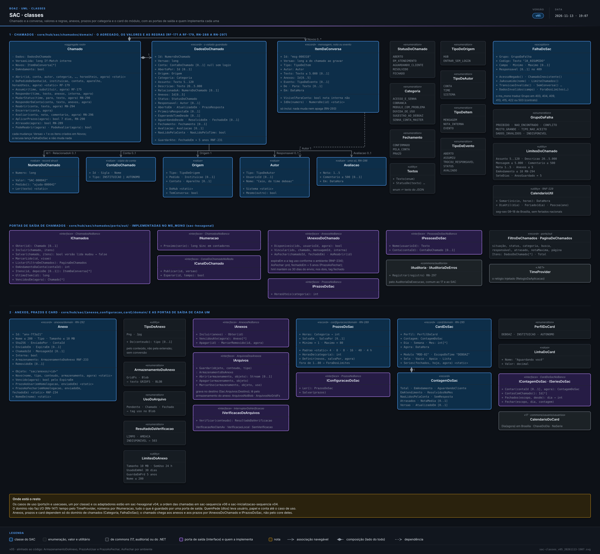

> **boaz · Funcionalidade** · `18_modulo-sac` · **v06** · 2026-11-13 21:37 · **Rascunho**

# SAC

**Objetivo:** permitir que a conta master da instituição e o educador autônomo abram chamados para falar com o time deboaz, acompanhem a conversa até a solução e avaliem o atendimento, e que o time deboaz atenda todos os chamados dentro do prazo de cada categoria.

**Sumário:** [Cenários de tela](#cenarios-tela) · [Cenários de API](#cenarios-api) · [Telas](#telas) · [Diagramas](#diagramas) · [Em aberto](#em-aberto) · [Histórico](#historico)

---

<a id="cenarios-tela"></a>

## Cenários de tela

<a id="exemplo-chamado"></a>

### Exemplo de um chamado do começo ao fim

> Registro do módulo: [15_modulos `MOD-02`](15_modulos.md#MOD-02)

```gherkin
Cenário: a Presença que não salva a chamada
  Dado a conta master da Escola Bento Freitas, sigla EBFGA, em 2026-11-12, quinta, às 10:00
  Quando abre o chamado "Presença não salva a chamada", na categoria "Módulo com problema"
  Então o chamado ganha o número "SAC-000042", o status "Aberto"
  E o prazo "Resposta até hoje, 18:00"
  E às 11:00 o Caio Lima, do time deboaz, assume e responde
  E o chamado passa a "Em atendimento", com "Caio, do time deboaz" como responsável
  E às 11:20 o Caio pede o nome da turma e o chamado passa a "Aguardando sua resposta"
  E às 11:30 a conta master responde "Turma 7A" e o chamado volta a "Em atendimento"
  E às 14:00 o Caio marca "Resolvido" com a mensagem "Corrigido. Pode salvar de novo."
  E a conta master toca em "Confirmar solução", dá 5 estrelas e o chamado fica "Fechado"
```

<a id="RF-171"></a>

### `RF-171` Abrir chamado

```gherkin
Cenário: instituição abre um chamado
  Dado a conta master da EBFGA no SAC
  Quando toca em "Abrir chamado", escolhe "Módulo com problema"
  E informa o assunto "Presença não salva a chamada", a descrição e o print "erro.png"
  E vê abaixo da descrição "Ao menos 20 caracteres"
  E abaixo dos anexos "PNG ou JPG · até 10 MB cada · até 5 arquivos"
  E toca em "Enviar"
  Então vê "Chamado SAC-000042 aberto. Resposta até hoje, 18:00"
  E o chamado aparece no topo de Meus chamados, como "Aberto"

Cenário: educador autônomo abre um chamado
  Dado o educador autônomo Pedro Reis no SAC
  Quando abre o chamado "Cobrança em dobro em novembro", na categoria "Cobrança"
  Então o chamado aparece em Meus chamados do Pedro
  E aparece na fila do time deboaz com a conta "Pedro Reis · autônomo"

Cenário: campo faltando
  Dado a conta master no formulário "Abrir chamado", sem categoria escolhida
  Quando toca em "Enviar"
  Então vê "Escolha a categoria" abaixo do campo
  E o chamado não é aberto
```

<a id="RF-172"></a>

### `RF-172` Meus chamados

```gherkin
Cenário: lista da instituição
  Dado a EBFGA com 3 chamados: SAC-000042 "Aguardando sua resposta"
  E SAC-000039 "Em atendimento" e SAC-000031 "Fechado"
  Quando a conta master abre o SAC
  Então vê os 3, o atualizado por último no topo
  E cada linha mostra o número, o assunto, o status e a última atualização
  E SAC-000042 aparece em negrito, com a marca "Nova resposta"

Esquema do Cenário: filtros de Meus chamados
  Dado o filtro "Todos" marcado ao abrir o SAC
  Quando a conta master toca no filtro "<filtro>"
  Então vê <resultado>

  Exemplos:
    | filtro       | resultado                                  |
    | Todos        | SAC-000042, SAC-000039 e SAC-000031        |
    | Em andamento | SAC-000042 e SAC-000039, sem o SAC-000031  |
    | Fechados     | só o SAC-000031                            |

Cenário: sem chamados
  Dado o educador autônomo Pedro Reis sem chamados
  Quando abre o SAC
  Então vê "Nenhum chamado. Precisa de ajuda?" e o botão "Abrir chamado"
```

<a id="RF-173"></a>

### `RF-173` Conversa do chamado

```gherkin
Cenário: responder ao time
  Dado o SAC-000042 "Aguardando sua resposta", com a pergunta do Caio "Qual a turma?"
  Quando a conta master escreve "Turma 7A" no campo "Escreva sua mensagem"
  E anexa "chamada-7a.png" e toca em "Enviar"
  Então a mensagem aparece no fim da conversa, com a hora "11:30"
  E o status passa a "Em atendimento"

Cenário: linha do tempo
  Quando a conta master abre o SAC-000042
  Então vê, entre as mensagens, "Aberto por você · 10:00"
  E "Caio, do time deboaz, assumiu · 11:00" e "Aguardando sua resposta · 11:20"

Cenário: chamado fechado não recebe mensagem
  Dado o SAC-000031 "Fechado"
  Quando a conta master abre o chamado
  Então não vê o campo de mensagem
  E vê "Chamado fechado", o apoio "Precisa de mais ajuda sobre o mesmo assunto?"
  E o botão "Abrir chamado relacionado"
```

<a id="RF-174"></a>

### `RF-174` Fila do time

```gherkin
Cenário: fila de chamados em andamento
  Dado o membro do time Caio Lima, com a Utilização do SAC
  E 14 chamados em andamento, 5 sem resposta e 2 com o prazo vencido
  Quando abre o SAC
  Então vê primeiro o chamado mais antigo esperando o time
  E os 2 de prazo vencido com a marca "Atrasado"
  E cada linha mostra o número, a conta, a categoria, o status, o responsável e o prazo

Esquema do Cenário: filtros da fila
  Quando o Caio toca no filtro "<filtro>"
  Então vê <resultado>

  Exemplos:
    | filtro              | resultado                                           |
    | Sem responsável     | os chamados "Aberto" que ninguém assumiu            |
    | Meus                | os chamados em que ele é o responsável              |
    | Atrasados           | os chamados com a marca "Atrasado"                  |
    | Aguardando cliente  | os chamados à espera da resposta da conta           |
    | Nota baixa          | os chamados fechados com 1 ou 2 estrelas            |

Cenário: chamado já respondido
  Quando o Caio responde o SAC-000042, aberto às 10:00, às 11:00
  Então a linha do SAC-000042 na fila mostra "Respondido em 1 h" no lugar do prazo

Cenário: busca
  Quando o Caio busca "EBFGA" na fila
  Então vê os chamados da Escola Bento Freitas, de todos os status

Cenário: fila zerada
  Dado nenhum chamado "Aberto" sem responsável
  Quando o Caio toca no filtro "Sem responsável"
  Então vê "Nenhum chamado esperando o time", com o mascote Orgulhoso
  E o mascote aparece animado, e parado quando o aparelho pede menos movimento
```

<a id="RF-175"></a>

### `RF-175` Assumir e responder

```gherkin
Cenário: assumir e responder
  Dado o SAC-000042 "Aberto", sem responsável
  Quando o Caio abre o chamado
  Então vê "Assuma o chamado para responder à conta." no lugar do campo de mensagem
  E ao tocar em "Assumir", o campo mostra "Escreva para a conta"
  E ele envia "Olá! Qual a turma da chamada?"
  Então o chamado passa a "Em atendimento", com o Caio como responsável
  E a conta master vê a mensagem assinada "Caio, do time deboaz"

Cenário: nota interna
  Quando o Caio marca "Nota interna" e escreve "Erro ao salvar a 7A, conferir na Presença"
  Então a nota aparece na conversa com o fundo de nota interna para o time
  E a conta master não vê a nota

Cenário: chamado já assumido por outro
  Dado o SAC-000042 com a Ana Lima como responsável
  Quando o Caio toca em "Assumir"
  Então vê "Ana Lima já atende este chamado. Assumir mesmo assim?"
  E ao confirmar passa a ser o responsável, e a linha do tempo registra a troca
```

<a id="RF-176"></a>

### `RF-176` Pedir informação e resolver

```gherkin
Cenário: pedir informação
  Dado o SAC-000042 "Em atendimento", com o Caio como responsável
  Quando o Caio toca em "Pedir informação" e envia "Qual a turma?"
  Então o chamado passa a "Aguardando cliente" para o time
  E a conta master vê "Aguardando sua resposta"

Cenário: resolver
  Quando o Caio toca em "Resolver" e envia "Corrigido. Pode salvar de novo."
  Então o chamado passa a "Resolvido"
  E a conta master vê "Resolveu?" e "Confirme a solução ou reabra o chamado."
  E o mascote do "Resolveu?" aparece animado, e parado com menos movimento pedido
  E os botões "Confirmar solução" e "Reabrir", sem o campo de mensagem

Cenário: resolver sem mensagem
  Quando o Caio toca em "Resolver" com o campo de mensagem vazio
  Então vê "Escreva a solução para a conta"
  E o chamado continua "Em atendimento"
```

<a id="RF-177"></a>

### `RF-177` Reabrir, confirmar ou encerrar

```gherkin
Cenário: reabrir o resolvido
  Dado o SAC-000042 "Resolvido" há 2 dias
  Quando a conta master toca em "Reabrir"
  Então o chamado só muda depois que ela escreve o motivo e toca em "Enviar"
  E com "Ainda aparece o erro na 8B" o chamado volta a "Em atendimento", com o Caio
  E a conversa volta a aceitar mensagens

Cenário: encerrar antes da solução
  Dado o SAC-000039 "Em atendimento"
  Quando a conta master toca em "Encerrar chamado"
  Então vê "Encerrar chamado?" e "O SAC-000039 passa a Fechado e não recebe mais mensagens."
  E os botões "Cancelar" e "Não preciso mais"
  E ao tocar em "Não preciso mais" o chamado passa a "Fechado"
  E ao tocar em "Cancelar" nada muda

Cenário: chamado relacionado
  Dado o SAC-000031 "Fechado"
  Quando a conta master toca em "Abrir chamado relacionado"
  Então o formulário abre com "Relacionado a SAC-000031" e a mesma categoria
```

<a id="RF-178"></a>

### `RF-178` Avaliar o atendimento

```gherkin
Cenário: confirmar com avaliação
  Dado o SAC-000042 "Resolvido"
  Quando a conta master toca em "Confirmar solução"
  Então vê as 5 estrelas, "Sua nota ajuda o time deboaz a melhorar." e o comentário opcional
  E o botão "Enviar" só fica ativo depois de escolher as estrelas
  E com 5 estrelas e "Resolvido em 4 h, obrigado" o chamado passa a "Fechado"
  E a conta vê "Sua avaliação: 5 estrelas", e o Caio vê a nota e o comentário

Cenário: cancelar não confirma
  Quando a conta master toca em "Cancelar" na avaliação
  Então o SAC-000042 continua "Resolvido", com "Confirmar solução" e "Reabrir"
  E se ela nada fizer, fecha pelo prazo de 7 dias, sem avaliação

Cenário: avaliar depois do fechamento automático
  Dado o SAC-000040 fechado sozinho em 2026-11-10, sem avaliação
  Quando a conta master abre o chamado em 2026-11-12
  Então vê "Como foi o atendimento?" com as 5 estrelas

Cenário: nota baixa
  Quando o Pedro Reis dá 2 estrelas ao SAC-000045
  Então o chamado aparece no filtro "Nota baixa" da fila do time
```

<a id="RF-179"></a>

### `RF-179` Pedido de senha da conta master

> Pedido feito sem login: [17_modulo-usuario `RF-111`](17_modulo-usuario.md#RF-111); conferência: [`RN-172`](17_modulo-usuario.md#RN-172)

```gherkin
Cenário: pedido chega à fila
  Dado o pedido sem login da "Escola Bento Freitas" com o contato "(51) 99999-0000"
  Quando o Caio abre o SAC
  Então vê o chamado SAC-000087, na categoria "Senha da conta master"
  E a origem "Tela Entrar, sem login", a instituição e o contato informados
  E na fila a linha mostra "Escola Bento Freitas", o nome informado, no lugar da conta

Cenário: gerar o código pelo chamado
  Dado o Caio com a Utilização do SAC e do Usuários
  Quando assume o SAC-000087 e toca em "Conferir e gerar código da master"
  Então abre a conferência da conta master da EBFGA
  E depois do código gerado, o Caio resolve o chamado com "Código enviado ao contato"
  E essa mensagem fica como nota interna, porque não há conversa com quem pediu

Cenário: membro só com o SAC
  Dado a Ana Lima com a Utilização do SAC, sem o Usuários
  Quando abre o SAC-000087
  Então vê "Conferir e gerar código da master" inativo, com "Precisa do módulo Usuários"
```

<a id="RF-180"></a>

### `RF-180` Aviso de resposta nova

```gherkin
Cenário: resposta do time
  Dado a conta master com Módulos aberto
  Quando o Caio responde o SAC-000042
  Então o card do SAC mostra o selo "1"
  E ao abrir o SAC-000042 o selo some e a marca "Nova resposta" sai da linha

Cenário: mensagem da conta para o time
  Quando a conta master responde o SAC-000042, com o Caio como responsável
  Então o SAC-000042 aparece em negrito no filtro "Meus" do Caio
  E o card do SAC do Caio soma 1 no selo

Cenário: rótulo falado
  Quando o leitor de tela lê o card do SAC da conta master na mínima
  Então diz "SAC, 1 resposta nova"
```

<a id="RF-181"></a>

### `RF-181` Prazos por categoria

```gherkin
Cenário: mudar um prazo
  Dado o administrador do deboaz na aba Configuração do SAC
  E o campo "Horas" de cada categoria, com o sufixo "h úteis"
  E o aviso "Vale para os chamados abertos depois de salvar"
  Quando muda "Dúvida de uso" de 16 para 12 h úteis e toca em "Salvar"
  Então vê "Prazos salvos"
  E os chamados de "Dúvida de uso" abertos depois disso têm o prazo de 12 h úteis
  E os já abertos mantêm o prazo que tinham

Cenário: prazo fora dos limites
  Quando informa 81 h úteis para "Sugestão ao deboaz"
  Então vê "Prazo entre 1 e 80 h úteis" e nada é salvo

Cenário: conta de cliente
  Quando a conta master da EBFGA abre o SAC
  Então não vê a aba Configuração
```

<a id="RN-288"></a>

### `RN-288` Quem vê o quê

```gherkin
Esquema do Cenário: chamados que cada perfil vê
  Quando <quem> abre o SAC
  Então <resultado>

  Exemplos:
    | quem                                | resultado                                      |
    | a conta master da EBFGA             | vê só os chamados da EBFGA                     |
    | o educador autônomo Pedro Reis      | vê só os chamados dele                         |
    | o membro do time Caio, com o SAC    | vê os chamados de todas as contas e sem login  |
    | o administrador do deboaz           | vê os chamados de todas as contas e sem login  |
    | o membro do time Rui, sem o SAC     | não vê o card do SAC                           |
    | a staff Maria, da EBFGA             | não vê o card do SAC                           |
    | o participante Lucas, no quest      | não vê o SAC                                   |

Cenário: chamado de outra conta
  Dado o link do SAC-000045, do Pedro Reis
  Quando a conta master da EBFGA abre o link
  Então vê "Chamado não encontrado" e "Volte a Meus chamados pela seta."
  E não sabe se o chamado existe
```

<a id="RN-289"></a>

### `RN-289` Categorias e prazos de primeira resposta

```gherkin
Esquema do Cenário: prazo inicial de cada categoria
  Quando um chamado é aberto na categoria "<categoria>"
  Então o time tem <prazo> úteis para a primeira resposta
  E <quem abre>

  Exemplos:
    | categoria             | prazo | quem abre                          |
    | Acesso e senha        | 4 h   | a conta master e o autônomo        |
    | Cobrança              | 8 h   | a conta master e o autônomo        |
    | Módulo com problema   | 8 h   | a conta master e o autônomo        |
    | Dúvida de uso         | 16 h  | a conta master e o autônomo        |
    | Sugestão ao deboaz    | 40 h  | a conta master e o autônomo        |
    | Senha da conta master | 4 h   | só o pedido sem login da tela Entrar |

Cenário: atrasado
  Dado o SAC-000042 aberto às 10:00 de 2026-11-12, com o prazo às 18:00
  Quando chega 18:01 sem nenhuma resposta do time
  Então o chamado ganha a marca "Atrasado" na fila do time
  E a conta master continua vendo só "Aberto"

Esquema do Cenário: prazo vencendo
  Dado o <chamado> sem resposta do time, com o prazo de primeira resposta <prazo>
  Quando o Caio vê a fila <quando>
  Então a linha do chamado mostra <prazo na fila>
  E o selo Lento aparece animado, e parado quando o aparelho pede menos movimento

  Exemplos:
    | chamado    | prazo               | quando              | prazo na fila                    |
    | SAC-000087 | quinta, 14:00       | quinta, 12:59       | o prazo, sem o selo Lento        |
    | SAC-000087 | quinta, 14:00       | quinta, 13:00       | "Vence em 1 h", com o selo Lento |
    | SAC-000087 | quinta, 14:00       | quinta, 13:40       | "Vence em 20 min", com o selo Lento |
    | SAC-000088 | sexta, 08:30        | quinta, 17:30       | "Vence em 1 h", com o selo Lento |
    | SAC-000087 | quinta, 14:00       | quinta, 14:01       | a marca "Atrasado"               |

Cenário: a primeira resposta para o prazo
  Quando o Caio envia a primeira mensagem ao cliente às 11:00
  Então o prazo do SAC-000042 está cumprido
  E nota interna e "Assumir" sem mensagem não cumprem o prazo

Cenário: pedido sem login cumpre o prazo ao resolver
  Dado o SAC-000087 "Senha da conta master", aberto às 09:00, com prazo às 13:00
  Quando o Caio o resolve às 12:00 com "Código enviado ao contato"
  Então o prazo está cumprido, mesmo sem mensagem à conta
  E a mensagem de resolver fica como nota interna
```

<a id="RN-290"></a>

### `RN-290` Status do chamado

```gherkin
Esquema do Cenário: mudanças de status permitidas
  Dado um chamado "<de>"
  Quando <evento>
  Então ele passa a "<para>"

  Exemplos:
    | de                 | evento                                  | para               |
    | Aberto             | o time assume ou responde               | Em atendimento     |
    | Em atendimento     | o time pede informação                  | Aguardando cliente |
    | Aguardando cliente | a conta responde                        | Em atendimento     |
    | Em atendimento     | o time resolve                          | Resolvido          |
    | Resolvido          | a conta reabre em até 7 dias            | Em atendimento     |
    | Resolvido          | a conta confirma a solução              | Fechado            |
    | Aguardando cliente | passam 7 dias sem resposta da conta     | Resolvido          |
    | Resolvido          | passam 7 dias sem a conta reabrir       | Fechado            |
    | Aberto             | a conta encerra                         | Fechado            |
    | Em atendimento     | a conta encerra                         | Fechado            |
    | Aguardando cliente | a conta encerra, porque desistiu        | Fechado            |

Esquema do Cenário: mudanças recusadas
  Dado um chamado "<de>"
  Quando <evento>
  Então vê "<aviso>" e o status não muda

  Exemplos:
    | de        | evento                         | aviso                                    |
    | Aberto    | o time tenta resolver          | Responda à conta antes de resolver       |
    | Fechado   | a conta tenta reabrir          | Chamado fechado. Abra um relacionado     |
    | Resolvido | a conta reabre depois de 7 dias | Prazo para reabrir encerrado            |

Cenário: aviso do fechamento por falta de resposta
  Dado o SAC-000039 "Aguardando cliente" desde 2026-11-05 10:00
  Quando chega 2026-11-12 10:00 sem resposta da conta
  Então o chamado passa a "Resolvido" com a mensagem do sistema
  E a mensagem diz "Encerramos por falta de resposta. Se ainda precisar, toque em Reabrir."
```

<a id="RN-291"></a>

### `RN-291` Campos do chamado

```gherkin
Esquema do Cenário: limites dos textos
  Quando a conta master informa <campo> com <tamanho> caracteres
  Então <resultado>

  Exemplos:
    | campo        | tamanho | resultado                                       |
    | o assunto    | 4       | vê "Assunto com 5 a 120 caracteres"             |
    | o assunto    | 5       | o assunto é aceito                              |
    | o assunto    | 120     | o assunto é aceito                              |
    | o assunto    | 121     | vê "Assunto com 5 a 120 caracteres"             |
    | a descrição  | 19      | vê "Descreva com ao menos 20 caracteres"        |
    | a descrição  | 5.000   | a descrição é aceita                            |
    | a descrição  | 5.001   | vê "Descrição com até 5.000 caracteres"         |
    | a mensagem   | 0       | o botão "Enviar" fica inativo                   |
    | a mensagem   | 5.000   | a mensagem é aceita                             |
    | a mensagem   | 5.001   | vê "Mensagem com até 5.000 caracteres"          |
    | o comentário | 501     | vê "Comentário com até 500 caracteres"          |
```

<a id="RN-292"></a>

### `RN-292` Anexos

```gherkin
Esquema do Cenário: arquivo anexado
  Quando a conta master anexa "<arquivo>" de <tamanho>
  Então <resultado>

  Exemplos:
    | arquivo       | tamanho | resultado                                     |
    | erro.png      | 2 MB    | o arquivo é anexado                           |
    | foto.jpg      | 10 MB   | o arquivo é anexado                           |
    | boleto.jpg    | 1 MB    | o arquivo é anexado                           |
    | foto.jpg      | 11 MB   | vê "Cada arquivo com até 10 MB"               |
    | boleto.pdf    | 1 MB    | vê "Envie PNG ou JPG"                         |
    | tela.mp4      | 3 MB    | vê "Envie PNG ou JPG"                         |
    | planilha.xlsx | 1 MB    | vê "Envie PNG ou JPG"                         |

Cenário: onde aparece a recusa do tipo
  Quando a conta master anexa "boleto.pdf"
  Então "Envie PNG ou JPG" aparece num Aviso de ação logo abaixo dos anexos
  E o arquivo não é anexado

Cenário: sexto arquivo
  Dado a mensagem com 5 arquivos anexados
  Quando a conta master anexa o sexto
  Então vê "Até 5 arquivos por mensagem"

Cenário: arquivo recusado na verificação
  Quando a conta master anexa "nota.jpg" que não passa na verificação de segurança
  Então vê "Arquivo recusado pela verificação de segurança" e ele não é anexado
```

<a id="RN-293"></a>

### `RN-293` Conversa sem edição

```gherkin
Cenário: mensagem enviada não muda
  Dado a mensagem "Turma 7A" enviada pela conta master no SAC-000042
  Quando a conta master toca e segura a mensagem
  Então não vê as opções de editar nem de apagar

Cenário: nota interna também fica
  Dado a nota interna do Caio no SAC-000042
  Então nem o Caio nem o administrador do deboaz a editam ou apagam
```

<a id="RN-294"></a>

### `RN-294` Limite de chamados em andamento

```gherkin
Cenário: décimo primeiro chamado
  Dado a EBFGA com 10 chamados em Aberto, Em atendimento ou Aguardando cliente
  Quando a conta master toca em "Enviar" num chamado novo
  Então vê "Você já tem 10 chamados em andamento. Acompanhe-os em Meus chamados."
  E o chamado não é aberto

Cenário: resolvido não conta
  Dado a EBFGA com 9 chamados em andamento e 3 "Resolvido"
  Quando a conta master abre um chamado novo
  Então o chamado é aberto

Cenário: reabrir não confere o limite
  Dado a EBFGA com 10 chamados em andamento e o SAC-000042 "Resolvido"
  Quando a conta master reabre o SAC-000042
  Então o chamado volta a "Em atendimento", com 11 em andamento
```

<a id="RN-295"></a>

### `RN-295` Card do SAC

> Card comum: [15_modulos `RN-276`](15_modulos.md#RN-276), com os recortes de [`RN-277`](15_modulos.md#RN-277) e a atualização de [`RN-279`](15_modulos.md#RN-279)

```gherkin
Esquema do Cenário: dados do card por perfil e tamanho
  Dado o card SAC do perfil <perfil>, em 2026-11-12, no recorte "Mês"
  Quando está na <tamanho>
  Então mostra <dados>

  Exemplos:
    | perfil      | tamanho  | dados                                                        |
    | deboaz      | mínima   | o ícone e o selo "5": chamados sem resposta do time          |
    | deboaz      | reduzida | 14 · chamados em andamento                                   |
    | deboaz      | normal   | 14, "+3 no mês", Sem resposta 5, Atrasados 2, Nota média 4,6 |
    | instituição | mínima   | o ícone e o selo "1": respostas novas não lidas              |
    | instituição | reduzida | 2 · chamados em andamento                                    |
    | instituição | normal   | 2, "+1 no mês", Aguardando você 1, Em atendimento 1, Resolvidos 3 |
    | autônomo    | mínima   | o ícone, sem selo                                            |
    | autônomo    | reduzida | 1 · chamados em andamento                                    |
    | autônomo    | normal   | 1, "-1 no mês", Aguardando você 0, Em atendimento 1, Resolvidos 2 |

Esquema do Cenário: lista da expandida de cada perfil
  Dado o card SAC do perfil <perfil> na expandida, com a série de 12 pontos
  Então a lista mostra "<primeira>", "<segunda>" e "<terceira>"

  Exemplos:
    | perfil      | primeira          | segunda           | terceira              |
    | deboaz      | Sem resposta 5    | Atrasados 2       | Aguardando cliente 4  |
    | instituição | Aguardando você 1 | Em atendimento 1  | Resolvidos no mês 3   |
    | autônomo    | Aguardando você 0 | Em atendimento 1  | Resolvidos no mês 2   |

Cenário: sem dados
  Dado o Pedro Reis sem nenhum chamado
  Então o card mostra "Precisa de ajuda? Fale com o time deboaz" e "Abrir chamado"
  E tocar em "Abrir chamado" abre o formulário, sem passar pela lista

Cenário: ordem e destaque das métricas da conta
  Quando a conta master vê o card na normal ou na expandida
  Então as métricas vêm na ordem Aguardando você, Em atendimento e Resolvidos no recorte
  E "Aguardando você" vem em destaque, porque pede a ação dela

Cenário: série do card
  Quando a conta master vê o card na normal, no recorte "Mês"
  Então a série mostra os chamados em andamento no fim de cada um dos 5 últimos meses
```

<a id="RN-296"></a>

### `RN-296` Avaliação única

```gherkin
Esquema do Cenário: quem avalia e quando
  Dado o SAC-000042 <estado>
  Quando <quem> tenta avaliar
  Então <resultado>

  Exemplos:
    | estado                                | quem                | resultado                    |
    | "Resolvido"                           | a conta master      | avalia e o chamado fecha     |
    | "Fechado" há 6 dias, sem avaliação    | a conta master      | avalia                       |
    | "Fechado" há 8 dias, sem avaliação    | a conta master      | não vê mais as estrelas      |
    | "Resolvido", e toca em "Cancelar"     | a conta master      | segue "Resolvido", sem nota  |
    | "Fechado", com 5 estrelas             | a conta master      | vê só a nota dada            |
    | "Fechado" pela conta, sem resposta    | a conta master      | não vê as estrelas           |
    | "Resolvido"                           | o Caio, do time     | não vê as estrelas           |
```

<a id="RN-297"></a>

### `RN-297` Histórico do atendimento

> Regras da auditoria: [17_modulo-usuario `RN-178`](17_modulo-usuario.md#RN-178)

```gherkin
Cenário: o que fica registrado
  Quando o SAC-000042 passa de "Aberto" a "Fechado"
  Então cada mudança de status, de responsável e cada mensagem fica com quem, quando e o quê
  E o fechamento por prazo fica com "sistema" no lugar de quem
  E nada disso pode ser alterado nem apagado
```

<a id="RNF-229"></a>

### `RNF-229` Horas úteis

```gherkin
Esquema do Cenário: contagem do prazo
  Dado os dias úteis de segunda a sexta, das 08:00 às 18:00, no horário de Brasília
  E sem os feriados nacionais, contando a Sexta-feira Santa e o 20 de novembro
  E com o Carnaval e o Corpus Christi como dias úteis
  Quando um chamado de <prazo> úteis é aberto <quando>
  Então o prazo vence <vence>

  Exemplos:
    | prazo | quando                     | vence                     |
    | 8 h   | quinta, 2026-11-12, 10:00  | quinta, 2026-11-12, 18:00 |
    | 4 h   | quinta, 2026-11-12, 17:00  | sexta, 2026-11-13, 11:00  |
    | 4 h   | sábado, 2026-11-14, 09:00  | segunda, 2026-11-16, 12:00 |
    | 16 h  | sexta, 2026-11-13, 14:00   | terça, 2026-11-17, 10:00  |
    | 4 h   | quinta, 2026-11-19, 17:00  | segunda, 2026-11-23, 11:00 |
    | 4 h   | terça, 2027-02-09, 08:00   | terça, 2027-02-09, 12:00  |
```

<a id="RNF-230"></a>

### `RNF-230` Mensagem na conversa

```gherkin
Cenário: conversa aberta dos dois lados
  Dado a conta master e o Caio com o SAC-000042 aberto
  Quando o Caio envia uma mensagem
  Então a mensagem aparece na tela da conta master em até 5 s, sem recarregar
```

<a id="RNF-231"></a>

### `RNF-231` Guarda dos chamados

```gherkin
Cenário: chamado antigo
  Dado o SAC-000012 fechado em produção em 2026-11-12
  Então o chamado, as mensagens e os anexos ficam disponíveis até 2031-11-12, 5 anos depois
  E a conta master o encontra na busca de Meus chamados durante todo esse tempo
```

<a id="RNF-232"></a>

### `RNF-232` Coleções e índices do SAC prontos na partida

> Mesma regra da partida: [17_modulo-usuario `RNF-227`](17_modulo-usuario.md#RNF-227)

```gherkin
Esquema do Cenário: coleção pronta antes do primeiro pedido
  Dado o banco de homologação sem as coleções do SAC
  Quando a aplicação inicia
  Então antes de aceitar o primeiro pedido, a coleção "<colecao>" existe
  E tem os índices <indices>

  Exemplos:
    | colecao          | indices                                                       |
    | chamados         | contaId+atualizadoEm↓, contaId+status, status+ordemDaFila     |
    | chamados         | responsavel.usuarioId+status, status+prazoResposta            |
    | chamados         | status+aguardandoDesde, status+resolvidoEm                    |
    | chamados         | avaliacao.nota, guardarAte                                    |
    | mensagensChamado | chamadoId+numero                                              |
    | anexosSac        | chamadoId, expiraEm, enviadoPor+enviadoEm                     |
    | cardSac          | escopo+dia único, o escopo_dia_unico                          |

Cenário: prazos sem índice
  Dado o banco de homologação sem a coleção "configuracaoSac"
  Quando a aplicação inicia
  Então ela aceita pedidos sem criar índice em "configuracaoSac"
  E a coleção guarda um só documento, "prazos", criado no primeiro "Salvar" da RF-181

Esquema do Cenário: índice que não pode ser criado
  Dado <impedimento> na coleção "<colecao>"
  Quando a aplicação inicia
  Então o índice <indice> não é criado
  E o log cita o nome do índice e da coleção, nunca o valor que impediu
  E a aplicação <resultado>

  Exemplos:
    | colecao          | indice           | impedimento             | resultado               |
    | cardSac          | escopo_dia_unico | dois cards EBFGA no dia | para antes do 1º pedido |
    | mensagensChamado | chamadoId_numero | o banco recusa o índice | aceita pedidos e avisa  |
```

<a id="RNF-233"></a>

### `RNF-233` Onde ficam os arquivos dos anexos

> Armazenamento por ambiente: [05_cd-implantacao `RNF-235`](05_cd-implantacao.md#RNF-235)

```gherkin
Esquema do Cenário: mesmo anexo com o armazenamento de objetos ligado ou desligado
  Dado o ambiente com o armazenamento de objetos (Azure Blob Storage) <estado>
  Quando a conta master anexa "erro.png" de 2 MB ao SAC-000042 e o Caio o abre
  Então o Caio vê o mesmo "erro.png", guardado como foi enviado, sem conversão
  E o arquivo fica <onde>

  Exemplos:
    | estado    | onde                                       |
    | ligado    | no armazenamento de objetos                |
    | desligado | no banco (GridFS), sem mudar nada na tela  |

Cenário: verificação antes de guardar
  Dado o armazenamento de objetos ligado
  Quando a conta master anexa "nota.jpg" que não passa na verificação de segurança
  Então vê "Arquivo recusado pela verificação de segurança"
  E nada é guardado, nem no armazenamento de objetos nem no banco

Cenário: cada anexo é lido de onde foi guardado
  Dado o "boleto.jpg" do SAC-000040 guardado no banco, com o armazenamento desligado
  E o armazenamento de objetos ligado depois
  Quando a conta master anexa "erro.png" ao SAC-000042
  Então o "erro.png" fica no armazenamento de objetos e o "boleto.jpg" continua no banco
  E os dois abrem iguais para o Caio, cada um lido de onde foi guardado, sem migração
  E o "boleto.jpg" sai do banco só no descarte da RNF-234
```

<a id="RNF-234"></a>

### `RNF-234` Descarte dos arquivos por ambiente

```gherkin
Cenário: anexo removido pela guarda
  Dado o SAC-000042 fechado em 2026-11-12, com o anexo "erro.png" na mensagem da conta
  Quando a conta master abre o chamado depois do prazo de guarda do arquivo
  Então vê, no lugar do anexo, "erro.png" e "Anexo removido", com o mascote Sonolento
  E tocar no anexo não baixa nada
  E as mensagens da conversa continuam visíveis
```

---

<a id="cenarios-api"></a>

## Cenários de API

<a id="formato-comum"></a>

### Formato comum

```gherkin
Cenário: resposta de erro
  Quando um pedido ao SAC é recusado
  Então o corpo traz o código, a mensagem e, quando houver, o campo:
    """
    {
      "codigo": "DADOS_INVALIDOS",
      "mensagem": "O campo \"assunto\" deve ter de 5 a 120 caracteres.",
      "campo": "assunto"
    }
    """

Cenário: identificadores, datas e valores
  Então o chamado vai no endereço pelo número, como "SAC-000042"
  E toda data e hora segue a ISO 8601 em UTC, como "2026-11-12T13:00:00Z"
  E status e categoria vão em maiúsculas, como "EM_ATENDIMENTO" e "MODULO_COM_PROBLEMA"
  E só a conta master, o autônomo, o administrador e o membro com "MOD-02" usam o SAC
```

<a id="RF-171-api"></a>

### `RF-171` Abrir chamado

```gherkin
Cenário: instituição abre um chamado
  Dado o token da conta master da EBFGA, com "MOD-02" com "U"
  E o anexo "anx-7f3a21" enviado antes por POST /sac/anexos
  Quando envia POST /sac/chamados em 2026-11-12T13:00:00Z com:
    """
    {
      "categoria": "MODULO_COM_PROBLEMA",
      "assunto": "Presença não salva a chamada",
      "descricao": "Desde ontem, ao tocar em Salvar na chamada da turma, aparece erro.",
      "relacionadoA": null,
      "anexos": [
        "anx-7f3a21"
      ]
    }
    """
  Então a resposta é 201 com:
    """
    {
      "id": "SAC-000042",
      "status": "ABERTO",
      "categoria": "MODULO_COM_PROBLEMA",
      "abertoEm": "2026-11-12T13:00:00Z",
      "prazoResposta": "2026-11-12T21:00:00Z",
      "responsavel": null
    }
    """

Esquema do Cenário: pedido inválido
  Quando a conta master envia POST /sac/chamados com <falha>
  Então a resposta é 422 DADOS_INVALIDOS com o campo "<campo>"

  Exemplos:
    | falha                                 | campo      |
    | sem a categoria                       | categoria  |
    | a categoria "SENHA_CONTA_MASTER"      | categoria  |
    | o assunto com 4 caracteres            | assunto    |
    | a descrição com 5.001 caracteres      | descricao  |
    | o relacionadoA "SAC-000045", do Pedro | relacionadoA |

Cenário: membro do time não abre chamado
  Quando o Caio, com "MOD-02" com "U", envia POST /sac/chamados
  Então a resposta é 403 ACESSO_NEGADO
```

<a id="RF-172-api"></a>

### `RF-172` Meus chamados

```gherkin
Cenário: lista da instituição
  Dado o token da conta master da EBFGA
  Quando envia GET /sac/chamados?situacao=EM_ANDAMENTO&pagina=1
  Então a resposta é 200 com itens e total, até 50 por página
  E itens traz o SAC-000042 e o SAC-000039, o atualizado por último primeiro
  E cada item traz id, assunto, categoria, status, atualizadoEm e novaResposta

Cenário: item com resposta nova
  Quando a conta master envia GET /sac/chamados
  Então o item do SAC-000042 traz:
    """
    {
      "id": "SAC-000042",
      "assunto": "Presença não salva a chamada",
      "categoria": "MODULO_COM_PROBLEMA",
      "status": "AGUARDANDO_CLIENTE",
      "atualizadoEm": "2026-11-12T14:20:00Z",
      "novaResposta": true
    }
    """
```

<a id="RF-173-api"></a>

### `RF-173` Conversa do chamado

```gherkin
Cenário: abrir o chamado marca como lido
  Quando a conta master envia GET /sac/chamados/SAC-000042
  Então a resposta é 200 com o chamado, as mensagens e a linhaDoTempo, sem as notas internas
  E o próximo GET /sac/chamados traz o SAC-000042 com novaResposta false

Cenário: responder ao time
  Quando a conta master envia POST /sac/chamados/SAC-000042/mensagens com:
    """
    {
      "texto": "Turma 7A",
      "anexos": [
        "anx-81bc09"
      ],
      "interna": false
    }
    """
  Então a resposta é 201 com:
    """
    {
      "id": "msg-000318",
      "autor": "Escola Bento Freitas",
      "enviadaEm": "2026-11-12T14:30:00Z",
      "statusChamado": "EM_ATENDIMENTO"
    }
    """

Esquema do Cenário: mensagem recusada
  Quando a conta master envia POST /sac/chamados/<chamado>/mensagens com <corpo>
  Então a resposta é <resposta>

  Exemplos:
    | chamado    | corpo                        | resposta                              |
    | SAC-000031 | o texto "Oi"                 | 409 CHAMADO_FECHADO                   |
    | SAC-000042 | o texto vazio                | 422 DADOS_INVALIDOS com o campo texto |
    | SAC-000042 | "interna": true              | 403 ACESSO_NEGADO                     |
```

<a id="RF-174-api"></a>

### `RF-174` Fila do time

```gherkin
Cenário: fila de chamados em andamento
  Dado o token do Caio, com o papel "MEMBRO_TIME" e "MOD-02" com "U"
  Quando envia GET /sac/chamados?situacao=EM_ANDAMENTO&pagina=1
  Então a resposta é 200 com os 14 chamados de todas as contas, até 50 por página
  E o mais antigo esperando o time vem primeiro
  E cada item traz também conta, responsavel, prazoResposta, prazoPerto e atrasado

Esquema do Cenário: filtros da fila
  Quando o Caio envia GET /sac/chamados?<filtro>
  Então itens traz <resultado>

  Exemplos:
    | filtro                        | resultado                                     |
    | responsavel=nenhum            | os "ABERTO" sem responsável                   |
    | responsavel=eu                | os chamados do Caio                           |
    | atrasado=true                 | os 2 com o prazo vencido                      |
    | status=AGUARDANDO_CLIENTE     | os 4 à espera da conta                        |
    | notaMaxima=2                  | os fechados com nota 1 ou 2                   |
    | busca=EBFGA                   | os da Escola Bento Freitas, de todo status    |

Cenário: filtro do time pedido pela conta
  Quando a conta master envia GET /sac/chamados?responsavel=eu
  Então a resposta é 422 DADOS_INVALIDOS com o campo "responsavel"
```

<a id="RF-175-api"></a>

### `RF-175` Assumir e responder

```gherkin
Cenário: assumir
  Dado o SAC-000042 "ABERTO", sem responsável
  Quando o Caio envia POST /sac/chamados/SAC-000042/assumir
  Então a resposta é 200 com:
    """
    {
      "id": "SAC-000042",
      "status": "EM_ATENDIMENTO",
      "responsavel": "Caio Lima"
    }
    """

Cenário: já assumido por outro
  Dado o SAC-000042 com a Ana Lima como responsável
  Quando o Caio envia POST /sac/chamados/SAC-000042/assumir sem corpo
  Então a resposta é 409 JA_ASSUMIDO com o responsavel "Ana Lima"
  E com "substituir" true no corpo, a resposta é 200 com o Caio como responsável

Cenário: nota interna
  Quando o Caio envia POST /sac/chamados/SAC-000042/mensagens com "interna": true
  Então a resposta é 201
  E GET /sac/chamados/SAC-000042 da conta master não traz a nota

Cenário: conta não assume
  Quando a conta master envia POST /sac/chamados/SAC-000042/assumir
  Então a resposta é 403 ACESSO_NEGADO
```

<a id="RF-176-api"></a>

### `RF-176` Pedir informação e resolver

```gherkin
Cenário: pedir informação
  Quando o Caio envia POST /sac/chamados/SAC-000042/status com:
    """
    {
      "status": "AGUARDANDO_CLIENTE",
      "mensagem": "Qual a turma?"
    }
    """
  Então a resposta é 200 com o status "AGUARDANDO_CLIENTE"
  E a mensagem entra na conversa, visível para a conta

Cenário: resolver
  Quando o Caio envia POST /sac/chamados/SAC-000042/status com:
    """
    {
      "status": "RESOLVIDO",
      "mensagem": "Corrigido. Pode salvar de novo."
    }
    """
  Então a resposta é 200 com o status "RESOLVIDO" e resolvidoEm

Cenário: sem mensagem
  Quando o Caio envia o status "RESOLVIDO" sem a mensagem
  Então a resposta é 422 DADOS_INVALIDOS com o campo "mensagem"
```

<a id="RF-177-api"></a>

### `RF-177` Reabrir, confirmar ou encerrar

```gherkin
Cenário: reabrir
  Dado o SAC-000042 "RESOLVIDO" há 2 dias, com a EBFGA no limite de 10 em andamento
  Quando a conta master envia POST /sac/chamados/SAC-000042/reabrir com:
    """
    {
      "mensagem": "Ainda aparece o erro na 8B"
    }
    """
  Então a resposta é 200 com o status "EM_ATENDIMENTO" e o mesmo responsavel

Cenário: encerrar
  Quando a conta master envia POST /sac/chamados/SAC-000039/encerrar
  Então a resposta é 200 com o status "FECHADO"

Cenário: time não encerra pela conta
  Quando o Caio envia POST /sac/chamados/SAC-000039/encerrar
  Então a resposta é 403 ACESSO_NEGADO
```

<a id="RF-178-api"></a>

### `RF-178` Avaliar o atendimento

```gherkin
Cenário: confirmar com avaliação
  Dado o SAC-000042 "RESOLVIDO"
  Quando a conta master envia POST /sac/chamados/SAC-000042/avaliacao com:
    """
    {
      "nota": 5,
      "comentario": "Resolvido em 4 h, obrigado"
    }
    """
  Então a resposta é 201 e o chamado passa a "FECHADO"

Esquema do Cenário: avaliação recusada
  Quando <quem> envia POST /sac/chamados/SAC-000042/avaliacao com <corpo>
  Então a resposta é <resposta>

  Exemplos:
    | quem           | corpo                         | resposta                                |
    | a conta master | sem a nota                    | 422 DADOS_INVALIDOS com o campo nota    |
    | a conta master | a nota 6                      | 422 DADOS_INVALIDOS com o campo nota    |
    | a conta master | um comentário de 501 letras   | 422 DADOS_INVALIDOS com o campo comentario |
    | a conta master | a nota 4, já avaliado         | 409 JA_AVALIADO                         |
    | o Caio         | a nota 5                      | 403 ACESSO_NEGADO                       |
```

<a id="RF-179-api"></a>

### `RF-179` Pedido de senha da conta master

> Pedido sem login: [17_modulo-usuario `RF-111`](17_modulo-usuario.md#RF-111-api); código: [`RN-172`](17_modulo-usuario.md#RN-172-api)

```gherkin
Cenário: pedido na fila do time
  Dado o pedido "ajuda-000087" de POST /contas/esqueci-senha-master, com 202
  Quando o Caio envia GET /sac/chamados?categoria=SENHA_CONTA_MASTER
  Então itens traz:
    """
    {
      "id": "SAC-000087",
      "categoria": "SENHA_CONTA_MASTER",
      "origem": "ENTRAR_SEM_LOGIN",
      "pedido": "ajuda-000087",
      "conta": null,
      "instituicao": "Escola Bento Freitas",
      "contato": "(51) 99999-0000",
      "status": "ABERTO"
    }
    """

Cenário: resolver o pedido
  Quando o Caio envia POST /sac/chamados/SAC-000087/status com o status "RESOLVIDO"
  E a mensagem "Código enviado ao contato"
  Então a resposta é 200 e a mensagem é gravada como nota interna
  E o prazo de primeira resposta fica cumprido

Cenário: sem conversa com quem pediu
  Quando o Caio envia POST /sac/chamados/SAC-000087/mensagens com "interna": false
  Então a resposta é 409 SEM_CONVERSA
  E com "interna": true a resposta é 201
```

<a id="RN-288-api"></a>

### `RN-288` Quem vê o quê

```gherkin
Esquema do Cenário: acesso ao chamado
  Quando <quem> envia GET /sac/chamados/SAC-000045, do Pedro Reis
  Então a resposta é <resposta>

  Exemplos:
    | quem                                 | resposta                    |
    | o Pedro Reis                         | 200                         |
    | o Caio, com "MOD-02" com "U"         | 200                         |
    | a conta master da EBFGA              | 404 CHAMADO_INEXISTENTE     |
    | o Rui, membro do time sem "MOD-02"   | 403 ACESSO_NEGADO           |
    | a staff Maria                        | 403 ACESSO_NEGADO           |

Cenário: anexo de outra conta
  Quando a conta master da EBFGA envia GET /sac/anexos/anx-55d0e2, do chamado do Pedro
  Então a resposta é 404 ANEXO_INEXISTENTE
```

<a id="RN-289-api"></a>

### `RN-289` Categorias e prazos de primeira resposta

```gherkin
Esquema do Cenário: prazo perto na fila
  Dado o SAC-000087 sem 1ª resposta, com prazoResposta "2026-11-12T17:00:00Z"
  Quando o Caio envia GET /sac/chamados?situacao=EM_ANDAMENTO em <quando>
  Então o item do SAC-000087 traz prazoPerto <perto> e atrasado <atrasado>

  Exemplos:
    | quando               | perto | atrasado |
    | 2026-11-12T15:59:00Z | false | false    |
    | 2026-11-12T16:00:00Z | true  | false    |
    | 2026-11-12T16:40:00Z | true  | false    |
    | 2026-11-12T17:01:00Z | false | true     |

Cenário: 1 hora útil atravessando a noite
  Dado o SAC-000088 sem 1ª resposta, com prazoResposta "2026-11-13T11:30:00Z"
  Quando o Caio envia GET /sac/chamados?situacao=EM_ANDAMENTO em "2026-11-12T20:30:00Z"
  Então o item do SAC-000088 traz prazoPerto true, com 1 hora útil até o prazo

Cenário: chamado já respondido
  Dado o SAC-000042 com a 1ª resposta do Caio e o prazoResposta daqui a 30 min
  Quando o Caio envia GET /sac/chamados?situacao=EM_ANDAMENTO
  Então o item do SAC-000042 traz prazoPerto false e atrasado false
```

<a id="RN-290-api"></a>

### `RN-290` Status do chamado

```gherkin
Esquema do Cenário: mudança recusada
  Dado o chamado SAC-000042 "<de>"
  Quando <quem> envia POST /sac/chamados/SAC-000042/<acao>
  Então a resposta é <resposta>

  Exemplos:
    | de        | quem           | acao                       | resposta                      |
    | ABERTO    | o Caio         | status com "RESOLVIDO"     | 409 TRANSICAO_INVALIDA        |
    | FECHADO   | a conta master | reabrir                    | 409 CHAMADO_FECHADO           |
    | RESOLVIDO | a conta master | reabrir, depois de 7 dias  | 409 PRAZO_REABERTURA_VENCIDO  |
    | RESOLVIDO | o Caio         | status com "FECHADO"       | 409 TRANSICAO_INVALIDA        |
    | RESOLVIDO | a conta master | mensagens                  | 409 TRANSICAO_INVALIDA        |

Cenário: fechamento por prazo
  Dado o SAC-000039 "AGUARDANDO_CLIENTE" desde 2026-11-05T13:00:00Z
  Quando chega 2026-11-12T13:00:00Z sem mensagem da conta
  Então GET /sac/chamados/SAC-000039 traz o status "RESOLVIDO"
  E a linhaDoTempo traz o evento com o autor "sistema"
```

<a id="RN-292-api"></a>

### `RN-292` Anexos

```gherkin
Cenário: enviar um anexo
  Quando a conta master envia POST /sac/anexos com o arquivo "erro.png" de 2 MB
  Então a resposta é 201 com:
    """
    {
      "id": "anx-7f3a21",
      "nome": "erro.png",
      "tipo": "image/png",
      "tamanho": 2097152
    }
    """
  E o anexo não usado num chamado ou mensagem em 24 h é descartado

Esquema do Cenário: anexo recusado
  Quando a conta master envia <pedido>
  Então a resposta é <resposta>

  Exemplos:
    | pedido                                         | resposta                   |
    | POST /sac/anexos com "foto.jpg" de 11 MB       | 413 ANEXO_GRANDE           |
    | POST /sac/anexos com "nota.jpg" com ameaça     | 422 ANEXO_RECUSADO         |
    | uma mensagem com 6 anexos                      | 422 LIMITE_ANEXOS          |
    | POST /sac/anexos com a verificação fora do ar  | 503 VERIFICACAO_INDISPONIVEL |

Esquema do Cenário: tipo não aceito
  Quando a conta master envia POST /sac/anexos <arquivo>
  Então a resposta é 415 com:
    """
    {
      "codigo": "TIPO_NAO_ACEITO",
      "mensagem": "Envie PNG ou JPG."
    }
    """

  Exemplos:
    | arquivo                       |
    | com "boleto.pdf"              |
    | com um PDF chamado "foto.png" |
    | com "tela.mp4"                |

Esquema do Cenário: anexo que não pode ser usado
  Quando a conta master envia POST /sac/chamados ou /mensagens com o anexo <anexo>
  Então a resposta é 422 DADOS_INVALIDOS com o campo "anexos"

  Exemplos:
    | anexo                                      |
    | "anx-000000", que não existe               |
    | "anx-55d0e2", enviado pelo Pedro Reis      |
    | "anx-7f3a21", já usado no SAC-000042       |
    | "anx-1c2d3e", descartado depois de 24 h    |

Cenário: baixar o anexo
  Dado o "erro.png" do SAC-000042, enviado como "anx-7f3a21"
  Quando a conta master envia GET /sac/anexos/anx-7f3a21
  Então a resposta é 200 com o arquivo, igual ao enviado
  E o cabeçalho Content-Type "image/png"
  E o cabeçalho Content-Disposition 'attachment; filename="erro.png"'

Esquema do Cenário: ganchos de teste do SAC fora do teste
  Dado a aplicação iniciada em <ambiente>, com Teste__Relogio <flag>
  Quando envia <metodo> <endereco>
  Então a resposta é 404

  Exemplos:
    | ambiente    | flag    | metodo | endereco                |
    | produção    | "sim"   | POST   | /_teste/sac/agendamento |
    | produção    | "sim"   | PUT    | /_teste/sac/verificacao |
    | homologação | ausente | POST   | /_teste/sac/agendamento |
    | homologação | ausente | DELETE | /_teste/sac/verificacao |

Cenário: gancho da verificação sem o campo disponivel
  Dado a aplicação de homologação, com Teste__Relogio "sim"
  Quando envia PUT /_teste/sac/verificacao sem "disponivel"
  Então a resposta é 422 DADOS_INVALIDOS com o campo "disponivel"
```

<a id="RN-293-api"></a>

### `RN-293` Conversa sem edição

```gherkin
Esquema do Cenário: mensagem não muda
  Quando o Caio envia <pedido> /sac/chamados/SAC-000042/mensagens/msg-000318
  Então a resposta é 405

  Exemplos:
    | pedido |
    | PATCH  |
    | PUT    |
    | DELETE |

Cenário: sem login
  Quando alguém sem token envia PATCH /sac/chamados/SAC-000042/mensagens/msg-000318
  Então a resposta é 405, sem corpo, com o cabeçalho Allow vazio
  E o token não é conferido
```

<a id="RN-294-api"></a>

### `RN-294` Limite de chamados em andamento

```gherkin
Cenário: décimo primeiro chamado
  Dado a EBFGA com 10 chamados em ABERTO, EM_ATENDIMENTO ou AGUARDANDO_CLIENTE
  Quando a conta master envia POST /sac/chamados
  Então a resposta é 409 LIMITE_CHAMADOS e nenhum chamado é aberto

Cenário: reabrir não confere o limite
  Quando a conta master envia POST /sac/chamados/SAC-000042/reabrir com os 10 em andamento
  Então a resposta é 200 com o status "EM_ATENDIMENTO"
```

<a id="RN-295-api"></a>

### `RN-295` Card do SAC

> Campos comuns do card: [15_modulos `RN-276`](15_modulos.md#RN-276-api) e ao vivo em [`RN-279`](15_modulos.md#RN-279-api)

```gherkin
Cenário: card da instituição
  Dado o token da conta master da EBFGA
  Quando envia GET /sac/card
  Então a resposta é 200 com:
    """
    {
      "modulo": "MOD-02",
      "perfil": "INSTITUICAO",
      "versao": 57,
      "atualizadoEm": "2026-11-12T14:20:00Z",
      "vazio": false,
      "selo": 1,
      "reduzida": {
        "valor": 2,
        "rotulo": "chamados em andamento"
      },
      "normal": {
        "valor": 2,
        "rotulo": "chamados em andamento",
        "apoio": [
          {
            "nome": "Aguardando você",
            "valor": 1
          },
          {
            "nome": "Em atendimento",
            "valor": 1
          },
          {
            "nome": "Resolvidos no mês",
            "valor": 3
          }
        ]
      }
    }
    """
  E traz também a expandida e as series de dia, semana e mes, 12 números cada

Esquema do Cenário: quem pede o card
  Quando <quem> envia GET /sac/card
  Então a resposta é <resposta>

  Exemplos:
    | quem                          | resposta                              |
    | o Caio, com "MOD-02" com "U"  | 200 com o perfil "DEBOAZ" e o selo 5  |
    | o Pedro Reis                  | 200 com o perfil "AUTONOMO"           |
    | a staff Maria                 | 403 ACESSO_NEGADO                     |

Cenário: ao vivo
  Quando a conta master envia GET /sac/card/ao-vivo?intervalo=30
  Então a resposta é 200, como em RN-279 de 15_modulos
  E traz Content-Type "text/event-stream" e Cache-Control "no-store"
  E o 1º evento "card" chega logo ao abrir, com o corpo de GET /sac/card
  E sem versão nova, a cada 30 s chega o comentário ": ping"

Esquema do Cenário: card sem sessão válida
  Quando alguém envia GET <endereco> <token>
  Então a resposta é 401 SESSAO_TERMINADA, seja qual for o problema do token
  E nenhum fluxo fica aberto

  Exemplos:
    | endereco                       | token                                  |
    | /sac/card                      | sem o cabeçalho Authorization          |
    | /sac/card                      | com o token vencido                    |
    | /sac/card/ao-vivo?intervalo=30 | com o token adulterado                 |
    | /sac/card/ao-vivo?intervalo=30 | da sessão encerrada em outro aparelho  |

Esquema do Cenário: intervalo inválido no card ao vivo
  Quando a conta master envia GET /sac/card/ao-vivo?intervalo=<intervalo>
  Então a resposta é 422 com:
    """
    {
      "codigo": "DADOS_INVALIDOS",
      "mensagem": "O campo \"intervalo\" está faltando ou é inválido.",
      "campo": "intervalo"
    }
    """
  E nenhum fluxo fica aberto

  Exemplos:
    | intervalo |
    | 10        |
    | 0         |
```

<a id="RN-296-api"></a>

### `RN-296` Avaliação única

```gherkin
Esquema do Cenário: avaliação fora do prazo ou do caminho
  Dado o chamado <chamado>
  Quando a conta dona envia POST /sac/chamados/<id>/avaliacao com a nota 4
  Então a resposta é <resposta>

  Exemplos:
    | chamado                                 | id         | resposta                     |
    | fechado há 6 dias, sem avaliação        | SAC-000040 | 201                          |
    | fechado há 8 dias, sem avaliação        | SAC-000036 | 409 PRAZO_AVALIACAO_VENCIDO  |
    | encerrado pela conta, sem resposta      | SAC-000039 | 409 TRANSICAO_INVALIDA       |
```

<a id="RN-297-api"></a>

### `RN-297` Histórico do atendimento

```gherkin
Esquema do Cenário: ações auditadas
  Quando <quem> envia <pedido> com sucesso
  Então "auditoria" ganha "INICIADO" e "CONCLUIDO" da ação "<acao>", com o mesmo traceId
  E a resposta traz o cabeçalho X-Trace-Id com esse traceId

  Exemplos:
    | quem           | pedido                                      | acao               |
    | a conta master | POST /sac/chamados                          | ABRIR_CHAMADO      |
    | a conta master | POST /sac/chamados/SAC-000042/mensagens     | ENVIAR_MENSAGEM    |
    | o Caio         | POST /sac/chamados/SAC-000042/assumir       | ASSUMIR_CHAMADO    |
    | o Caio         | POST /sac/chamados/SAC-000042/status        | MUDAR_STATUS       |
    | a conta master | POST /sac/chamados/SAC-000042/reabrir       | REABRIR_CHAMADO    |
    | a conta master | POST /sac/chamados/SAC-000039/encerrar      | ENCERRAR_CHAMADO   |
    | a conta master | POST /sac/chamados/SAC-000042/avaliacao     | AVALIAR_CHAMADO    |
    | o administrador| PUT /sac/configuracao                       | SALVAR_PRAZOS_SAC  |

Cenário: mudança feita pelo prazo
  Quando o SAC-000039 passa a "RESOLVIDO" por 7 dias sem resposta
  Então "auditoria" ganha a ação "FECHAR_POR_PRAZO", sem quem, com o alvo "SAC-000039"

Esquema do Cenário: X-Trace-Id da ação auditada
  Quando <quem> envia POST /sac/chamados <caso>
  Então a resposta é <resposta> com o cabeçalho X-Trace-Id, como "trc-7f3a9c21"
  E esse é o traceId de "INICIADO" em "auditoria" e de <registro>

  Exemplos:
    | quem           | caso            | resposta            | registro                    |
    | a conta master | válido          | 201                 | "CONCLUIDO"                 |
    | a conta master | sem a categoria | 422 DADOS_INVALIDOS | "auditoriaErros" com ALERTA |
    | a staff Maria  | válido          | 403 ACESSO_NEGADO   | "auditoriaErros" com ALERTA |
    | a conta master | com falha geral | 500 ERRO_INESPERADO | "auditoriaErros" com ERRO   |

Esquema do Cenário: pedidos sem auditoria
  Quando a conta master envia <pedido> com sucesso
  Então a resposta não traz X-Trace-Id e nada é gravado em "auditoria"

  Exemplos:
    | pedido                                    |
    | GET /sac/chamados/SAC-000042              |
    | GET /sac/chamados/SAC-000042/ao-vivo      |
    | GET /sac/card                             |
    | POST /sac/anexos com "erro.png"           |

Cenário: 401 antes de tudo
  Dado o token da conta master com as permissões já mudadas
  Quando envia POST /sac/chamados com o corpo "abc", que não é JSON
  Então a resposta é 401 PERMISSOES_DESATUALIZADAS, não 422
  E sem X-Trace-Id, nada é gravado em "auditoria" nem em "auditoriaErros"

Cenário: corpo que não é JSON
  Quando a conta master envia POST /sac/chamados com o corpo "abc"
  Então a resposta é 422 com:
    """
    {
      "codigo": "DADOS_INVALIDOS",
      "mensagem": "O campo \"corpo\" está faltando ou é inválido.",
      "campo": "corpo"
    }
    """
  E sem X-Trace-Id, nada é gravado em "auditoria"
```

<a id="RF-181-api"></a>

### `RF-181` Prazos por categoria

```gherkin
Cenário: salvar os prazos
  Dado o token do administrador do deboaz, com "MOD-02" com "CU"
  Quando envia PUT /sac/configuracao com:
    """
    {
      "prazos": [
        {
          "categoria": "ACESSO_E_SENHA",
          "horasUteis": 4
        },
        {
          "categoria": "DUVIDA_DE_USO",
          "horasUteis": 12
        }
      ]
    }
    """
  Então a resposta é 200 e GET /sac/configuracao traz os prazos novos

Cenário: time lê os prazos
  Quando o Caio, com "MOD-02" só com "U", envia GET /sac/configuracao
  Então a resposta é 200 com os prazos de cada categoria
  E a conta master da EBFGA recebe 403 ACESSO_NEGADO no mesmo pedido

Cenário: prazos nunca salvos
  Dado nenhum prazo salvo na aba Configuração
  Quando o Caio envia GET /sac/configuracao
  Então a resposta é 200 com as 6 categorias, nesta ordem, nos prazos padrão:
    """
    {
      "prazos": [
        {
          "categoria": "ACESSO_E_SENHA",
          "horasUteis": 4
        },
        {
          "categoria": "COBRANCA",
          "horasUteis": 8
        },
        {
          "categoria": "MODULO_COM_PROBLEMA",
          "horasUteis": 8
        },
        {
          "categoria": "DUVIDA_DE_USO",
          "horasUteis": 16
        },
        {
          "categoria": "SUGESTAO_AO_DEBOAZ",
          "horasUteis": 40
        },
        {
          "categoria": "SENHA_CONTA_MASTER",
          "horasUteis": 4
        }
      ],
      "salvaEm": null,
      "salvaPor": null
    }
    """

Esquema do Cenário: recusas
  Quando <quem> envia PUT /sac/configuracao com <corpo>
  Então a resposta é <resposta>

  Exemplos:
    | quem                          | corpo                    | resposta                 |
    | o administrador do deboaz     | horasUteis 81            | 422 FORA_DOS_LIMITES     |
    | o administrador do deboaz     | horasUteis 0             | 422 FORA_DOS_LIMITES     |
    | o Caio, só com "U" no MOD-02  | horasUteis 12            | 403 ACESSO_NEGADO        |
    | a conta master da EBFGA       | horasUteis 12            | 403 ACESSO_NEGADO        |
```

<a id="RNF-230-api"></a>

### `RNF-230` Mensagem na conversa

```gherkin
Cenário: conversa ao vivo
  Dado o token da conta master da EBFGA
  Quando envia GET /sac/chamados/SAC-000042/ao-vivo com Accept "text/event-stream"
  Então a resposta é 200 e a conexão fica aberta
  E traz Content-Type "text/event-stream" e Cache-Control "no-store"
  E quando o Caio envia uma mensagem, o evento "mensagem" chega em até 5 s
  E o evento tem o id da mensagem, como "msg-000319", e o mesmo corpo de GET do chamado
  E a nota interna do Caio não chega à conta

Cenário: reconexão sem perder mensagem
  Dado a conexão caída depois do evento "msg-000318"
  Quando a conta master reconecta com o cabeçalho Last-Event-ID "msg-000318"
  Então recebe primeiro as mensagens enviadas depois da "msg-000318", na ordem

Cenário: conversa sem mensagem nova
  Dado a conexão ao vivo do SAC-000042 aberta, sem mensagem nova
  Quando passam 30 s
  Então chega o comentário ": ping" e a conexão continua aberta

Cenário: chamado de outra conta
  Quando a conta master envia GET /sac/chamados/SAC-000045/ao-vivo
  Então a resposta é 404 CHAMADO_INEXISTENTE
```

<a id="RNF-232-api"></a>

### `RNF-232` Coleções e índices do SAC prontos na partida

```gherkin
Cenário: pronta depois da partida
  Dado a partida de homologação concluída, com as coleções do SAC e seus índices prontos
  Quando envia GET /health, sem login
  Então a resposta é 200, sem corpo

Cenário: índice único que não pode ser criado
  Dado dois documentos de "cardSac" com o escopo "EBFGA" e o dia 2026-11-12
  Quando a aplicação de homologação inicia
  Então GET /health, sem login, não tem resposta, a conexão é recusada
  E o processo termina com código 1, como na RNF-227

Cenário: índice não único que não pode ser criado
  Dado o banco recusa o índice chamadoId_numero em "mensagensChamado" na partida
  Quando envia GET /health, sem login
  Então a resposta é 200, sem corpo
  E o log traz um aviso com o nome do índice e da coleção, nunca o valor
```

<a id="RNF-233-api"></a>

### `RNF-233` Onde ficam os arquivos dos anexos

```gherkin
Esquema do Cenário: o mesmo arquivo nos dois armazenamentos
  Dado o armazenamento de objetos <estado> no ambiente
  E o "erro.png" de 2 MB enviado por POST /sac/anexos como "anx-7f3a21"
  Quando a conta master envia GET /sac/anexos/anx-7f3a21
  Então a resposta é 200 com os mesmos bytes enviados, sem conversão
  E o cabeçalho Content-Type "image/png"

  Exemplos:
    | estado    |
    | ligado    |
    | desligado |

Cenário: anexo lido de onde foi guardado, sem migração
  Dado o "erro.png" enviado como "anx-7f3a21" com o armazenamento de objetos desligado
  E a aplicação reinicia com o armazenamento de objetos ligado
  Quando a conta master envia GET /sac/anexos/anx-7f3a21
  Então a resposta é 200 com os mesmos bytes enviados, sem conversão
  E o arquivo continua só no GridFS, sem migração

Cenário: verificação fora do ar
  Dado o armazenamento de objetos ligado e a verificação de segurança fora do ar
  Quando a conta master envia POST /sac/anexos com "erro.png"
  Então a resposta é 503 VERIFICACAO_INDISPONIVEL e nada é guardado
```

<a id="RNF-234-api"></a>

### `RNF-234` Descarte dos arquivos por ambiente

> Guarda dos chamados: [`RNF-231`](#RNF-231)

```gherkin
Esquema do Cenário: quando o arquivo do anexo é removido
  Dado o "erro.png" enviado como "anx-7f3a21" em 2026-11-12 10:00, em <ambiente>
  E <uso>
  Quando a conta master envia GET /sac/anexos/anx-7f3a21 em <quando>
  Então a resposta é 404 ANEXO_INEXISTENTE e o arquivo já foi removido

  Exemplos:
    | ambiente    | uso                                    | quando           |
    | produção    | sem chamado nem mensagem em 24 h       | 2026-11-13 10:01 |
    | homologação | sem chamado nem mensagem em 24 h       | 2026-11-13 10:01 |
    | homologação | no SAC-000042                          | 2026-12-12 10:01 |
    | produção    | no SAC-000042, fechado em 2026-11-20   | 2031-11-20 10:01 |

Cenário: anexo vencido responde 404 antes de o arquivo sair
  Dado o "erro.png" enviado como "anx-7f3a21" em 2026-11-12 10:00, em homologação
  E sem chamado nem mensagem que o use
  E o relógio em 2026-11-13 10:01, antes de o agendamento rodar
  Quando a conta master envia GET /sac/anexos/anx-7f3a21
  Então a resposta é 404 ANEXO_INEXISTENTE

Esquema do Cenário: arquivo ainda guardado
  Dado o "erro.png" do SAC-000042 enviado em 2026-11-12 10:00, em <ambiente>
  Quando a conta master envia GET /sac/anexos/anx-7f3a21 em <quando>
  Então a resposta é 200 com o arquivo

  Exemplos:
    | ambiente    | quando           |
    | homologação | 2026-12-12 09:59 |
    | produção    | 2031-11-19 10:00 |

Cenário: conversa sem o arquivo em homologação
  Dado o arquivo do "anx-7f3a21" removido 30 dias depois do envio, em homologação
  Quando a conta master envia GET /sac/chamados/SAC-000042
  Então a resposta é 200 com o chamado e as mensagens, sem nada removido
```

<a id="fora-de-escopo"></a>

### Fora de escopo

```gherkin
Cenário: o que o SAC não faz
  Então o SAC não tem chat ao vivo, telefone nem atendimento por robô
  E o staff, o participante e o responsável não abrem chamado
  E a conversa com pais e alunos é do módulo Mensagens
  E o time deboaz não abre chamado em nome da conta
```

---

<a id="telas"></a>

## Telas

### Web

**Hub · SAC da conta · web · vista** — `2_Diagramas/vista-hub-sac-cliente-web_v03_20261113-1351.svg`

[](../2_Diagramas/vista-hub-sac-cliente-web_v03_20261113-1351.svg)

**Hub · SAC do time deboaz · web · vista** — `2_Diagramas/vista-hub-sac-time-web_v03_20261113-1351.svg`

[](../2_Diagramas/vista-hub-sac-time-web_v03_20261113-1351.svg)

**Hub · SAC · configuração · web · vista** — `2_Diagramas/vista-hub-sac-configuracao-web_v03_20261113-1351.svg`

[](../2_Diagramas/vista-hub-sac-configuracao-web_v03_20261113-1351.svg)

### PWA

**Hub · SAC da conta · pwa · vista** — `2_Diagramas/vista-hub-sac-cliente-pwa_v03_20261113-1351.svg`

[](../2_Diagramas/vista-hub-sac-cliente-pwa_v03_20261113-1351.svg)

**Hub · SAC do time deboaz · pwa · vista** — `2_Diagramas/vista-hub-sac-time-pwa_v03_20261113-1351.svg`

[](../2_Diagramas/vista-hub-sac-time-pwa_v03_20261113-1351.svg)

**Hub · SAC · configuração · pwa · vista** — `2_Diagramas/vista-hub-sac-configuracao-pwa_v03_20261113-1351.svg`

[](../2_Diagramas/vista-hub-sac-configuracao-pwa_v03_20261113-1351.svg)

### Mobile

**Hub · SAC da conta · mobile · vista** — `2_Diagramas/vista-hub-sac-cliente-mobile_v03_20261113-1351.svg`

[](../2_Diagramas/vista-hub-sac-cliente-mobile_v03_20261113-1351.svg)

**Hub · SAC do time deboaz · mobile · vista** — `2_Diagramas/vista-hub-sac-time-mobile_v03_20261113-1351.svg`

[](../2_Diagramas/vista-hub-sac-time-mobile_v03_20261113-1351.svg)

**Hub · SAC · configuração · mobile · vista** — `2_Diagramas/vista-hub-sac-configuracao-mobile_v03_20261113-1351.svg`

[](../2_Diagramas/vista-hub-sac-configuracao-mobile_v03_20261113-1351.svg)

---

<a id="diagramas"></a>

## Diagramas

**SAC · casos de uso** — `2_Diagramas/sac-casos-de-uso_v01_20261112-1705.svg`

[](../2_Diagramas/sac-casos-de-uso_v01_20261112-1705.svg)

**SAC · sequência com as telas** — `2_Diagramas/sac-sequencia_v06_20261113-1907.svg`

[](../2_Diagramas/sac-sequencia_v06_20261113-1907.svg)

**SAC · inicialização · sequência** — `2_Diagramas/sac-inicializacao-sequencia_v04_20261113-1907.svg`

[](../2_Diagramas/sac-inicializacao-sequencia_v04_20261113-1907.svg)

**SAC · contrato de API** — `2_Diagramas/sac-contrato-api_v03_20261113-0914.svg`

[](../2_Diagramas/sac-contrato-api_v03_20261113-0914.svg)

**SAC · classes** — `2_Diagramas/sac-classes_v05_20261113-1907.svg`

[](../2_Diagramas/sac-classes_v05_20261113-1907.svg)

**SAC · pacotes da arquitetura hexagonal** — `2_Diagramas/sac-hexagonal_v04_20261113-1907.svg`

[](../2_Diagramas/sac-hexagonal_v04_20261113-1907.svg)

**SAC · modelo de documentos** — `2_Diagramas/sac-documentos_v03_20261113-0914.svg`

[](../2_Diagramas/sac-documentos_v03_20261113-0914.svg)

---

<a id="em-aberto"></a>

## Em aberto

- Além do selo no card, a conta recebe aviso de resposta nova por e-mail, WhatsApp ou notificação do aparelho? — **Produto**
- A conta desativada por falta de pagamento (17 `RF-113`) pode abrir chamado no SAC, se não entra no hub? — **Produto**
- Hoje valem os feriados nacionais, com a Sexta-feira Santa e o 20 de novembro, e o Carnaval e o Corpus Christi são úteis (`RNF-229`); feriados estaduais e municipais entram na contagem? — **Produto**

---

<a id="historico"></a>

## Histórico

| Versão | Data | Mudança |
|---|---|---|
| **v06** | 2026-11-13 21:37 | Índice responsavel.usuarioId+status em chamados (`RNF-232`); respostas do contrato v03 levadas do qa: mensagem do 415, ganchos /_teste/sac com 404 fora do teste e 422 em "disponivel" (`RN-292-api`), X-Trace-Id em toda ação auditada (`RN-297-api`), sem migração (`RNF-233-api`), vencido com 404 antes da remoção (`RNF-234-api`); fila do time com prazoPerto, nunca junto com atrasado (`RF-174-api`, `RN-289-api` incluído); decisões do produto e das vistas v02: anexo removido com "Anexo removido" e o Sonolento (`RNF-234` de tela; a de API vira `RNF-234-api`), fila zerada com o Orgulhoso (`RF-174`), "Vence em 1 h" e "Vence em 20 min" com o selo Lento (`RN-289`), recusa do tipo num Aviso de ação (`RN-292`); mascote e selo animados, parados com menos movimento (`RF-174`, `RF-176`, `RN-289`); anexos só PNG ou JPG, guardados como enviados (`RF-171`, `RN-292`, `RN-292-api` com o download e o Content-Disposition); `RNF-231` em produção; novos `RNF-232` e `RNF-232-api` (índices do SAC na partida, como a `RNF-227`), `RNF-233` e `RNF-233-api` (armazenamento de objetos ligável, senão o banco; cada anexo lido de onde foi guardado, sem migração, 05 `RNF-235`) e `RNF-234` (descarte: 24 h sem uso, 5 anos em produção, 30 dias em homologação); `RN-295-api` (401 SESSAO_TERMINADA sempre, 422 do intervalo, no-store e ping); `RN-297-api` (X-Trace-Id, sem auditoria, 401 antes de tudo, corpo não JSON); `RN-293-api` (405 sem login); `RF-181-api` (prazos nunca salvos); `RNF-230-api` (no-store e ping) |
| v05 | 2026-11-13 03:33 | Diagramas no padrão do módulo Usuários: sac-contrato-api e sac-documentos (GridFS sacAnexos, numero, ordemDaFila, cardSac e chaves Redis) v01 → v02, sac-sequencia (7 fases com as vistas pwa v01, `RF-179` e `RF-181`) e sac-classes (só o domínio) v01 → v03; novos sac-inicializacao-sequencia e sac-hexagonal v02 (secundario/in com AvisosDoChamadoPeloRedis assinando sac:chamado:*); cenários sem mudança |
| v04 | 2026-11-12 17:21 | Retorno do arquiteto e do designer: `RNF-229` (terça 10:00, feriados nacionais com Sexta-feira Santa e 20/11, Carnaval e Corpus Christi úteis), `RNF-230-api` (conversa ao vivo), `RN-296-api` (409 PRAZO_AVALIACAO_VENCIDO e TRANSICAO_INVALIDA), `RN-292-api` (503 VERIFICACAO_INDISPONIVEL, 422 no campo anexos), `RF-171-api` (403 do time), `RN-290` (encerrar de Aguardando cliente; mensagem no Resolvido 409), `RN-289` e `RF-179` (pedido sem login cumpre o prazo ao resolver, mensagem como nota interna), `RN-294` (reabrir sem limite), `RF-178` (nota obrigatória, Cancelar não confirma), `RF-181-api` (GET com U); textos das vistas em `RF-171` a `RF-177`, `RF-181`, `RN-288`; ordem das métricas em `RN-295` |
| v03 | 2026-11-12 17:20 | Telas: vistas vista-hub-sac-cliente, vista-hub-sac-time e vista-hub-sac-configuracao v01 em Web, PWA e Mobile (com o card do SAC, `RN-295`); cenários sem mudança |
| v02 | 2026-11-12 17:19 | Diagramas: sac-casos-de-uso, sac-sequencia (com as vistas previstas), sac-contrato-api, sac-classes e sac-documentos v01; cenários sem mudança |
| v01 | 2026-11-12 16:58 | Criação: chamados da conta master e do autônomo com o time deboaz (`RF-171` a `RF-181`), regras (`RN-288` a `RN-297`) e medidas (`RNF-229` a `RNF-231`), com as âncoras -api; telas e diagramas a desenhar |

---

<sub>boaz · v06 · 2026-11-13 21:37 · `1_Requisitos/18_modulo-sac.md`</sub>
