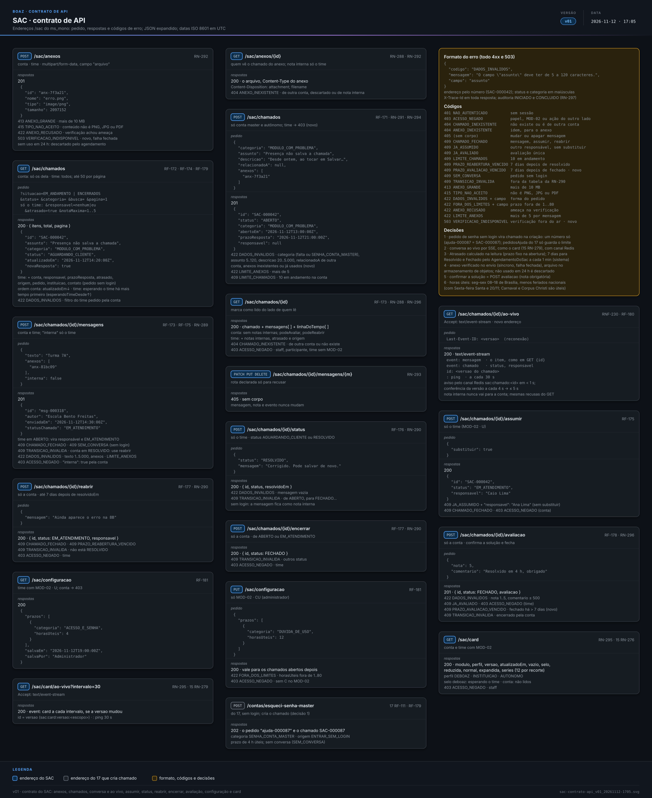
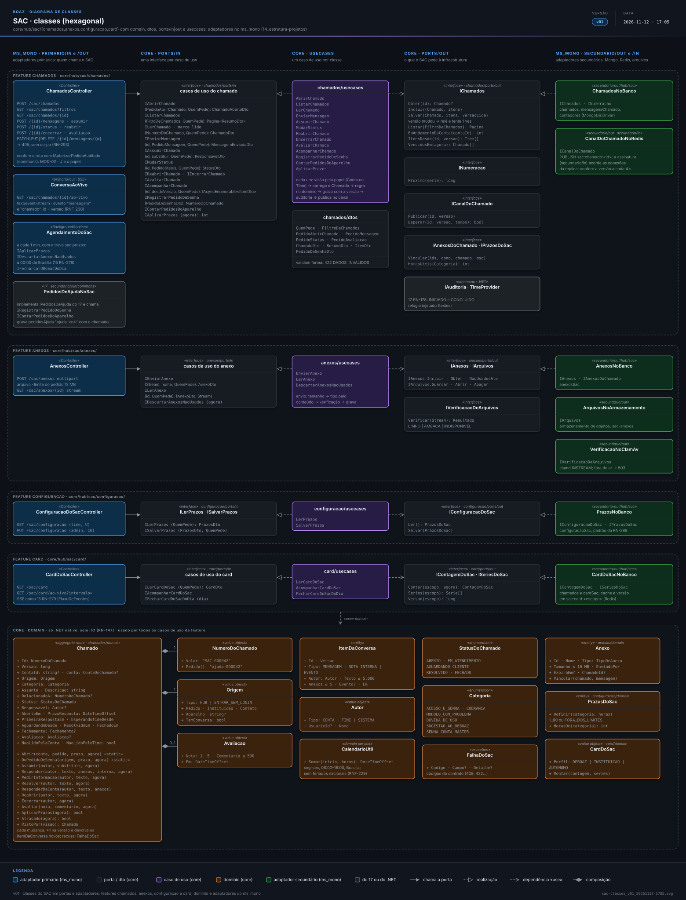
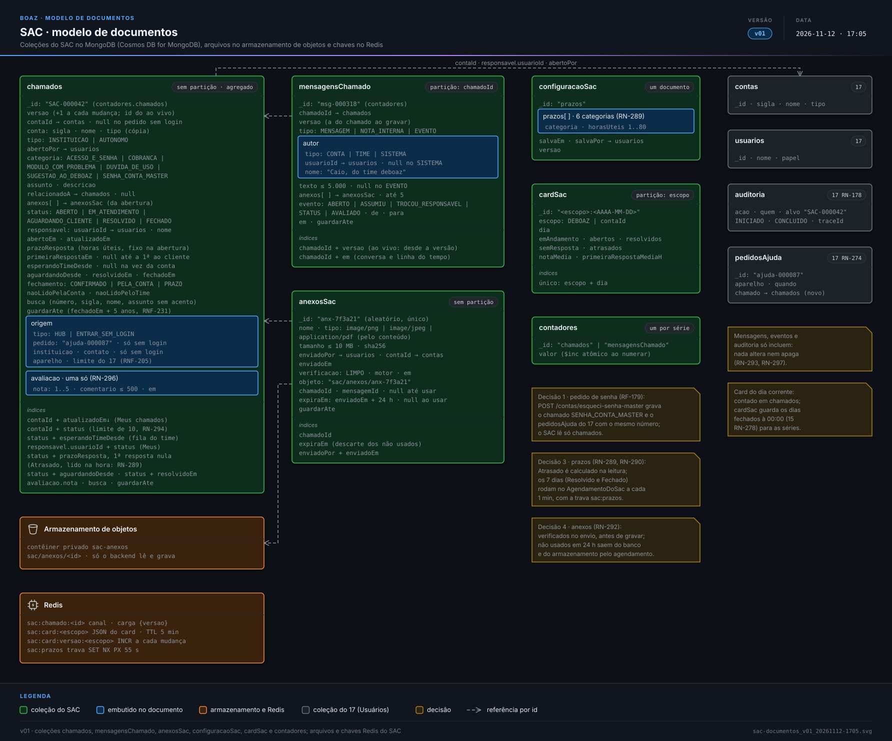

> **boaz · Funcionalidade** · `18_modulo-sac` · **v02** · 2026-11-12 17:19 · **Rascunho**

# SAC

**Objetivo:** permitir que a conta master da instituição e o educador autônomo abram chamados para falar com o time deboaz, acompanhem a conversa até a solução e avaliem o atendimento, e que o time deboaz atenda todos os chamados dentro do prazo de cada categoria.

**Sumário:** [Cenários de tela](#cenarios-tela) · [Cenários de API](#cenarios-api) · [Telas](#telas) · [Diagramas](#diagramas) · [Em aberto](#em-aberto) · [Histórico](#historico)

---

<a id="cenarios-tela"></a>

## Cenários de tela

<a id="exemplo-chamado"></a>

### Exemplo de um chamado do começo ao fim

> Registro do módulo: [15_modulos `MOD-02`](15_modulos.md#MOD-02)

```gherkin
Cenário: a Presença que não salva a chamada
  Dado a conta master da Escola Bento Freitas, sigla EBFGA, em 2026-11-12, quinta, às 10:00
  Quando abre o chamado "Presença não salva a chamada", na categoria "Módulo com problema"
  Então o chamado ganha o número "SAC-000042", o status "Aberto"
  E o prazo "Resposta até hoje, 18:00"
  E às 11:00 o Caio Lima, do time deboaz, assume e responde
  E o chamado passa a "Em atendimento", com "Caio, do time deboaz" como responsável
  E às 11:20 o Caio pede o nome da turma e o chamado passa a "Aguardando sua resposta"
  E às 11:30 a conta master responde "Turma 7A" e o chamado volta a "Em atendimento"
  E às 14:00 o Caio marca "Resolvido" com a mensagem "Corrigido. Pode salvar de novo."
  E a conta master toca em "Confirmar solução", dá 5 estrelas e o chamado fica "Fechado"
```

<a id="RF-171"></a>

### `RF-171` Abrir chamado

```gherkin
Cenário: instituição abre um chamado
  Dado a conta master da EBFGA no SAC
  Quando toca em "Abrir chamado", escolhe "Módulo com problema"
  E informa o assunto "Presença não salva a chamada", a descrição e o print "erro.png"
  E toca em "Enviar"
  Então vê "Chamado SAC-000042 aberto. Resposta até hoje, 18:00"
  E o chamado aparece no topo de Meus chamados, como "Aberto"

Cenário: educador autônomo abre um chamado
  Dado o educador autônomo Pedro Reis no SAC
  Quando abre o chamado "Cobrança em dobro em novembro", na categoria "Cobrança"
  Então o chamado aparece em Meus chamados do Pedro
  E aparece na fila do time deboaz com a conta "Pedro Reis · autônomo"

Cenário: campo faltando
  Dado a conta master no formulário "Abrir chamado", sem categoria escolhida
  Quando toca em "Enviar"
  Então vê "Escolha a categoria" abaixo do campo
  E o chamado não é aberto
```

<a id="RF-172"></a>

### `RF-172` Meus chamados

```gherkin
Cenário: lista da instituição
  Dado a EBFGA com 3 chamados: SAC-000042 "Aguardando sua resposta"
  E SAC-000039 "Em atendimento" e SAC-000031 "Fechado"
  Quando a conta master abre o SAC
  Então vê os 3, o atualizado por último no topo
  E cada linha mostra o número, o assunto, o status e a última atualização
  E SAC-000042 aparece em negrito, com a marca "Nova resposta"

Cenário: filtro por status
  Quando a conta master toca no filtro "Em andamento"
  Então vê SAC-000042 e SAC-000039, sem o SAC-000031

Cenário: sem chamados
  Dado o educador autônomo Pedro Reis sem chamados
  Quando abre o SAC
  Então vê "Nenhum chamado. Precisa de ajuda?" e o botão "Abrir chamado"
```

<a id="RF-173"></a>

### `RF-173` Conversa do chamado

```gherkin
Cenário: responder ao time
  Dado o SAC-000042 "Aguardando sua resposta", com a pergunta do Caio "Qual a turma?"
  Quando a conta master escreve "Turma 7A", anexa "chamada-7a.png" e toca em "Enviar"
  Então a mensagem aparece no fim da conversa, com a hora "11:30"
  E o status passa a "Em atendimento"

Cenário: linha do tempo
  Quando a conta master abre o SAC-000042
  Então vê, entre as mensagens, "Aberto por você · 10:00"
  E "Caio, do time deboaz, assumiu · 11:00" e "Aguardando sua resposta · 11:20"

Cenário: chamado fechado não recebe mensagem
  Dado o SAC-000031 "Fechado"
  Quando a conta master abre o chamado
  Então não vê o campo de mensagem
  E vê "Chamado fechado" e o botão "Abrir chamado relacionado"
```

<a id="RF-174"></a>

### `RF-174` Fila do time

```gherkin
Cenário: fila de chamados em andamento
  Dado o membro do time Caio Lima, com a Utilização do SAC
  E 14 chamados em andamento, 5 sem resposta e 2 com o prazo vencido
  Quando abre o SAC
  Então vê primeiro o chamado mais antigo esperando o time
  E os 2 de prazo vencido com a marca "Atrasado"
  E cada linha mostra o número, a conta, a categoria, o status, o responsável e o prazo

Esquema do Cenário: filtros da fila
  Quando o Caio toca no filtro "<filtro>"
  Então vê <resultado>

  Exemplos:
    | filtro              | resultado                                           |
    | Sem responsável     | os chamados "Aberto" que ninguém assumiu            |
    | Meus                | os chamados em que ele é o responsável              |
    | Atrasados           | os chamados com a marca "Atrasado"                  |
    | Aguardando cliente  | os chamados à espera da resposta da conta           |
    | Nota baixa          | os chamados fechados com 1 ou 2 estrelas            |

Cenário: busca
  Quando o Caio busca "EBFGA" na fila
  Então vê os chamados da Escola Bento Freitas, de todos os status
```

<a id="RF-175"></a>

### `RF-175` Assumir e responder

```gherkin
Cenário: assumir e responder
  Dado o SAC-000042 "Aberto", sem responsável
  Quando o Caio toca em "Assumir" e envia "Olá! Qual a turma da chamada?"
  Então o chamado passa a "Em atendimento", com o Caio como responsável
  E a conta master vê a mensagem assinada "Caio, do time deboaz"

Cenário: nota interna
  Quando o Caio marca "Nota interna" e escreve "Erro ao salvar a 7A, conferir na Presença"
  Então a nota aparece na conversa com o fundo de nota interna para o time
  E a conta master não vê a nota

Cenário: chamado já assumido por outro
  Dado o SAC-000042 com a Ana Lima como responsável
  Quando o Caio toca em "Assumir"
  Então vê "Ana Lima já atende este chamado. Assumir mesmo assim?"
  E ao confirmar passa a ser o responsável, e a linha do tempo registra a troca
```

<a id="RF-176"></a>

### `RF-176` Pedir informação e resolver

```gherkin
Cenário: pedir informação
  Dado o SAC-000042 "Em atendimento", com o Caio como responsável
  Quando o Caio toca em "Pedir informação" e envia "Qual a turma?"
  Então o chamado passa a "Aguardando cliente" para o time
  E a conta master vê "Aguardando sua resposta"

Cenário: resolver
  Quando o Caio toca em "Resolver" e envia "Corrigido. Pode salvar de novo."
  Então o chamado passa a "Resolvido"
  E a conta master vê "Resolveu?" com os botões "Confirmar solução" e "Reabrir"

Cenário: resolver sem mensagem
  Quando o Caio toca em "Resolver" com o campo de mensagem vazio
  Então vê "Escreva a solução para a conta"
  E o chamado continua "Em atendimento"
```

<a id="RF-177"></a>

### `RF-177` Reabrir, confirmar ou encerrar

```gherkin
Cenário: reabrir o resolvido
  Dado o SAC-000042 "Resolvido" há 2 dias
  Quando a conta master toca em "Reabrir" e envia "Ainda aparece o erro na 8B"
  Então o chamado volta a "Em atendimento", com o Caio como responsável

Cenário: encerrar antes da solução
  Dado o SAC-000039 "Em atendimento"
  Quando a conta master toca em "Encerrar chamado" e confirma "Não preciso mais"
  Então o chamado passa a "Fechado"

Cenário: chamado relacionado
  Dado o SAC-000031 "Fechado"
  Quando a conta master toca em "Abrir chamado relacionado"
  Então o formulário abre com "Relacionado a SAC-000031" e a mesma categoria
```

<a id="RF-178"></a>

### `RF-178` Avaliar o atendimento

```gherkin
Cenário: confirmar com avaliação
  Dado o SAC-000042 "Resolvido"
  Quando a conta master toca em "Confirmar solução"
  E escolhe 5 estrelas, escreve "Resolvido em 4 h, obrigado" e toca em "Enviar"
  Então o chamado passa a "Fechado" com "Sua avaliação: 5 estrelas"
  E o Caio vê a nota e o comentário no chamado

Cenário: avaliar depois do fechamento automático
  Dado o SAC-000040 fechado sozinho em 2026-11-10, sem avaliação
  Quando a conta master abre o chamado em 2026-11-12
  Então vê "Como foi o atendimento?" com as 5 estrelas

Cenário: nota baixa
  Quando o Pedro Reis dá 2 estrelas ao SAC-000045
  Então o chamado aparece no filtro "Nota baixa" da fila do time
```

<a id="RF-179"></a>

### `RF-179` Pedido de senha da conta master

> Pedido feito sem login: [17_modulo-usuario `RF-111`](17_modulo-usuario.md#RF-111); conferência: [`RN-172`](17_modulo-usuario.md#RN-172)

```gherkin
Cenário: pedido chega à fila
  Dado o pedido sem login da "Escola Bento Freitas" com o contato "(51) 99999-0000"
  Quando o Caio abre o SAC
  Então vê o chamado SAC-000087, na categoria "Senha da conta master"
  E a origem "Tela Entrar, sem login", a instituição e o contato informados

Cenário: gerar o código pelo chamado
  Dado o Caio com a Utilização do SAC e do Usuários
  Quando assume o SAC-000087 e toca em "Conferir e gerar código da master"
  Então abre a conferência da conta master da EBFGA
  E depois do código gerado, o Caio resolve o chamado com a nota "Código enviado ao contato"

Cenário: membro só com o SAC
  Dado a Ana Lima com a Utilização do SAC, sem o Usuários
  Quando abre o SAC-000087
  Então vê "Conferir e gerar código da master" inativo, com "Precisa do módulo Usuários"
```

<a id="RF-180"></a>

### `RF-180` Aviso de resposta nova

```gherkin
Cenário: resposta do time
  Dado a conta master com Módulos aberto
  Quando o Caio responde o SAC-000042
  Então o card do SAC mostra o selo "1"
  E ao abrir o SAC-000042 o selo some e a marca "Nova resposta" sai da linha

Cenário: mensagem da conta para o time
  Quando a conta master responde o SAC-000042, com o Caio como responsável
  Então o SAC-000042 aparece em negrito no filtro "Meus" do Caio
  E o card do SAC do Caio soma 1 no selo

Cenário: rótulo falado
  Quando o leitor de tela lê o card do SAC da conta master na mínima
  Então diz "SAC, 1 resposta nova"
```

<a id="RF-181"></a>

### `RF-181` Prazos por categoria

```gherkin
Cenário: mudar um prazo
  Dado o administrador do deboaz na aba Configuração do SAC
  Quando muda "Dúvida de uso" de 16 h úteis para 12 h úteis e toca em "Salvar"
  Então vê "Prazos salvos"
  E os chamados de "Dúvida de uso" abertos depois disso têm o prazo de 12 h úteis
  E os já abertos mantêm o prazo que tinham

Cenário: prazo fora dos limites
  Quando informa 81 h úteis para "Sugestão ao deboaz"
  Então vê "Prazo entre 1 e 80 h úteis" e nada é salvo

Cenário: conta de cliente
  Quando a conta master da EBFGA abre o SAC
  Então não vê a aba Configuração
```

<a id="RN-288"></a>

### `RN-288` Quem vê o quê

```gherkin
Esquema do Cenário: chamados que cada perfil vê
  Quando <quem> abre o SAC
  Então <resultado>

  Exemplos:
    | quem                                | resultado                                      |
    | a conta master da EBFGA             | vê só os chamados da EBFGA                     |
    | o educador autônomo Pedro Reis      | vê só os chamados dele                         |
    | o membro do time Caio, com o SAC    | vê os chamados de todas as contas e sem login  |
    | o administrador do deboaz           | vê os chamados de todas as contas e sem login  |
    | o membro do time Rui, sem o SAC     | não vê o card do SAC                           |
    | a staff Maria, da EBFGA             | não vê o card do SAC                           |
    | o participante Lucas, no quest      | não vê o SAC                                   |

Cenário: chamado de outra conta
  Dado o link do SAC-000045, do Pedro Reis
  Quando a conta master da EBFGA abre o link
  Então vê "Chamado não encontrado", sem saber se ele existe
```

<a id="RN-289"></a>

### `RN-289` Categorias e prazos de primeira resposta

```gherkin
Esquema do Cenário: prazo inicial de cada categoria
  Quando um chamado é aberto na categoria "<categoria>"
  Então o time tem <prazo> úteis para a primeira resposta
  E <quem abre>

  Exemplos:
    | categoria             | prazo | quem abre                          |
    | Acesso e senha        | 4 h   | a conta master e o autônomo        |
    | Cobrança              | 8 h   | a conta master e o autônomo        |
    | Módulo com problema   | 8 h   | a conta master e o autônomo        |
    | Dúvida de uso         | 16 h  | a conta master e o autônomo        |
    | Sugestão ao deboaz    | 40 h  | a conta master e o autônomo        |
    | Senha da conta master | 4 h   | só o pedido sem login da tela Entrar |

Cenário: atrasado
  Dado o SAC-000042 aberto às 10:00 de 2026-11-12, com o prazo às 18:00
  Quando chega 18:01 sem nenhuma resposta do time
  Então o chamado ganha a marca "Atrasado" na fila do time
  E a conta master continua vendo só "Aberto"

Cenário: a primeira resposta para o prazo
  Quando o Caio envia a primeira mensagem ao cliente às 11:00
  Então o prazo do SAC-000042 está cumprido
  E nota interna e "Assumir" sem mensagem não cumprem o prazo
```

<a id="RN-290"></a>

### `RN-290` Status do chamado

```gherkin
Esquema do Cenário: mudanças de status permitidas
  Dado um chamado "<de>"
  Quando <evento>
  Então ele passa a "<para>"

  Exemplos:
    | de                 | evento                                  | para               |
    | Aberto             | o time assume ou responde               | Em atendimento     |
    | Em atendimento     | o time pede informação                  | Aguardando cliente |
    | Aguardando cliente | a conta responde                        | Em atendimento     |
    | Em atendimento     | o time resolve                          | Resolvido          |
    | Resolvido          | a conta reabre em até 7 dias            | Em atendimento     |
    | Resolvido          | a conta confirma a solução              | Fechado            |
    | Aguardando cliente | passam 7 dias sem resposta da conta     | Resolvido          |
    | Resolvido          | passam 7 dias sem a conta reabrir       | Fechado            |
    | Aberto             | a conta encerra                         | Fechado            |
    | Em atendimento     | a conta encerra                         | Fechado            |

Esquema do Cenário: mudanças recusadas
  Dado um chamado "<de>"
  Quando <evento>
  Então vê "<aviso>" e o status não muda

  Exemplos:
    | de        | evento                         | aviso                                    |
    | Aberto    | o time tenta resolver          | Responda à conta antes de resolver       |
    | Fechado   | a conta tenta reabrir          | Chamado fechado. Abra um relacionado     |
    | Resolvido | a conta reabre depois de 7 dias | Prazo para reabrir encerrado            |

Cenário: aviso do fechamento por falta de resposta
  Dado o SAC-000039 "Aguardando cliente" desde 2026-11-05 10:00
  Quando chega 2026-11-12 10:00 sem resposta da conta
  Então o chamado passa a "Resolvido" com a mensagem do sistema
  E a mensagem diz "Encerramos por falta de resposta. Se ainda precisar, toque em Reabrir."
```

<a id="RN-291"></a>

### `RN-291` Campos do chamado

```gherkin
Esquema do Cenário: limites dos textos
  Quando a conta master informa <campo> com <tamanho> caracteres
  Então <resultado>

  Exemplos:
    | campo        | tamanho | resultado                                       |
    | o assunto    | 4       | vê "Assunto com 5 a 120 caracteres"             |
    | o assunto    | 5       | o assunto é aceito                              |
    | o assunto    | 120     | o assunto é aceito                              |
    | o assunto    | 121     | vê "Assunto com 5 a 120 caracteres"             |
    | a descrição  | 19      | vê "Descreva com ao menos 20 caracteres"        |
    | a descrição  | 5.000   | a descrição é aceita                            |
    | a descrição  | 5.001   | vê "Descrição com até 5.000 caracteres"         |
    | a mensagem   | 0       | o botão "Enviar" fica inativo                   |
    | a mensagem   | 5.000   | a mensagem é aceita                             |
    | a mensagem   | 5.001   | vê "Mensagem com até 5.000 caracteres"          |
    | o comentário | 501     | vê "Comentário com até 500 caracteres"          |
```

<a id="RN-292"></a>

### `RN-292` Anexos

```gherkin
Esquema do Cenário: arquivo anexado
  Quando a conta master anexa "<arquivo>" de <tamanho>
  Então <resultado>

  Exemplos:
    | arquivo       | tamanho | resultado                                     |
    | erro.png      | 2 MB    | o arquivo é anexado                           |
    | foto.jpg      | 10 MB   | o arquivo é anexado                           |
    | boleto.pdf    | 1 MB    | o arquivo é anexado                           |
    | foto.jpg      | 11 MB   | vê "Cada arquivo com até 10 MB"               |
    | tela.mp4      | 3 MB    | vê "Envie PNG, JPG ou PDF"                    |
    | planilha.xlsx | 1 MB    | vê "Envie PNG, JPG ou PDF"                    |

Cenário: sexto arquivo
  Dado a mensagem com 5 arquivos anexados
  Quando a conta master anexa o sexto
  Então vê "Até 5 arquivos por mensagem"

Cenário: arquivo recusado na verificação
  Quando a conta master anexa "nota.pdf" que não passa na verificação de segurança
  Então vê "Arquivo recusado pela verificação de segurança" e ele não é anexado
```

<a id="RN-293"></a>

### `RN-293` Conversa sem edição

```gherkin
Cenário: mensagem enviada não muda
  Dado a mensagem "Turma 7A" enviada pela conta master no SAC-000042
  Quando a conta master toca e segura a mensagem
  Então não vê as opções de editar nem de apagar

Cenário: nota interna também fica
  Dado a nota interna do Caio no SAC-000042
  Então nem o Caio nem o administrador do deboaz a editam ou apagam
```

<a id="RN-294"></a>

### `RN-294` Limite de chamados em andamento

```gherkin
Cenário: décimo primeiro chamado
  Dado a EBFGA com 10 chamados em Aberto, Em atendimento ou Aguardando cliente
  Quando a conta master toca em "Enviar" num chamado novo
  Então vê "Você já tem 10 chamados em andamento. Acompanhe-os em Meus chamados."
  E o chamado não é aberto

Cenário: resolvido não conta
  Dado a EBFGA com 9 chamados em andamento e 3 "Resolvido"
  Quando a conta master abre um chamado novo
  Então o chamado é aberto
```

<a id="RN-295"></a>

### `RN-295` Card do SAC

> Card comum: [15_modulos `RN-276`](15_modulos.md#RN-276), com os recortes de [`RN-277`](15_modulos.md#RN-277) e a atualização de [`RN-279`](15_modulos.md#RN-279)

```gherkin
Esquema do Cenário: dados do card por perfil e tamanho
  Dado o card SAC do perfil <perfil>, em 2026-11-12, no recorte "Mês"
  Quando está na <tamanho>
  Então mostra <dados>

  Exemplos:
    | perfil      | tamanho  | dados                                                        |
    | deboaz      | mínima   | o ícone e o selo "5": chamados sem resposta do time          |
    | deboaz      | reduzida | 14 · chamados em andamento                                   |
    | deboaz      | normal   | 14, "+3 no mês", Sem resposta 5, Atrasados 2, Nota média 4,6 |
    | instituição | mínima   | o ícone e o selo "1": respostas novas não lidas              |
    | instituição | reduzida | 2 · chamados em andamento                                    |
    | instituição | normal   | 2, "+1 no mês", Aguardando você 1, Resolvidos 3, 1ª resp. 2 h |
    | autônomo    | mínima   | o ícone, sem selo                                            |
    | autônomo    | reduzida | 1 · chamados em andamento                                    |
    | autônomo    | normal   | 1, "-1 no mês", Aguardando você 0, Resolvidos 2, 1ª resp. 3 h |

Esquema do Cenário: lista da expandida de cada perfil
  Dado o card SAC do perfil <perfil> na expandida, com a série de 12 pontos
  Então a lista mostra "<primeira>", "<segunda>" e "<terceira>"

  Exemplos:
    | perfil      | primeira          | segunda           | terceira              |
    | deboaz      | Sem resposta 5    | Atrasados 2       | Aguardando cliente 4  |
    | instituição | Aguardando você 1 | Em atendimento 1  | Resolvidos no mês 3   |
    | autônomo    | Aguardando você 0 | Em atendimento 1  | Resolvidos no mês 2   |

Cenário: sem dados
  Dado o Pedro Reis sem nenhum chamado
  Então o card mostra "Precisa de ajuda? Fale com o time deboaz" e "Abrir chamado"
  E tocar em "Abrir chamado" abre o formulário, sem passar pela lista

Cenário: série do card
  Quando a conta master vê o card na normal, no recorte "Mês"
  Então a série mostra os chamados em andamento no fim de cada um dos 5 últimos meses
```

<a id="RN-296"></a>

### `RN-296` Avaliação única

```gherkin
Esquema do Cenário: quem avalia e quando
  Dado o SAC-000042 <estado>
  Quando <quem> tenta avaliar
  Então <resultado>

  Exemplos:
    | estado                                | quem                | resultado                    |
    | "Resolvido"                           | a conta master      | avalia e o chamado fecha     |
    | "Fechado" há 6 dias, sem avaliação    | a conta master      | avalia                       |
    | "Fechado" há 8 dias, sem avaliação    | a conta master      | não vê mais as estrelas      |
    | "Fechado", com 5 estrelas             | a conta master      | vê só a nota dada            |
    | "Fechado" pela conta, sem resposta    | a conta master      | não vê as estrelas           |
    | "Resolvido"                           | o Caio, do time     | não vê as estrelas           |
```

<a id="RN-297"></a>

### `RN-297` Histórico do atendimento

> Regras da auditoria: [17_modulo-usuario `RN-178`](17_modulo-usuario.md#RN-178)

```gherkin
Cenário: o que fica registrado
  Quando o SAC-000042 passa de "Aberto" a "Fechado"
  Então cada mudança de status, de responsável e cada mensagem fica com quem, quando e o quê
  E o fechamento por prazo fica com "sistema" no lugar de quem
  E nada disso pode ser alterado nem apagado
```

<a id="RNF-229"></a>

### `RNF-229` Horas úteis

```gherkin
Esquema do Cenário: contagem do prazo
  Dado os dias úteis de segunda a sexta, das 08:00 às 18:00, no horário de Brasília
  E sem os feriados nacionais
  Quando um chamado de <prazo> úteis é aberto <quando>
  Então o prazo vence <vence>

  Exemplos:
    | prazo | quando                     | vence                     |
    | 8 h   | quinta, 2026-11-12, 10:00  | quinta, 2026-11-12, 18:00 |
    | 4 h   | quinta, 2026-11-12, 17:00  | sexta, 2026-11-13, 11:00  |
    | 4 h   | sábado, 2026-11-14, 09:00  | segunda, 2026-11-16, 12:00 |
    | 16 h  | sexta, 2026-11-13, 14:00   | terça, 2026-11-17, 12:00  |
```

<a id="RNF-230"></a>

### `RNF-230` Mensagem na conversa

```gherkin
Cenário: conversa aberta dos dois lados
  Dado a conta master e o Caio com o SAC-000042 aberto
  Quando o Caio envia uma mensagem
  Então a mensagem aparece na tela da conta master em até 5 s, sem recarregar
```

<a id="RNF-231"></a>

### `RNF-231` Guarda dos chamados

```gherkin
Cenário: chamado antigo
  Dado o SAC-000012 fechado em 2026-11-12
  Então o chamado, as mensagens e os anexos ficam disponíveis até 2031-11-12, 5 anos depois
  E a conta master o encontra na busca de Meus chamados durante todo esse tempo
```

---

<a id="cenarios-api"></a>

## Cenários de API

<a id="formato-comum"></a>

### Formato comum

```gherkin
Cenário: resposta de erro
  Quando um pedido ao SAC é recusado
  Então o corpo traz o código, a mensagem e, quando houver, o campo:
    """
    {
      "codigo": "DADOS_INVALIDOS",
      "mensagem": "O campo \"assunto\" deve ter de 5 a 120 caracteres.",
      "campo": "assunto"
    }
    """

Cenário: identificadores, datas e valores
  Então o chamado vai no endereço pelo número, como "SAC-000042"
  E toda data e hora segue a ISO 8601 em UTC, como "2026-11-12T13:00:00Z"
  E status e categoria vão em maiúsculas, como "EM_ATENDIMENTO" e "MODULO_COM_PROBLEMA"
  E só a conta master, o autônomo, o administrador e o membro com "MOD-02" usam o SAC
```

<a id="RF-171-api"></a>

### `RF-171` Abrir chamado

```gherkin
Cenário: instituição abre um chamado
  Dado o token da conta master da EBFGA, com "MOD-02" com "U"
  E o anexo "anx-7f3a21" enviado antes por POST /sac/anexos
  Quando envia POST /sac/chamados em 2026-11-12T13:00:00Z com:
    """
    {
      "categoria": "MODULO_COM_PROBLEMA",
      "assunto": "Presença não salva a chamada",
      "descricao": "Desde ontem, ao tocar em Salvar na chamada da turma, aparece erro.",
      "relacionadoA": null,
      "anexos": [
        "anx-7f3a21"
      ]
    }
    """
  Então a resposta é 201 com:
    """
    {
      "id": "SAC-000042",
      "status": "ABERTO",
      "categoria": "MODULO_COM_PROBLEMA",
      "abertoEm": "2026-11-12T13:00:00Z",
      "prazoResposta": "2026-11-12T21:00:00Z",
      "responsavel": null
    }
    """

Esquema do Cenário: pedido inválido
  Quando a conta master envia POST /sac/chamados com <falha>
  Então a resposta é 422 DADOS_INVALIDOS com o campo "<campo>"

  Exemplos:
    | falha                                 | campo      |
    | sem a categoria                       | categoria  |
    | a categoria "SENHA_CONTA_MASTER"      | categoria  |
    | o assunto com 4 caracteres            | assunto    |
    | a descrição com 5.001 caracteres      | descricao  |
    | o relacionadoA "SAC-000045", do Pedro | relacionadoA |
```

<a id="RF-172-api"></a>

### `RF-172` Meus chamados

```gherkin
Cenário: lista da instituição
  Dado o token da conta master da EBFGA
  Quando envia GET /sac/chamados?situacao=EM_ANDAMENTO&pagina=1
  Então a resposta é 200 com itens e total, até 50 por página
  E itens traz o SAC-000042 e o SAC-000039, o atualizado por último primeiro
  E cada item traz id, assunto, categoria, status, atualizadoEm e novaResposta

Cenário: item com resposta nova
  Quando a conta master envia GET /sac/chamados
  Então o item do SAC-000042 traz:
    """
    {
      "id": "SAC-000042",
      "assunto": "Presença não salva a chamada",
      "categoria": "MODULO_COM_PROBLEMA",
      "status": "AGUARDANDO_CLIENTE",
      "atualizadoEm": "2026-11-12T14:20:00Z",
      "novaResposta": true
    }
    """
```

<a id="RF-173-api"></a>

### `RF-173` Conversa do chamado

```gherkin
Cenário: abrir o chamado marca como lido
  Quando a conta master envia GET /sac/chamados/SAC-000042
  Então a resposta é 200 com o chamado, as mensagens e a linhaDoTempo, sem as notas internas
  E o próximo GET /sac/chamados traz o SAC-000042 com novaResposta false

Cenário: responder ao time
  Quando a conta master envia POST /sac/chamados/SAC-000042/mensagens com:
    """
    {
      "texto": "Turma 7A",
      "anexos": [
        "anx-81bc09"
      ],
      "interna": false
    }
    """
  Então a resposta é 201 com:
    """
    {
      "id": "msg-000318",
      "autor": "Escola Bento Freitas",
      "enviadaEm": "2026-11-12T14:30:00Z",
      "statusChamado": "EM_ATENDIMENTO"
    }
    """

Esquema do Cenário: mensagem recusada
  Quando a conta master envia POST /sac/chamados/<chamado>/mensagens com <corpo>
  Então a resposta é <resposta>

  Exemplos:
    | chamado    | corpo                        | resposta                              |
    | SAC-000031 | o texto "Oi"                 | 409 CHAMADO_FECHADO                   |
    | SAC-000042 | o texto vazio                | 422 DADOS_INVALIDOS com o campo texto |
    | SAC-000042 | "interna": true              | 403 ACESSO_NEGADO                     |
```

<a id="RF-174-api"></a>

### `RF-174` Fila do time

```gherkin
Cenário: fila de chamados em andamento
  Dado o token do Caio, com o papel "MEMBRO_TIME" e "MOD-02" com "U"
  Quando envia GET /sac/chamados?situacao=EM_ANDAMENTO&pagina=1
  Então a resposta é 200 com os 14 chamados de todas as contas, até 50 por página
  E o mais antigo esperando o time vem primeiro
  E cada item traz também conta, responsavel, prazoResposta e atrasado

Esquema do Cenário: filtros da fila
  Quando o Caio envia GET /sac/chamados?<filtro>
  Então itens traz <resultado>

  Exemplos:
    | filtro                        | resultado                                     |
    | responsavel=nenhum            | os "ABERTO" sem responsável                   |
    | responsavel=eu                | os chamados do Caio                           |
    | atrasado=true                 | os 2 com o prazo vencido                      |
    | status=AGUARDANDO_CLIENTE     | os 4 à espera da conta                        |
    | notaMaxima=2                  | os fechados com nota 1 ou 2                   |
    | busca=EBFGA                   | os da Escola Bento Freitas, de todo status    |

Cenário: filtro do time pedido pela conta
  Quando a conta master envia GET /sac/chamados?responsavel=eu
  Então a resposta é 422 DADOS_INVALIDOS com o campo "responsavel"
```

<a id="RF-175-api"></a>

### `RF-175` Assumir e responder

```gherkin
Cenário: assumir
  Dado o SAC-000042 "ABERTO", sem responsável
  Quando o Caio envia POST /sac/chamados/SAC-000042/assumir
  Então a resposta é 200 com:
    """
    {
      "id": "SAC-000042",
      "status": "EM_ATENDIMENTO",
      "responsavel": "Caio Lima"
    }
    """

Cenário: já assumido por outro
  Dado o SAC-000042 com a Ana Lima como responsável
  Quando o Caio envia POST /sac/chamados/SAC-000042/assumir sem corpo
  Então a resposta é 409 JA_ASSUMIDO com o responsavel "Ana Lima"
  E com "substituir" true no corpo, a resposta é 200 com o Caio como responsável

Cenário: nota interna
  Quando o Caio envia POST /sac/chamados/SAC-000042/mensagens com "interna": true
  Então a resposta é 201
  E GET /sac/chamados/SAC-000042 da conta master não traz a nota

Cenário: conta não assume
  Quando a conta master envia POST /sac/chamados/SAC-000042/assumir
  Então a resposta é 403 ACESSO_NEGADO
```

<a id="RF-176-api"></a>

### `RF-176` Pedir informação e resolver

```gherkin
Cenário: pedir informação
  Quando o Caio envia POST /sac/chamados/SAC-000042/status com:
    """
    {
      "status": "AGUARDANDO_CLIENTE",
      "mensagem": "Qual a turma?"
    }
    """
  Então a resposta é 200 com o status "AGUARDANDO_CLIENTE"
  E a mensagem entra na conversa, visível para a conta

Cenário: resolver
  Quando o Caio envia POST /sac/chamados/SAC-000042/status com:
    """
    {
      "status": "RESOLVIDO",
      "mensagem": "Corrigido. Pode salvar de novo."
    }
    """
  Então a resposta é 200 com o status "RESOLVIDO" e resolvidoEm

Cenário: sem mensagem
  Quando o Caio envia o status "RESOLVIDO" sem a mensagem
  Então a resposta é 422 DADOS_INVALIDOS com o campo "mensagem"
```

<a id="RF-177-api"></a>

### `RF-177` Reabrir, confirmar ou encerrar

```gherkin
Cenário: reabrir
  Dado o SAC-000042 "RESOLVIDO" há 2 dias
  Quando a conta master envia POST /sac/chamados/SAC-000042/reabrir com:
    """
    {
      "mensagem": "Ainda aparece o erro na 8B"
    }
    """
  Então a resposta é 200 com o status "EM_ATENDIMENTO" e o mesmo responsavel

Cenário: encerrar
  Quando a conta master envia POST /sac/chamados/SAC-000039/encerrar
  Então a resposta é 200 com o status "FECHADO"

Cenário: time não encerra pela conta
  Quando o Caio envia POST /sac/chamados/SAC-000039/encerrar
  Então a resposta é 403 ACESSO_NEGADO
```

<a id="RF-178-api"></a>

### `RF-178` Avaliar o atendimento

```gherkin
Cenário: confirmar com avaliação
  Dado o SAC-000042 "RESOLVIDO"
  Quando a conta master envia POST /sac/chamados/SAC-000042/avaliacao com:
    """
    {
      "nota": 5,
      "comentario": "Resolvido em 4 h, obrigado"
    }
    """
  Então a resposta é 201 e o chamado passa a "FECHADO"

Esquema do Cenário: avaliação recusada
  Quando <quem> envia POST /sac/chamados/SAC-000042/avaliacao com <corpo>
  Então a resposta é <resposta>

  Exemplos:
    | quem           | corpo                         | resposta                                |
    | a conta master | a nota 6                      | 422 DADOS_INVALIDOS com o campo nota    |
    | a conta master | um comentário de 501 letras   | 422 DADOS_INVALIDOS com o campo comentario |
    | a conta master | a nota 4, já avaliado         | 409 JA_AVALIADO                         |
    | o Caio         | a nota 5                      | 403 ACESSO_NEGADO                       |
```

<a id="RF-179-api"></a>

### `RF-179` Pedido de senha da conta master

> Pedido sem login: [17_modulo-usuario `RF-111`](17_modulo-usuario.md#RF-111-api); código: [`RN-172`](17_modulo-usuario.md#RN-172-api)

```gherkin
Cenário: pedido na fila do time
  Dado o pedido "ajuda-000087" de POST /contas/esqueci-senha-master, com 202
  Quando o Caio envia GET /sac/chamados?categoria=SENHA_CONTA_MASTER
  Então itens traz:
    """
    {
      "id": "SAC-000087",
      "categoria": "SENHA_CONTA_MASTER",
      "origem": "ENTRAR_SEM_LOGIN",
      "pedido": "ajuda-000087",
      "conta": null,
      "instituicao": "Escola Bento Freitas",
      "contato": "(51) 99999-0000",
      "status": "ABERTO"
    }
    """

Cenário: sem conversa com quem pediu
  Quando o Caio envia POST /sac/chamados/SAC-000087/mensagens com "interna": false
  Então a resposta é 409 SEM_CONVERSA
  E com "interna": true a resposta é 201
```

<a id="RN-288-api"></a>

### `RN-288` Quem vê o quê

```gherkin
Esquema do Cenário: acesso ao chamado
  Quando <quem> envia GET /sac/chamados/SAC-000045, do Pedro Reis
  Então a resposta é <resposta>

  Exemplos:
    | quem                                 | resposta                    |
    | o Pedro Reis                         | 200                         |
    | o Caio, com "MOD-02" com "U"         | 200                         |
    | a conta master da EBFGA              | 404 CHAMADO_INEXISTENTE     |
    | o Rui, membro do time sem "MOD-02"   | 403 ACESSO_NEGADO           |
    | a staff Maria                        | 403 ACESSO_NEGADO           |

Cenário: anexo de outra conta
  Quando a conta master da EBFGA envia GET /sac/anexos/anx-55d0e2, do chamado do Pedro
  Então a resposta é 404 ANEXO_INEXISTENTE
```

<a id="RN-290-api"></a>

### `RN-290` Status do chamado

```gherkin
Esquema do Cenário: mudança recusada
  Dado o chamado SAC-000042 "<de>"
  Quando <quem> envia POST /sac/chamados/SAC-000042/<acao>
  Então a resposta é <resposta>

  Exemplos:
    | de        | quem           | acao                       | resposta                      |
    | ABERTO    | o Caio         | status com "RESOLVIDO"     | 409 TRANSICAO_INVALIDA        |
    | FECHADO   | a conta master | reabrir                    | 409 CHAMADO_FECHADO           |
    | RESOLVIDO | a conta master | reabrir, depois de 7 dias  | 409 PRAZO_REABERTURA_VENCIDO  |
    | RESOLVIDO | o Caio         | status com "FECHADO"       | 409 TRANSICAO_INVALIDA        |

Cenário: fechamento por prazo
  Dado o SAC-000039 "AGUARDANDO_CLIENTE" desde 2026-11-05T13:00:00Z
  Quando chega 2026-11-12T13:00:00Z sem mensagem da conta
  Então GET /sac/chamados/SAC-000039 traz o status "RESOLVIDO"
  E a linhaDoTempo traz o evento com o autor "sistema"
```

<a id="RN-292-api"></a>

### `RN-292` Anexos

```gherkin
Cenário: enviar um anexo
  Quando a conta master envia POST /sac/anexos com o arquivo "erro.png" de 2 MB
  Então a resposta é 201 com:
    """
    {
      "id": "anx-7f3a21",
      "nome": "erro.png",
      "tipo": "image/png",
      "tamanho": 2097152
    }
    """
  E o anexo não usado num chamado ou mensagem em 24 h é descartado

Esquema do Cenário: anexo recusado
  Quando a conta master envia <pedido>
  Então a resposta é <resposta>

  Exemplos:
    | pedido                                         | resposta                   |
    | POST /sac/anexos com "foto.jpg" de 11 MB       | 413 ANEXO_GRANDE           |
    | POST /sac/anexos com "tela.mp4"                | 415 TIPO_NAO_ACEITO        |
    | POST /sac/anexos com "nota.pdf" com ameaça     | 422 ANEXO_RECUSADO         |
    | uma mensagem com 6 anexos                      | 422 LIMITE_ANEXOS          |
```

<a id="RN-293-api"></a>

### `RN-293` Conversa sem edição

```gherkin
Esquema do Cenário: mensagem não muda
  Quando o Caio envia <pedido> /sac/chamados/SAC-000042/mensagens/msg-000318
  Então a resposta é 405

  Exemplos:
    | pedido |
    | PATCH  |
    | PUT    |
    | DELETE |
```

<a id="RN-294-api"></a>

### `RN-294` Limite de chamados em andamento

```gherkin
Cenário: décimo primeiro chamado
  Dado a EBFGA com 10 chamados em ABERTO, EM_ATENDIMENTO ou AGUARDANDO_CLIENTE
  Quando a conta master envia POST /sac/chamados
  Então a resposta é 409 LIMITE_CHAMADOS e nenhum chamado é aberto
```

<a id="RN-295-api"></a>

### `RN-295` Card do SAC

> Campos comuns do card: [15_modulos `RN-276`](15_modulos.md#RN-276-api) e ao vivo em [`RN-279`](15_modulos.md#RN-279-api)

```gherkin
Cenário: card da instituição
  Dado o token da conta master da EBFGA
  Quando envia GET /sac/card
  Então a resposta é 200 com:
    """
    {
      "modulo": "MOD-02",
      "perfil": "INSTITUICAO",
      "versao": 57,
      "atualizadoEm": "2026-11-12T14:20:00Z",
      "vazio": false,
      "selo": 1,
      "reduzida": {
        "valor": 2,
        "rotulo": "chamados em andamento"
      },
      "normal": {
        "valor": 2,
        "rotulo": "chamados em andamento",
        "apoio": [
          {
            "nome": "Aguardando você",
            "valor": 1
          },
          {
            "nome": "Resolvidos no mês",
            "valor": 3
          },
          {
            "nome": "1ª resposta média (h)",
            "valor": 2
          }
        ]
      }
    }
    """
  E traz também a expandida e as series de dia, semana e mes, 12 números cada

Esquema do Cenário: quem pede o card
  Quando <quem> envia GET /sac/card
  Então a resposta é <resposta>

  Exemplos:
    | quem                          | resposta                              |
    | o Caio, com "MOD-02" com "U"  | 200 com o perfil "DEBOAZ" e o selo 5  |
    | o Pedro Reis                  | 200 com o perfil "AUTONOMO"           |
    | a staff Maria                 | 403 ACESSO_NEGADO                     |

Cenário: ao vivo
  Quando a conta master envia GET /sac/card/ao-vivo?intervalo=30
  Então a resposta é 200, como em RN-279 de 15_modulos
```

<a id="RN-297-api"></a>

### `RN-297` Histórico do atendimento

```gherkin
Esquema do Cenário: ações auditadas
  Quando <quem> envia <pedido> com sucesso
  Então "auditoria" ganha "INICIADO" e "CONCLUIDO" da ação "<acao>", com o mesmo traceId

  Exemplos:
    | quem           | pedido                                      | acao               |
    | a conta master | POST /sac/chamados                          | ABRIR_CHAMADO      |
    | a conta master | POST /sac/chamados/SAC-000042/mensagens     | ENVIAR_MENSAGEM    |
    | o Caio         | POST /sac/chamados/SAC-000042/assumir       | ASSUMIR_CHAMADO    |
    | o Caio         | POST /sac/chamados/SAC-000042/status        | MUDAR_STATUS       |
    | a conta master | POST /sac/chamados/SAC-000042/reabrir       | REABRIR_CHAMADO    |
    | a conta master | POST /sac/chamados/SAC-000039/encerrar      | ENCERRAR_CHAMADO   |
    | a conta master | POST /sac/chamados/SAC-000042/avaliacao     | AVALIAR_CHAMADO    |
    | o administrador| PUT /sac/configuracao                       | SALVAR_PRAZOS_SAC  |

Cenário: mudança feita pelo prazo
  Quando o SAC-000039 passa a "RESOLVIDO" por 7 dias sem resposta
  Então "auditoria" ganha a ação "FECHAR_POR_PRAZO", sem quem, com o alvo "SAC-000039"
```

<a id="RF-181-api"></a>

### `RF-181` Prazos por categoria

```gherkin
Cenário: salvar os prazos
  Dado o token do administrador do deboaz, com "MOD-02" com "CU"
  Quando envia PUT /sac/configuracao com:
    """
    {
      "prazos": [
        {
          "categoria": "ACESSO_E_SENHA",
          "horasUteis": 4
        },
        {
          "categoria": "DUVIDA_DE_USO",
          "horasUteis": 12
        }
      ]
    }
    """
  Então a resposta é 200 e GET /sac/configuracao traz os prazos novos

Esquema do Cenário: recusas
  Quando <quem> envia PUT /sac/configuracao com <corpo>
  Então a resposta é <resposta>

  Exemplos:
    | quem                          | corpo                    | resposta                 |
    | o administrador do deboaz     | horasUteis 81            | 422 FORA_DOS_LIMITES     |
    | o administrador do deboaz     | horasUteis 0             | 422 FORA_DOS_LIMITES     |
    | o Caio, só com "U" no MOD-02  | horasUteis 12            | 403 ACESSO_NEGADO        |
    | a conta master da EBFGA       | horasUteis 12            | 403 ACESSO_NEGADO        |
```

<a id="fora-de-escopo"></a>

### Fora de escopo

```gherkin
Cenário: o que o SAC não faz
  Então o SAC não tem chat ao vivo, telefone nem atendimento por robô
  E o staff, o participante e o responsável não abrem chamado
  E a conversa com pais e alunos é do módulo Mensagens
  E o time deboaz não abre chamado em nome da conta
```

---

<a id="telas"></a>

## Telas

> Vistas a desenhar pelo `deboaz-uxui`, uma por plataforma (Web, PWA e Mobile): `vista-hub-sac-cliente` (Meus chamados, Abrir chamado, conversa e avaliação), `vista-hub-sac-time` (fila, conversa com nota interna, pedido de senha da master) e `vista-hub-sac-configuracao` (prazos por categoria)

---

<a id="diagramas"></a>

## Diagramas

**SAC · casos de uso** — `2_Diagramas/sac-casos-de-uso_v01_20261112-1705.svg`

[](../2_Diagramas/sac-casos-de-uso_v01_20261112-1705.svg)

**SAC · sequência com as telas** — `2_Diagramas/sac-sequencia_v01_20261112-1705.svg`

[](../2_Diagramas/sac-sequencia_v01_20261112-1705.svg)

**SAC · contrato de API** — `2_Diagramas/sac-contrato-api_v01_20261112-1705.svg`

[](../2_Diagramas/sac-contrato-api_v01_20261112-1705.svg)

**SAC · classes** — `2_Diagramas/sac-classes_v01_20261112-1705.svg`

[](../2_Diagramas/sac-classes_v01_20261112-1705.svg)

**SAC · modelo de documentos** — `2_Diagramas/sac-documentos_v01_20261112-1705.svg`

[](../2_Diagramas/sac-documentos_v01_20261112-1705.svg)

---

<a id="em-aberto"></a>

## Em aberto

- Além do selo no card, a conta recebe aviso de resposta nova por e-mail, WhatsApp ou notificação do aparelho? — **Produto**
- A conta desativada por falta de pagamento (17 `RF-113`) pode abrir chamado no SAC, se não entra no hub? — **Produto**
- Feriados estaduais e municipais entram na contagem de horas úteis (`RNF-229`)? — **Produto**

---

<a id="historico"></a>

## Histórico

| Versão | Data | Mudança |
|---|---|---|
| **v02** | 2026-11-12 17:19 | Diagramas: sac-casos-de-uso, sac-sequencia (com as vistas previstas), sac-contrato-api, sac-classes e sac-documentos v01; cenários sem mudança |
| v01 | 2026-11-12 16:58 | Criação: chamados da conta master e do autônomo com o time deboaz (`RF-171` a `RF-181`), regras (`RN-288` a `RN-297`) e medidas (`RNF-229` a `RNF-231`), com as âncoras -api; telas e diagramas a desenhar |

---

<sub>boaz · v02 · 2026-11-12 17:19 · `1_Requisitos/18_modulo-sac.md`</sub>
