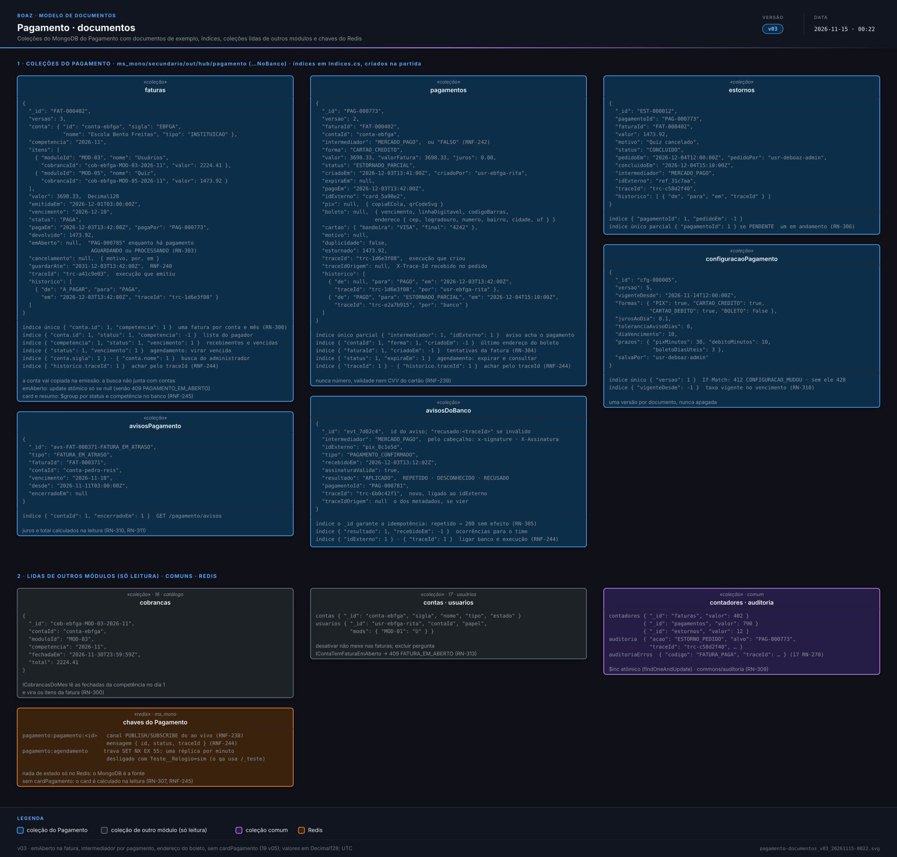

> **boaz · Funcionalidade** · `19_modulo-pagamento` · **v06** · 2026-11-15 01:06 · **Rascunho**

# Pagamento

**Objetivo:** permitir que a instituição e o educador autônomo paguem pelo hub a fatura mensal dos módulos contratados, com PIX, cartão de crédito, cartão de débito ou boleto, e que o deboaz acompanhe tudo o que recebeu, tem a receber e está vencido.

**Sumário:** [Cenários de tela](#cenarios-tela) · [Cenários de API](#cenarios-api) · [Telas](#telas) · [Diagramas](#diagramas) · [Em aberto](#em-aberto) · [Histórico](#historico)

---

<a id="cenarios-tela"></a>

## Cenários de tela

<a id="exemplo-pagamento"></a>

### Exemplo de uma fatura do começo ao fim

> Registro do módulo: [15_modulos `MOD-01`](15_modulos.md#MOD-01); valor de cada módulo: [16_modulo-catalogo `RNF-210`](16_modulo-catalogo.md#RNF-210)

```gherkin
Cenário: a fatura de novembro da EBFGA paga pelo setor financeiro
  Dado a Escola Bento Freitas, sigla EBFGA, com o Usuários e o Quiz contratados
  E a staff Rita Gomes, do setor financeiro, com a Utilização do Pagamento
  Quando a competência "2026-11" fecha em 2026-11-30, às 23:59
  Então a FAT-000402 nasce em 2026-12-01 com o Usuários R$ 2.224,41 e o Quiz R$ 1.473,92
  E o total "R$ 3.698,33", o vencimento "10/12/2026" e o status "A pagar"
  E em 2026-12-03, às 09:40, a Rita paga com cartão de crédito e o banco recusa
  E às 10:00 gera um código PIX, que expira às 10:30 sem pagamento
  E às 10:42 paga com o cartão de crédito Visa de final 4242 e vê "Pagamento aprovado"
  E a fatura fica "Paga em 03/12/2026", com as 3 tentativas em "Pagamentos desta fatura"
  E ela toca em "Baixar comprovante" e recebe "comprovante-FAT-000402.pdf"
  E o administrador do deboaz vê R$ 3.698,33 a mais em "Recebido" na competência "2026-11"
  E em 2026-12-04 estorna R$ 1.473,92 do Quiz cancelado, e a EBFGA vê "Devolvidos R$ 1.473,92"
```

<a id="RF-182"></a>

### `RF-182` Faturas da conta

```gherkin
Cenário: abrir o Pagamento
  Dado a EBFGA em 2026-12-03 com a FAT-000402 "A pagar", de novembro
  E a FAT-000318 "Paga", de outubro, e a FAT-000247 "Paga", de setembro
  Quando a conta master abre o Pagamento
  Então vê no topo "A pagar", "R$ 3.698,33" e "Próximo vencimento 10/12/2026"
  E o filtro "A pagar" marcado, só com a FAT-000402

Esquema do Cenário: filtros das faturas
  Quando a conta master toca no filtro "<filtro>"
  Então vê <resultado>

  Exemplos:
    | filtro  | resultado                                                |
    | A pagar | a FAT-000402 e as faturas "Vencida", se houver, no topo  |
    | Pagas   | a FAT-000318 e a FAT-000247                              |
    | Todas   | "3 faturas · a mais nova primeiro" e as 3 faturas        |

Esquema do Cenário: linha de cada fatura em "Todas"
  Quando a conta master toca no filtro "Todas"
  Então a linha "<competencia>" mostra "<valor>", "<numero> · <vencimento>" e o status "<status>"

  Exemplos:
    | competencia      | valor       | numero     | vencimento              | status  |
    | Novembro de 2026 | R$ 3.698,33 | FAT-000402 | Vence em 10/12/2026     | A pagar |
    | Outubro de 2026  | R$ 3.612,08 | FAT-000318 | Venceu em 10/11/2026    | Paga    |
    | Setembro de 2026 | R$ 3.540,17 | FAT-000247 | Venceu em 10/10/2026    | Paga    |

Cenário: sem faturas
  Dado o educador autônomo Pedro Reis no primeiro mês de uso, sem nenhuma fatura
  Quando abre o Pagamento
  Então vê o mascote Curioso, "Nenhuma fatura ainda"
  E o apoio "A fatura de cada mês chega no dia 1º do mês seguinte."
```

<a id="RF-183"></a>

### `RF-183` Detalhe da fatura

```gherkin
Cenário: fatura a pagar
  Dado a FAT-000402 "A pagar"
  Quando a Rita abre a fatura
  Então vê "Fatura de novembro de 2026", o status "A pagar" e "Vence em 10/12/2026"
  E em "Itens", "Usuários R$ 2.224,41" e "Quiz R$ 1.473,92", e "Total R$ 3.698,33"
  E a seção "Pagamentos desta fatura" com "Nenhum pagamento ainda"
  E o botão "Pagar R$ 3.698,33"

Esquema do Cenário: fatura vencida, com e sem juros
  Dado a FAT-000371, do Pedro Reis, com o Usuários R$ 147,00 e o Quiz R$ 147,00
  E o vencimento em 2026-11-10, sem pagamento, e os juros de <taxa> ao dia
  Quando o Pedro abre a fatura em 2026-11-14
  Então vê o status "Vencida", "Venceu em 10/11/2026" e o total "R$ 294,00"
  E <juros>
  E o botão "<botao>"

  Exemplos:
    | taxa  | juros                                                        | botao           |
    | 0 %   | nenhuma linha de juros                                       | Pagar R$ 294,00 |
    | 0,1 % | "Juros de 0,1 % ao dia desde 11/11/2026: R$ 1,18 em 4 dias." | Pagar R$ 295,18 |

Cenário: fatura cancelada
  Dado a FAT-000371 cancelada pelo deboaz em 2026-11-14
  Quando o Pedro abre a fatura
  Então vê o status "Cancelada", "Cancelada em 14/11/2026" e "Motivo: Cobrança em dobro do Quiz"
  E não vê o botão "Pagar"

Cenário: sem conexão
  Dado a Rita com a FAT-000402 aberta no celular
  Quando a rede cai
  Então vê "Sem conexão. Mostrando os dados de 03/12/2026, 09:58."
  E o botão "Pagar R$ 3.698,33" fica desativado, com "Conecte-se para pagar" acima dele
```

<a id="RF-184"></a>

### `RF-184` Escolher e trocar a forma de pagamento

```gherkin
Esquema do Cenário: formas aceitas
  Dado as quatro formas ligadas pelo deboaz
  Quando a Rita toca em "Pagar R$ 3.698,33" na FAT-000402
  Então vê "Como você quer pagar?" e "Fatura de novembro de 2026 · R$ 3.698,33"
  E a forma "<forma>" com o apoio "<apoio>"

  Exemplos:
    | forma             | apoio                            |
    | PIX               | Confirmação na hora              |
    | Cartão de crédito | Confirmação na hora, à vista     |
    | Cartão de débito  | Confirmação no app do banco      |
    | Boleto            | Confirmação em até 3 dias úteis  |

Cenário: forma desligada pelo deboaz
  Dado o boleto desligado pelo administrador do deboaz
  Quando a Rita toca em "Pagar R$ 3.698,33"
  Então vê só "PIX", "Cartão de crédito" e "Cartão de débito"

Cenário: trocar o boleto por outra forma
  Dado o boleto da FAT-000402 "Aguardando pagamento"
  Quando a Rita abre a fatura e toca em "Pagar de outra forma"
  Então vê "Cancelar o boleto e escolher outra forma?"
  E o apoio "Se você já pagou o boleto, aguarde a confirmação em até 3 dias úteis."
  E os botões "Voltar", que fecha o diálogo sem mudar nada, e "Cancelar boleto"
  E ao tocar em "Cancelar boleto", o boleto fica "Cancelado" e volta "Como você quer pagar?"
```

<a id="RF-185"></a>

### `RF-185` Pagar com PIX

```gherkin
Cenário: código PIX gerado
  Dado a Rita em "Como você quer pagar?" na FAT-000402, em 2026-12-03, às 10:00
  Quando escolhe "PIX"
  Então vê o QR Code, o valor "R$ 3.698,33" e "Válido até 10:30"
  E ao tocar em "Copiar código PIX" vê "Código copiado"
  E o pagamento aparece em "Pagamentos desta fatura" como "PIX · Aguardando pagamento"

Cenário: PIX pago
  Dado o código PIX da FAT-000402 gerado às 10:00 e aberto na tela da Rita
  Quando o banco confirma o pagamento às 10:12
  Então a Rita vê "Fatura paga" com o mascote Orgulhoso, e a fatura "Paga em 03/12/2026"
  E o mascote aparece animado, e parado quando o aparelho pede menos movimento

Cenário: código expirado
  Dado o código PIX gerado às 10:00 e não pago
  Quando chega 10:30
  Então a Rita vê "Este código PIX expirou." e o botão "Gerar novo código"
  E o pagamento fica "PIX · Expirado" e a fatura segue "A pagar"
```

<a id="RF-186"></a>

### `RF-186` Pagar com cartão de crédito

```gherkin
Cenário: crédito aprovado
  Dado a Rita em "Cartão de crédito" na FAT-000402
  Quando informa "Número do cartão", "Nome como está no cartão", "Validade (MM/AA)"
  E "Código de segurança" e toca em "Pagar R$ 3.698,33"
  Então vê "Pagamento aprovado" e a fatura "Paga em 03/12/2026"
  E o pagamento aparece como "Cartão de crédito · Visa final 4242 · Pago", à vista

Cenário: crédito recusado
  Quando o banco do cartão recusa o pagamento
  Então a Rita vê "Pagamento recusado pelo banco do cartão. Tente outro cartão ou outra forma."
  E o pagamento fica "Cartão de crédito · Visa final 4242 · Recusado"
  E a fatura segue "A pagar", com o botão "Pagar R$ 3.698,33"

Esquema do Cenário: cartão com dado inválido
  Quando a Rita informa <dado> e toca em "Pagar R$ 3.698,33"
  Então vê "<aviso>" abaixo do campo e nada é cobrado

  Exemplos:
    | dado                                          | aviso                           |
    | um número que não passa na conferência        | Confira o número do cartão      |
    | a validade "10/26", em 2026-12-03             | Cartão vencido                  |
    | o código de segurança com 2 números           | Código de segurança incompleto  |
```

<a id="RF-187"></a>

### `RF-187` Pagar com cartão de débito

```gherkin
Cenário: débito confirmado no banco
  Dado a Rita em "Cartão de débito" na FAT-000402, às 10:00
  Quando informa os dados do cartão e toca em "Pagar R$ 3.698,33"
  Então vê "Confirme o pagamento no app do seu banco" e "Aguardando a confirmação até 10:10"
  E ao confirmar no banco, vê "Pagamento aprovado" e a fatura "Paga em 03/12/2026"

Cenário: confirmação não chegou
  Dado o débito aguardando a confirmação do banco desde 10:00
  Quando chega 10:10 sem confirmação
  Então a Rita vê "A confirmação não chegou a tempo. Nada foi cobrado." e "Tentar de novo"
  E o pagamento fica "Cartão de débito · Expirado" e a fatura segue "A pagar"

Cenário: débito recusado
  Quando o banco recusa o débito por falta de saldo
  Então a Rita vê "Pagamento recusado pelo banco do cartão. Tente outro cartão ou outra forma."
  E o pagamento fica "Cartão de débito · Recusado"
```

<a id="RF-188"></a>

### `RF-188` Pagar com boleto

```gherkin
Cenário: boleto gerado
  Dado a Rita em "Como você quer pagar?" na FAT-000402, em 2026-12-03
  Quando escolhe "Boleto"
  Então vê o valor "R$ 3.698,33", "Vence em 10/12/2026" e o código de barras
  E a linha digitável "23793.38128 60000.000003 00000.000400 1 12960000369833"
  E os botões "Copiar linha digitável" e "Baixar boleto (PDF)"
  E o apoio "Pagamentos com boleto levam até 3 dias úteis para serem confirmados."

Cenário: endereço de quem paga o boleto
  Dado a EBFGA sem nenhum boleto gerado antes
  Quando a Rita escolhe "Boleto" na FAT-000402
  Então vê "Endereço de quem paga", com o apoio "O banco exige o endereço no boleto."
  E os campos "CEP", "Rua", "Número", "Bairro", "Cidade" e "UF", e o botão "Gerar boleto"
  E o boleto sai em nome da Escola Bento Freitas, com o CNPJ 12.345.678/0001-90 da conta
  E no próximo boleto da EBFGA os campos já vêm com o último endereço usado

Esquema do Cenário: endereço do boleto com erro
  Dado a Rita em "Endereço de quem paga" na FAT-000402
  Quando informa <campo> "<valor>" e toca em "Gerar boleto"
  Então vê "<erro>" abaixo do campo <campo>
  E nenhum boleto é gerado

  Exemplos:
    | campo | valor    | erro          |
    | "CEP" | 9601-500 | Confira o CEP |
    | "UF"  | XX       | Confira a UF  |

Cenário: boleto compensado
  Dado o boleto da FAT-000402 pago no banco em 2026-12-04
  Quando o banco confirma a compensação em 2026-12-07
  Então a fatura fica "Paga em 04/12/2026" e o boleto "Boleto · Pago"

Cenário: boleto não compensado
  Dado o boleto da FAT-000402 com vencimento em 2026-12-10 e não pago
  Quando chega 2026-12-16, 3 dias úteis depois do vencimento, sem compensação
  Então o boleto fica "Boleto · Expirado"
  E a fatura segue "Vencida" e "Venceu em 10/12/2026", com o botão "Pagar" para uma nova forma
```

<a id="RF-189"></a>

### `RF-189` Comprovante do pagamento

```gherkin
Cenário: baixar o comprovante
  Dado a FAT-000318, paga com PIX em 2026-11-05
  Quando a conta master abre a fatura e toca em "Baixar comprovante"
  Então recebe o arquivo "comprovante-FAT-000318.pdf"
  E o comprovante traz a conta, a competência, os itens, o valor, a forma, a data e a hora
  E o número do pagamento "PAG-000655"

Cenário: fatura sem pagamento confirmado
  Dado a FAT-000402 com o boleto "Aguardando pagamento"
  Quando a Rita abre a fatura
  Então não vê "Baixar comprovante"
```

<a id="RF-190"></a>

### `RF-190` Recebimentos do deboaz

> Definição de cada número: [`RN-308`](#RN-308)

```gherkin
Cenário: competência de outubro
  Dado o administrador do deboaz em 2026-11-14
  Quando abre o Pagamento, com as abas "Recebimentos" e "Configuração"
  E escolhe a competência "Outubro de 2026" em "Recebimentos"
  Então vê "Recebido R$ 198.120,50 · 119 faturas" e "Faturado R$ 212.450,30 · 128 faturas"
  E "A receber R$ 0,00 · 0 faturas" e "Vencido R$ 14.329,80 · 9 faturas"
  E "Inadimplência 6,7 %", com o apoio "Vencido ÷ Faturado" e o selo Lento
  E tocar em "Vencido" abre as 9 faturas vencidas

Esquema do Cenário: recebido por forma de pagamento, em outubro
  Quando o administrador vê "Por forma de pagamento"
  Então a linha "<forma>" mostra "<valor> · <faturas> faturas"

  Exemplos:
    | forma             | valor          | faturas |
    | PIX               | R$ 120.300,00  | 74      |
    | Cartão de crédito | R$ 41.250,50   | 25      |
    | Cartão de débito  | R$ 6.570,00    | 5       |
    | Boleto            | R$ 30.000,00   | 15      |

Esquema do Cenário: por competência, com faturado, recebido e inadimplência
  Quando o administrador vê "Por competência"
  Então a linha "<competencia>" mostra "Faturado <faturado>", "Recebido <recebido>" e "<inad>"

  Exemplos:
    | competencia      | faturado      | recebido      | inad  |
    | Agosto de 2026   | R$ 205.300,10 | R$ 203.110,00 | 1,1 % |
    | Setembro de 2026 | R$ 208.770,40 | R$ 205.600,40 | 1,5 % |
    | Outubro de 2026  | R$ 212.450,30 | R$ 198.120,50 | 6,7 % |

Esquema do Cenário: por tipo de conta, em outubro
  Quando o administrador vê "Por tipo de conta"
  Então a linha "<tipo>" mostra "Recebido <recebido> · <pagas>" e "Vencido <vencido> · <vencidas>"

  Exemplos:
    | tipo         | recebido      | pagas | vencido      | vencidas |
    | Instituições | R$ 188.920,50 | 90    | R$ 13.153,80 | 6        |
    | Autônomos    | R$ 9.200,00   | 29    | R$ 1.176,00  | 3        |
```

<a id="RF-191"></a>

### `RF-191` Faturas de todas as contas

```gherkin
Esquema do Cenário: vencidas de outubro
  Dado o administrador do deboaz em Recebimentos, na competência "Outubro de 2026", em 2026-11-14
  Quando toca em "Vencido"
  Então vê "9 faturas · R$ 14.329,80 · Outubro de 2026" e o filtro "Vencida" marcado
  E a linha <ordem> mostra "<conta>", "<valor>", "<fatura>", "Venceu em 10/11/2026"
  E "4 dias de atraso"

  Exemplos:
    | ordem | conta                    | valor       | fatura                                      |
    | 1     | Colégio Aurora           | R$ 3.280,40 | FAT-000352 · instituição · Outubro de 2026  |
    | 2     | Escola Horizonte         | R$ 2.947,10 | FAT-000358 · instituição · Outubro de 2026  |
    | 3     | Ana Duarte · autônomo    | R$ 441,00   | FAT-000364 · Outubro de 2026                |
    | 4     | Pedro Reis · autônomo    | R$ 294,00   | FAT-000371 · Outubro de 2026                |
    | 5     | Escola Nova Era          | R$ 2.106,30 | FAT-000377 · instituição · Outubro de 2026  |
    | 6     | Lia Campos · autônomo    | R$ 441,00   | FAT-000383 · Outubro de 2026                |
    | 7     | Colégio Vale Verde       | R$ 1.940,00 | FAT-000389 · instituição · Outubro de 2026  |
    | 8     | Escola Sol Nascente      | R$ 1.612,50 | FAT-000394 · instituição · Outubro de 2026  |
    | 9     | Instituto Lumen          | R$ 1.267,50 | FAT-000398 · instituição · Outubro de 2026  |

Cenário: ordem das vencidas
  Então a de vencimento mais antigo vem no topo e, no mesmo vencimento, a de menor número

Cenário: busca e detalhe
  Quando o administrador escreve "EBFGA" em "Buscar por conta ou fatura"
  Então vê "3 faturas · Escola Bento Freitas", de todos os status
  E ao abrir a FAT-000402 vê "Escola Bento Freitas · EBFGA" e "Usuários e Quiz · 2 itens"
  E o pagamento "PAG-000773 · Rita Gomes, staff", com "Estornar"
  Mas não vê o botão "Pagar"

Cenário: cancelar uma fatura cobrada por engano
  Dado a FAT-000371 "Vencida"
  Quando o administrador toca em "Cancelar fatura"
  Então vê "FAT-000371 · Pedro Reis · R$ 294,00." e "A conta vê a fatura cancelada, com o motivo."
  E os botões "Voltar" e "Cancelar fatura", este só com o "Motivo" preenchido
  E ao informar "Cobrança em dobro do Quiz" e confirmar, a fatura fica "Cancelada"
```

<a id="RF-192"></a>

### `RF-192` Estorno

> Saldo do estorno: [`RN-306`](#RN-306); boleto: [`RN-312`](#RN-312)

```gherkin
Cenário: estornar parte de um pagamento
  Dado o PAG-000773 da FAT-000402, de R$ 3.698,33 com o cartão de crédito Visa 4242, "Pago"
  Quando o administrador toca em "Estornar"
  Então vê "PAG-000773 · Cartão de crédito · Visa final 4242 · R$ 3.698,33" e "Saldo R$ 3.698,33"
  E ao informar o "Valor" "R$ 1.473,92" e o motivo "Quiz cancelado"
  E tocar em "Estornar R$ 1.473,92"
  E vê "Estorno pedido. Pode levar até 2 dias úteis." e "Estorno em andamento"
  E com a confirmação do banco, o pagamento fica "Estornado em parte · R$ 1.473,92"
  E "Saldo R$ 2.224,41"
  E a conta master vê na fatura "Devolvidos R$ 1.473,92 em 04/12/2026"

Cenário: estorno recusado pelo banco
  Dado o estorno de R$ 1.473,92 do PAG-000773 "Estorno em andamento"
  Quando o banco recusa o estorno
  Então o administrador vê "Estorno recusado pelo banco" e o pagamento volta a "Pago"

Cenário: estorno de boleto só orienta
  Dado o boleto PAG-000790 da FAT-000402 "Em duplicidade"
  Quando o administrador toca em "Estornar"
  Então vê que o estorno do boleto é pedido por quem pagou, no SAC ([`RN-312`](#RN-312))
  E não há valor, motivo nem botão de abrir chamado

Cenário: só o administrador estorna
  Quando a conta master da EBFGA abre o PAG-000773
  Então não vê "Estornar"
```

<a id="RF-193"></a>

### `RF-193` Configuração do Pagamento

```gherkin
Cenário: desligar o boleto
  Dado o administrador do deboaz na aba "Configuração" do Pagamento
  E em "Formas aceitas", com o apoio "A conta escolhe entre as formas ligadas."
  E "PIX", "Cartão de crédito", "Cartão de débito" e "Boleto" ligados
  Quando desliga "Boleto" e toca em "Salvar"
  Então vê "Formas de pagamento salvas"
  E a conta master deixa de ver "Boleto" em "Como você quer pagar?"
  E abaixo do Boleto aparece "Boletos já gerados continuam valendo até expirar"

Cenário: ao menos uma forma
  Dado só "PIX" ligado
  Quando o administrador desliga "PIX" e toca em "Salvar"
  Então vê "Mantenha ao menos uma forma ligada" e nada muda

Esquema do Cenário: campos de atraso e de prazos, com o padrão
  Quando o administrador vê o bloco "<bloco>"
  Então o campo "<campo>" vem com <padrao> <unidade>

  Exemplos:
    | bloco                | campo                               | padrao | unidade    |
    | Atraso               | Juros por dia de atraso             | 0      | % ao dia   |
    | Atraso               | Tolerância antes do aviso de atraso | 0      | dias       |
    | Prazos de cada forma | Validade do PIX                     | 30     | min        |
    | Prazos de cada forma | Espera da confirmação do débito     | 10     | min        |
    | Prazos de cada forma | Boleto expira após o vencimento     | 3      | dias úteis |

Cenário: textos de apoio dos blocos
  Então o bloco "Atraso" traz "Vale para as faturas que vencerem depois."
  E "Padrão 0 %: sem juros", "Padrão 0: aviso no dia 11" e "Vencimento: todo dia 10, fixo"
  E o bloco "Prazos de cada forma" traz "Vale para os próximos pagamentos."

Esquema do Cenário: limites dos campos
  Quando o administrador informa <valor> em "<campo>" e toca em "Salvar"
  Então vê "<aviso>" abaixo do campo e nada muda

  Exemplos:
    | campo                               | valor | aviso                    |
    | Juros por dia de atraso             | 1,01  | Entre 0 e 1 % ao dia     |
    | Tolerância antes do aviso de atraso | 31    | Entre 0 e 30 dias        |
    | Validade do PIX                     | 4     | Entre 5 e 1.440 min      |
    | Espera da confirmação do débito     | 31    | Entre 5 e 30 min         |
    | Boleto expira após o vencimento     | 0     | Entre 1 e 30 dias úteis  |

Cenário: aba só do administrador
  Quando a conta master da EBFGA abre o Pagamento
  Então não vê as abas "Recebimentos" e "Configuração"
```

<a id="RN-298"></a>

### `RN-298` Quem vê o quê

```gherkin
Esquema do Cenário: o que cada perfil vê no Pagamento
  Quando <quem> abre o hub
  Então <resultado>

  Exemplos:
    | quem                                      | resultado                                      |
    | a conta master da EBFGA                   | vê e paga só as faturas da EBFGA               |
    | a staff Rita, com a Utilização            | vê e paga só as faturas da EBFGA               |
    | o educador autônomo Pedro Reis            | vê e paga só as faturas dele                   |
    | o administrador do deboaz                 | vê Recebimentos, com as faturas de toda conta  |
    | o membro do time Caio                     | não vê o card do Pagamento                     |
    | a staff Maria, sem o Pagamento            | não vê o card do Pagamento                     |
    | o participante Lucas ou a Carla, no quest | não vê o Pagamento                             |

Cenário: fatura de outra conta
  Dado o link da FAT-000371, do Pedro Reis
  Quando a conta master da EBFGA abre o link
  Então vê o mascote Dúvida, "Fatura não encontrada" e "Volte às faturas pela seta."
  E não sabe se a fatura existe

Cenário: só paga quem tem conta no hub
  Dado o link da FAT-000402 aberto num navegador sem login
  Quando a página abre
  Então vai para a tela Entrar do hub
  E nenhuma fatura é mostrada nem paga sem a entrada de quem tem o Pagamento
```

<a id="RN-299"></a>

### `RN-299` Delegação do pagador

> Concessão de permissões: [17_modulo-usuario-b-autorizacao `RN-251`](17_modulo-usuario-b-autorizacao.md#RN-251) e [`RN-252`](17_modulo-usuario-b-autorizacao.md#RN-252); autônomo sem staff: [17_modulo-usuario `RN-165`](17_modulo-usuario.md#RN-165)

```gherkin
Cenário: conta master delega ao setor financeiro
  Dado a staff Rita Gomes, do setor financeiro da EBFGA, sem o Pagamento
  Quando a conta master abre Permissões da Rita, marca a Utilização do Pagamento e salva
  Então na próxima ação a Rita vê o card do Pagamento e paga as faturas da EBFGA
  E cada pagamento dela fica registrado com "Rita Gomes, staff"

Esquema do Cenário: só a conta master concede o Pagamento
  Quando <quem> abre Permissões de <quem recebe>
  Então <resultado>

  Exemplos:
    | quem                       | quem recebe        | resultado                                |
    | a conta master da EBFGA    | a staff Rita       | vê o Pagamento só com a aba Utilização   |
    | a Rita, com Adm. usuários  | a Bia, abaixo dela | não vê o Pagamento para marcar           |
    | o administrador do deboaz  | o membro Caio      | não vê o Pagamento para marcar           |

Cenário: autônomo não delega
  Dado o educador autônomo Pedro Reis, sem staff
  Então só o Pedro paga as faturas da conta dele
```

<a id="RN-300"></a>

### `RN-300` Fatura da competência

> Cobrança de cada módulo no fechamento: [16_modulo-catalogo `RN-195`](16_modulo-catalogo.md#RN-195) e arredondamento em [`RN-196`](16_modulo-catalogo.md#RN-196)

```gherkin
Cenário: uma fatura por conta e competência
  Dado as cobranças da EBFGA do Usuários e do Quiz fechadas na competência "2026-11"
  Então a EBFGA tem uma só fatura de novembro, a FAT-000402, com os dois itens
  E o total da fatura é a soma dos itens, em reais, com duas casas

Esquema do Cenário: o que muda e o que não muda a fatura
  Dado a FAT-000402 de R$ 3.698,33, emitida em 2026-12-01
  Quando <evento>
  Então <resultado>

  Exemplos:
    | evento                                           | resultado                               |
    | o fechamento de "2026-11" roda de novo           | não nasce outra fatura de novembro      |
    | o preço do Quiz muda em 2026-12-05               | a FAT-000402 continua R$ 3.698,33       |
    | a EBFGA ganha 5 staff em dezembro                | só a fatura de dezembro muda de valor   |
    | uma conta fecha a competência com R$ 0,00        | nenhuma fatura nasce para ela           |
    | a conta do time deboaz fecha a competência       | nenhuma fatura nasce, ela não paga      |

Cenário: vencimento todo dia 10
  Quando a competência "2026-11" fecha
  Então a fatura nasce em 2026-12-01, às 00:00, e vence em 2026-12-10, no horário de Brasília
  E o dia 10 vale para toda conta e não muda na Configuração
  E a Configuração mostra "Vencimento: todo dia 10, fixo"
```

<a id="RN-301"></a>

### `RN-301` Status da fatura

```gherkin
Esquema do Cenário: mudanças de status permitidas
  Dado uma fatura "<de>"
  Quando <evento>
  Então ela passa a "<para>"

  Exemplos:
    | de       | evento                                                   | para      |
    | A pagar  | um pagamento é confirmado                                | Paga      |
    | A pagar  | chega 00:00 do dia seguinte ao vencimento, sem pagamento | Vencida   |
    | Vencida  | um pagamento é confirmado                                | Paga      |
    | A pagar  | o administrador do deboaz cancela, com o motivo          | Cancelada |
    | Vencida  | o administrador do deboaz cancela, com o motivo          | Cancelada |
    | Paga     | o administrador estorna todo o valor pago                | Cancelada |

Esquema do Cenário: mudanças recusadas
  Dado uma fatura "<de>"
  Quando <evento>
  Então vê "<aviso>" e o status não muda

  Exemplos:
    | de        | evento                   | aviso                                               |
    | Paga      | o admin tenta cancelar   | Fatura paga não pode ser cancelada. Faça o estorno. |
    | Cancelada | a conta tenta pagar      | Fatura cancelada não recebe pagamento.              |

Cenário: vencida continua devida
  Dado a FAT-000371, do Pedro, "Vencida" desde 2026-11-11
  Então ela segue no topo de "A pagar", com "1 fatura · vencidas no topo", até ser paga ou cancelada
  E o valor da fatura continua R$ 294,00, e os juros, se houver, aparecem à parte
  E a conta do Pedro segue ativa: ele, o staff e os participantes continuam entrando
```

<a id="RN-302"></a>

### `RN-302` Status de cada pagamento

```gherkin
Esquema do Cenário: caminho de cada forma, com os prazos padrão
  Dado um pagamento com <forma>
  Quando <evento>
  Então o pagamento fica "<status>"

  Exemplos:
    | forma             | evento                                           | status               |
    | PIX               | o código é gerado                                | Aguardando pagamento |
    | PIX               | o banco confirma                                 | Pago                 |
    | PIX               | passam 30 min sem pagamento                      | Expirado             |
    | Cartão de crédito | os dados são enviados                            | Em processamento     |
    | Cartão de crédito | o banco aprova                                   | Pago                 |
    | Cartão de crédito | o banco recusa                                   | Recusado             |
    | Cartão de débito  | o banco pede a confirmação no app                | Aguardando pagamento |
    | Cartão de débito  | passam 10 min sem a confirmação                  | Expirado             |
    | Boleto            | o boleto é gerado                                | Aguardando pagamento |
    | Boleto            | o banco confirma a compensação                   | Pago                 |
    | Boleto            | passam 3 dias úteis do vencimento sem compensar  | Expirado             |
    | qualquer          | a pessoa troca de forma antes de pagar           | Cancelado            |

Esquema do Cenário: estorno de um pagamento
  Dado um pagamento "<de>"
  Quando <evento>
  Então o pagamento fica "<para>"

  Exemplos:
    | de                   | evento                                  | para                 |
    | Pago                 | o administrador pede um estorno         | Estorno em andamento |
    | Estorno em andamento | o banco devolve parte do valor          | Estornado em parte   |
    | Estorno em andamento | o banco devolve todo o saldo            | Estornado            |
    | Estorno em andamento | o banco recusa o estorno                | o status anterior    |

Esquema do Cenário: prazos mudados na Configuração
  Dado o administrador do deboaz com "<campo>" em <novo>, salvo às 09:00
  Quando a Rita gera <pagamento> às 10:00
  Então <resultado>
  E os pagamentos gerados antes das 09:00 mantêm o prazo que tinham

  Exemplos:
    | campo                           | novo | pagamento | resultado                              |
    | Validade do PIX                 | 60   | um PIX    | vê "Válido até 11:00"                  |
    | Espera da confirmação do débito | 15   | um débito | vê "Aguardando a confirmação até 10:15" |
    | Boleto expira após o vencimento | 5    | um boleto | expira 5 dias úteis após o vencimento  |

Cenário: boleto com vencimento perto
  Dado a FAT-000402 com vencimento em 2026-12-10
  Quando a Rita gera o boleto em 2026-12-09, a menos de 3 dias do vencimento
  Então o boleto vence em 2026-12-12, 3 dias corridos depois de gerado
```

<a id="RN-303"></a>

### `RN-303` Sem cobrança em dobro

```gherkin
Cenário: fatura paga não gera cobrança
  Dado a FAT-000318 "Paga"
  Quando a conta master abre a fatura
  Então não vê "Pagar" e vê "Baixar comprovante"

Cenário: um pagamento em aberto por vez
  Dado o boleto da FAT-000402 "Aguardando pagamento"
  Quando a Rita abre a fatura
  Então vê "Boleto · Aguardando pagamento" e "Pagar de outra forma", e não "Pagar R$ 3.698,33"
  E outra forma só começa depois de cancelar o boleto

Cenário: boleto pago depois de cancelado
  Dado a FAT-000402 paga com PIX em 2026-12-03, às 10:12
  E o boleto dela cancelado em 2026-12-03, mas já pago no banco em 2026-12-02
  Quando o banco confirma a compensação do boleto em 2026-12-04
  Então o boleto fica "Boleto · Pago" com a marca "Em duplicidade", e a fatura segue "Paga" uma vez
  E a conta master vê "Recebemos dois pagamentos desta fatura. O valor a mais será devolvido."
  E o administrador do deboaz vê "1 pagamento em duplicidade"
  E "Boleto da FAT-000402 · para estornar"
```

<a id="RN-304"></a>

### `RN-304` Tentativas e histórico da fatura

```gherkin
Cenário: várias tentativas na mesma fatura
  Dado a FAT-000402 com o crédito recusado às 09:40 e o PIX expirado às 10:30 de 2026-12-03
  Quando a Rita paga com o cartão de crédito Visa de final 4242 às 10:42
  Então "Pagamentos desta fatura" mostra, do mais novo ao mais antigo:
    | pagamento                                | quando           |
    | Cartão de crédito · Visa final 4242 · Pago | 03/12/2026 10:42 |
    | PIX · Expirado                           | 03/12/2026 10:30 |
    | Cartão de crédito · Recusado             | 03/12/2026 09:40 |
  E nenhuma tentativa sai da lista
  E todas têm o mesmo valor da fatura, R$ 3.698,33
```

<a id="RN-305"></a>

### `RN-305` Confirmação só pelo banco

```gherkin
Cenário: volta do app do banco antes da confirmação
  Dado a Rita voltando do app do banco às 10:12, com o PIX pago e ainda sem confirmação
  Quando abre a FAT-000402
  Então vê o mascote Esperando e "Aguardando a confirmação do banco"
  E o status segue "A pagar" até a confirmação do banco

Cenário: confirmação depois de expirado
  Dado o PIX da FAT-000402 "Expirado" às 10:30
  Quando o banco confirma às 10:31 um pagamento feito às 10:29
  Então o pagamento passa a "Pago" e a fatura a "Paga em 03/12/2026"
```

<a id="RN-306"></a>

### `RN-306` Estorno respeita o saldo

```gherkin
Esquema do Cenário: valor do estorno
  Dado o PAG-000773 de R$ 3.698,33, "Pago", com <ja estornado> já devolvidos
  Quando o administrador pede o estorno de <pedido>
  Então <resultado>

  Exemplos:
    | ja estornado | pedido      | resultado                                              |
    | R$ 0,00      | R$ 1.000,00 | o estorno é pedido e o saldo passa a R$ 2.698,33       |
    | R$ 1.000,00  | R$ 2.698,33 | o estorno é pedido e o saldo passa a R$ 0,00           |
    | R$ 1.000,00  | R$ 2.698,34 | vê "Valor acima do saldo de R$ 2.698,33"               |
    | R$ 0,00      | R$ 0,00     | vê "Informe um valor maior que zero"                   |
    | R$ 3.698,33  | R$ 0,01     | não vê "Estornar": o pagamento está "Estornado"        |

Cenário: estorno em andamento
  Dado o PAG-000773 com um estorno "Estorno em andamento"
  Quando o administrador abre o pagamento
  Então vê "Estornar" desativado com o apoio "Aguarde o estorno em andamento"
```

<a id="RN-307"></a>

### `RN-307` Card do Pagamento

> Card comum: [15_modulos `RN-276`](15_modulos.md#RN-276), com os recortes de [`RN-277`](15_modulos.md#RN-277) e a atualização de [`RN-279`](15_modulos.md#RN-279)

```gherkin
Esquema do Cenário: dados do card por perfil e tamanho
  Dado o card Pagamento do perfil <perfil>, em <data>, no recorte "Mês"
  Quando está na <tamanho>
  Então mostra <dados>

  Exemplos:
    | perfil      | data       | tamanho  | dados                                      |
    | deboaz      | 2026-11-14 | mínima   | o ícone e o selo "9": faturas vencidas     |
    | deboaz      | 2026-11-14 | reduzida | R$ 186k · recebido no mês                  |
    | deboaz      | 2026-11-14 | normal   | R$ 186.400,00, "+3,1 % no mês" e os apoios |
    | instituição | 2026-12-03 | mínima   | o ícone e o selo "1": vencimento próximo   |
    | instituição | 2026-12-03 | reduzida | R$ 3.698,33 · a pagar                      |
    | instituição | 2026-12-03 | normal   | R$ 3.698,33, "Vence em 10/12" e os apoios  |
    | autônomo    | 2026-11-14 | mínima   | o ícone e o selo "1": a FAT-000371 vencida |
    | autônomo    | 2026-11-14 | reduzida | R$ 294,00 · vencido                        |
    | autônomo    | 2026-11-14 | normal   | R$ 294,00, "Venceu em 10/11" e os apoios   |

Esquema do Cenário: apoios da normal
  Dado o card Pagamento do perfil <perfil> na normal
  Então os apoios são <apoios>

  Exemplos:
    | perfil      | apoios                                                          |
    | deboaz      | "A receber R$ 0,00", "Vencido R$ 14.329,80", "Inadimplência 6,7 %" |
    | instituição | "Vencidas 0" e "Pago no ano R$ 39.810,44"                       |
    | autônomo    | "Vencidas 1" e "Pago no ano R$ 2.646,00"                        |

Esquema do Cenário: lista da expandida de cada perfil
  Dado o card Pagamento do perfil <perfil> na expandida, com a série de 12 pontos
  Então a lista mostra "<primeira>", "<segunda>" e "<terceira>"

  Exemplos:
    | perfil      | primeira               | segunda              | terceira                  |
    | deboaz      | Vencido R$ 14.329,80   | A receber R$ 0,00    | Inadimplência 6,7 %       |
    | instituição | A pagar R$ 3.698,33    | Vencidas 0           | Pago no ano R$ 39.810,44  |
    | autônomo    | Vencido R$ 294,00      | Vencidas 1           | Pago no ano R$ 2.646,00   |

Cenário: selo do card da instituição
  Dado a FAT-000402 da EBFGA "A pagar", com vencimento em 10/12/2026
  Quando a conta master vê o card Pagamento na mínima em 2026-12-03
  Então o selo "1" conta a fatura a pagar em até 5 dias úteis ou vencida

Cenário: deboaz sem recebido no mês anterior
  Dado nenhum valor recebido em outubro de 2026
  Quando o administrador vê o card na normal em 2026-11-14
  Então a tendência mostra "Sem recebido no mês anterior"

Cenário: série de 5 pontos do deboaz, no recorte "Mês"
  Quando o administrador vê o card na normal
  Então a série mostra o recebido em cada mês, de "jul" a "nov", em reais:
  E 192.310,00; 198.940,00; 203.120,00; 180.800,00; 186.400,00

Cenário: série de 5 pontos da instituição, no recorte "Mês"
  Quando a conta master vê o card na normal
  Então a série mostra o valor da fatura de cada competência, de "jul" a "nov", em reais:
  E 3.497,63; 3.505,44; 3.540,17; 3.612,08; 3.698,33

Cenário: série de 5 pontos do autônomo, no recorte "Mês"
  Quando o Pedro vê o card na normal
  Então a série mostra R$ 294,00 em cada competência, de "jun" a "out"

Cenário: série de 12 pontos da instituição
  Quando a conta master vê o card na expandida, em "Últimos 12 meses", de "dez" a "nov"
  Então a série mostra, em reais, 3.828,75; 3.610,20; 3.655,80; 3.671,35; 3.668,90; 3.640,12
  E 3.580,00; 3.497,63; 3.505,44; 3.540,17; 3.612,08; 3.698,33
  E "Pago no ano R$ 39.810,44" soma as 11 primeiras, pagas em 2026

Cenário: série de 12 pontos do deboaz
  Quando o administrador vê o card na expandida, de "dez" a "nov"
  Então a série mostra, em reais, 171.200,00; 174.880,00; 178.350,00; 181.020,00; 184.760,00
  E 187.410,00; 189.930,00; 192.310,00; 198.940,00; 203.120,00; 180.800,00; 186.400,00

Cenário: sem dados
  Dado o Pedro Reis sem nenhuma fatura
  Então o card mostra o mascote Curioso e "Nenhuma fatura ainda"
  E tocar no card abre o Pagamento, sem botão "Pagar"

Cenário: a staff delegada vê o card da instituição
  Quando a Rita, com a Utilização do Pagamento, abre Módulos
  Então vê o card do perfil instituição, com os mesmos números da conta master
```

<a id="RN-308"></a>

### `RN-308` Números dos recebimentos

```gherkin
Esquema do Cenário: como cada número da competência é contado
  Dado a competência "2026-10" em 2026-11-14
  Quando o administrador do deboaz vê "<numero>"
  Então ele soma <conta> e mostra <valor>

  Exemplos:
    | numero        | conta                                              | valor                |
    | Faturado      | as faturas da competência, sem as canceladas       | R$ 212.450,30 em 128 |
    | Recebido      | o pago nas faturas, com juros, menos o estornado   | R$ 198.120,50 em 119 |
    | A receber     | as faturas "A pagar", ainda no prazo               | R$ 0,00 em 0         |
    | Vencido       | as faturas "Vencida", sem os juros                 | R$ 14.329,80 em 9    |
    | Inadimplência | o Vencido dividido pelo Faturado                   | 6,7 %, com uma casa  |

Esquema do Cenário: selo da inadimplência
  Quando a inadimplência da competência é <inad>
  Então ela aparece com o selo <selo>

  Exemplos:
    | inad  | selo        |
    | 0,0 % | Operacional |
    | 2,0 % | Operacional |
    | 2,1 % | Lento       |
    | 6,7 % | Lento       |

Cenário: competência ainda no prazo
  Dado a competência "Novembro de 2026" em 2026-12-05, com 130 faturas de R$ 218.900,00
  E 38 já pagas, somando R$ 61.200,00
  Então o administrador vê "A receber R$ 157.700,00 · 92 faturas" e "Inadimplência 0,0 %"

Cenário: pagamento em duplicidade não soma
  Dado o boleto da FAT-000402 pago "Em duplicidade"
  Então ele não entra no Recebido da competência "2026-11"
  E aparece só em "1 pagamento em duplicidade"
```

<a id="RN-309"></a>

### `RN-309` Histórico do que muda

> Regras da auditoria: [17_modulo-usuario `RN-178`](17_modulo-usuario.md#RN-178)

```gherkin
Cenário: o que fica registrado
  Quando a FAT-000402 passa de "A pagar" a "Paga" e tem um estorno
  Então cada pagamento, mudança de status, cancelamento e estorno fica com quem, quando e o quê
  E a confirmação do banco fica com "banco" no lugar de quem
  E a virada para "Vencida" e os juros do dia ficam com "sistema" no lugar de quem
  E cada mudança da Configuração fica com o valor de antes e o de depois
  E nada disso pode ser alterado nem apagado
```

<a id="RN-310"></a>

### `RN-310` Juros por atraso

```gherkin
Esquema do Cenário: juros da fatura vencida
  Dado a FAT-000371, de R$ 294,00, vencida em 2026-11-10, com os juros de <taxa> ao dia
  Quando o Pedro paga em <dia>
  Então paga <total>, com <juros> de juros

  Exemplos:
    | taxa  | dia        | juros    | total     |
    | 0 %   | 2026-11-14 | R$ 0,00  | R$ 294,00 |
    | 0,1 % | 2026-11-10 | R$ 0,00  | R$ 294,00 |
    | 0,1 % | 2026-11-11 | R$ 0,29  | R$ 294,29 |
    | 0,1 % | 2026-11-14 | R$ 1,18  | R$ 295,18 |

Cenário: conta dos juros
  Então os juros são o valor da fatura × a taxa × os dias desde o dia seguinte ao vencimento
  E o arredondamento de meio centavo para cima vale só no fim, como no Catálogo
  E a taxa é a da Configuração no dia do vencimento: mudar depois não muda a fatura

Cenário: juros na fatura e na lista
  Dado a FAT-000371 vencida, com 0,1 % ao dia, em 2026-11-14
  Então a linha da fatura mostra "FAT-000371 · R$ 294,00 + R$ 1,18 de juros"
  E o detalhe mostra a linha "Juros · 4 dias × 0,1 %" com "R$ 1,18" e o botão "Pagar R$ 295,18"

Cenário: código gerado não muda
  Dado um código PIX de R$ 295,18 gerado em 2026-11-14, às 23:50
  Quando o Pedro paga às 00:05 de 2026-11-15
  Então paga R$ 295,18, o valor do código, sem o juro do novo dia
```

<a id="RN-311"></a>

### `RN-311` Aviso de atraso no módulo

```gherkin
Esquema do Cenário: quando o aviso aparece
  Dado a FAT-000371 vencida em 2026-11-10 e a tolerância de <tolerancia> dias
  Quando o Pedro abre o Pagamento em <dia>
  Então <aviso>

  Exemplos:
    | tolerancia | dia        | aviso                                        |
    | 0          | 2026-11-11 | vê o aviso "Fatura em atraso" e o selo "1"   |
    | 3          | 2026-11-13 | não vê aviso, só a fatura "Vencida"          |
    | 3          | 2026-11-14 | vê o aviso "Fatura em atraso" e o selo "1"   |

Esquema do Cenário: texto do aviso
  Dado a FAT-000371 vencida, com os juros de <taxa> ao dia, em 2026-11-14
  Então o aviso "Fatura em atraso" diz "A FAT-000371 venceu em 10/11/2026."
  E <linha de juros>
  E mostra "<valor>"

  Exemplos:
    | taxa  | linha de juros                                   | valor     |
    | 0 %   | não traz linha de juros                          | R$ 294,00 |
    | 0,1 % | traz "Juros de 0,1 % ao dia: R$ 1,18 até hoje."  | R$ 295,18 |

Cenário: só no módulo, sem desativar a conta
  Quando o aviso de atraso nasce
  Então ele aparece só dentro do Pagamento, no hub e no app, para quem tem o Pagamento
  E nenhum e-mail, SMS ou WhatsApp é enviado
  E a conta segue ativa e todos continuam entrando
  E o aviso sai quando a fatura fica "Paga" ou "Cancelada"
```

<a id="RN-312"></a>

### `RN-312` Estorno de boleto pelo SAC

> Quem pagou abre o chamado: [18_modulo-sac `RF-171`](18_modulo-sac.md#RF-171), na categoria Cobrança de [`RN-289`](18_modulo-sac.md#RN-289); o time não abre em nome da conta ([18 Fora de escopo](18_modulo-sac.md#fora-de-escopo))

```gherkin
Cenário: pagador vê os assuntos do estorno do boleto
  Dado a FAT-000402 paga com boleto, compensado em 04/12/2026
  Quando a conta master abre o pagamento do boleto
  Então vê "Estorno de boleto é pelo SAC" e "Escolha o assunto do atendimento"
  E os assuntos "Estorno do boleto", "Paguei em dobro" e "Valor cobrado errado"
  E o botão "Abrir atendimento no SAC"

Esquema do Cenário: chamado aberto com o assunto pronto
  Dado a conta master nos assuntos do estorno do boleto da FAT-000402
  Quando escolhe "<assunto>" e toca em "Abrir atendimento no SAC"
  Então abre "Abrir chamado" do SAC na categoria "Cobrança", com o assunto "<chamado>"
  E a descrição já traz a fatura, o pagamento e o valor

  Exemplos:
    | assunto              | chamado                                 |
    | Estorno do boleto    | Estorno do boleto · FAT-000402          |
    | Paguei em dobro      | Pagamento em dobro · FAT-000402         |
    | Valor cobrado errado | Valor cobrado errado · FAT-000402       |

Cenário: administrador só é orientado no boleto
  Dado o boleto PAG-000790 da FAT-000402 "Em duplicidade"
  Quando o administrador toca em "Estornar"
  Então vê "PAG-000790 · Boleto · R$ 3.698,33"
  E vê "O estorno de boleto é pedido pela própria conta no SAC."
  E o único botão é "Voltar", que fecha o diálogo
  E não há assunto, valor nem botão de abrir chamado: o administrador não abre pela conta
  E o boleto é devolvido pelo atendimento, fora do Pagamento
```

<a id="RN-313"></a>

### `RN-313` Conta desativada segue devendo

> Desativação da conta: [17_modulo-usuario `RF-113`](17_modulo-usuario.md#RF-113); aviso de atraso: [`RN-311`](#RN-311)

```gherkin
Esquema do Cenário: desativar não apaga a fatura
  Dado a conta do Pedro Reis com a FAT-000371 "Vencida" de R$ 294,00
  Quando <quem> desativa a conta do Pedro
  Então a conta fica desativada e a FAT-000371 segue "Vencida" e devida
  E os juros da Configuração seguem correndo desde 11/11/2026
  E o administrador do deboaz segue vendo a FAT-000371 em "Faturas de todas as contas"

  Exemplos:
    | quem                                       |
    | o administrador do deboaz                  |
    | o Pedro, administrador da própria conta    |

Cenário: a cobrança espera a volta
  Dado a conta do Pedro desativada com a FAT-000371 "Vencida"
  Quando a conta é reativada e o Pedro entra no hub em 2026-11-20
  Então vê o aviso "Fatura em atraso" no Pagamento
  E a FAT-000371 com os juros de 11/11/2026 até 20/11/2026

Cenário: conta com fatura em aberto não se exclui
  Dado a conta do Pedro com a FAT-000371 "Vencida"
  Quando o administrador do deboaz encerra a conta do Pedro na lista Contas
  Então vê "Esta conta tem fatura em aberto e não pode ser excluída."
  E a conta e a fatura seguem como estavam

Cenário: inadimplência sozinha não bloqueia
  Dado a conta do Pedro ativa com a FAT-000371 "Vencida" há 30 dias
  Quando o Pedro entra no hub
  Então entra normalmente e usa todos os módulos contratados
  E vê só o aviso "Fatura em atraso" no Pagamento
```

<a id="RNF-238"></a>

### `RNF-238` Confirmação na tela

```gherkin
Cenário: tela aberta durante o pagamento
  Dado a Rita com o código PIX da FAT-000402 aberto
  Quando o banco confirma o pagamento
  Então "Fatura paga" aparece na tela da Rita em até 5 s, sem recarregar
```

<a id="RNF-239"></a>

### `RNF-239` Dados do cartão

```gherkin
Cenário: o que o deboaz guarda do cartão
  Quando a Rita paga a FAT-000402 com o cartão Visa de final 4242
  Então o deboaz guarda só a bandeira "Visa" e o final "4242"
  E o número completo, a validade e o código de segurança vão direto ao banco
  E não passam pelo deboaz
  E a tela mostra "Os dados vão direto ao banco. Na próxima vez, informe o cartão de novo."
```

<a id="RNF-240"></a>

### `RNF-240` Guarda dos registros

```gherkin
Cenário: fatura antiga
  Dado a FAT-000318, paga em produção em 2026-11-05
  Então a fatura, os pagamentos, os estornos e o comprovante ficam disponíveis até 2031-11-05
  E a conta master a encontra em "Todas" durante todo esse tempo
```

<a id="RNF-241"></a>

### `RNF-241` Banco fora do ar

```gherkin
Cenário: sem resposta do banco
  Dado a Rita escolhendo "PIX" na FAT-000402
  Quando o banco não responde em 15 s
  Então a Rita vê o mascote Preocupado
  E "Não conseguimos falar com o banco agora. Nada foi cobrado."
  E o botão "Tentar de novo", que volta a "Como você quer pagar?"
  E a fatura segue "A pagar" e a falha fica registrada para o time deboaz
```

---

<a id="cenarios-api"></a>

## Cenários de API

<a id="formato-comum"></a>

### Formato comum

```gherkin
Cenário: resposta de erro
  Quando um pedido ao Pagamento é recusado
  Então o corpo traz o código, a mensagem e, quando houver, o campo:
    """
    {
      "codigo": "DADOS_INVALIDOS",
      "mensagem": "O campo \"forma\" está faltando ou é inválido.",
      "campo": "forma",
      "traceId": "trc-7f3a9c21"
    }
    """
  E o "traceId" do corpo é o mesmo do cabeçalho X-Trace-Id ([`RNF-243`](#RNF-243))

Cenário: identificadores, datas e valores
  Então a fatura vai no endereço pelo número, como "FAT-000402", e o pagamento como "PAG-000771"
  E toda data e hora segue a ISO 8601 em UTC, como "2026-12-03T13:00:00Z"
  E o vencimento e a competência vão sem hora, como "2026-12-10" e "2026-11"
  E todo valor vai em reais, com duas casas, como 3698.33
  E status e forma vão em maiúsculas, como "A_PAGAR" e "CARTAO_CREDITO"
  E o pagador usa "MOD-01" com "U"; o recebedor é só o papel "ADMINISTRADOR"
  E o "MOD-01" com "U" do administrador só abre o card; as rotas do recebedor checam o papel
  E toda resposta do Pagamento, de sucesso ou de erro, traz o cabeçalho X-Trace-Id

Esquema do Cenário: mensagem de cada código de erro
  Quando a resposta do Pagamento é <resposta>
  Então a "mensagem" do corpo é "<mensagem>"

  Exemplos:
    | resposta                     | mensagem                                                    |
    | 403 ACESSO_NEGADO            | Você não tem permissão para esta ação.                      |
    | 404 FATURA_INEXISTENTE       | Fatura não encontrada.                                      |
    | 404 PAGAMENTO_INEXISTENTE    | Pagamento não encontrado.                                   |
    | 404 BOLETO_INEXISTENTE       | Este pagamento não tem boleto.                              |
    | 409 FATURA_PAGA              | Esta fatura já está paga.                                   |
    | 409 FATURA_CANCELADA         | Fatura cancelada não recebe pagamento.                      |
    | 409 PAGAMENTO_EM_ABERTO      | Esta fatura já tem um pagamento em andamento.               |
    | 409 PAGAMENTO_CONFIRMADO     | Pagamento já confirmado pelo banco: não pode ser cancelado. |
    | 409 PAGAMENTO_NAO_CONFIRMADO | Este pagamento ainda não foi confirmado pelo banco.         |
    | 409 ESTORNO_EM_ANDAMENTO     | Aguarde o estorno em andamento.                             |
    | 409 ESTORNO_PELO_SAC         | O estorno de boleto é pedido pela própria conta no SAC.     |
    | 412 CONFIGURACAO_MUDOU       | A configuração mudou. Recarregue e salve de novo.           |
    | 422 FORMA_INDISPONIVEL       | Esta forma de pagamento não está disponível agora.          |
    | 422 FORMA_OBRIGATORIA        | Mantenha ao menos uma forma ligada.                         |
    | 428 VERSAO_AUSENTE           | Envie a versão lida da configuração no If-Match.            |
    | 401 ASSINATURA_INVALIDA      | Assinatura do aviso inválida.                               |
    | 503 BANCO_INDISPONIVEL       | Não conseguimos falar com o banco agora. Nada foi cobrado.  |

Esquema do Cenário: mensagens com valor
  Quando a resposta do Pagamento é <caso>
  Então a "mensagem" do corpo é "<mensagem>"

  Exemplos:
    | caso                                | mensagem                                            |
    | 422 DADOS_INVALIDOS, campo "forma"  | O campo "forma" está faltando ou é inválido.        |
    | 422 ESTORNO_ACIMA_DO_SALDO, 2698.33 | Valor acima do saldo de R$ 2.698,33.                |
    | 409 FATURA_PAGA, ao cancelar        | Fatura paga não pode ser cancelada. Faça o estorno. |
```

<a id="RF-182-api"></a>

### `RF-182` Faturas da conta

```gherkin
Cenário: lista da instituição
  Dado o token da staff Rita, da EBFGA, com "MOD-01" com "U"
  Quando envia GET /pagamento/faturas?situacao=A_PAGAR&pagina=1
  Então a resposta é 200 com itens, total e resumo, até 50 itens por página
  E as faturas "VENCIDA" vêm antes das "A_PAGAR", a competência mais nova primeiro
  E o item da FAT-000402 é:
    """
    {
      "id": "FAT-000402",
      "competencia": "2026-11",
      "valor": 3698.33,
      "vencimento": "2026-12-10",
      "status": "A_PAGAR",
      "pagamentoEmAberto": null
    }
    """
  E o resumo é:
    """
    {
      "aPagar": 3698.33,
      "vencidas": 0,
      "proximoVencimento": "2026-12-10"
    }
    """

Esquema do Cenário: situação pedida
  Quando a conta master envia GET /pagamento/faturas?situacao=<situacao>
  Então a resposta é <resposta>

  Exemplos:
    | situacao | resposta                                          |
    | A_PAGAR  | 200 com as faturas "A_PAGAR" e "VENCIDA"          |
    | PAGAS    | 200 com as faturas "PAGA"                         |
    | TODAS    | 200 com as faturas de todos os status             |
    | ABERTAS  | 422 DADOS_INVALIDOS com o campo "situacao"        |

Cenário: sem faturas
  Quando o Pedro Reis, sem faturas, envia GET /pagamento/faturas?situacao=TODAS
  Então a resposta é 200 com itens vazio e total 0
```

<a id="RF-183-api"></a>

### `RF-183` Detalhe da fatura

```gherkin
Cenário: fatura a pagar
  Dado o token da staff Rita, da EBFGA, com "MOD-01" com "U"
  Quando envia GET /pagamento/faturas/FAT-000402
  Então a resposta é 200 com:
    """
    {
      "id": "FAT-000402",
      "conta": {
        "id": "conta-ebfga",
        "sigla": "EBFGA",
        "nome": "Escola Bento Freitas"
      },
      "competencia": "2026-11",
      "emitidaEm": "2026-12-01T03:00:00Z",
      "vencimento": "2026-12-10",
      "status": "A_PAGAR",
      "itens": [
        {
          "moduloId": "MOD-03",
          "nome": "Usuários",
          "cobrancaId": "cob-ebfga-MOD-03-2026-11",
          "valor": 2224.41
        },
        {
          "moduloId": "MOD-05",
          "nome": "Quiz",
          "cobrancaId": "cob-ebfga-MOD-05-2026-11",
          "valor": 1473.92
        }
      ],
      "valor": 3698.33,
      "pagaEm": null,
      "devolvido": 0.00,
      "juros": null,
      "totalAPagar": 3698.33,
      "pagamentos": []
    }
    """

Cenário: fatura vencida com juros
  Dado a FAT-000371, do Pedro, vencida em 2026-11-10, com 0,1 % ao dia
  Quando o Pedro envia GET /pagamento/faturas/FAT-000371 em 2026-11-14
  Então a resposta é 200 com o status "VENCIDA", o valor 294.00 e:
    """
    {
      "juros": {
        "taxaAoDia": 0.1,
        "dias": 4,
        "valor": 1.18
      },
      "totalAPagar": 295.18
    }
    """
  E itens traz o "MOD-03" Usuários com 147.00 e o "MOD-05" Quiz com 147.00
  E com a taxa 0, juros vem null e totalAPagar 294.00

Cenário: fatura cancelada
  Quando o Pedro envia GET /pagamento/faturas/FAT-000371, cancelada em 2026-11-14
  Então a resposta é 200 com o status "CANCELADA", "canceladaEm" e o motivo
  E "motivo" é "Cobrança em dobro do Quiz"

Esquema do Cenário: fatura de outra conta ou que não existe
  Quando a conta master da EBFGA envia GET /pagamento/faturas/<id>
  Então a resposta é 404 FATURA_INEXISTENTE, sem dizer se a fatura existe

  Exemplos:
    | id         | fatura                   |
    | FAT-000371 | do Pedro Reis            |
    | FAT-999999 | que não existe           |
```

<a id="RF-184-api"></a>

### `RF-184` Escolher e trocar a forma de pagamento

```gherkin
Cenário: formas aceitas
  Dado o boleto desligado pelo administrador do deboaz
  Quando a Rita envia GET /pagamento/formas
  Então a resposta é 200 com:
    """
    {
      "formas": [
        "PIX",
        "CARTAO_CREDITO",
        "CARTAO_DEBITO"
      ],
      "cartao": {
        "intermediador": "MERCADO_PAGO",
        "chavePublica": "APP_USR-3f1c…"
      },
      "enderecoDoBoleto": null
    }
    """
  E "chavePublica" é a chave pública do intermediador, que a tela usa para gerar o token
  E fora de produção, com o intermediador falso, vem "intermediador": "FALSO"

Cenário: último endereço do boleto da conta
  Dado o boleto PAG-000785 da EBFGA gerado com o endereço da Rua Sete
  Quando a Rita envia GET /pagamento/formas
  Então "enderecoDoBoleto" traz:
    """
    {
      "cep": "96015-000",
      "logradouro": "Rua Sete de Setembro",
      "numero": "1020",
      "bairro": "Centro",
      "cidade": "Pelotas",
      "uf": "RS"
    }
    """

Esquema do Cenário: pedido de pagamento recusado
  Quando a Rita envia POST /pagamento/faturas/FAT-000402/pagamentos com <pedido>
  Então a resposta é <resposta>

  Exemplos:
    | pedido                                  | resposta                                  |
    | sem a forma                             | 422 DADOS_INVALIDOS com o campo "forma"   |
    | a forma "CHEQUE"                        | 422 DADOS_INVALIDOS com o campo "forma"   |
    | a forma "BOLETO", desligada             | 422 FORMA_INDISPONIVEL                    |
    | "PIX", com o boleto "AGUARDANDO" aberto | 409 PAGAMENTO_EM_ABERTO                   |

Cenário: cancelar o boleto para trocar de forma
  Dado o boleto PAG-000785 da FAT-000402 "AGUARDANDO"
  Quando a Rita envia POST /pagamento/pagamentos/PAG-000785/cancelar
  Então a resposta é 200 com o status "CANCELADO"
  E POST /pagamento/faturas/FAT-000402/pagamentos com "PIX" passa a ser aceito
```

<a id="RF-185-api"></a>

### `RF-185` Pagar com PIX

```gherkin
Cenário: código PIX gerado
  Dado o token da staff Rita, da EBFGA, com "MOD-01" com "U"
  Quando envia POST /pagamento/faturas/FAT-000402/pagamentos em 2026-12-03T13:00:00Z com:
    """
    {
      "forma": "PIX"
    }
    """
  Então a resposta é 201 com:
    """
    {
      "id": "PAG-000772",
      "faturaId": "FAT-000402",
      "forma": "PIX",
      "valor": 3698.33,
      "status": "AGUARDANDO",
      "criadoEm": "2026-12-03T13:00:00Z",
      "expiraEm": "2026-12-03T13:30:00Z",
      "pix": {
        "copiaECola": "00020101021226…6304A1B2",
        "qrCodeSvg": "<svg xmlns=\"http://www.w3.org/2000/svg\" viewBox=\"0 0 33 33\">…</svg>"
      }
    }
    """

Cenário: QR Code desenhado pelo deboaz
  Então "qrCodeSvg" é o QR Code do "copiaECola" desenhado em vetor, com quadrados do SVG
  E não é a imagem do banco embrulhada no SVG

Cenário: consultar o PIX
  Quando a Rita envia GET /pagamento/pagamentos/PAG-000772
  Então a resposta é 200 com o mesmo corpo e o status atual

Cenário: PIX expirado
  Dado o PAG-000772 sem pagamento até 2026-12-03T13:30:00Z
  Quando a Rita envia GET /pagamento/pagamentos/PAG-000772
  Então a resposta é 200 com o status "EXPIRADO" e sem o "pix"
  E a fatura FAT-000402 segue "A_PAGAR" e aceita um novo POST de pagamento
```

<a id="RF-186-api"></a>

### `RF-186` Pagar com cartão de crédito

> Dados do cartão: [`RNF-239`](#RNF-239-api)

```gherkin
Cenário: crédito aprovado
  Dado o token do cartão "tok_9f2c71", gerado pela tela direto no banco
  Quando a Rita envia POST /pagamento/faturas/FAT-000402/pagamentos com:
    """
    {
      "forma": "CARTAO_CREDITO",
      "cartao": {
        "token": "tok_9f2c71",
        "metodo": "visa",
        "emissor": "25"
      }
    }
    """
  E "metodo" e "emissor" vêm do intermediador junto com o token; "emissor" pode faltar
  Então a resposta é 201 com:
    """
    {
      "id": "PAG-000773",
      "faturaId": "FAT-000402",
      "forma": "CARTAO_CREDITO",
      "valor": 3698.33,
      "status": "PAGO",
      "pagoEm": "2026-12-03T13:42:00Z",
      "cartao": {
        "bandeira": "VISA",
        "final": "4242"
      }
    }
    """

Cenário: crédito recusado
  Quando o banco recusa o cartão
  Então a resposta é 201 com o status "RECUSADO" e o motivo "RECUSADO_PELO_EMISSOR"
  E a fatura FAT-000402 segue "A_PAGAR"

Esquema do Cenário: cartão em análise ou inválido
  Quando a Rita envia o pagamento com <cartao>
  Então a resposta é <resposta>

  Exemplos:
    | cartao                               | resposta                                       |
    | um cartão em análise no banco        | 201 com o status "PROCESSANDO"                 |
    | o token "tok_vencido", já usado      | 422 DADOS_INVALIDOS com o campo "cartao.token" |
    | o token sem o "metodo"               | 422 DADOS_INVALIDOS com o campo "cartao.metodo" |
    | sem o cartao                         | 422 DADOS_INVALIDOS com o campo "cartao"       |
```

<a id="RF-187-api"></a>

### `RF-187` Pagar com cartão de débito

```gherkin
Cenário: débito aguardando a confirmação
  Quando a Rita envia POST /pagamento/faturas/FAT-000402/pagamentos em 2026-12-03T13:00:00Z com:
    """
    {
      "forma": "CARTAO_DEBITO",
      "cartao": {
        "token": "tok_d41b07",
        "metodo": "debmaster"
      }
    }
    """
  Então a resposta é 201 com:
    """
    {
      "id": "PAG-000774",
      "faturaId": "FAT-000402",
      "forma": "CARTAO_DEBITO",
      "valor": 3698.33,
      "status": "AGUARDANDO",
      "expiraEm": "2026-12-03T13:10:00Z",
      "debito": {
        "confirmacaoUrl": "https://banco.exemplo/confirmar/d41b07"
      },
      "cartao": {
        "bandeira": "MASTERCARD",
        "final": "5100"
      }
    }
    """

Esquema do Cenário: fim do débito
  Dado o PAG-000774 "AGUARDANDO"
  Quando <evento>
  Então GET /pagamento/pagamentos/PAG-000774 traz o status "<status>"

  Exemplos:
    | evento                                             | status    |
    | o banco confirma às 13:04                          | PAGO      |
    | o banco recusa                                     | RECUSADO  |
    | chega 2026-12-03T13:10:00Z sem a confirmação       | EXPIRADO  |
```

<a id="RF-188-api"></a>

### `RF-188` Pagar com boleto

```gherkin
Cenário: boleto gerado
  Quando a Rita envia POST /pagamento/faturas/FAT-000402/pagamentos em 2026-12-03T13:00:00Z com:
    """
    {
      "forma": "BOLETO",
      "endereco": {
        "cep": "96015-000",
        "logradouro": "Rua Sete de Setembro",
        "numero": "1020",
        "bairro": "Centro",
        "cidade": "Pelotas",
        "uf": "RS"
      }
    }
    """
  Então a resposta é 201 com:
    """
    {
      "id": "PAG-000785",
      "faturaId": "FAT-000402",
      "forma": "BOLETO",
      "valor": 3698.33,
      "status": "AGUARDANDO",
      "boleto": {
        "vencimento": "2026-12-10",
        "linhaDigitavel": "23793.38128 60000.000003 00000.000400 1 12960000369833",
        "codigoBarras": "23791129600003698333381260000000000000000400",
        "pdf": "/pagamento/pagamentos/PAG-000785/boleto"
      }
    }
    """
  E o boleto sai em nome da conta, "Escola Bento Freitas", com o documento 12.345.678/0001-90

Cenário: PDF do boleto
  Quando a Rita envia GET /pagamento/pagamentos/PAG-000785/boleto
  Então a resposta é 200 com Content-Type "application/pdf"
  E Content-Disposition "attachment; filename=\"boleto-FAT-000402.pdf\""
  E o PDF traz a linha digitável e o código de barras desenhado, no padrão intercalado 2 de 5

Esquema do Cenário: endereço do boleto recusado
  Quando a Rita envia o boleto da FAT-000402 <endereco>
  Então a resposta é 422 DADOS_INVALIDOS com o campo "<campo>"

  Exemplos:
    | endereco                    | campo        |
    | sem o endereco              | endereco     |
    | com o CEP "9601-500"        | endereco.cep |
    | com a UF "XX"               | endereco.uf  |

Esquema do Cenário: fim do boleto
  Dado o PAG-000785 "AGUARDANDO", com vencimento em 2026-12-10
  Quando <evento>
  Então GET /pagamento/pagamentos/PAG-000785 traz <resultado>

  Exemplos:
    | evento                                           | resultado                               |
    | o banco confirma a compensação de 2026-12-04     | o status "PAGO" e pagoEm de 2026-12-04  |
    | chega 2026-12-16 sem compensação                 | o status "EXPIRADO"                     |

Cenário: PDF de boleto de um PIX
  Dado o PIX PAG-000772 da FAT-000402, já "EXPIRADO", sem boleto em aberto
  Quando a Rita envia GET /pagamento/pagamentos/PAG-000772/boleto
  Então a resposta é 404 BOLETO_INEXISTENTE
```

<a id="RF-189-api"></a>

### `RF-189` Comprovante do pagamento

```gherkin
Cenário: baixar o comprovante
  Dado o PAG-000655, "PAGO", da FAT-000318
  Quando a conta master envia GET /pagamento/pagamentos/PAG-000655/comprovante
  Então a resposta é 200 com Content-Type "application/pdf"
  E Content-Disposition "attachment; filename=\"comprovante-FAT-000318.pdf\""

Cenário: pagamento sem confirmação
  Quando a Rita envia GET /pagamento/pagamentos/PAG-000785/comprovante, do boleto "AGUARDANDO"
  Então a resposta é 409 PAGAMENTO_NAO_CONFIRMADO
```

<a id="RF-190-api"></a>

### `RF-190` Recebimentos do deboaz

```gherkin
Cenário: resumo da competência
  Dado o token do administrador do deboaz, em 2026-11-14
  Quando envia GET /pagamento/recebimentos/resumo?competencia=2026-10
  Então a resposta é 200 com:
    """
    {
      "competencia": "2026-10",
      "faturado": {
        "valor": 212450.30,
        "faturas": 128
      },
      "recebido": {
        "valor": 198120.50,
        "faturas": 119
      },
      "aReceber": {
        "valor": 0.00,
        "faturas": 0
      },
      "vencido": {
        "valor": 14329.80,
        "faturas": 9
      },
      "inadimplencia": 6.7,
      "duplicidades": 0,
      "porForma": [
        {
          "forma": "PIX",
          "valor": 120300.00,
          "faturas": 74
        },
        {
          "forma": "CARTAO_CREDITO",
          "valor": 41250.50,
          "faturas": 25
        },
        {
          "forma": "CARTAO_DEBITO",
          "valor": 6570.00,
          "faturas": 5
        },
        {
          "forma": "BOLETO",
          "valor": 30000.00,
          "faturas": 15
        }
      ],
      "porTipoDeConta": [
        {
          "tipo": "INSTITUICAO",
          "recebido": 188920.50,
          "pagas": 90,
          "vencido": 13153.80,
          "vencidas": 6
        },
        {
          "tipo": "AUTONOMO",
          "recebido": 9200.00,
          "pagas": 29,
          "vencido": 1176.00,
          "vencidas": 3
        }
      ]
    }
    """

Cenário: por competência
  Quando o administrador envia GET /pagamento/recebimentos/competencias?ate=2026-10
  Então a resposta é 200 com as 12 competências de "2025-11" a "2026-10", a mais nova primeiro
  E cada uma com competencia, faturado, recebido, vencido e inadimplencia

Esquema do Cenário: quem pede os recebimentos
  Quando <quem> envia GET /pagamento/recebimentos/resumo?competencia=2026-10
  Então a resposta é <resposta>

  Exemplos:
    | quem                                  | resposta                                     |
    | o membro do time Caio                 | 403 ACESSO_NEGADO                            |
    | a conta master da EBFGA               | 403 ACESSO_NEGADO                            |
    | o administrador, com "2026-13"        | 422 DADOS_INVALIDOS com o campo "competencia" |
```

<a id="RF-191-api"></a>

### `RF-191` Faturas de todas as contas

```gherkin
Cenário: vencidas de outubro
  Dado o token do administrador do deboaz, em 2026-11-14
  Quando envia GET /pagamento/recebimentos/faturas?competencia=2026-10&situacao=VENCIDA&pagina=1
  Então a resposta é 200 só com faturas "VENCIDA" de "2026-10" e total com quantas são
  E o item da FAT-000371 é:
    """
    {
      "id": "FAT-000371",
      "conta": {
        "id": "conta-pedro-reis",
        "nome": "Pedro Reis",
        "tipo": "AUTONOMO"
      },
      "competencia": "2026-10",
      "valor": 294.00,
      "vencimento": "2026-11-10",
      "status": "VENCIDA",
      "diasDeAtraso": 4
    }
    """

Cenário: busca
  Quando o administrador envia GET /pagamento/recebimentos/faturas?busca=EBFGA&situacao=TODAS
  Então a resposta é 200 com a FAT-000402, a FAT-000318 e a FAT-000247
  E a busca vale para a sigla, o nome da conta e o número da fatura

Cenário: ordem das vencidas
  Dado três faturas vencidas de "2026-10": A, com vencimento em 2026-11-08
  E B e C, com vencimento em 2026-11-10, B emitida antes de C e com número menor
  Quando o administrador pede as vencidas de "2026-10", como no cenário acima
  Então A vem antes de B, e B antes de C

Cenário: detalhe de uma fatura para o recebedor
  Quando o administrador envia GET /pagamento/recebimentos/faturas/FAT-000402
  Então a resposta é 200 com o mesmo corpo de GET /pagamento/faturas/FAT-000402 da conta
  E a FAT-999999 dá 404 FATURA_INEXISTENTE

Cenário: cancelar uma fatura
  Quando o administrador envia POST /pagamento/recebimentos/faturas/FAT-000371/cancelar com:
    """
    {
      "motivo": "Cobrança em dobro do Quiz"
    }
    """
  Então a resposta é 200 com o status "CANCELADA" e o motivo
  E GET /pagamento/faturas/FAT-000371 do Pedro traz o status "CANCELADA" e o motivo

Esquema do Cenário: cancelamento recusado
  Quando o administrador envia POST /pagamento/recebimentos/faturas/<id>/cancelar <corpo>
  Então a resposta é <resposta>

  Exemplos:
    | id         | corpo                       | resposta                                   |
    | FAT-000318 | com o motivo, fatura "PAGA" | 409 FATURA_PAGA                            |
    | FAT-000371 | sem o motivo                | 422 DADOS_INVALIDOS com o campo "motivo"   |
    | FAT-999999 | com o motivo                | 404 FATURA_INEXISTENTE                     |
```

<a id="RF-192-api"></a>

### `RF-192` Estorno

```gherkin
Cenário: estornar parte de um pagamento
  Dado o token do administrador do deboaz e o PAG-000773 "PAGO", de 3698.33
  Quando envia POST /pagamento/recebimentos/pagamentos/PAG-000773/estornos com:
    """
    {
      "valor": 1473.92,
      "motivo": "Quiz cancelado"
    }
    """
  Então a resposta é 201 com:
    """
    {
      "id": "EST-000012",
      "pagamentoId": "PAG-000773",
      "valor": 1473.92,
      "motivo": "Quiz cancelado",
      "status": "PENDENTE",
      "pedidoEm": "2026-12-04T12:00:00Z"
    }
    """
  E GET /pagamento/recebimentos/pagamentos/PAG-000773 traz o status "ESTORNO_PENDENTE"

Cenário: pagamento com os estornos, para o recebedor
  Dado o EST-000012 confirmado pelo banco em 2026-12-04T15:10:00Z
  Quando o administrador envia GET /pagamento/recebimentos/pagamentos/PAG-000773
  Então a resposta é 200 com:
    """
    {
      "id": "PAG-000773",
      "faturaId": "FAT-000402",
      "conta": {
        "id": "conta-ebfga",
        "sigla": "EBFGA",
        "nome": "Escola Bento Freitas"
      },
      "forma": "CARTAO_CREDITO",
      "valor": 3698.33,
      "status": "ESTORNADO_PARCIAL",
      "pagoEm": "2026-12-03T13:42:00Z",
      "pagoPor": "Rita Gomes",
      "cartao": {
        "bandeira": "VISA",
        "final": "4242"
      },
      "estornado": 1473.92,
      "saldo": 2224.41,
      "estornos": [
        {
          "id": "EST-000012",
          "valor": 1473.92,
          "motivo": "Quiz cancelado",
          "status": "CONCLUIDO",
          "pedidoEm": "2026-12-04T12:00:00Z",
          "concluidoEm": "2026-12-04T15:10:00Z"
        }
      ],
      "traceId": "trc-1d6e3f08"
    }
    """
  E GET /pagamento/pagamentos/PAG-000773 da conta traz a mesma lista "estornos"

Esquema do Cenário: resposta do banco ao estorno
  Quando o banco <resposta do banco> o EST-000012
  Então GET /pagamento/recebimentos/pagamentos/PAG-000773 traz o status "<status>"
  E o EST-000012 em "estornos" com o status "<estorno>"

  Exemplos:
    | resposta do banco | status            | estorno   |
    | confirma          | ESTORNADO_PARCIAL | CONCLUIDO |
    | recusa            | PAGO              | RECUSADO  |

Cenário: boleto não se estorna por aqui
  Quando o administrador envia POST /pagamento/recebimentos/pagamentos/PAG-000790/estornos
  Então a resposta é 409 ESTORNO_PELO_SAC, porque o PAG-000790 é boleto
  E nenhum chamado é aberto: quem pagou abre pelo POST /sac/chamados, na categoria "COBRANCA"
  E o administrador que tenta abrir em nome da conta recebe 403, como no 18 RF-171-api

Cenário: pagador não estorna
  Quando a conta master envia POST /pagamento/recebimentos/pagamentos/PAG-000773/estornos
  Então a resposta é 403 ACESSO_NEGADO
```

<a id="RF-193-api"></a>

### `RF-193` Configuração do Pagamento

```gherkin
Cenário: configuração atual
  Dado o token do administrador do deboaz
  Quando envia GET /pagamento/recebimentos/configuracao
  Então a resposta é 200 com:
    """
    {
      "versao": 4,
      "formas": {
        "PIX": true,
        "CARTAO_CREDITO": true,
        "CARTAO_DEBITO": true,
        "BOLETO": true
      },
      "jurosAoDia": 0,
      "toleranciaAvisoDias": 0,
      "diaVencimento": 10,
      "prazos": {
        "pixMinutos": 30,
        "debitoMinutos": 10,
        "boletoDiasUteis": 3
      }
    }
    """

Cenário: desligar o boleto
  Dado a configuração lida pelo administrador, como a versão 4 acima
  Quando ele envia PUT /pagamento/recebimentos/configuracao com If-Match da versão lida, "4"
  E o mesmo corpo, com "BOLETO": false
  Então a resposta é 200 com a versão lida + 1, a 5, e o boleto false
  E GET /pagamento/formas da conta master deixa de trazer "BOLETO"
  E os boletos "AGUARDANDO" seguem válidos até pagos ou expirados

Esquema do Cenário: configuração recusada
  Quando <quem> envia PUT /pagamento/recebimentos/configuracao com <corpo>
  Então a resposta é <resposta>, com o campo citado quando há

  Exemplos:
    | quem           | corpo                     | resposta                                 |
    | o admin        | as quatro formas false    | 422 FORMA_OBRIGATORIA                    |
    | o admin        | sem "formas.BOLETO"       | 422 DADOS_INVALIDOS, "formas.BOLETO"     |
    | o admin        | "jurosAoDia": 1.01        | 422 DADOS_INVALIDOS, "jurosAoDia"        |
    | o admin        | "toleranciaAvisoDias": 31 | 422 DADOS_INVALIDOS, "toleranciaAvisoDias" |
    | o admin        | "prazos.pixMinutos": 4    | 422 DADOS_INVALIDOS, "prazos.pixMinutos" |
    | o admin        | "diaVencimento": 15       | 422 DADOS_INVALIDOS, "diaVencimento"     |
    | o admin        | If-Match da lida - 1      | 412 CONFIGURACAO_MUDOU                   |
    | o admin        | sem If-Match              | 428 VERSAO_AUSENTE                       |
    | a conta master | o corpo válido            | 403 ACESSO_NEGADO                        |
```

<a id="RN-298-api"></a>

### `RN-298` Quem vê o quê

```gherkin
Esquema do Cenário: quem usa cada parte
  Quando <quem> envia GET <endereco>
  Então a resposta é <resposta>

  Exemplos:
    | quem                                 | endereco                         | resposta          |
    | a staff Rita, com "MOD-01" com "U"   | /pagamento/faturas               | 200, da EBFGA     |
    | a staff Maria, sem "MOD-01"          | /pagamento/faturas               | 403 ACESSO_NEGADO |
    | o administrador do deboaz            | /pagamento/faturas               | 403 ACESSO_NEGADO |
    | o membro do time Caio                | /pagamento/faturas               | 403 ACESSO_NEGADO |
    | o participante Lucas                 | /pagamento/faturas               | 403 ACESSO_NEGADO |
    | a staff Rita                         | /pagamento/recebimentos/faturas  | 403 ACESSO_NEGADO |

Esquema do Cenário: pedidos de quem não pode
  Quando <quem> envia <pedido>
  Então a resposta é 403 ACESSO_NEGADO e nada muda

  Exemplos:
    | quem                 | pedido                                                   |
    | o participante Lucas | POST /pagamento/faturas/FAT-000402/pagamentos com "PIX"  |
    | o participante Lucas | POST /pagamento/pagamentos/PAG-000785/cancelar           |
    | a staff Maria        | POST /pagamento/pagamentos/PAG-000785/cancelar           |
    | a staff Rita         | GET /pagamento/recebimentos/faturas/FAT-000402           |
    | a staff Rita         | GET /pagamento/recebimentos/pagamentos/PAG-000773        |

Cenário: sem sessão válida
  Quando alguém envia GET /pagamento/faturas sem o cabeçalho Authorization
  Então a resposta é 401 SESSAO_TERMINADA
```

<a id="RN-299-api"></a>

### `RN-299` Delegação do pagador

> Mesma recusa do módulo que não existe: [17_modulo-usuario-b-autorizacao `RF-161`](17_modulo-usuario-b-autorizacao.md#RF-161-api)

```gherkin
Cenário: conta master delega à Rita
  Dado as permissões da Rita lidas pela conta master, na versão que estiverem
  Quando a conta master envia PUT /usuarios/usr-ebfga-rita/permissoes com If-Match dessa versão e:
    """
    {
      "mods": {
        "MOD-01": "U"
      }
    }
    """
  Então a resposta é 200 com a versão lida + 1 e "MOD-01" com "U"
  E o token novo da Rita tem "MOD-01" com "U"

Esquema do Cenário: concessões recusadas
  Quando <quem> envia PUT /usuarios/<id>/permissoes com "MOD-01" com "<abas>"
  Então a resposta é 422 com:
    """
    {
      "codigo": "DADOS_INVALIDOS",
      "mensagem": "<mensagem>",
      "campo": "mods.MOD-01"
    }
    """

  Exemplos:
    | quem            | id             | abas | mensagem                                |
    | a conta master  | usr-ebfga-rita | CU   | O Pagamento só tem a aba Utilização.    |
    | a Rita, com Adm.| usr-ebfga-bia  | U    | Só a conta master concede o Pagamento.  |
    | o administrador | usr-dboaz-caio | U    | O módulo MOD-01 não pode ser concedido. |
```

<a id="RN-301-api"></a>

### `RN-301` Status da fatura

```gherkin
Esquema do Cenário: pagamento de fatura que não aceita
  Dado a <id>, da conta dona, com o status <fatura>
  Quando a conta dona envia POST /pagamento/faturas/<id>/pagamentos com "PIX"
  Então a resposta é <resposta> e a fatura segue <fatura>

  Exemplos:
    | id         | fatura      | resposta             |
    | FAT-000318 | "PAGA"      | 409 FATURA_PAGA      |
    | FAT-000371 | "CANCELADA" | 409 FATURA_CANCELADA |

Cenário: fatura vencida aceita pagamento, com os juros
  Dado a FAT-000371, do Pedro, "VENCIDA" desde 2026-11-11, de 294.00, com 0,1 % ao dia
  Quando o Pedro envia POST /pagamento/faturas/FAT-000371/pagamentos com "PIX" em 2026-11-14
  Então a resposta é 201 com o valor 295.18: 294.00 da fatura e 1.18 de juros de 4 dias

Cenário: virada para vencida
  Dado a FAT-000402 "A_PAGAR" com vencimento em 2026-12-10
  Quando chega 2026-12-11T03:00:00Z sem pagamento
  Então GET /pagamento/faturas/FAT-000402 traz o status "VENCIDA" e o mesmo valor 3698.33
  E POST /auth/hub/entrar da Maria, staff da EBFGA, segue com 200: a conta não é desativada
```

<a id="RN-303-api"></a>

### `RN-303` Sem cobrança em dobro

```gherkin
Cenário: dois pedidos ao mesmo tempo
  Dado a FAT-000402 sem pagamento em aberto
  Quando a conta master e a Rita enviam POST /pagamento/faturas/FAT-000402/pagamentos juntas
  Então só uma recebe 201
  E a outra recebe 409 PAGAMENTO_EM_ABERTO

Cenário: pagamento em duplicidade
  Dado a FAT-000402 "PAGA" pelo PIX PAG-000781 e o boleto PAG-000790 "CANCELADO"
  Quando o banco confirma a compensação do PAG-000790
  Então GET /pagamento/pagamentos/PAG-000790 traz o status "PAGO" e "duplicidade": true
  E a FAT-000402 segue "PAGA", com pagaEm do PAG-000781
  E GET /pagamento/recebimentos/resumo?competencia=2026-11 traz "duplicidades": 1

Cenário: cancelar pagamento confirmado
  Quando a Rita envia POST /pagamento/pagamentos/PAG-000773/cancelar, do crédito "PAGO"
  Então a resposta é 409 PAGAMENTO_CONFIRMADO
```

<a id="RN-304-api"></a>

### `RN-304` Tentativas e histórico da fatura

```gherkin
Cenário: tentativas no detalhe
  Dado a FAT-000402 com o crédito recusado, o PIX expirado e o crédito pago de 2026-12-03
  Quando a Rita envia GET /pagamento/faturas/FAT-000402
  Então pagamentos traz os 3, o mais novo primeiro, cada um com o mesmo valor 3698.33:
    """
    [
      {
        "id": "PAG-000773",
        "forma": "CARTAO_CREDITO",
        "status": "PAGO",
        "criadoEm": "2026-12-03T13:42:00Z",
        "pagoPor": "Rita Gomes",
        "traceId": "trc-1d6e3f08"
      },
      {
        "id": "PAG-000772",
        "forma": "PIX",
        "status": "EXPIRADO",
        "criadoEm": "2026-12-03T13:00:00Z",
        "pagoPor": null,
        "traceId": "trc-83b5c1a9"
      },
      {
        "id": "PAG-000771",
        "forma": "CARTAO_CREDITO",
        "status": "RECUSADO",
        "criadoEm": "2026-12-03T12:40:00Z",
        "pagoPor": null,
        "traceId": "trc-52f0e7c4"
      }
    ]
    """
```

<a id="RN-305-api"></a>

### `RN-305` Confirmação só pelo banco

```gherkin
Cenário: aviso do banco com assinatura válida
  Dado o PAG-000781 "AGUARDANDO", com o identificador externo "pix_8c1e5d" no banco
  Quando o banco envia POST /pagamento/notificacoes com a assinatura válida, pago às 13:12
  Então a resposta é 200
  E o PAG-000781 fica "PAGO" e a FAT-000402 "PAGA", com pagaEm "2026-12-03T13:12:00Z"

Esquema do Cenário: avisos que não mudam nada
  Quando chega POST /pagamento/notificacoes <caso>
  Então a resposta é <resposta> e nenhum pagamento ou fatura muda
  E a coleção "avisosDoBanco" guarda o aviso com o "resultado" "<resultado>" e o traceId

  Exemplos:
    | caso                              | resposta                | resultado    |
    | com a assinatura inválida         | 401 ASSINATURA_INVALIDA | RECUSADO     |
    | repetido, já processado           | 200                     | REPETIDO     |
    | de pagamento externo desconhecido | 200                     | DESCONHECIDO |

Cenário: ocorrências para o time
  Então os avisos "RECUSADO" e "DESCONHECIDO" de "avisosDoBanco" são o que o time deboaz confere
  E o 401 ASSINATURA_INVALIDA também vai a "auditoriaErros", como na 17 RN-270
  E o aviso repetido não soma nada em dobro

Cenário: o pagador não confirma
  Quando a Rita envia POST /pagamento/pagamentos/PAG-000781/confirmar
  Então a resposta é 404, porque o endereço não existe
  E só o aviso do banco ou a consulta do deboaz ao banco confirma um pagamento
```

<a id="RN-306-api"></a>

### `RN-306` Estorno respeita o saldo

```gherkin
Esquema do Cenário: valor do estorno
  Dado o PAG-000773 de 3698.33, com <devolvido> já estornado
  Quando o administrador envia POST /pagamento/recebimentos/pagamentos/PAG-000773/estornos
  E o valor <valor>
  Então a resposta é <resposta>

  Exemplos:
    | devolvido | valor   | resposta                                         |
    | 1000.00   | 2698.33 | 201                                              |
    | 1000.00   | 2698.34 | 422 ESTORNO_ACIMA_DO_SALDO, com o saldo 2698.33  |
    | 0.00      | 0.00    | 422 DADOS_INVALIDOS com o campo "valor"          |
    | 0.00      | 10.005  | 422 DADOS_INVALIDOS com o campo "valor"          |

Cenário: estorno já em andamento
  Dado o EST-000012 "PENDENTE" do PAG-000773
  Quando o administrador envia outro POST de estorno do PAG-000773
  Então a resposta é 409 ESTORNO_EM_ANDAMENTO
```

<a id="RN-307-api"></a>

### `RN-307` Card do Pagamento

> Campos comuns do card: [15_modulos `RN-276`](15_modulos.md#RN-276-api) e ao vivo em [`RN-279`](15_modulos.md#RN-279-api)

```gherkin
Cenário: card da instituição
  Dado o token da staff Rita, da EBFGA, com "MOD-01" com "U", em 2026-12-03
  Quando envia GET /pagamento/card
  Então a resposta é 200 com:
    """
    {
      "modulo": "MOD-01",
      "perfil": "INSTITUICAO",
      "versao": 12,
      "atualizadoEm": "2026-12-01T03:00:00Z",
      "vazio": false,
      "selo": 1,
      "reduzida": {
        "valor": 3698.33,
        "rotulo": "a pagar"
      },
      "normal": {
        "valor": 3698.33,
        "rotulo": "Vence em 10/12",
        "apoio": [
          {
            "nome": "Vencidas",
            "valor": 0
          },
          {
            "nome": "Pago no ano",
            "valor": 39810.44
          }
        ]
      }
    }
    """
  E traz também a expandida e as séries "dia", "semana" e "mes", 12 números cada
  E a cada mudança de uma fatura que o card lê, "versao" passa à versão lida + 1

Esquema do Cenário: pontos de cada série
  Quando <perfil> lê a série "<serie>" do card
  Então cada ponto é <ponto>, do mais antigo ao atual

  Exemplos:
    | perfil         | serie  | ponto                                                     |
    | o deboaz       | dia    | o recebido no dia, pela data do pagamento                 |
    | o deboaz       | semana | o recebido nos 7 dias que terminam no dia do ponto        |
    | o deboaz       | mes    | o recebido no mês                                         |
    | a instituição  | dia    | o pago pela conta no dia                                  |
    | a instituição  | semana | o pago pela conta nos 7 dias que terminam no dia do ponto |
    | a instituição  | mes    | o valor da fatura da competência, sem as canceladas       |

Esquema do Cenário: tendência do deboaz na normal
  Dado o recebido de <atual> no mês e de <anterior> no mês anterior
  Quando o administrador envia GET /pagamento/card
  Então "normal.rotulo" é "<rotulo>"

  Exemplos:
    | atual     | anterior  | rotulo                       |
    | 186400.00 | 180800.00 | +3,1 % no mês                |
    | 170000.00 | 180800.00 | -6,0 % no mês                |
    | 186400.00 | 0.00      | Sem recebido no mês anterior |

Esquema do Cenário: selo da instituição
  Dado a FAT-000402 "A_PAGAR" com vencimento em 2026-12-10, sem fatura vencida
  Quando a Rita envia GET /pagamento/card em <dia>
  Então "selo" é <selo>, porque conta a pagar em até 5 dias úteis

  Exemplos:
    | dia        | selo |
    | 2026-12-02 | 0    |
    | 2026-12-03 | 1    |

Esquema do Cenário: quem pede o card
  Quando <quem> envia GET /pagamento/card
  Então a resposta é <resposta>

  Exemplos:
    | quem                          | resposta                              |
    | o administrador do deboaz     | 200 com o perfil "DEBOAZ" e o selo 9  |
    | o Pedro Reis                  | 200 com o perfil "AUTONOMO"           |
    | o membro do time Caio         | 403 ACESSO_NEGADO                     |
    | a staff Maria, sem "MOD-01"   | 403 ACESSO_NEGADO                     |

Cenário: ao vivo
  Quando a conta master envia GET /pagamento/card/ao-vivo?intervalo=30
  Então a resposta é 200, como em RN-279 de 15_modulos
  E traz Content-Type "text/event-stream" e Cache-Control "no-store"
  E o 1º evento "card" chega logo ao abrir, com o corpo de GET /pagamento/card
```

<a id="RN-309-api"></a>

### `RN-309` Histórico do que muda

```gherkin
Esquema do Cenário: ações auditadas
  Quando <quem> envia <pedido> e a resposta é de sucesso
  Então a coleção "auditoria" ganha os registros da ação "<acao>", como na RN-178

  Exemplos:
    | quem    | pedido                                                      | acao                |
    | a Rita  | POST /pagamento/faturas/FAT-000402/pagamentos com "PIX"     | PAGAMENTO_CRIADO    |
    | a Rita  | POST /pagamento/pagamentos/PAG-000785/cancelar              | PAGAMENTO_CANCELADO |
    | o admin | POST /pagamento/recebimentos/faturas/FAT-000371/cancelar    | FATURA_CANCELADA    |
    | o admin | POST /pagamento/recebimentos/pagamentos/PAG-000773/estornos | ESTORNO_PEDIDO      |
    | o admin | PUT /pagamento/recebimentos/configuracao                    | CONFIGURACAO_SALVA  |
    | o banco | POST /pagamento/notificacoes                                | AVISO_DO_BANCO      |
    | sistema | a virada para "VENCIDA" e o aviso de atraso                 | FATURA_VENCIDA      |
```

<a id="RN-310-api"></a>

### `RN-310` Juros por atraso

```gherkin
Cenário: PIX da fatura vencida com juros
  Dado a FAT-000371, de 294.00, vencida em 2026-11-10, com 0,1 % ao dia
  Quando o Pedro envia POST /pagamento/faturas/FAT-000371/pagamentos em 2026-11-14 com "PIX"
  Então a resposta é 201 com o valor 295.18 e:
    """
    {
      "valorFatura": 294.00,
      "juros": 1.18
    }
    """
  E o valor do pagamento não muda depois de gerado, mesmo que vire o dia

Cenário: taxa mudada depois do vencimento
  Dado a FAT-000371 vencida em 2026-11-10 com 0,1 % ao dia
  Quando o administrador salva "jurosAoDia": 0.2 em 2026-11-12
  Então GET /pagamento/faturas/FAT-000371 segue com "taxaAoDia": 0.1
```

<a id="RN-311-api"></a>

### `RN-311` Aviso de atraso no módulo

```gherkin
Cenário: aviso do Pedro
  Dado a FAT-000371 vencida em 2026-11-10, a tolerância 0 e os juros de 0,1 % ao dia
  Quando o Pedro envia GET /pagamento/avisos em 2026-11-14
  Então a resposta é 200 com:
    """
    {
      "itens": [
        {
          "tipo": "FATURA_EM_ATRASO",
          "faturaId": "FAT-000371",
          "vencimento": "2026-11-10",
          "valorFatura": 294.00,
          "juros": 1.18,
          "totalAPagar": 295.18,
          "desde": "2026-11-11T03:00:00Z"
        }
      ],
      "total": 1
    }
    """

Esquema do Cenário: quando o aviso existe
  Dado a FAT-000371 vencida em 2026-11-10 e a tolerância de <tolerancia> dias
  Quando o Pedro envia GET /pagamento/avisos em <dia>
  Então total é <total>

  Exemplos:
    | tolerancia | dia                    | total |
    | 3          | 2026-11-13T12:00:00Z   | 0     |
    | 3          | 2026-11-14T12:00:00Z   | 1     |
    | 0          | 2026-11-14, já paga    | 0     |

Cenário: avisos de outra conta e do time
  Quando o administrador do deboaz envia GET /pagamento/avisos
  Então a resposta é 403 ACESSO_NEGADO
```

<a id="RN-313-api"></a>

### `RN-313` Conta desativada segue devendo

```gherkin
Cenário: desativada, a fatura segue devida
  Dado a conta-pedro-reis com a FAT-000371 "VENCIDA" de 294.00 e juros de 0,1 % ao dia
  Quando o administrador do deboaz envia POST /contas/conta-pedro-reis/estado com:
    """
    {
      "estado": "DESATIVADA"
    }
    """
  Então a resposta é 200
  E GET /pagamento/recebimentos/faturas?busca=Pedro&situacao=TODAS em 2026-11-20 traz:
    """
    {
      "id": "FAT-000371",
      "conta": {
        "id": "conta-pedro-reis",
        "nome": "Pedro Reis",
        "tipo": "AUTONOMO"
      },
      "competencia": "2026-10",
      "valor": 294.00,
      "vencimento": "2026-11-10",
      "status": "VENCIDA",
      "diasDeAtraso": 10
    }
    """

Cenário: reativada, o aviso volta com os juros até hoje
  Dado a conta-pedro-reis desativada com a FAT-000371 "VENCIDA" de 294.00
  E os juros de 0,1 % ao dia, vigentes no vencimento, em 2026-11-10
  Quando a conta volta ao estado "ATIVA" e o Pedro envia GET /pagamento/avisos em 2026-11-20
  Então a resposta é 200 com total 1 e o item, com 10 dias de juros, de 11/11 a 20/11:
    """
    {
      "tipo": "FATURA_EM_ATRASO",
      "faturaId": "FAT-000371",
      "vencimento": "2026-11-10",
      "valorFatura": 294.00,
      "juros": 2.94,
      "totalAPagar": 296.94,
      "desde": "2026-11-11T03:00:00Z"
    }
    """

Cenário: exclusão recusada com fatura em aberto
  Dado a conta-pedro-reis com a FAT-000371 "VENCIDA"
  Quando o administrador do deboaz envia POST /contas/conta-pedro-reis/estado com "ENCERRADA"
  Então a resposta é 409 com:
    """
    {
      "codigo": "FATURA_EM_ABERTO",
      "mensagem": "Esta conta tem fatura em aberto e não pode ser excluída."
    }
    """

Cenário: inadimplência sozinha não bloqueia
  Dado a conta-pedro-reis "ATIVA" com a FAT-000371 "VENCIDA" há 30 dias
  Quando o Pedro envia POST /auth/hub/entrar com a senha certa
  Então a resposta é 200
```

<a id="RNF-238-api"></a>

### `RNF-238` Confirmação na tela

```gherkin
Cenário: pagamento ao vivo
  Dado a Rita com GET /pagamento/pagamentos/PAG-000781/ao-vivo aberto
  Quando o aviso do banco confirma o PAG-000781
  Então o evento "pagamento" com o status "PAGO" chega em até 5 s
  E traz Content-Type "text/event-stream" e Cache-Control "no-store"
  E o fluxo fecha depois do status final: "PAGO", "RECUSADO", "EXPIRADO" ou "CANCELADO"
  E cada evento traz o traceId da execução que mudou o status ([`RNF-244`](#RNF-244))
```

<a id="RNF-239-api"></a>

### `RNF-239` Dados do cartão

```gherkin
Esquema do Cenário: dados do cartão no pedido
  Quando a Rita envia POST /pagamento/faturas/FAT-000402/pagamentos com o cartão <campo>
  Então a resposta é 422 DADOS_INVALIDOS com o campo "<campo>"
  E nada desse pedido é guardado nem escrito em log

  Exemplos:
    | campo          |
    | cartao.numero  |
    | cartao.cvv     |
    | cartao.validade |
```

<a id="RNF-241-api"></a>

### `RNF-241` Banco fora do ar

```gherkin
Cenário: banco sem resposta
  Quando a Rita envia POST /pagamento/faturas/FAT-000402/pagamentos com "PIX"
  E o banco não responde em 15 s
  Então a resposta é 503 BANCO_INDISPONIVEL
  E nenhum pagamento fica "AGUARDANDO" e a FAT-000402 segue "A_PAGAR"
```

<a id="RNF-242"></a>

### `RNF-242` Troca do intermediador

```gherkin
Cenário: o deboaz troca o intermediador de pagamento
  Dado o PAG-000785, boleto "AGUARDANDO", que guarda "intermediador": "MERCADO_PAGO"
  Quando uma nova implantação do ambiente liga outro intermediador
  Então faturas, status, códigos de erro e endereços do Pagamento não mudam
  E os novos pagamentos vão ao intermediador ligado e guardam o nome dele
  E o PAG-000785 segue com o Mercado Pago: avisos e consultas dele vão a ele
  E isso vale até o PAG-000785 ficar "PAGO", "EXPIRADO" ou "CANCELADO"

Cenário: intermediador de cada ambiente
  Então em produção o intermediador é sempre o "MERCADO_PAGO", com as chaves do Key Vault
  E fora de produção é o "MERCADO_PAGO" de teste, ou o "FALSO" com o relógio de teste ligado
  E o "FALSO" também vale quando o ambiente não tem a chave de acesso do Mercado Pago
  E em produção, sem as chaves, a aplicação não inicia

Esquema do Cenário: de qual intermediador é o aviso
  Quando chega POST /pagamento/notificacoes com <cabecalho>
  Então o aviso é conferido como do <intermediador>
  E o pagamento é achado pelo id externo e pelo intermediador que o gerou

  Exemplos:
    | cabecalho                                         | intermediador                     |
    | x-signature "ts=…,v1=…" e x-request-id            | "MERCADO_PAGO"                    |
    | X-Assinatura "sha256=…"                           | "FALSO", só fora de produção      |
    | nenhum dos dois                                   | nenhum: 401 ASSINATURA_INVALIDA   |
```

<a id="RNF-243"></a>

### `RNF-243` Rastreio em toda resposta

> Um traceId por execução: [17_modulo-usuario `RN-271`](17_modulo-usuario.md#RN-271)

```gherkin
Esquema do Cenário: X-Trace-Id em toda resposta do Pagamento
  Dado que "…/" abrevia "/pagamento/faturas/" nos exemplos
  Quando <quem> envia <pedido>
  Então a resposta é <resposta>, com o cabeçalho X-Trace-Id
  E o valor segue o formato "trc-" mais 8 hexadecimais, como "trc-1d6e3f08"
  E cada execução tem o seu, diferente do de qualquer outra

  Exemplos:
    | quem    | pedido                                               | resposta                |
    | a Rita  | GET /pagamento/faturas?situacao=A_PAGAR              | 200                     |
    | a Rita  | POST …/FAT-000402/pagamentos com "forma": "PIX"      | 201                     |
    | a Rita  | POST …/FAT-000318/pagamentos com "forma": "PIX"      | 409 FATURA_PAGA         |
    | a Rita  | POST …/FAT-000402/pagamentos com o corpo "forma=PIX" | 422 DADOS_INVALIDOS     |
    | alguém  | GET /pagamento/faturas sem Authorization             | 401 SESSAO_TERMINADA    |
    | o banco | POST /pagamento/notificacoes com assinatura inválida | 401 ASSINATURA_INVALIDA |
    | o admin | GET /pagamento/recebimentos/resumo?competencia=2026-10 | 200                   |
    | a Rita  | GET /pagamento/pagamentos/PAG-000781/ao-vivo         | 200, na abertura        |

Cenário: o mesmo traceId no corpo do erro
  Quando a Rita envia POST /pagamento/faturas/FAT-000402/pagamentos sem a forma
  Então a resposta é 422 com o cabeçalho X-Trace-Id "trc-7f3a9c21" e:
    """
    {
      "codigo": "DADOS_INVALIDOS",
      "mensagem": "O campo \"forma\" está faltando ou é inválido.",
      "campo": "forma",
      "traceId": "trc-7f3a9c21"
    }
    """
  E o 503 BANCO_INDISPONIVEL e o 500 também trazem o traceId no corpo

Esquema do Cenário: traceId de origem recebido no pedido
  Dado o 503 BANCO_INDISPONIVEL da FAT-000402 com o traceId "trc-9a20d5be"
  Quando a Rita envia o pagamento de novo com o cabeçalho X-Trace-Id <recebido>
  Então a resposta traz um X-Trace-Id novo, "trc-1d6e3f08"
  E <efeito>

  Exemplos:
    | recebido       | efeito                                                          |
    | "trc-9a20d5be" | a execução nova guarda "trc-9a20d5be" como traceIdOrigem        |
    | "abc"          | o valor fora do formato é ignorado e o pedido segue sem recusa  |
```

<a id="RNF-244"></a>

### `RNF-244` Rastreio das transações

> Ações auditadas: [`RN-309`](#RN-309-api); erros: [17_modulo-usuario `RN-270`](17_modulo-usuario.md#RN-270)

```gherkin
Cenário: traceId gravado em cada transação
  Dado a execução "trc-1d6e3f08" do POST que cria o PAG-000773 da FAT-000402
  Então o PAG-000773 guarda o traceId "trc-1d6e3f08" de quando foi criado
  E cada mudança de status do PAG-000773 entra no histórico com o traceId de quem a fez
  E o mesmo vale para a fatura, o estorno e o aviso do banco
  E a auditoria da RN-309 e os erros da 17 RN-270 dessa execução têm "trc-1d6e3f08"

Cenário: traceId levado ao intermediador
  Quando o deboaz pede ao intermediador a cobrança do PAG-000773
  Então o pedido leva o cabeçalho X-Trace-Id "trc-1d6e3f08"
  E os metadados da cobrança levam o pagamento "PAG-000773" e o traceId "trc-1d6e3f08"

Esquema do Cenário: aviso do banco com o seu traceId
  Quando o banco envia POST /pagamento/notificacoes do "pix_8c1e5d" <como>
  Então a resposta é 200 com o X-Trace-Id "trc-6b0c42f1", novo
  E avisosDoBanco guarda "trc-6b0c42f1", o id externo "pix_8c1e5d" e o "PAG-000781"
  E <ligacao>

  Exemplos:
    | como                                  | ligacao                                             |
    | sem traceId                           | o PAG-000781 liga "pix_8c1e5d" a "trc-6b0c42f1"     |
    | com "trc-2e7d90aa" de volta nos dados | "trc-2e7d90aa", da criação, fica como traceIdOrigem |

Cenário: traceId nos eventos ao vivo
  Dado a Rita com GET /pagamento/pagamentos/PAG-000781/ao-vivo aberto
  Quando o aviso do banco da execução "trc-6b0c42f1" confirma o PAG-000781
  Então o evento "pagamento" traz:
    """
    {
      "id": "PAG-000781",
      "status": "PAGO",
      "traceId": "trc-6b0c42f1"
    }
    """

Cenário: execuções do agendamento
  Quando o agendamento vira a FAT-000371 para "VENCIDA" em 2026-11-11T03:00:00Z
  Então essa execução tem traceId próprio, como "trc-0f3b6a7d"
  E ele fica na mudança de status da FAT-000371 e na auditoria FATURA_VENCIDA

Cenário: achar uma transação pelo traceId
  Dado o traceId "trc-1d6e3f08"
  Quando o time deboaz procura o que aconteceu nessa execução
  Então encontra o PAG-000773, a FAT-000402, a auditoria e os erros com esse traceId
```

<a id="RNF-245"></a>

### `RNF-245` Card e Recebimentos com muitas faturas

```gherkin
Cenário: números somados sem ler fatura por fatura
  Dado 20.000 faturas de 800 contas, em 24 competências
  Quando o administrador envia GET /pagamento/card ou GET /pagamento/recebimentos/resumo
  Então a resposta 200 chega em até 1 segundo, com competencia=2026-10 no resumo
  E os valores e as contagens são somados no banco de dados, sem trazer as faturas à aplicação

Cenário: card da conta
  Dado a EBFGA com 24 faturas entre as 20.000
  Quando a Rita envia GET /pagamento/card
  Então a resposta 200 chega em até 1 segundo e só as faturas da EBFGA são lidas
```

<a id="fora-de-escopo"></a>

### Fora de escopo

```gherkin
Cenário: o que o Pagamento não faz
  Então não há PIX Automático, débito automático nem cobrança recorrente no cartão
  E não há parcelamento, cartão guardado para a próxima vez, outra moeda nem banco do exterior
  E não há divisão do valor entre recebedores nem nota fiscal
  E preço, desconto e plano anual são do Catálogo, e o cálculo de cada cobrança também
  E participante, responsável e acesso anônimo não pagam nada no deboaz
  E não há aviso por e-mail, SMS ou WhatsApp: toda comunicação é no próprio módulo
  E a falta de pagamento, sozinha, não desativa a conta nem bloqueia a entrada
  E desativar a conta não apaga a fatura em aberto ([`RN-313`](#RN-313))
  E multa por atraso não existe: só os juros ao dia da Configuração
```

---

<a id="telas"></a>

## Telas

### Web

**Hub · Pagamento · Faturas da conta · web · vista** — `2_Diagramas/vista-hub-pagamento-faturas-web_v03_20261115-0101.svg`

[](../2_Diagramas/vista-hub-pagamento-faturas-web_v03_20261115-0101.svg)

**Hub · Pagamento · Pagar · web · vista** — `2_Diagramas/vista-hub-pagamento-pagar-web_v05_20261115-0103.svg`

[](../2_Diagramas/vista-hub-pagamento-pagar-web_v05_20261115-0103.svg)

**Hub · Pagamento · Recebimentos do deboaz · web · vista** — `2_Diagramas/vista-hub-pagamento-recebimentos-web_v02_20261115-0101.svg`

[](../2_Diagramas/vista-hub-pagamento-recebimentos-web_v02_20261115-0101.svg)

**Hub · Pagamento · Faturas de todas as contas · web · vista** — `2_Diagramas/vista-hub-pagamento-recebimentos-faturas-web_v03_20261114-0152.svg`

[](../2_Diagramas/vista-hub-pagamento-recebimentos-faturas-web_v03_20261114-0152.svg)

**Hub · Pagamento · Configuração · web · vista** — `2_Diagramas/vista-hub-pagamento-configuracao-web_v02_20261114-0149.svg`

[](../2_Diagramas/vista-hub-pagamento-configuracao-web_v02_20261114-0149.svg)

### PWA

**Hub · Pagamento · Faturas da conta · pwa · vista** — `2_Diagramas/vista-hub-pagamento-faturas-pwa_v03_20261115-0101.svg`

[](../2_Diagramas/vista-hub-pagamento-faturas-pwa_v03_20261115-0101.svg)

**Hub · Pagamento · Pagar · pwa · vista** — `2_Diagramas/vista-hub-pagamento-pagar-pwa_v05_20261115-0103.svg`

[](../2_Diagramas/vista-hub-pagamento-pagar-pwa_v05_20261115-0103.svg)

**Hub · Pagamento · Recebimentos do deboaz · pwa · vista** — `2_Diagramas/vista-hub-pagamento-recebimentos-pwa_v02_20261115-0101.svg`

[](../2_Diagramas/vista-hub-pagamento-recebimentos-pwa_v02_20261115-0101.svg)

**Hub · Pagamento · Faturas de todas as contas · pwa · vista** — `2_Diagramas/vista-hub-pagamento-recebimentos-faturas-pwa_v03_20261114-0152.svg`

[](../2_Diagramas/vista-hub-pagamento-recebimentos-faturas-pwa_v03_20261114-0152.svg)

**Hub · Pagamento · Configuração · pwa · vista** — `2_Diagramas/vista-hub-pagamento-configuracao-pwa_v02_20261114-0149.svg`

[](../2_Diagramas/vista-hub-pagamento-configuracao-pwa_v02_20261114-0149.svg)

### Mobile

**Hub · Pagamento · Faturas da conta · mobile · vista** — `2_Diagramas/vista-hub-pagamento-faturas-mobile_v03_20261115-0101.svg`

[](../2_Diagramas/vista-hub-pagamento-faturas-mobile_v03_20261115-0101.svg)

**Hub · Pagamento · Pagar · mobile · vista** — `2_Diagramas/vista-hub-pagamento-pagar-mobile_v05_20261115-0103.svg`

[](../2_Diagramas/vista-hub-pagamento-pagar-mobile_v05_20261115-0103.svg)

**Hub · Pagamento · Recebimentos do deboaz · mobile · vista** — `2_Diagramas/vista-hub-pagamento-recebimentos-mobile_v02_20261115-0101.svg`

[](../2_Diagramas/vista-hub-pagamento-recebimentos-mobile_v02_20261115-0101.svg)

**Hub · Pagamento · Faturas de todas as contas · mobile · vista** — `2_Diagramas/vista-hub-pagamento-recebimentos-faturas-mobile_v03_20261114-0152.svg`

[](../2_Diagramas/vista-hub-pagamento-recebimentos-faturas-mobile_v03_20261114-0152.svg)

**Hub · Pagamento · Configuração · mobile · vista** — `2_Diagramas/vista-hub-pagamento-configuracao-mobile_v02_20261114-0149.svg`

[](../2_Diagramas/vista-hub-pagamento-configuracao-mobile_v02_20261114-0149.svg)

---

<a id="diagramas"></a>

## Diagramas

**Pagamento · casos de uso** — `2_Diagramas/pagamento-casos-de-uso_v01_20261114-0149.svg`

[](../2_Diagramas/pagamento-casos-de-uso_v01_20261114-0149.svg)

**Pagamento · sequência com as telas** — `2_Diagramas/pagamento-sequencia_v03_20261115-0023.svg`

[](../2_Diagramas/pagamento-sequencia_v03_20261115-0023.svg)

**Pagamento · contrato de API** — `2_Diagramas/pagamento-contrato-api_v03_20261115-0022.svg`

[](../2_Diagramas/pagamento-contrato-api_v03_20261115-0022.svg)

**Pagamento · classes** — `2_Diagramas/pagamento-classes_v03_20261115-0022.svg`

[](../2_Diagramas/pagamento-classes_v03_20261115-0022.svg)

**Pagamento · documentos** — `2_Diagramas/pagamento-documentos_v03_20261115-0022.svg`

[](../2_Diagramas/pagamento-documentos_v03_20261115-0022.svg)

**Pagamento · hexagonal** — `2_Diagramas/pagamento-hexagonal_v03_20261115-0023.svg`

[](../2_Diagramas/pagamento-hexagonal_v03_20261115-0023.svg)

---

<a id="em-aberto"></a>

## Em aberto

- Limites dos campos da Configuração (juros até 1 % ao dia, tolerância até 30 dias, PIX de 5 a 1.440 min, débito de 5 a 30 min, boleto de 1 a 30 dias úteis) e o selo Lento acima de 2 % de inadimplência (`RF-193`, `RN-308`): validar na revisão do usuário — **Produto**
- X-Trace-Id: a [17 `RN-271`](17_modulo-usuario.md#RN-271) o põe só nas respostas auditadas e sem corpo; o Pagamento o põe em toda resposta e no corpo do erro (`RNF-243`): estender a todos os módulos? — **Arquitetura**
- 12 ícones novos das vistas no catálogo do design system — **UX/UI**

---

<a id="historico"></a>

## Histórico

| Versão | Data | Mudança |
|---|---|---|
| **v06** | 2026-11-15 01:06 | Textos das vistas: erros de campo do endereço do boleto, "Confira o CEP" e "Confira a UF" (`RF-188`); selo do card da instituição "a pagar em até 5 dias úteis ou vencida", em cenário próprio (`RN-307`); vistas Pagar v05, Faturas v03 e Recebimentos v02; sai de Em aberto o pedido dessas vistas |
| v05 | 2026-11-15 00:34 | Lacunas do qa e do backend: mensagem de cada código de erro no formato-comum; endereço de quem paga o boleto na tela e na API, em nome e CNPJ da conta, com o último endereço lembrado (`RF-188`, `RF-188-api`, `RF-184-api`); chave pública e intermediador do cartão em GET /pagamento/formas, cartão com metodo e emissor (`RF-186-api`, `RF-187-api`); QR Code desenhado pelo deboaz (`RF-185-api`); código de barras intercalado 2 de 5 e PDF de boleto de um PIX (`RF-188-api`); 404 em esquema (`RF-183-api`); detalhe da fatura e do pagamento para o recebedor, com os estornos (`RF-191-api`, `RF-192-api`); 428 VERSAO_AUSENTE e versão lida + 1 (`RF-193-api`, `RN-299-api`); 403 do participante e da staff sem permissão em pagar, cancelar e recebimentos (`RN-298-api`); fatura vencida aceita pagamento com juros (`RN-301-api`); resultado do aviso do banco e ocorrências (`RN-305-api`); séries, tendência "Sem recebido no mês anterior" e selo em dias úteis (`RN-307`, `RN-307-api`); juros da reativada e exclusão como encerramento, POST /contas/{id}/estado com "ENCERRADA", ligada ao 17 v110 (`RN-313`, `RN-313-api`); "MOD-01" com "U" no token do administrador só para o card (formato-comum, 17-b v35 `RN-233-api`); intermediador Mercado Pago em hml e prd, falso só fora de prd, aviso roteado pelo cabeçalho (`RNF-242`, decisão no 01_stack); `RNF-243`; novo `RNF-245` (card e recebimentos com muitas faturas); diagramas v03 (sequência, contrato, classes, documentos e hexagonal) |
| v04 | 2026-11-14 04:32 | Rastreio: X-Trace-Id em toda resposta do Pagamento, traceId no corpo do erro e traceIdOrigem recebido no pedido (novo `RNF-243`); traceId gravado na fatura, no pagamento, no estorno e no aviso do banco, com histórico de status, levado ao intermediador e aos eventos (novo `RNF-244`); formato-comum com "traceId"; tentativas com traceId (`RN-304-api`); eventos com traceId (`RNF-238-api`); Em aberto: estender o X-Trace-Id da 17 `RN-271` aos outros módulos; Diagramas: sequência, contrato de API, classes, documentos e hexagonal v02 |
| v03 | 2026-11-14 02:08 | Respostas do Produto: estorno de boleto pedido pela própria conta no SAC, o administrador só é orientado com "Voltar" (`RN-312`, `RF-192`, `RF-192-api`); conta desativada segue devendo, exclusão recusada com fatura em aberto e inadimplência sozinha não bloqueia (novo `RN-313` e `RN-313-api`; Fora de escopo); "Tentar de novo" em `RNF-241`; Em aberto: ajuste do 17 `RF-113`, limites da Configuração para a revisão do usuário e o intermediador por ADR; Telas: faturas e configuração v02, pagar v03, recebimentos-faturas v03 e recebimentos v01; Diagramas: casos de uso, sequência com as telas, contrato de API, classes, documentos e hexagonal v01 |
| v02 | 2026-11-14 01:42 | Respostas do Produto: vencimento fixo no dia 10 (`RN-300`), juros ao dia configuráveis, padrão 0 % (novo `RN-310` e `RN-310-api`), prazos de PIX, débito e boleto configuráveis (`RN-302`, `RF-193` agora Configuração do Pagamento, com GET e PUT /pagamento/recebimentos/configuracao), aviso de atraso só no módulo, com tolerância, sem e-mail e sem desativar a conta (novo `RN-311` e `RN-311-api`; `RN-301`, `RN-301-api`), estorno de boleto pelo SAC com assuntos prontos (novo `RN-312`; `RF-192-api` com 409 ESTORNO_PELO_SAC), só a conta master concede o Pagamento (`RN-299`, `RN-299-api`); textos e dados das vistas v01 em `RF-182` a `RF-193`, `RN-298`, `RN-303` a `RN-308`, `RNF-239` e `RNF-241`; FAT-000402 com uma só história (crédito recusado, PIX expirado e crédito pago às 10:42 pelo PAG-000773), caminho do PIX com o PAG-000781 e o boleto PAG-000785/PAG-000790 (`RN-303-api`, `RN-304-api`, `RN-305-api`, `RNF-238-api`, `RNF-242`); FAT-000371 com Usuários e Quiz e juros (`RF-183`, `RF-183-api`); série dos cards (`RN-307`); 9 vencidas de outubro (`RF-191`, `RF-191-api`); Telas com as 15 vistas v01; diagramas a desenhar |
| v01 | 2026-11-14 01:06 | Criação: fatura mensal dos módulos paga pela conta master, pelo autônomo e pela staff delegada com PIX, crédito, débito ou boleto, e recebimentos do administrador do deboaz, não delegáveis (`RF-182` a `RF-193`), regras (`RN-298` a `RN-309`) e medidas (`RNF-238` a `RNF-242`), com as âncoras -api; telas e diagramas a desenhar |

---

<sub>boaz · v06 · 2026-11-15 01:06 · `1_Requisitos/19_modulo-pagamento.md`</sub>
